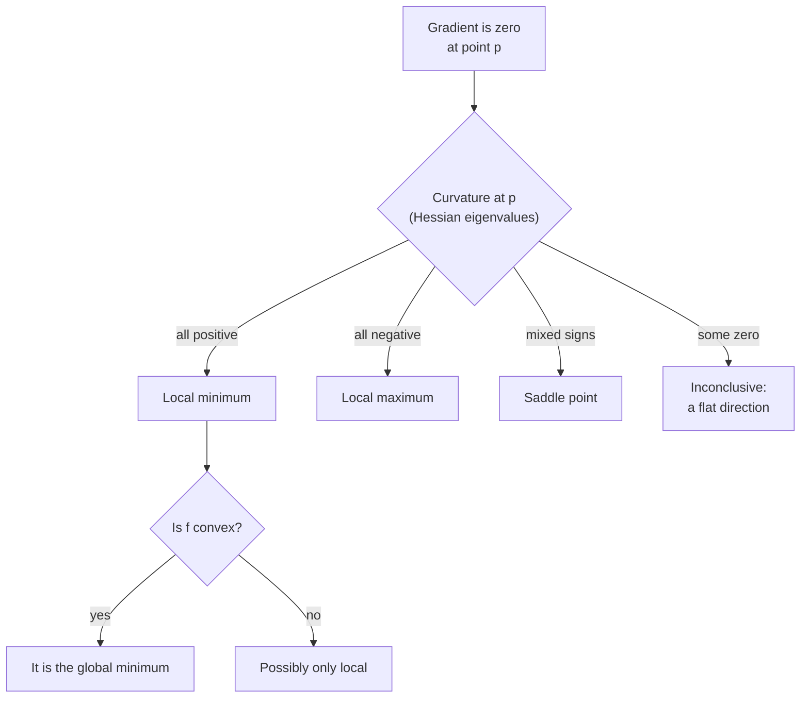

Optimization is the business of finding the inputs that make a function as small (or as large) as possible. Training a model is an optimization problem: find the weights that minimise the loss. [Gradient descent](/learn/calculus/gradient-descent) is one way to search, but it only ever sees the local slope, so you need to understand the landscape it is walking on. Where can it get stuck? How do you know you have reached the bottom? Why are some problems guaranteed to have one best answer while neural networks are not? This lesson answers those questions with critical points, second derivatives, saddle points and convexity.

## Critical points

At the bottom of a smooth valley the ground is flat. So at any minimum or maximum of a differentiable function, the derivative (or, with several variables, the gradient) is zero. Points where that happens are called **critical points** or **stationary points**:

$$
f'(x) = 0 \quad \text{(one variable)}, \qquad \nabla f(\mathbf{x}) = \mathbf{0} \quad \text{(several variables)}
$$

The converse is not true: a zero gradient does not guarantee a minimum. With one variable, a flat point can be a minimum, a maximum, or an inflection point like $x = 0$ on $f(x) = x^3$. With many variables there is a fourth, very important possibility: the saddle point.

| Kind of critical point | Shape nearby | Example |
| --- | --- | --- |
| Local minimum | Curves up in every direction | $x^2$ at 0 |
| Local maximum | Curves down in every direction | $-x^2$ at 0 |
| Saddle point | Up in some directions, down in others | $x^2 - y^2$ at the origin |
| Flat inflection | Flat but keeps going the same way | $x^3$ at 0 |

## The second derivative: curvature

To tell the cases apart, look at how the slope itself changes. The **second derivative** $f''(x)$, the derivative of the derivative, measures **curvature**:

- $f''(x) > 0$: the slope is increasing, the curve bends upward like a cup. A critical point here is a **local minimum**.
- $f''(x) < 0$: the curve bends downward like a cap. A critical point here is a **local maximum**.
- $f''(x) = 0$: the test is inconclusive.

This is the **second derivative test**. Take

$$
f(x) = x^4 - 3x^2 + x, \qquad f'(x) = 4x^3 - 6x + 1, \qquad f''(x) = 12x^2 - 6
$$

Setting $f'(x) = 0$ gives three critical points, approximately $x = -1.3008$, $0.1699$ and $1.1309$. The second derivative is about $14.3$, $-5.65$ and $9.35$ at those points, so the outer two are minima and the middle one is a maximum. The minimum at $-1.3008$ has $f \approx -3.514$; the one at $1.1309$ has $f \approx -1.070$. The first is the **global minimum**, the lowest point anywhere; the second is only a **local minimum**, the lowest point in its own neighbourhood.

## Where gradient descent ends up

Gradient descent follows the slope downhill from wherever it starts, so it settles into whichever valley it begins in:

```python
def f(x):
    return x**4 - 3 * x**2 + x

def df(x):
    return 4 * x**3 - 6 * x + 1

def descend(x, lr=0.01, steps=500):
    for _ in range(steps):
        x = x - lr * df(x)
    return x

for start in [-2.0, -0.5, 0.5, 2.0]:
    x = descend(start)
    print(f"start={start:>4}  ends at x={x:.4f}  f(x)={f(x):.4f}")
```

```output
start=-2.0  ends at x=-1.3008  f(x)=-3.5139
start=-0.5  ends at x=-1.3008  f(x)=-3.5139
start= 0.5  ends at x=1.1309  f(x)=-1.0702
start= 2.0  ends at x=1.1309  f(x)=-1.0702
```

Starting on the right of the maximum at 0.17, it finds the worse, local minimum and has no way of knowing that a deeper valley exists. The local slope carries no information about distant terrain.



## Many variables: the Hessian and saddle points

With several variables, curvature differs by direction. All the second partial derivatives (introduced in [partial derivatives](/learn/calculus/partial-derivatives)) are collected into a square matrix called the **Hessian**, $H$, where entry $(i, j)$ is $\dfrac{\partial^2 f}{\partial x_i \, \partial x_j}$. At a critical point its [eigenvalues](/learn/linear-algebra/eigenvalues-and-eigenvectors) give the curvature along its principal directions:

- All eigenvalues positive: a bowl, so a local minimum.
- All negative: an upside-down bowl, a local maximum.
- Mixed signs: a **saddle point**, shaped like a horse's saddle or a mountain pass, curving up one way and down another.

For $f(x, y) = x^2 - y^2$ the gradient $(2x, -2y)$ is zero at the origin, and:

```python
import numpy as np

# f(x, y) = x**2 - y**2 has gradient (2x, -2y), which is zero at the origin
hessian = np.array([[2.0, 0.0],
                    [0.0, -2.0]])
print(np.linalg.eigvalsh(hessian))

# f(x, y) = x**2 + 3*y**2: a bowl
print(np.linalg.eigvalsh(np.array([[2.0, 0.0], [0.0, 6.0]])))
```

```output
[-2.  2.]
[2. 6.]
```

One negative and one positive eigenvalue: a saddle. The bowl has two positive eigenvalues: a minimum.

> [!NOTE]
> In very high-dimensional loss surfaces, such as those of neural networks with millions of weights, research suggests that most critical points with high loss are saddle points rather than poor local minima: it is unlikely that the surface curves upward in **every one** of a million directions at once. Gradient descent can slow down near saddles, where the gradient is tiny, but the noise in mini-batch gradients and momentum-based optimisers usually carry it through.

## Convexity: when every local minimum is global

A function is **convex** if the straight line between any two points on its graph never dips below the graph. Formally, for any points $\mathbf{a}$, $\mathbf{b}$ and any $t$ between 0 and 1:

$$
f(t\mathbf{a} + (1 - t)\mathbf{b}) \le t f(\mathbf{a}) + (1 - t) f(\mathbf{b})
$$

For a smooth function this is the same as saying the curvature is never negative: $f''(x) \ge 0$ everywhere in one variable, or a Hessian with no negative eigenvalues everywhere in several.

> [!KEY]
> For a convex function, every local minimum is a global minimum. There are no false valleys to get trapped in, and gradient descent with a suitable learning rate will find the best answer from any starting point.

| Problem | Convex in the weights? | Consequence |
| --- | --- | --- |
| Linear regression with MSE | Yes | One best answer; closed form or gradient descent both find it |
| Logistic regression with cross-entropy | Yes | Reliable training from any start |
| Linear SVM | Yes | Unique optimal margin |
| Neural networks | No | Many minima and saddles; the result depends on initialisation and randomness |

Neural networks are non-convex mainly because of the hidden layers: swapping two hidden units gives a different set of weights with identical loss, so there are always many equally good minima. In practice this is less alarming than it sounds. For large networks, the different minima that gradient descent reaches tend to have similar loss and similar test performance, which is why setting a random seed changes the weights you get but rarely the quality of the model.

## Optimisers in libraries

You will seldom write the minimiser yourself. SciPy's `minimize` implements several classic algorithms. BFGS, used here, builds up an approximation of the Hessian from successive gradients so that it can take better-shaped steps than plain gradient descent:

```python
import numpy as np
from scipy.optimize import minimize

def f(p):
    x, y = p
    return (x - 1) ** 2 + 10 * (y + 2) ** 2

def grad(p):
    x, y = p
    return np.array([2 * (x - 1), 20 * (y + 2)])

result = minimize(f, x0=np.array([0.0, 0.0]), jac=grad, method="BFGS")
print(result.success)
print(np.round(result.x, 4))
print(f"{result.fun:.1e}")
```

```output
True
[ 1. -2.]
2.6e-12
```

The `jac` argument is the gradient: the same function you would check with a numerical gradient. Second-order methods like this are excellent for problems with up to thousands of parameters. For neural networks, storing or approximating a Hessian with billions of entries is impractical, so deep learning uses first-order methods: SGD with momentum, and adaptive methods such as Adam that keep a running estimate of each weight's gradient scale. You will meet these in [optimization algorithms](/learn/essential-mathematics-for-machine-learning/optimization-algorithms) and [optimizers](/learn/neural-network-fundamentals/optimizers).

## Exercises

**1.** Find and classify the critical points of $f(x) = x^3 - 3x$.

<details>
<summary>Show solution</summary>

$f'(x) = 3x^2 - 3 = 0$ gives $x = \pm 1$. $f''(x) = 6x$, so $f''(1) = 6 > 0$ (local minimum, $f(1) = -2$) and $f''(-1) = -6 < 0$ (local maximum, $f(-1) = 2$). Neither is global: $f$ goes to minus infinity as $x \to -\infty$, so there is no global minimum at all.

</details>

**2.** The Hessian of $f(x, y) = x^2 + 4xy + y^2$ is $\begin{bmatrix} 2 & 4 \\ 4 & 2 \end{bmatrix}$ everywhere. What kind of critical point is the origin? Is $f$ convex?

<details>
<summary>Show solution</summary>

```python
import numpy as np
print(np.linalg.eigvalsh(np.array([[2.0, 4.0], [4.0, 2.0]])))
```

```output
[-2.  6.]
```

Mixed signs, so the origin is a saddle point, and since the Hessian has a negative eigenvalue, $f$ is not convex. Along the direction $(1, -1)$, $f(t, -t) = -2t^2$ curves downward, even though both $x^2$ and $y^2$ curve up on their own.

</details>

**3.** Run `descend` from the code above starting at $x = 0.1699$, very close to the local maximum. What happens, and what does it tell you about starting at a critical point exactly?

<details>
<summary>Show solution</summary>

```python
for steps in [100, 200, 500]:
    print(steps, round(descend(0.1699, steps=steps), 4))
```

```output
100 0.1605
200 -1.2135
500 -1.3008
```

The start is a hair to the left of the maximum at about 0.16994, where $f'(0.1699) \approx 0.0002$: positive but tiny. The first 100 steps barely move, because the slope near a maximum is almost zero; then the iterate picks up speed and slides into the left valley at $x \approx -1.3008$. Started exactly at a critical point, the gradient would be zero and gradient descent would never move at all. Flat regions slow optimisation down even when they are not traps, and starting everything at an identical symmetric point is a bad idea, which is one reason network weights are initialised randomly.

</details>

```quiz
[
  {
    "q": "At a critical point of f(x), the second derivative is negative. What is the point?",
    "options": ["A local minimum", "A local maximum", "A saddle point", "It cannot be determined"],
    "answer": 1,
    "why": "Negative curvature means the curve bends downward like a cap, so a flat point there is a local maximum."
  },
  {
    "q": "At a critical point, the Hessian has eigenvalues 3, 1 and -0.5. What kind of point is it?",
    "options": ["Local minimum", "Local maximum", "Global minimum", "Saddle point"],
    "answer": 3,
    "why": "Mixed signs mean the surface curves up in some directions and down in at least one, which is a saddle point."
  },
  {
    "q": "Why is convexity such a valuable property for an optimisation problem?",
    "options": [
      "Convex functions have no critical points",
      "Every local minimum of a convex function is a global minimum",
      "Convex functions can be minimised in one step",
      "Convex functions never need a learning rate"
    ],
    "answer": 1,
    "why": "With no false valleys, any minimum gradient descent finds is the best possible one."
  },
  {
    "q": "Which of these training problems is NOT convex in its weights?",
    "options": [
      "Linear regression with mean squared error",
      "Logistic regression with cross-entropy loss",
      "A neural network with a hidden layer",
      "A linear SVM"
    ],
    "answer": 2,
    "why": "Hidden layers make the loss surface non-convex, with many minima and saddle points. The other three are classic convex problems."
  }
]
```
