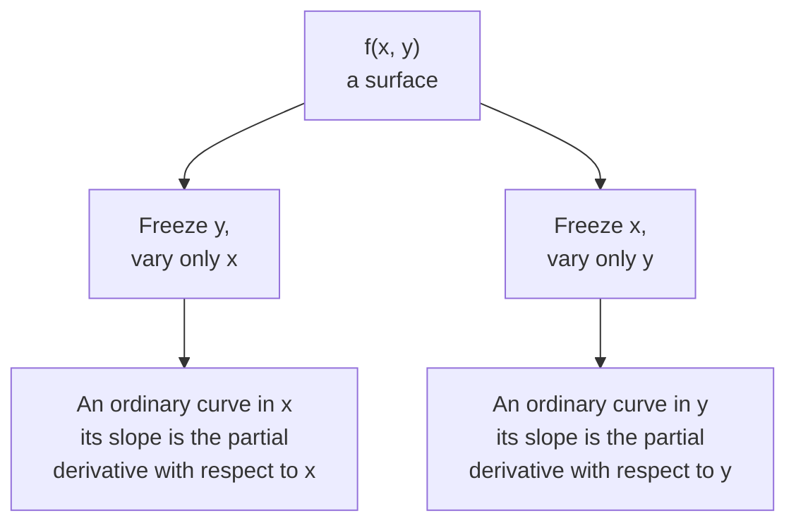
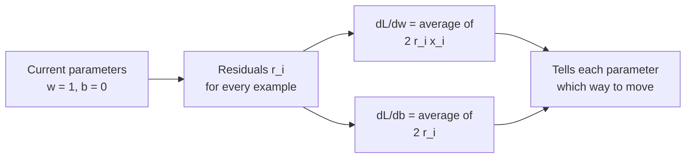

Real models have many weights, so their loss is a function of many variables at once. A partial derivative answers the question for **one** of them: if I nudge just this weight and freeze all the others, how fast does the loss change? It is the ordinary derivative from the [previous lesson](/learn/calculus/derivatives), applied one variable at a time. Once you can take partial derivatives, you can tell every weight in a model which way to move, and that list of answers is the gradient.

## Intuition: walking on a hillside

Imagine a hillside described by a height function $f(x, y)$, where $x$ is how far east you are and $y$ how far north. Standing at some point, you could ask two separate questions:

- If I walk due east, keeping my north position fixed, how steep is the ground?
- If I walk due north, keeping my east position fixed, how steep is the ground?

Each answer is a **partial derivative**. Freezing $y$ turns the surface into an ordinary curve along the east-west line through your position, and you take its slope as usual. The two slopes can be completely different: a path along a ridge can be flat east-west and steep north-south.



## Notation and definition

The partial derivative of $f$ with respect to $x$ is written $\dfrac{\partial f}{\partial x}$, with a curly $\partial$ (read "partial") instead of $d$ to signal that other variables exist and are being held fixed. Formally:

$$
\frac{\partial f}{\partial x}(x, y) = \lim_{h \to 0} \frac{f(x + h, y) - f(x, y)}{h}
$$

Only $x$ moves; $y$ stays put. The definition for $\dfrac{\partial f}{\partial y}$ moves only $y$. You will also see the short forms $f_x$ and $\partial_x f$.

## Computing them: treat the others as constants

In practice you differentiate with the normal rules, treating every other variable as if it were a number. Take

$$
f(x, y) = x^2 y + 3y
$$

For $\dfrac{\partial f}{\partial x}$, pretend $y$ is a constant like 5. Then $x^2 y$ is "a constant times $x^2$", with derivative $2xy$, and $3y$ is a constant, with derivative 0:

$$
\frac{\partial f}{\partial x} = 2xy
$$

For $\dfrac{\partial f}{\partial y}$, pretend $x$ is a constant. Then $x^2 y$ is "a constant times $y$", with derivative $x^2$, and $3y$ has derivative 3:

$$
\frac{\partial f}{\partial y} = x^2 + 3
$$

At the point $(2, 1)$ these give 4 and 7. The ground is steeper going north than east.

## Checking numerically

The central difference from the previous lesson works one variable at a time: nudge only the variable you care about.

```python
def f(x, y):
    return x**2 * y + 3 * y

def partial_x(f, x, y, h=1e-5):
    return (f(x + h, y) - f(x - h, y)) / (2 * h)

def partial_y(f, x, y, h=1e-5):
    return (f(x, y + h) - f(x, y - h)) / (2 * h)

x, y = 2.0, 1.0
print("df/dx analytic:", 2 * x * y, " numerical:", round(partial_x(f, x, y), 6))
print("df/dy analytic:", x**2 + 3, " numerical:", round(partial_y(f, x, y), 6))
```

```output
df/dx analytic: 4.0  numerical: 4.0
df/dy analytic: 7.0  numerical: 7.0
```

> [!KEY]
> A function of $n$ variables has $n$ partial derivatives at each point, one per variable. Each answers "how sensitive is the output to this one input, right here?" A model with a million weights has a million partial derivatives of its loss.

## Partial derivatives of a real loss

Now give the model from earlier lessons a bias term $b$ as well as a weight $w$, so it predicts $\hat{y} = wx + b$. The mean squared error over $n$ examples is

$$
L(w, b) = \frac{1}{n} \sum_{i=1}^{n} (w x_i + b - y_i)^2
$$

Call $r_i = w x_i + b - y_i$ the **residual** of example $i$: prediction minus target. Each term is $r_i^2$. To differentiate it with respect to $w$, use the fact (which the [chain rule](/learn/calculus/chain-rule) lesson justifies) that the derivative of $r_i^2$ is $2 r_i$ times the derivative of $r_i$. Holding $b$ fixed, the derivative of $r_i$ with respect to $w$ is $x_i$; holding $w$ fixed, its derivative with respect to $b$ is 1. So:

$$
\frac{\partial L}{\partial w} = \frac{2}{n} \sum_{i=1}^{n} r_i \, x_i, \qquad
\frac{\partial L}{\partial b} = \frac{2}{n} \sum_{i=1}^{n} r_i
$$

Read them as sentences. The bias should move according to the average error. The weight should move according to the average error **weighted by the input**: examples with large $x_i$ have more say about the slope of the line. Check them numerically:

```python
xs = [1.0, 2.0, 3.0, 4.0]
ys = [2.1, 3.9, 6.2, 7.8]
n = len(xs)

def loss(w, b):
    return sum((w * x + b - y) ** 2 for x, y in zip(xs, ys)) / n

def grads(w, b):
    """Analytic partial derivatives of the MSE loss."""
    residuals = [w * x + b - y for x, y in zip(xs, ys)]
    dL_dw = 2 / n * sum(r * x for r, x in zip(residuals, xs))
    dL_db = 2 / n * sum(residuals)
    return dL_dw, dL_db

w, b, h = 1.0, 0.0, 1e-5
num_dw = (loss(w + h, b) - loss(w - h, b)) / (2 * h)
num_db = (loss(w, b + h) - loss(w, b - h)) / (2 * h)

print("analytic :", [round(g, 6) for g in grads(w, b)])
print("numerical:", [round(num_dw, 6), round(num_db, 6)])
```

```output
analytic : [-14.85, -5.0]
numerical: [-14.85, -5.0]
```

Both partials are negative, so the loss falls if either $w$ or $b$ increases. And $\partial L / \partial w$ is about three times larger in size: at this point the loss is more sensitive to the weight than to the bias.



## Second partial derivatives

You can differentiate a partial derivative again. For $f(x, y) = x^2 y + 3y$:

| Second partial | Meaning | Value |
| --- | --- | --- |
| $\dfrac{\partial^2 f}{\partial x^2}$ | How the east-slope changes going east | $2y$ |
| $\dfrac{\partial^2 f}{\partial y^2}$ | How the north-slope changes going north | $0$ |
| $\dfrac{\partial^2 f}{\partial x \, \partial y}$ | How the east-slope changes going north | $2x$ |

For smooth functions the mixed partials come out the same in either order (this is Schwarz's theorem), so you only need one of them. Second derivatives measure **curvature**, and they reappear in the [optimization](/learn/calculus/optimization) lesson, arranged in a matrix called the Hessian, to tell minima from saddle points.

> [!WARNING]
> Holding the other variables fixed is part of the meaning, not a detail. "The effect of $w$" depends on the value of $b$ you froze it at. Partial derivatives describe the surface at one point; move to a different point and every one of them can change.

## Exercises

**1.** Find both partial derivatives of $g(x, y) = 3x^2 + 2xy - y^3$ and evaluate them at $(1, 2)$. Confirm numerically.

<details>
<summary>Show solution</summary>

$\partial g / \partial x = 6x + 2y$ and $\partial g / \partial y = 2x - 3y^2$. At $(1, 2)$: $10$ and $-10$.

```python
g = lambda x, y: 3 * x**2 + 2 * x * y - y**3
h = 1e-5
print(round((g(1 + h, 2) - g(1 - h, 2)) / (2 * h), 6))
print(round((g(1, 2 + h) - g(1, 2 - h)) / (2 * h), 6))
```

```output
10.0
-10.0
```

</details>

**2.** In the loss example, both partials are zero at the best-fit line. Using `grads`, evaluate them at $w = 1.94$, $b = 0.15$. What do you notice, and what does it mean?

<details>
<summary>Show solution</summary>

```python
print([round(g, 6) for g in grads(1.94, 0.15)])
```

```output
[0.0, 0.0]
```

Both partial derivatives are zero (to rounding), so no small change to either parameter reduces the loss: $(1.94, 0.15)$ is the bottom of the bowl, the least-squares line for this data.

</details>

**3.** Consider $f(w_1, w_2) = (w_1 w_2 - 1)^2$. What is $\partial f / \partial w_1$ at $(w_1, w_2) = (0, 3)$, and why does it depend on $w_2$?

<details>
<summary>Show solution</summary>

Treating $w_2$ as a constant, $\partial f / \partial w_1 = 2(w_1 w_2 - 1) \cdot w_2$. At $(0, 3)$ that is $2 \cdot (-1) \cdot 3 = -6$. It depends on $w_2$ because $w_1$ only affects the output through the product $w_1 w_2$: the larger $w_2$ is, the more a nudge to $w_1$ matters. Weights in a neural network interact in exactly this way.

</details>

```quiz
[
  {
    "q": "For f(x, y) = 5xy^2, what is the partial derivative with respect to x?",
    "options": ["10xy", "5y^2", "5x", "10y"],
    "answer": 1,
    "why": "Treat y as a constant: 5y^2 is then a constant multiplying x, and the derivative of x is 1."
  },
  {
    "q": "What does the curly symbol in df/dx (partial) signal compared with an ordinary d?",
    "options": [
      "The derivative is only approximate",
      "The function has several inputs and the others are held fixed",
      "The derivative is taken twice",
      "The function is not differentiable"
    ],
    "answer": 1,
    "why": "The partial symbol signals a function of several variables where only one varies and the rest are frozen."
  },
  {
    "q": "For the MSE loss of y_hat = wx + b, the partial derivative with respect to b is (2/n) times the sum of the residuals. If every prediction is too high, what is its sign?",
    "options": [
      "Positive, so b should decrease",
      "Negative, so b should increase",
      "Zero",
      "It depends on x"
    ],
    "answer": 0,
    "why": "Predictions too high means every residual (prediction minus target) is positive, so the partial is positive. Moving against it means decreasing b."
  },
  {
    "q": "How many first partial derivatives does the loss of a model with 1,000 weights have at a given point?",
    "options": ["1", "2", "1,000", "1,000,000"],
    "answer": 2,
    "why": "One partial derivative per variable. Together they form the gradient, a vector of 1,000 numbers."
  }
]
```
