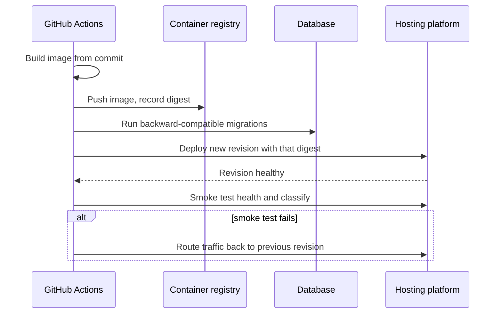
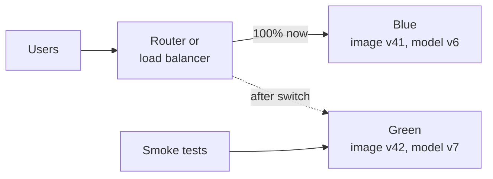
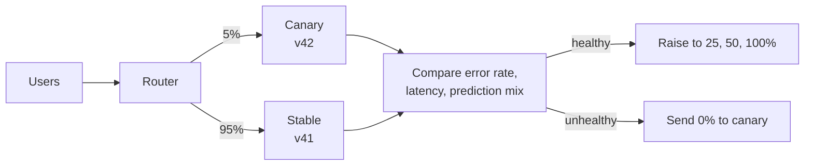

A deployment done by hand is a sequence of commands typed from memory: build the image, push it, update the service, run the migration, check it works. Each step is a chance to deploy the wrong tag, forget the migration or skip the check. **Automated deployment** turns that sequence into code that runs the same way every time, records what it did, and can undo it. This lesson builds the deployment half of the `ticket-triage` pipeline: building and pushing the Docker image, deploying it, migrating the database safely, rolling back, rolling out gradually with blue-green and canary releases, and handling the model as an artefact with its own life cycle.

You know how to write a [Dockerfile](/learn/docker-and-containers/dockerfile) and build an image by hand. Here the pipeline does it.

## Anatomy of a deployment job



Every step is a job or step in a workflow, and every step's output (the digest, the revision name) is recorded so the next step uses exactly that.

## Building and pushing the image

Docker publishes official actions for this. The example pushes to GitHub Container Registry (`ghcr.io`), which authenticates with the workflow's own `GITHUB_TOKEN`:

```yaml
jobs:
  build:
    runs-on: ubuntu-latest
    permissions:
      contents: read
      packages: write
    outputs:
      digest: ${{ steps.push.outputs.digest }}
    steps:
      - uses: actions/checkout@v4
      - uses: docker/setup-buildx-action@v3
      - uses: docker/login-action@v3
        with:
          registry: ghcr.io
          username: ${{ github.actor }}
          password: ${{ secrets.GITHUB_TOKEN }}
      - id: push
        uses: docker/build-push-action@v6
        with:
          context: .
          push: true
          tags: ghcr.io/${{ github.repository }}:${{ github.sha }}
          cache-from: type=gha
          cache-to: type=gha,mode=max
```

The image is tagged with the commit SHA, so every image traces back to its source. `build-push-action` exposes the pushed image's **digest** as an output; the job re-exports it so later jobs deploy exactly that image. `cache-from`/`cache-to` with `type=gha` stores Docker layer cache in the GitHub Actions cache, so unchanged layers (such as the `pip install` layer) are not rebuilt. As always, check these actions for newer major versions.

## Deploying to a platform

The deploy step depends on where the service runs. On Google Cloud Run, for example, after logging in with OIDC (see [GitHub Actions](/learn/ci-cd/github-actions)):

```yaml
  deploy-staging:
    needs: build
    runs-on: ubuntu-latest
    environment: staging
    permissions:
      contents: read
      id-token: write
    steps:
      - uses: google-github-actions/auth@v2
        with:
          workload_identity_provider: ${{ vars.WIF_PROVIDER }}
          service_account: ${{ vars.DEPLOY_SERVICE_ACCOUNT }}
      - uses: google-github-actions/setup-gcloud@v2
      - name: Deploy
        run: |
          gcloud run deploy ticket-triage \
            --image "ghcr.io/${{ github.repository }}@${{ needs.build.outputs.digest }}" \
            --region europe-west1
```

Other platforms follow the same shape: authenticate, then point the service at the new image. On Kubernetes that might be `kubectl set image deployment/ticket-triage app=IMAGE@DIGEST` followed by `kubectl rollout status deployment/ticket-triage` to wait for the rollout to finish. Platform details come in [model hosting](/learn/cloud-computing/model-hosting). (Cloud Run may require the image to be mirrored into a supported registry such as Artifact Registry; consult the platform documentation.)

## Database migrations

`ticket-triage` stores tickets and predictions in PostgreSQL, and schema changes are applied with a migration tool such as Alembic (`alembic upgrade head`). The danger: during a rolling deployment, **old and new versions of the code run at the same time** against the same database. A migration that renames a column breaks the old version instantly.

The answer is the **expand and contract** pattern: split every breaking change into backward-compatible steps across several deployments.

| Step | Migration | Code |
| --- | --- | --- |
| 1. Expand | Add the new column `priority_level`, nullable | Old code ignores it |
| 2. Migrate | Backfill from `priority` | New code writes both, reads the new one |
| 3. Contract | Drop `priority`, in a later deployment | Only new code is running now |

Run migrations as their own pipeline step before the new code is deployed, and make each migration compatible with the code currently in production. Then rollback of the code never requires rollback of the database.

> [!WARNING]
> Destructive migrations (dropping columns or tables) cannot be rolled back by redeploying an image. Keep them in a separate, later deployment, after you are confident nothing reads the old structure, and take a backup first.

## Rollback

Because every deployment is an immutable image digest, rolling back means deploying the previous digest. Most platforms keep previous revisions, so it can be one command:

```bash
# Kubernetes: return to the previous ReplicaSet
kubectl rollout undo deployment/ticket-triage

# Cloud Run: send all traffic back to a known-good revision
gcloud run services update-traffic ticket-triage \
  --to-revisions ticket-triage-00041-abc=100 --region europe-west1
```

Automate the decision too: if the post-deploy smoke test fails, the pipeline runs the rollback step (`if: failure()` on a later step or job). A rollback that requires someone to remember the right command at 2 a.m. will be slow and error-prone.

## Blue-green and canary releases

A plain rolling update replaces instances gradually, but every user is exposed as soon as their request hits a new instance. Two strategies give more control.

**Blue-green**: run two complete environments. Blue serves all traffic; you deploy to green, test it, then switch the router so green takes all traffic. Rollback is switching back.



**Canary**: send a small share of real traffic, say 5%, to the new version, compare its metrics with the old version, and increase the share step by step if it is healthy.



| | Blue-green | Canary |
| --- | --- | --- |
| Exposure of new version | All at once at switch time | Gradual |
| Infrastructure cost | Two full environments during the switch | Small extra capacity |
| Rollback | Instant switch back | Set canary weight to 0 |
| Detects problems that only appear with real traffic | Only after full switch | Yes, while blast radius is small |

The canary decision should be automated, with explicit rules:

```python
def canary_verdict(stable, canary, min_requests=500,
                   max_error_ratio=1.5, max_p95_increase_ms=50):
    if canary["requests"] < min_requests:
        return "WAIT: not enough traffic yet"
    stable_err = stable["errors"] / stable["requests"]
    canary_err = canary["errors"] / canary["requests"]
    if canary_err > max(stable_err * max_error_ratio, 0.001):
        return f"ROLL BACK: error rate {canary_err:.2%} vs {stable_err:.2%}"
    if canary["p95_ms"] - stable["p95_ms"] > max_p95_increase_ms:
        return f"ROLL BACK: p95 {canary['p95_ms']} ms vs {stable['p95_ms']} ms"
    return "PROMOTE"

stable = {"requests": 19000, "errors": 38, "p95_ms": 210}
print(canary_verdict(stable, {"requests": 300, "errors": 0, "p95_ms": 205}))
print(canary_verdict(stable, {"requests": 1000, "errors": 6, "p95_ms": 215}))
print(canary_verdict(stable, {"requests": 1000, "errors": 2, "p95_ms": 290}))
print(canary_verdict(stable, {"requests": 1000, "errors": 2, "p95_ms": 220}))
```

```output
WAIT: not enough traffic yet
ROLL BACK: error rate 0.60% vs 0.20%
ROLL BACK: p95 290 ms vs 210 ms
PROMOTE
```

For a model, the canary comparison should include model signals as well as HTTP ones: the distribution of predicted labels, the share of low-confidence predictions, or LLM output validation failures. A new classifier that sends 40% of tickets to `billing` instead of 15% is returning HTTP 200 and is still broken.

## Feature flags

A **feature flag** is a runtime switch, read from configuration or a flag service, that turns behaviour on for some users. It lets you deploy code dark and release it gradually. Assign users to buckets deterministically, so the same tenant always gets the same answer:

```python
import hashlib

def in_rollout(tenant_id: str, flag: str, percent: int) -> bool:
    digest = hashlib.sha256(f"{flag}:{tenant_id}".encode()).hexdigest()
    return int(digest[:8], 16) % 100 < percent

tenants = [f"tenant-{i}" for i in range(1000)]
print("enabled at 10%:", sum(in_rollout(t, "prompt_v2", 10) for t in tenants))
print("stable answer:", in_rollout("tenant-42", "prompt_v2", 10) == in_rollout("tenant-42", "prompt_v2", 10))
print("still enabled at 50%:", all(in_rollout(t, "prompt_v2", 50) for t in tenants if in_rollout(t, "prompt_v2", 10)))
```

```output
enabled at 10%: 90
stable answer: True
still enabled at 50%: True
```

Raising the percentage only adds tenants; nobody who already had the feature loses it. Delete flags once a rollout is complete, or the code fills with dead branches.

## Deploying models versus deploying code

The classifier changes on a different schedule from the code: it is retrained when data drifts, while the code changes when engineers ship features. Coupling them, by baking the model file into the image, means every retrain needs a code release and every code release redeploys whatever model happened to be in the build. Many teams therefore **version and deploy models separately**:

- The model artefact is stored in a [model registry](/learn/mlops/model-registry) with a version number and metadata (training data version, metrics, commit of the training code).
- The service reads a setting such as `MODEL_URI=models:/ticket-classifier@production` and loads that version at startup.
- Deploying a new model means moving the `production` alias to the new version and restarting or reloading the service; the image is unchanged.

| | Model baked into image | Model loaded from registry |
| --- | --- | --- |
| Reproducibility | One digest pins code and model | Need both digest and model version |
| Startup | Fast, no download | Downloads the model at start, so cache or mount it |
| Retraining release | Requires a new image | Alias change and restart |
| Rollback of model only | Redeploy an old image (old code too) | Move the alias back |

Both are legitimate. Small models that change rarely are often baked in; large or frequently retrained models are usually loaded. Either way, log the code commit and the model version with every prediction, so any output can be traced.

> [!TIP]
> Canary releases work for models as well: run the new model version for a slice of traffic, or in **shadow mode**, scoring every request without returning the result, and compare predictions before switching.

## Exercises

**1.** A migration renames `tickets.priority` to `tickets.priority_level` and is deployed together with code that reads the new name. During the rolling update, errors spike. Explain why and redesign the change.

<details>
<summary>Show solution</summary>

During the rollout, old instances still query `priority`, which no longer exists. Use expand and contract: add `priority_level` (nullable), deploy code that writes both and reads the new column, backfill, then in a later deployment drop `priority` once no running code reads it.

</details>

**2.** Using `canary_verdict`, what is returned for a canary with 2,000 requests, 1 error and p95 of 240 ms, against the `stable` shown above?

<details>
<summary>Show solution</summary>

The canary error rate is 0.05%, below 1.5 times 0.20%. The p95 increase is 30 ms, within 50. The result is `PROMOTE`.

```python
print(canary_verdict(stable, {"requests": 2000, "errors": 1, "p95_ms": 240}))
```

```output
PROMOTE
```

</details>

**3.** Your team bakes a 4 GB embedding model into the image and retrains weekly, while code ships daily. What problems will this cause, and what would you change?

<details>
<summary>Show solution</summary>

Every daily code release ships and pulls a 4 GB image, slowing builds and startups, and every weekly retrain needs an image rebuild and full release. Rolling back code also rolls back the model. Store the model in a registry or object storage, load it by version at startup (with a cache or volume), and promote models by moving an alias.

</details>

```quiz
[
  {
    "q": "Why tag images with the Git commit SHA and deploy by digest?",
    "options": [
      "It makes images smaller",
      "Registries reject other tags",
      "Every running container can be traced to its source, and the deployed bytes cannot change under you",
      "It enables GPU support"
    ],
    "answer": 2,
    "why": "The SHA tag links image to commit; the digest is immutable, so deploys and rollbacks are exact."
  },
  {
    "q": "What is the main advantage of a canary release over blue-green?",
    "options": [
      "Problems that only show under real traffic are detected while only a small share of users is exposed",
      "It needs no monitoring",
      "It makes database migrations unnecessary",
      "Rollback is impossible, so teams test more carefully"
    ],
    "answer": 0,
    "why": "Canary exposure is gradual; blue-green switches all traffic at once."
  },
  {
    "q": "In the expand and contract pattern, when is the old column dropped?",
    "options": [
      "In the same deployment that adds the new column",
      "Before the new code is deployed",
      "Never",
      "In a later deployment, once no running code reads it"
    ],
    "answer": 3,
    "why": "Keeping each step backward-compatible means old and new code can run side by side during rollouts and rollbacks."
  },
  {
    "q": "A team loads the classifier from a registry using `MODEL_URI=models:/ticket-classifier@production`. How do they roll back a bad model?",
    "options": [
      "Rebuild the Docker image",
      "Move the `production` alias back to the previous version and restart or reload the service",
      "Revert the last Git commit",
      "Run the database migration in reverse"
    ],
    "answer": 1,
    "why": "Models are versioned separately from code, so a model rollback is an alias change; the image stays the same."
  }
]
```
