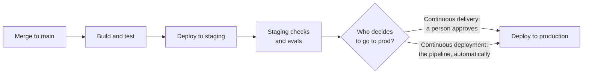
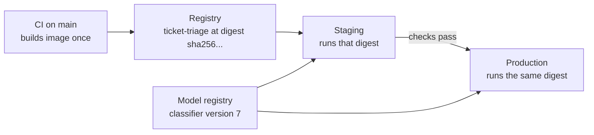

[Continuous integration](/learn/ci-cd/continuous-integration) gives you a `main` branch that is always tested. **Continuous delivery** takes the next step: every change that passes the pipeline is automatically built, deployed to a production-like environment and proven **releasable**, so that putting it into production is a routine, low-risk decision you could make at any moment. The "CD" in CI/CD is ambiguous, because it is also used for **continuous deployment**, which goes one step further still. The difference is small to write down and large in practice, and this lesson pins it down precisely before looking at environments, artefact promotion and approvals for `ticket-triage`.

## Continuous delivery versus continuous deployment

Both run the same automated pipeline. They differ only in the very last step.

- **Continuous delivery**: every change that passes is *ready* to go to production, and has been deployed to staging. Going to production is a **human decision**, usually one click or one approval.
- **Continuous deployment**: every change that passes is deployed to production **automatically**. There is no human gate. The tests, quality gates and automated rollback are the gate.



| | Continuous delivery | Continuous deployment |
| --- | --- | --- |
| Every passing change is releasable | Yes | Yes |
| Every passing change reaches production | No, only when someone approves | Yes |
| Human step before production | One approval or button | None |
| Demands on test suite | High | Very high: tests must catch what a person would have |
| Typical fit | Regulated domains, model changes with business sign-off, teams building confidence | Mature teams with strong tests, monitoring and automatic rollback |

Note what continuous delivery is *not*: it is not "we deploy every two weeks after a manual test phase". If preparing a release takes days of manual work, you are not doing continuous delivery, regardless of how often you ship. The defining property is that the release candidate is always ready.

> [!KEY]
> Continuous delivery: always releasable, a human chooses when. Continuous deployment: always released, automatically. Many teams do continuous deployment for application code and continuous delivery for model changes.

## Environments

An **environment** is a complete running copy of the system with its own configuration, data and credentials.

| Environment | Purpose | Data | Who uses it |
| --- | --- | --- | --- |
| **dev** | Try changes quickly; may be a developer's laptop with Docker Compose or a shared cloud deployment | Synthetic or small samples | Developers |
| **staging** | A production-like rehearsal: same image, same infrastructure shape, same model artefact | Anonymised or synthetic data at realistic scale | The pipeline, QA, reviewers |
| **production** | Real users | Real data | Customers |

Staging is only useful if it resembles production. If staging runs a different Python version, a smaller database or an older model, a green staging run proves little. Keep them as similar as cost allows, defined by the same infrastructure code with different parameters.

For `ticket-triage`, the differences between environments should come entirely from **configuration** passed in at runtime, typically environment variables:

```text
APP_ENV=staging
DATABASE_URL=...                 # from the environment's secrets
MODEL_URI=models:/ticket-classifier@staging
LLM_MODEL=...                    # pinned model version
LOG_LEVEL=INFO
```

The code and the image are identical everywhere.

## Build once, promote the same artefact

The most important rule in continuous delivery: **build the artefact once and promote that exact artefact** through every environment. Do not rebuild for production. A rebuild can pull a newer base image or a newer transitive dependency, so the thing you tested in staging is not the thing you ship.

For a Docker image, "that exact artefact" means the image **digest**, a content hash such as `sha256:4f1c...`, not a tag. Tags like `latest` or even `v1.4.0` can be moved; a digest cannot.



Tag images with the Git commit SHA for traceability (`ticket-triage:3f9a2c1`), and record the digest the build produced so later jobs deploy exactly that. With this setup, any running container can be traced back to the commit that produced it, and rolling back means re-deploying a previous digest.

## Approvals with GitHub environments

In GitHub Actions, approvals are attached to **environments**. In the repository settings you create `staging` and `production`, and for `production` you add **required reviewers** (people or teams who must approve), optionally a **wait timer**, and a rule that only the `main` branch may deploy there. A job that names the environment pauses until approved:

```yaml
jobs:
  deploy-staging:
    runs-on: ubuntu-latest
    environment: staging
    steps:
      - run: echo "deploy image ${{ needs.build.outputs.digest }} to staging"

  deploy-production:
    needs: deploy-staging
    runs-on: ubuntu-latest
    environment:
      name: production
      url: https://triage.example.com
    steps:
      - run: echo "deploy the same digest to production"
```

(The `echo` lines stand in for real deploy steps, which you will write in [automated deployment](/learn/ci-cd/automated-deployment).) Each environment can hold its own secrets, so the production database password is only available to jobs that have passed the production approval.

Approve with information, not by habit. The approval page should link to the staging deployment, the test and eval results artefacts, and the diff since the last production release. An approval that nobody reads is just a delay.

## Deploying is not releasing

Two words worth separating:

- **Deploy**: put new code on production servers.
- **Release**: let users experience the new behaviour.

Feature flags decouple them. `ticket-triage` can deploy the code for prompt v2 to production with the flag off, then release it to 5% of tenants, then everyone, without another deployment. This is what makes continuous deployment safe in practice: shipping code frequently does not force you to expose half-finished features.

## Continuous delivery of models

Model changes follow the same idea with the artefact held in a [model registry](/learn/mlops/model-registry) rather than in the image. A new model version is trained, evaluated and registered; the pipeline deploys it to staging by moving a `staging` alias to that version; after the staging evals and, often, a human sign-off, the `production` alias moves to the same version. The service loads whichever version the alias in its environment points to.

| Promoted thing | Artefact | Identity | Promotion mechanism |
| --- | --- | --- | --- |
| Application code | Docker image | Image digest | Deploy the digest to the next environment |
| Model | Registered model version | Registry version number | Move an alias (`staging`, `production`) to the version |
| Prompt | Versioned prompt file or config | Git commit or prompt version | Released with the code, or behind a flag |

Human approval is common for model promotion even in teams that deploy code continuously, because model quality can have business, fairness or compliance implications that a threshold does not capture.

> [!WARNING]
> Never let staging and production share a database, a message queue or an LLM API key with production quotas. A load test in staging that exhausts the production rate limit is a production incident.

## Exercises

**1.** A team says, "We do continuous delivery: we release to production every Friday after QA has spent Thursday testing manually." Is that continuous delivery? Explain.

<details>
<summary>Show solution</summary>

No. Continuous delivery means every change that passes the automated pipeline is releasable at any time. Here, a release requires a day of manual testing, so changes are not releasable until Thursday's QA has happened. Shipping on a regular schedule is not the defining property.

</details>

**2.** The production deploy job runs `docker build` again with the same commit and pushes `ticket-triage:prod`. What is wrong, and what should it do?

<details>
<summary>Show solution</summary>

It rebuilds, so the production image may differ from the one tested in staging (newer base image, different dependency resolution), and it uses a mutable tag. It should deploy the image digest produced by the single CI build and already verified in staging.

</details>

**3.** Write a `deploy-production` job skeleton that requires approval via a `production` environment and only runs after `deploy-staging` has succeeded.

<details>
<summary>Show solution</summary>

```yaml
  deploy-production:
    needs: deploy-staging
    runs-on: ubuntu-latest
    environment: production
    steps:
      - run: echo "deploy the promoted digest"
```

Required reviewers are configured on the `production` environment in the repository settings, not in the YAML.

</details>

```quiz
[
  {
    "q": "What is the precise difference between continuous delivery and continuous deployment?",
    "options": [
      "Continuous delivery has no automated tests",
      "Continuous deployment only deploys to staging",
      "In continuous delivery a human decides when a releasable change goes to production; in continuous deployment it goes automatically",
      "They are two names for the same practice"
    ],
    "answer": 2,
    "why": "Both keep every passing change releasable. Only continuous deployment removes the human step before production."
  },
  {
    "q": "Why should production run the same image digest that was tested in staging?",
    "options": [
      "Digests are smaller than tags",
      "Rebuilding could produce a different image, so what was tested would not be what ships",
      "Registries delete images after staging",
      "Production cannot pull tagged images"
    ],
    "answer": 1,
    "why": "Build once, promote the same artefact. A digest identifies the exact bytes, unlike a tag, which can move."
  },
  {
    "q": "Where are required reviewers for a production deployment configured in GitHub Actions?",
    "options": [
      "On the `production` environment in repository settings",
      "In a `reviewers:` key in each step",
      "In `.pre-commit-config.yaml`",
      "In the Dockerfile"
    ],
    "answer": 0,
    "why": "Protection rules belong to the environment. A job that references `environment: production` waits for those reviewers."
  },
  {
    "q": "What does a feature flag let you do?",
    "options": [
      "Skip the test suite for urgent changes",
      "Deploy code to production while controlling separately when users see the new behaviour",
      "Run two Python versions at once",
      "Store secrets in the repository"
    ],
    "answer": 1,
    "why": "Flags separate deploying code from releasing behaviour, enabling gradual rollouts and instant switch-off."
  }
]
```
