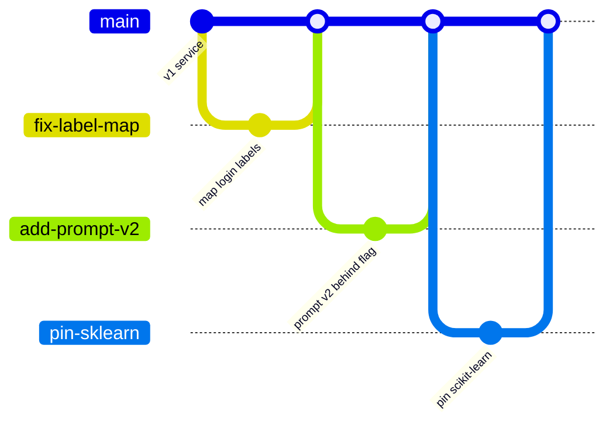
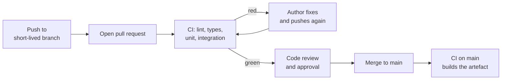

**Continuous integration (CI)** is the practice of merging everyone's work into the main branch frequently, at least daily, with every merge verified by an automated build and test run. The tooling, such as [GitHub Actions](/learn/ci-cd/github-actions), is only half of it. The other half is a team habit: small changes, a main branch that always works, and a rule that a failing check blocks the merge. Without CI, a team of four working on `ticket-triage` spends Friday afternoons untangling merge conflicts and discovering that the classifier refactor broke the summariser three weeks ago. With it, problems surface within minutes of the commit that caused them, while the change is still fresh in its author's head.

## Why "continuous"

The cost of integrating two pieces of work grows with how far they have drifted apart. Two branches that diverged an hour ago differ by a few lines; two that diverged a month ago differ in design. CI makes integration so frequent that each one is boring.

The precise idea has three parts:

1. Everyone commits to a shared **mainline** (usually `main`) often.
2. Every commit, and every proposed commit in a pull request, triggers an **automated build and test**.
3. A broken mainline is the team's **top priority** to fix, usually by reverting first and investigating after.

Point 3 is the one teams forget. If `main` stays red for a day, people stop believing the checks, and the whole system decays.

## Trunk-based development

CI fits best with **trunk-based development**: branches are short-lived (hours to a couple of days), pull requests are small, and they merge into `main` (the "trunk") quickly. Unfinished features hide behind [feature flags](/learn/ci-cd/automated-deployment) rather than living on a long branch. Compare that with long-lived feature branches, which you met in [Git branching](/learn/software-engineering/git-branching):



Each branch lives for one small change and merges back almost immediately. Every merge is small enough to review properly and easy to revert.

| | Trunk-based | Long-lived feature branches |
| --- | --- | --- |
| Branch lifetime | Hours to days | Weeks |
| Merge conflicts | Small and frequent | Large and painful |
| Review size | Small diffs, real reviews | Huge diffs, rubber stamps |
| Unfinished work | Behind feature flags | On the branch |
| Fit with CI/CD | Natural | Integration happens late, defeating CI |

## The CI loop for a pull request



The checks on the pull request answer "is this change safe to merge?" The run on `main` after merging answers "does the integrated result still work?" and produces the build artefact, such as a Docker image, that later stages deploy.

## Linting, formatting and type checking

The cheapest bugs to catch are the ones a tool can see without running the code. In Python, three checks cover most of it.

| Tool | Catches | CI command |
| --- | --- | --- |
| **Ruff** linter | Unused imports, undefined names, mutable default arguments, many common bugs | `ruff check .` |
| **Ruff** formatter | Inconsistent formatting (Black-compatible style) | `ruff format --check .` |
| **mypy** | Type errors: passing `str` where `list[str]` was expected, missing `None` checks | `mypy app` |

In CI you use the **check** forms: `ruff format --check` reports unformatted files and fails, rather than silently rewriting them on the runner where nobody would see the change. Configure the tools once in `pyproject.toml` so local runs and CI behave identically:

```toml
[tool.ruff]
line-length = 100
target-version = "py312"

[tool.ruff.lint]
select = ["E", "F", "I", "B", "UP"]   # pycodestyle, pyflakes, isort, bugbear, pyupgrade

[tool.mypy]
python_version = "3.12"
strict = true
ignore_missing_imports = true
```

Type checking pays off particularly in ML code, where a function silently receiving a pandas Series instead of a DataFrame, or `None` from a failed model load, can produce wrong predictions instead of errors. If you are adding mypy to an existing codebase, start without `strict` and tighten module by module.

## pre-commit: the same checks locally and in CI

**pre-commit** is a tool that runs a configured list of checks as a Git hook before each commit, so most problems never reach CI at all. The configuration lives in `.pre-commit-config.yaml`:

```yaml
repos:
  - repo: https://github.com/pre-commit/pre-commit-hooks
    rev: v4.6.0
    hooks:
      - id: check-yaml
      - id: end-of-file-fixer
      - id: check-added-large-files   # stops a 2 GB model file being committed
  - repo: https://github.com/astral-sh/ruff-pre-commit
    rev: v0.6.9
    hooks:
      - id: ruff
        args: [--fix]
      - id: ruff-format
  - repo: https://github.com/pre-commit/mirrors-mypy
    rev: v1.11.2
    hooks:
      - id: mypy
```

The `rev` values pin each hook repository to a tag; run `pre-commit autoupdate` to move them to the latest releases. Developers run `pre-commit install` once per clone.

Local hooks can be skipped (`git commit --no-verify`), so CI must run the same checks as the authority:

```yaml
  lint:
    runs-on: ubuntu-latest
    steps:
      - uses: actions/checkout@v4
      - uses: actions/setup-python@v5
        with:
          python-version: "3.12"
      - run: pip install pre-commit
      - run: pre-commit run --all-files --show-diff-on-failure
```

> [!TIP]
> `check-added-large-files` matters in AI repositories. Model weights and datasets belong in a model registry, object storage or [DVC](/learn/mlops/dvc), not in Git history, where they bloat every clone forever.

## Branch protection and required status checks

CI checks are advice until the repository enforces them. On GitHub, **branch protection rules** (or the newer **rulesets**) on `main` turn them into requirements:

| Setting | Effect |
| --- | --- |
| Require a pull request before merging | Nobody pushes straight to `main` |
| Required approvals (for example 1) | At least one reviewer must approve |
| Require status checks to pass | Named jobs, such as `lint`, `test`, `integration`, must be green |
| Require branches to be up to date | The PR must be tested against the latest `main`, not a stale base |
| Block force pushes | History on `main` cannot be rewritten |
| Merge queue (optional) | Queues approved PRs and tests each against the result of the ones ahead, so busy repositories stay green without constant rebasing |

The status check names you require are job names from your workflows, so renaming a job silently changes what is required. Check the protection settings whenever you restructure workflows.

> [!KEY]
> CI is a contract: no change reaches `main` without passing the same automated checks, and a red `main` is fixed before anything else. The tools enforce the first half; the team has to honour the second.

## CI for an ML repository

AI codebases add some specific rules on top of the general practice:

- **Do not train full models in CI.** Pull request CI should finish in minutes. Instead, run a tiny training smoke test (a few hundred rows, one epoch) that proves the training code runs end to end and produces a loadable artefact.
- **Check notebooks too**, or keep production logic out of them. Ruff can lint `.ipynb` files; tools such as `nbstripout` remove outputs so diffs stay readable.
- **Pin dependencies.** A scikit-learn or tokenizer upgrade can change predictions without any code change. Lock exact versions and let a bot propose upgrades through pull requests, where CI and the eval suite can judge them.
- **Separate fast and slow checks.** Lint, types and unit tests on every push; integration and LLM evals when relevant paths change (see [automated testing](/learn/ci-cd/automated-testing)).

## Exercises

**1.** A developer pushes a commit with `def add_tag(tag, tags=[]):`. Which tool in this lesson flags it, and why is it a bug?

<details>
<summary>Show solution</summary>

Ruff with the bugbear rules (`B`, rule B006) flags a mutable default argument. The same list object is shared between every call, so tags from one call leak into the next.

</details>

**2.** Your team's `main` has been red for two days because of a failing integration test that "someone is looking at". Several PRs have been merged meanwhile. What went wrong, and what should the policy be?

<details>
<summary>Show solution</summary>

The core CI rule, fix a broken mainline first, was ignored, and merges continued on top of a failure, so nobody knows whether the newer changes are broken too. Policy: when `main` goes red, revert the offending commit immediately (or fix within minutes), and use required status checks so PRs cannot merge on a red build.

</details>

**3.** Write the steps of a CI job that installs dev dependencies and runs ruff (lint and format check) and mypy on the `app` package.

<details>
<summary>Show solution</summary>

```yaml
    steps:
      - uses: actions/checkout@v4
      - uses: actions/setup-python@v5
        with:
          python-version: "3.12"
          cache: pip
      - run: pip install -r requirements.txt -r requirements-dev.txt
      - run: ruff check .
      - run: ruff format --check .
      - run: mypy app
```

</details>

```quiz
[
  {
    "q": "Which statement best describes continuous integration?",
    "options": [
      "Deploying every commit to production automatically",
      "Running tests once before each release",
      "Merging work into the mainline frequently, with each merge verified by an automated build and tests",
      "Using GitHub instead of a self-hosted Git server"
    ],
    "answer": 2,
    "why": "CI is about frequent integration plus automated verification. Deploying to production is continuous deployment, a later stage."
  },
  {
    "q": "Why does CI use `ruff format --check` rather than `ruff format`?",
    "options": [
      "It is faster",
      "It fails on unformatted files instead of rewriting them on a runner where nobody sees the change",
      "`ruff format` does not exist",
      "It also runs mypy"
    ],
    "answer": 1,
    "why": "CI should report problems, not silently fix them in a throwaway environment."
  },
  {
    "q": "pre-commit hooks already run locally. Why run `pre-commit run --all-files` in CI as well?",
    "options": [
      "Local hooks can be skipped or not installed, so CI must be the authority",
      "CI runs different hooks",
      "pre-commit only works in CI",
      "To make the hooks faster"
    ],
    "answer": 0,
    "why": "`git commit --no-verify` or a fresh clone without `pre-commit install` bypasses local hooks; CI enforces the same checks for everyone."
  },
  {
    "q": "What does 'Require branches to be up to date before merging' protect against?",
    "options": [
      "Merging a PR without any reviewer",
      "Force pushes to `main`",
      "Secrets leaking in logs",
      "Merging a PR whose checks passed only against an older `main`, so the combined result was never tested"
    ],
    "answer": 3,
    "why": "Two PRs can each pass on their own and still break when combined. Requiring an up-to-date branch (or a merge queue) tests the real result."
  }
]
```
