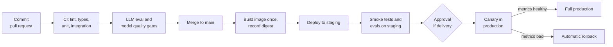
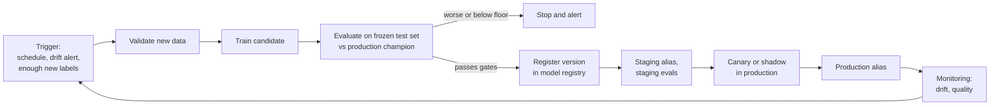

The earlier lessons in this module built the pieces separately: [GitHub Actions](/learn/ci-cd/github-actions) workflows, [automated tests](/learn/ci-cd/automated-testing) and quality gates, [continuous integration](/learn/ci-cd/continuous-integration), [continuous delivery](/learn/ci-cd/continuous-delivery) with environments and approvals, and [automated deployment](/learn/ci-cd/automated-deployment) with canaries and rollback. A **deployment pipeline** is the whole chain assembled: the automated path every change takes from a commit to production, with a gate at each stage that a change must pass to move on. For an AI system there is a twist. Code is not the only thing that changes: the model changes when it is retrained, and the data changes all the time. This lesson assembles the end-to-end pipeline for `ticket-triage`, then adds the ML-specific half, **continuous training**.

## The pipeline from commit to production



Each box is a stage, and each arrow is only taken if the stage before it passed. The pipeline's job is to reject bad changes as early and as cheaply as possible, and to give everyone the same, recorded path to production. Nobody, including the most senior engineer, deploys by another route.

| Stage | Question it answers | Gate | Typical duration |
| --- | --- | --- | --- |
| CI on pull request | Does the change work in isolation? | Lint, types, unit and integration tests green | A few minutes |
| Eval gates | Does the AI behaviour still meet the bar? | Metric floors and maximum regression vs baseline | Minutes |
| Build | Can we produce a deployable artefact? | Image builds and pushes; digest recorded | Minutes |
| Staging | Does it work deployed, with real infrastructure? | Smoke tests, staging evals, migrations applied | Minutes |
| Approval | Do we want this in production now? | Human approval (continuous delivery only) | Varies |
| Canary | Does it behave with real users? | Error rate, latency and prediction mix vs stable | Tens of minutes |
| Production | Is it fully live and healthy? | Smoke test; monitoring | Ongoing |

## Order gates by cost

Put fast, cheap, deterministic checks first and slow, expensive ones later. Linting costs seconds and catches many problems; an LLM eval run costs minutes and API spend; a canary costs real user exposure. If the cheap stage fails, you never pay for the expensive one.

There is a counterweight: a problem caught at the canary stage is far more expensive than the same problem caught by a unit test. When a canary rollback happens, ask what earlier, cheaper check could have caught it, and add that check. Over time, the pipeline learns.

## The release workflow

Here is a compact version of the workflow that runs on every merge to `main`. Details live in scripts in the repository so the workflow shows the shape of the pipeline:

```yaml
name: Release

on:
  push:
    branches: [main]
  workflow_dispatch:

permissions:
  contents: read

concurrency:
  group: release-main
  cancel-in-progress: false

jobs:
  test:
    runs-on: ubuntu-latest
    steps:
      - uses: actions/checkout@v4
      - uses: actions/setup-python@v5
        with:
          python-version: "3.12"
          cache: pip
      - run: pip install -r requirements.txt -r requirements-dev.txt
      - run: pytest -q

  llm-evals:
    needs: test
    runs-on: ubuntu-latest
    steps:
      - uses: actions/checkout@v4
      - uses: actions/setup-python@v5
        with:
          python-version: "3.12"
          cache: pip
      - run: pip install -r requirements.txt
      - run: python evals/run_evals.py --baseline evals/baseline.json --out eval-results.json
        env:
          LLM_API_KEY: ${{ secrets.LLM_API_KEY }}
      - uses: actions/upload-artifact@v4
        if: always()
        with:
          name: eval-results
          path: eval-results.json

  build:
    needs: [test, llm-evals]
    runs-on: ubuntu-latest
    permissions:
      contents: read
      packages: write
    outputs:
      digest: ${{ steps.push.outputs.digest }}
    steps:
      - uses: actions/checkout@v4
      - uses: docker/setup-buildx-action@v3
      - uses: docker/login-action@v3
        with:
          registry: ghcr.io
          username: ${{ github.actor }}
          password: ${{ secrets.GITHUB_TOKEN }}
      - id: push
        uses: docker/build-push-action@v6
        with:
          push: true
          tags: ghcr.io/${{ github.repository }}:${{ github.sha }}

  deploy-staging:
    needs: build
    runs-on: ubuntu-latest
    environment: staging
    permissions:
      contents: read
      id-token: write
    env:
      DIGEST: ${{ needs.build.outputs.digest }}
    steps:
      - uses: actions/checkout@v4
      # cloud login with OIDC goes here
      - run: ./scripts/migrate.sh staging
      - run: ./scripts/deploy.sh staging "$DIGEST"
      - run: ./scripts/smoke_test.sh staging
      - run: ./scripts/run_staging_evals.sh

  deploy-production:
    needs: [build, deploy-staging]
    runs-on: ubuntu-latest
    environment: production
    permissions:
      contents: read
      id-token: write
    env:
      DIGEST: ${{ needs.build.outputs.digest }}
    steps:
      - uses: actions/checkout@v4
      # cloud login with OIDC goes here
      - run: ./scripts/migrate.sh production
      - run: ./scripts/deploy.sh production "$DIGEST" --canary 10
      - run: ./scripts/canary_check.sh --minutes 20
      - run: ./scripts/promote.sh production "$DIGEST"
      - run: ./scripts/smoke_test.sh production
      - if: failure()
        run: ./scripts/rollback.sh production
```

Points worth noticing:

- `needs` encodes the order of the stages. `build` waits for both `test` and `llm-evals`, so an eval regression stops the release before an image even exists.
- The digest flows from `build` to both deploy jobs through job outputs: **build once, promote the same artefact**.
- `environment: production` adds the approval gate if the environment has required reviewers. Remove the reviewers and the same file is continuous deployment.
- The digest is passed to scripts through an `env` variable rather than pasted into the shell command with `${{ }}`. Passing values through environment variables is a good habit generally, because interpolating untrusted values (branch names, PR titles) directly into `run` scripts can allow shell injection.
- The final step runs only `if: failure()`, rolling back automatically when the canary check or smoke test fails.
- `concurrency` with a fixed group queues releases so two never deploy at once.

> [!NOTE]
> Exact CI output cannot be shown here, and it varies by runner. In the GitHub Actions web interface, each run shows the job graph matching the `needs` structure, with each job's log and the uploaded artefacts.

## Three things change: code, model, data

A web service changes when its code changes. An ML service has three sources of change, and the pipeline needs a trigger for each.

| What changed | Example | Pipeline that responds |
| --- | --- | --- |
| Code or prompts | New endpoint, prompt v2, dependency bump | CI/CD pipeline above, triggered by a commit |
| Model | Retrained classifier, new LLM version from the provider | Model evaluation and promotion, triggered by a new registered version or a config change |
| Data | New tickets arrive; the mix of issues shifts | Monitoring detects drift and triggers retraining |

The LLM case is easy to miss: if your code calls a model alias that the provider updates, behaviour can change with no commit at all. Pin model versions in configuration, so that a model upgrade is a commit that goes through the eval gate, and run the eval suite on a nightly `schedule` trigger to detect drift you did not cause.

## Continuous training

**Continuous training (CT)** is the ML-specific pipeline that retrains, evaluates and proposes a new model automatically, rather than a data scientist doing it in a notebook. The details of when and how to retrain are covered in [model retraining](/learn/mlops/model-retraining); here is how CT plugs into CI/CD.



Notice the two pipelines are distinct but connected:

- The **CI/CD pipeline** tests and ships the *training code* and the *serving code*. A change to `train.py` goes through CI like any other code.
- The **CT pipeline** runs that already-tested training code on new data to produce *model versions*. Each candidate passes the same kind of quality gate as in [automated testing](/learn/ci-cd/automated-testing), and is then promoted by moving registry aliases, using the same staging, canary and rollback machinery as code.

The loop closes through [model monitoring](/learn/mlops/model-monitoring): when [data drift](/learn/mlops/data-drift) or falling quality is detected, CT is triggered again.

> [!KEY]
> In mature ML systems, the deliverable of CI/CD is not a model, it is a pipeline that produces models. The training pipeline is code; it is tested and deployed like code, and then it runs on its own to keep the model fresh.

A useful way to judge progress is how much of this is automated. At first, many teams train and deploy models manually and only automate the serving code. The next step is an automated training pipeline with evaluation gates. The full picture adds CI/CD for the training pipeline itself, so changes to feature code or training logic are tested before the pipeline runs them.

## Measuring the pipeline

A pipeline is a product your team uses every day, so measure it. The widely used **DORA metrics** describe delivery performance:

| Metric | Meaning |
| --- | --- |
| Deployment frequency | How often changes reach production |
| Lead time for changes | Time from commit to running in production |
| Change failure rate | Share of deployments that cause a failure needing remediation |
| Time to restore service | How long recovery from a failed change takes |

Add ML-specific ones: time from a drift alert to a retrained model in production, and the share of candidate models rejected by gates. If the pipeline is slow, people find ways around it; if it is flaky, they stop trusting it. Both undo everything the pipeline exists to guarantee.

> [!TIP]
> Treat a manual hotfix that bypassed the pipeline as an incident in its own right. Find out why the normal path was too slow or blocked, and fix that.

## Exercises

**1.** In the release workflow, the LLM eval job fails. Which jobs run, and is anything deployed?

<details>
<summary>Show solution</summary>

`test` ran and passed; `llm-evals` failed. `build` needs `llm-evals`, so it is skipped, and so are both deploy jobs, which depend on `build`. No image is built and nothing is deployed. The eval results artefact is still uploaded because of `if: always()`.

</details>

**2.** The LLM provider silently updates the model behind the alias your service uses, and summaries start including invented ticket numbers. No commit was made. Which parts of the pipeline would catch this, and what would you change?

<details>
<summary>Show solution</summary>

The commit-triggered pipeline would not run at all. A nightly scheduled eval run and production monitoring (output validation failures, user feedback) would catch it. Change: pin the exact model version in configuration so upgrades become commits that pass through the eval gate, and keep the scheduled eval for anything that still drifts.

</details>

**3.** Draw (in words or a list) the stages a retrained classifier passes through from a drift alert to serving all traffic, naming the gate at each stage.

<details>
<summary>Show solution</summary>

Drift alert triggers CT; new data validated (schema, ranges, labels); candidate trained; evaluated on the frozen test set against the floor and the production champion; registered; `staging` alias moved and staging evals plus smoke tests run; canary or shadow in production compared with the champion's predictions and error rates; `production` alias moved; monitoring continues.

</details>

```quiz
[
  {
    "q": "Why should cheap, fast checks come before expensive ones in a pipeline?",
    "options": [
      "Expensive checks are less accurate",
      "So that a failure in a cheap check avoids paying for the expensive stages",
      "GitHub Actions requires it",
      "Fast checks cannot run in parallel"
    ],
    "answer": 1,
    "why": "Ordering by cost rejects bad changes early, saving time, money and user exposure."
  },
  {
    "q": "In the release workflow, what turns continuous deployment into continuous delivery?",
    "options": [
      "Adding a `schedule` trigger",
      "Removing the canary step",
      "Adding required reviewers to the `production` environment",
      "Using `cancel-in-progress: true`"
    ],
    "answer": 2,
    "why": "Required reviewers make the production job wait for a human approval, the defining step of continuous delivery."
  },
  {
    "q": "What does continuous training (CT) produce?",
    "options": [
      "New model versions, from tested training code run on new data, that must pass evaluation gates before promotion",
      "New Docker base images",
      "Code changes to the serving API",
      "Database migrations"
    ],
    "answer": 0,
    "why": "CT automates retraining and evaluation; promotion then uses the same staging, canary and rollback machinery as code."
  },
  {
    "q": "Which is NOT one of the DORA delivery metrics?",
    "options": [
      "Deployment frequency",
      "Change failure rate",
      "Lead time for changes",
      "Lines of code per deployment"
    ],
    "answer": 3,
    "why": "The four DORA metrics are deployment frequency, lead time for changes, change failure rate and time to restore service."
  }
]
```
