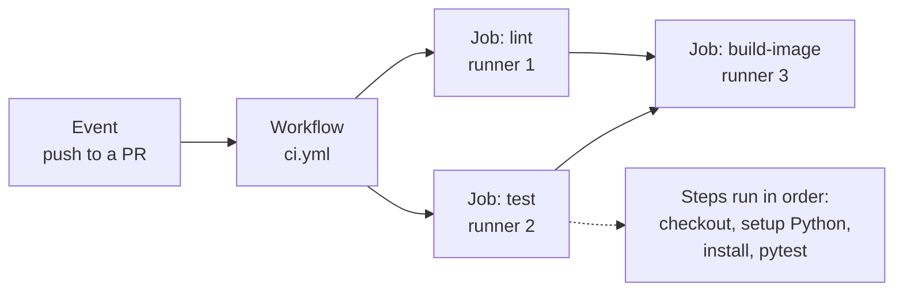
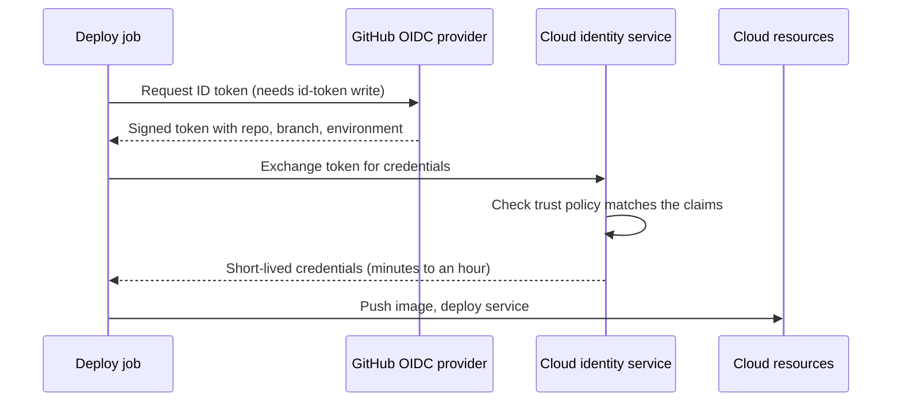

Every time you push a commit, someone should run the tests, check the code style, build the Docker image and, if all is well, ship it. If that someone is you, typing commands by hand, it will eventually be skipped on a busy Friday. **GitHub Actions** is GitHub's built-in automation service: you describe the work in a YAML file inside your repository, and GitHub runs it on a fresh machine whenever something happens, such as a push or a pull request. It is the most common way small and medium AI teams run their CI/CD, and it is the tool this whole module uses.

Throughout the module we follow one running example: **`ticket-triage`**, a FastAPI service that serves a scikit-learn classifier for support tickets on `/classify` and calls an LLM to draft summaries on `/summarise`. The repository looks like this:

```text
ticket-triage/
├── app/                  # FastAPI app: main.py, model.py, llm.py
├── tests/
│   ├── unit/             # fast, no network
│   └── integration/      # spins up the app, talks to a database
├── evals/                # LLM eval suite: cases.jsonl, run_evals.py
├── Dockerfile
├── requirements.txt
├── requirements-dev.txt  # pytest, ruff, mypy
└── .github/workflows/    # the automation lives here
```

## The vocabulary

GitHub Actions has five ideas, nested inside each other.

| Concept | What it is |
| --- | --- |
| **Workflow** | A YAML file in `.github/workflows/`. A repository can have many. |
| **Event** (trigger) | What starts a workflow: `push`, `pull_request`, a schedule, a manual button (`workflow_dispatch`), a published release. |
| **Job** | A group of steps that runs on one machine. Jobs run in parallel unless you chain them with `needs`. |
| **Step** | One command (`run`) or one reusable action (`uses`). Steps in a job run in order and share the job's file system. |
| **Runner** | The machine that executes a job. GitHub-hosted runners (`ubuntu-latest`, `windows-latest`, `macos-latest`) are fresh virtual machines thrown away after the job. You can also register **self-hosted runners**, for example a machine with a GPU. |



The key consequence of "fresh machine per job": nothing carries over between jobs or between runs unless you explicitly pass it, through artefacts, caches or a registry. This is a feature. A green build means the code works from a clean checkout, not just on the laptop that happens to have the right files lying around.

## Your first workflow

Here is a complete CI workflow for `ticket-triage`. Save it as `.github/workflows/ci.yml`.

```yaml
name: CI

on:
  push:
    branches: [main]
  pull_request:

permissions:
  contents: read

jobs:
  test:
    runs-on: ubuntu-latest
    timeout-minutes: 15
    steps:
      - uses: actions/checkout@v4

      - uses: actions/setup-python@v5
        with:
          python-version: "3.12"
          cache: pip
          cache-dependency-path: |
            requirements.txt
            requirements-dev.txt

      - name: Install dependencies
        run: |
          python -m pip install --upgrade pip
          pip install -r requirements.txt -r requirements-dev.txt

      - name: Run unit tests
        run: pytest tests/unit -q
```

Reading it from the top:

- `on` lists the events. This workflow runs on every push to `main` and on every pull request.
- `permissions` limits what the automatic `GITHUB_TOKEN` can do. More on this below.
- `jobs.test` is one job, named `test`, on a GitHub-hosted Ubuntu runner. `timeout-minutes` stops a hung job from burning minutes for hours.
- Each `-` under `steps` is a step. `name` is optional and only labels the step in the logs.

The action versions shown (`@v4`, `@v5`) were current when this lesson was written. Actions release new major versions over time, so check each action's repository for the latest major version before copying.

> [!NOTE]
> YAML is sensitive to indentation and quoting. Quote Python versions (`"3.12"`, not `3.12`), because unquoted `3.10` is parsed as the number 3.1. This exact bug has broken many matrices.

## `uses` versus `run`

A step does one of two things.

| | `run` | `uses` |
| --- | --- | --- |
| What it does | Runs shell commands on the runner | Runs a packaged **action** someone published |
| Example | `run: pytest -q` | `uses: actions/checkout@v4` |
| Inputs | Environment variables, `${{ }}` expressions | The `with:` block |
| When to prefer | Anything you could type in a terminal | Setup that is fiddly to script: checking out code, installing a Python toolchain, logging in to a registry, building multi-platform images |

`actions/checkout` is needed in almost every job: the runner starts empty, without your code. `actions/setup-python` installs the requested Python and, with `cache: pip`, saves and restores pip's download cache keyed on a hash of the files in `cache-dependency-path`. When `requirements.txt` has not changed, installs come from the cache instead of the network.

A useful rule: keep logic in scripts in your repository (`make test`, `python evals/run_evals.py`) and keep workflow steps thin. Then you can run exactly what CI runs on your own machine.

## Matrices: one job, many configurations

A **matrix** runs the same job several times with different values. If `ticket-triage` is also published as a client library that must support several Python versions, you can test them all at once:

```yaml
jobs:
  test:
    runs-on: ${{ matrix.os }}
    strategy:
      fail-fast: false
      matrix:
        os: [ubuntu-latest, macos-latest]
        python-version: ["3.11", "3.12"]
    steps:
      - uses: actions/checkout@v4
      - uses: actions/setup-python@v5
        with:
          python-version: ${{ matrix.python-version }}
          cache: pip
      - run: pip install -r requirements.txt -r requirements-dev.txt
      - run: pytest tests/unit -q
```

This produces four jobs (2 operating systems times 2 Python versions), running in parallel. `fail-fast: false` lets the others finish when one fails, so you see the full picture. For a service that only ever runs in one Docker image, a matrix is usually unnecessary: test against the Python version in your `Dockerfile` and nothing else.

## Chaining jobs and passing artefacts

Jobs run in parallel by default. `needs` creates an order, and **artefacts** carry files from one job to another or keep them for download after the run (test reports, coverage, eval results).

```yaml
jobs:
  test:
    runs-on: ubuntu-latest
    steps:
      - uses: actions/checkout@v4
      - uses: actions/setup-python@v5
        with:
          python-version: "3.12"
          cache: pip
      - run: pip install -r requirements.txt -r requirements-dev.txt
      - run: pytest tests/unit --junitxml=reports/unit.xml
      - uses: actions/upload-artifact@v4
        if: always()            # upload the report even when tests fail
        with:
          name: unit-test-report
          path: reports/

  evals:
    needs: test                  # only starts if test succeeded
    runs-on: ubuntu-latest
    steps:
      - uses: actions/checkout@v4
      - uses: actions/setup-python@v5
        with:
          python-version: "3.12"
          cache: pip
      - run: pip install -r requirements.txt
      - run: python evals/run_evals.py --out eval-results.json
      - uses: actions/upload-artifact@v4
        with:
          name: eval-results
          path: eval-results.json
```

A downstream job can fetch an artefact with `actions/download-artifact@v4` and the same `name`. Note the difference from caching: a **cache** speeds up future runs and may be evicted at any time; an **artefact** is an output of this run that you want to keep or hand on.

## Secrets, environments and permissions

The `/summarise` endpoint needs an LLM API key, and the eval job calls the real model, so CI needs that key too. Never commit it. Store it under the repository's **Settings, Secrets and variables, Actions**, and reference it as an environment variable:

```yaml
      - name: Run LLM evals
        env:
          LLM_API_KEY: ${{ secrets.LLM_API_KEY }}
        run: python evals/run_evals.py
```

GitHub masks secret values in logs. By default, secrets are **not** passed to workflows triggered by pull requests from forks, which stops a stranger's PR from printing your key.

An **environment** (`staging`, `production`) is a named deployment target with its own secrets and protection rules, such as required reviewers or "only the `main` branch may deploy here". A job opts in with `environment: production`, and it then waits for any required approval before it starts.

### Least privilege for `GITHUB_TOKEN`

Every run gets an automatic `GITHUB_TOKEN`. Set `permissions` explicitly so it can do only what each workflow needs. Start from `contents: read` at the top, and grant more per job:

| Need | Permission |
| --- | --- |
| Check out code | `contents: read` |
| Push an image to GitHub Container Registry | `packages: write` |
| Comment on a pull request | `pull-requests: write` |
| Request an OIDC token for a cloud login | `id-token: write` |

### OIDC instead of long-lived cloud keys

The traditional way to deploy to a cloud was to paste a long-lived access key into a secret. If it leaks, it works for anyone, anywhere, until someone notices and revokes it. The better pattern is **OpenID Connect (OIDC)**: the workflow asks GitHub for a short-lived signed token describing itself ("repository `acme/ticket-triage`, branch `main`, environment `production`"), and the cloud exchanges that token for temporary credentials, but only if its trust policy matches those claims.



Each cloud has an official action for this, for example `aws-actions/configure-aws-credentials` (with `role-to-assume`) or `google-github-actions/auth` (with `workload_identity_provider`). No stored secret, nothing long-lived to leak. You will configure the cloud side in [IAM and security](/learn/cloud-computing/iam-and-security).

## Pinning actions and controlling concurrency

`uses: some-org/some-action@v2` points at a **tag**, and tags can be moved. If that third-party repository is compromised, your next run executes the attacker's code with your secrets. For third-party actions, pin to a full commit SHA and keep the version in a comment:

```yaml
      - uses: some-org/some-action@<full-40-character-commit-sha> # v2.3.1
```

Tools such as Dependabot can open pull requests to bump pinned SHAs. Actions published by GitHub (`actions/*`) and well-known vendors are lower risk, but many teams pin everything for consistency.

**Concurrency groups** stop wasted or dangerous overlap. If you push three commits to a PR in a minute, you only care about the last run; and two deployments to production must never run at once.

```yaml
concurrency:
  group: ${{ github.workflow }}-${{ github.ref }}
  cancel-in-progress: true
```

For a deployment workflow, use a fixed group such as `deploy-production` with `cancel-in-progress: false`, so a second deploy queues instead of killing one half-way through.

> [!WARNING]
> Workflows that run on `pull_request_target` run with access to secrets in the context of the base repository. Never check out and execute a fork's code in such a workflow. If you are not sure you need `pull_request_target`, you do not.

## Exercises

**1.** Write a workflow that runs `ruff check .` and `pytest tests/unit -q` on every pull request and on pushes to `main`, using Python 3.12 with pip caching, with a read-only token.

<details>
<summary>Show solution</summary>

```yaml
name: CI
on:
  push:
    branches: [main]
  pull_request:
permissions:
  contents: read
jobs:
  check:
    runs-on: ubuntu-latest
    steps:
      - uses: actions/checkout@v4
      - uses: actions/setup-python@v5
        with:
          python-version: "3.12"
          cache: pip
      - run: pip install -r requirements.txt -r requirements-dev.txt
      - run: ruff check .
      - run: pytest tests/unit -q
```

</details>

**2.** A matrix has `python-version: [3.10, 3.11, 3.12]` and the 3.10 job installs Python 3.1, which fails. Why, and what is the fix?

<details>
<summary>Show solution</summary>

YAML parses the unquoted `3.10` as a floating-point number, which becomes `3.1`. Quote every version: `["3.10", "3.11", "3.12"]`.

</details>

**3.** Add the right `permissions`, `environment` and `concurrency` settings to a job called `deploy` that logs in to a cloud with OIDC and must never run twice at the same time.

<details>
<summary>Show solution</summary>

```yaml
jobs:
  deploy:
    runs-on: ubuntu-latest
    environment: production
    permissions:
      contents: read
      id-token: write
    concurrency:
      group: deploy-production
      cancel-in-progress: false
    steps:
      - uses: actions/checkout@v4
      # cloud login action with OIDC, then deploy commands
```

`id-token: write` allows the job to request the OIDC token; `cancel-in-progress: false` queues a second deploy rather than cancelling a running one.

</details>

```quiz
[
  {
    "q": "Two jobs in the same workflow have no `needs` between them. How do they run?",
    "options": [
      "In the order they appear in the file, on the same runner",
      "In parallel, each on its own fresh runner",
      "Only the first one runs",
      "Sequentially, sharing the same file system"
    ],
    "answer": 1,
    "why": "Jobs are independent and parallel by default, each on a separate runner. `needs` creates ordering; files must be passed via artefacts."
  },
  {
    "q": "What is the main difference between a cache and an artefact in GitHub Actions?",
    "options": [
      "Caches are for Docker images, artefacts are for Python packages",
      "There is no difference",
      "A cache speeds up later runs and may be evicted; an artefact is an output of this run kept for download or later jobs",
      "Artefacts are encrypted, caches are not"
    ],
    "answer": 2,
    "why": "Caches are an optimisation (for example pip downloads); artefacts are deliberate outputs such as reports and eval results."
  },
  {
    "q": "Why is OIDC preferred over storing a cloud access key as a repository secret?",
    "options": [
      "OIDC credentials are short-lived and only issued when the workflow's identity matches a trust policy",
      "OIDC makes workflows run faster",
      "Secrets cannot be used in deployment jobs",
      "OIDC removes the need for any cloud permissions"
    ],
    "answer": 0,
    "why": "There is no long-lived key to leak, and the cloud checks claims such as repository, branch and environment before issuing temporary credentials."
  },
  {
    "q": "Why pin a third-party action to a full commit SHA instead of `@v2`?",
    "options": [
      "SHAs make the action run faster",
      "Tags like `v2` can be moved to point at different, possibly malicious, code",
      "GitHub requires SHAs for all actions",
      "Tags do not work with `with:` inputs"
    ],
    "answer": 1,
    "why": "A commit SHA is immutable, so the code you reviewed is the code that runs with your secrets."
  }
]
```
