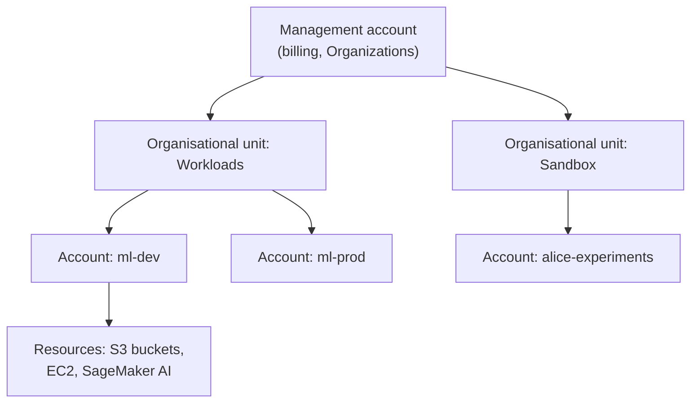
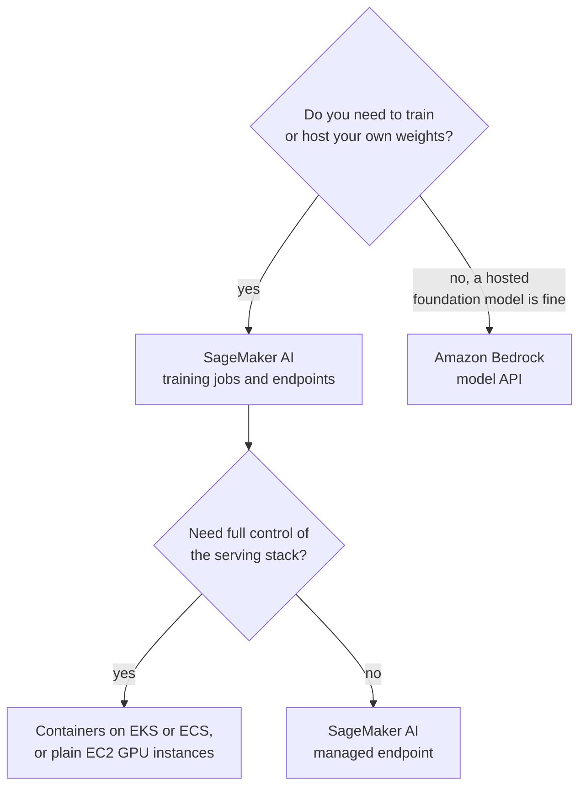

Sooner or later every AI system you build has to run somewhere other than your laptop: a GPU to fine-tune on, a bucket to hold a few hundred gigabytes of documents, an endpoint that serves a model to thousands of users. Amazon Web Services (AWS) is the largest public cloud and the one you are most likely to meet in job descriptions. This lesson orients you on AWS as an AI engineer: how accounts are organised, where your resources physically live, which services map to the concept lessons in this module, how to use the command line, and how to avoid a surprise bill.

The advice for this module is to learn **at least one cloud platform deeply**. The concepts (object storage, virtual machines, managed databases, identity) are shared by all three major providers, so the second and third clouds are much faster to learn than the first.

## Accounts and organisations

An **AWS account** is the basic container for resources and for billing. Everything you create, from a virtual machine to a database, belongs to exactly one account, and each account has a 12-digit ID. Accounts are also a strong security boundary: by default, nothing in one account can touch anything in another.

Organisations rarely use a single account. **AWS Organizations** groups many accounts under one management account, with consolidated billing and **service control policies** (SCPs) that limit what any account may do, such as "no resources outside these two regions".



A common pattern is separate accounts for development, staging and production, so a mistake in a notebook cannot delete the production model bucket. For a personal learning setup, one account is fine, but follow two rules from day one:

1. Never use the **root user** (the email address you signed up with) for daily work. Turn on multi-factor authentication for it and lock it away.
2. Sign in as a separate identity with only the permissions you need. **IAM Identity Center** is the recommended way for humans to sign in; the [IAM and security](/learn/cloud-computing/iam-and-security) lesson explains why.

## Regions and availability zones

AWS runs data centres in many **regions** around the world, each with a code such as `us-east-1` or `eu-west-2`. Each region contains several **availability zones** (AZs), such as `eu-west-2a`: physically separate data centres with independent power and networking, connected by fast links.

| Concept | What it means for you |
| --- | --- |
| Region | Most resources live in one region. Choose one near your users and your data, and check data residency rules |
| Availability zone | Spread production servers across at least two AZs so one data-centre failure does not take you down |
| Service availability | Not every service, GPU type or foundation model is offered in every region. Check before you design around it |
| Data transfer | Moving data between regions, or out to the internet, is usually charged; moving it within a region is cheaper or free |

For AI work, region choice often comes down to which GPU instance types and which Amazon Bedrock models are available there. A region that has the GPUs you need beats a slightly closer one that does not.

## The core services, mapped to this module

An AI engineer uses a small, stable core of AWS's hundreds of services:

| Need | AWS service | Concept lesson |
| --- | --- | --- |
| Object storage for datasets, models, documents | Amazon S3 | [Cloud storage](/learn/cloud-computing/cloud-storage) |
| Virtual machines, including GPU machines | Amazon EC2 | [Virtual machines](/learn/cloud-computing/virtual-machines), [GPU instances](/learn/cloud-computing/gpu-instances) |
| Relational databases | Amazon RDS, Amazon Aurora | [Managed databases](/learn/cloud-computing/managed-databases) |
| Key-value and document data | Amazon DynamoDB | [Managed databases](/learn/cloud-computing/managed-databases) |
| Container images | Amazon ECR | [Model hosting](/learn/cloud-computing/model-hosting) |
| Running containers | Amazon ECS, AWS Fargate, Amazon EKS (Kubernetes) | [Model hosting](/learn/cloud-computing/model-hosting) |
| Functions | AWS Lambda | [Serverless computing](/learn/cloud-computing/serverless-computing) |
| Identity and secrets | AWS IAM, IAM Identity Center, AWS Secrets Manager, AWS KMS | [IAM and security](/learn/cloud-computing/iam-and-security) |
| Metrics, logs, audit trail | Amazon CloudWatch, AWS CloudTrail | [Monitoring and logging](/learn/cloud-computing/monitoring-and-logging) |

### The ML platforms: SageMaker AI and Bedrock

Two services are specifically for machine learning, and they answer different questions.

- **Amazon SageMaker AI** (long known simply as SageMaker) is a platform for building, training and deploying **your own models**: managed notebooks, training jobs that spin up GPU machines and shut them down when finished, a model registry, and managed inference endpoints. You bring the code and the weights.
- **Amazon Bedrock** gives API access to **foundation models from several providers** without managing any servers. You send a prompt and receive a completion, paying per use. It also offers building blocks such as knowledge bases for retrieval, guardrails and agents.



> [!KEY]
> Most AI applications start on a model API (Bedrock, or a provider's own API from the [Working with LLMs](/learn/working-with-llms/openai-api) module) and move to self-hosted models only when cost, latency, privacy or customisation demands it. Do not stand up GPU infrastructure before you know you need it.

## The AWS CLI

The AWS Command Line Interface, `aws`, lets you script everything you could do in the web console. Install version 2 from the official documentation, then configure credentials. With IAM Identity Center, the flow is:

```bash
aws configure sso                 # one-time: creates a named profile
aws sso login --profile ml-dev    # opens a browser to sign in
aws sts get-caller-identity --profile ml-dev   # who am I?
```

`aws sts get-caller-identity` is worth memorising: when something fails with "access denied", the first question is which identity the call actually ran as.

Commands follow the pattern `aws <service> <operation>`. The S3 commands are the ones you will use most:

```bash
aws s3 ls                                          # list buckets
aws s3 cp model.safetensors s3://my-ml-models/v1/  # upload a file
aws s3 sync ./data s3://my-ml-datasets/raw/        # upload only changed files
aws s3 cp s3://my-ml-models/v1/model.safetensors . # download
```

The Python SDK, **boto3**, reads the same credentials and profiles, so setting `AWS_PROFILE=ml-dev` in the environment makes your scripts use the identity your terminal uses.

> [!WARNING]
> Never paste long-term access keys into code, notebooks or Git. Leaked AWS keys are found by automated scanners within minutes and used to start expensive machines. Use short-lived credentials from IAM Identity Center on your laptop and IAM roles on servers.

## Free tier and cost safety

AWS offers a free tier for new accounts, but its terms have changed over time, so read the current terms rather than a blog post. GPU instances are never free: a forgotten GPU machine can cost more in a weekend than a year of small experiments.

Protect yourself before you launch anything:

| Safeguard | What it does |
| --- | --- |
| AWS Budgets | Sends an email (or other notification) when actual or forecast spend crosses a threshold you set |
| Cost Explorer | Shows spend by service, region and tag, so you can find what is costing money |
| Cost allocation tags | Labels such as `project=rag-demo` that let you group spend |
| A cleanup habit | Stop or terminate instances and delete endpoints when you finish a session |

A budget **alerts**; it does not automatically stop your resources. That is your job, which is why a shutdown checklist matters more than any tool. The [monitoring and logging](/learn/cloud-computing/monitoring-and-logging) lesson returns to cost monitoring.

## AWS and the other two clouds

The same ideas appear under different names on Google Cloud and Azure. Keep this table nearby as you read the next two lessons.

| Concept | AWS | Google Cloud | Azure |
| --- | --- | --- | --- |
| Billing and isolation unit | Account | Project | Subscription (plus resource groups) |
| Grouping of units | AWS Organizations | Organization and folders | Management groups |
| Object storage | S3 | Cloud Storage | Blob Storage |
| Virtual machines | EC2 | Compute Engine | Virtual Machines |
| Managed relational DB | RDS, Aurora | Cloud SQL, AlloyDB | Azure SQL Database, Azure Database for PostgreSQL |
| NoSQL | DynamoDB | Firestore, Bigtable | Cosmos DB |
| Managed Kubernetes | EKS | GKE | AKS |
| Serverless containers | Fargate, App Runner | Cloud Run | Azure Container Apps |
| Functions | Lambda | Cloud Run functions | Azure Functions |
| ML platform | SageMaker AI | Vertex AI | Azure Machine Learning |
| Foundation model API | Bedrock | Vertex AI (Gemini and Model Garden) | Azure OpenAI in Azure AI Foundry |
| Identity | IAM, IAM Identity Center | Cloud IAM | Microsoft Entra ID, Azure RBAC |
| Secrets | Secrets Manager | Secret Manager | Key Vault |
| Monitoring | CloudWatch | Cloud Monitoring, Cloud Logging | Azure Monitor |
| CLI | `aws` | `gcloud` | `az` |

## Exercises

**1.** A team has one AWS account in which developers experiment and the production chatbot runs. Name two risks of this setup and the AWS feature that addresses them.

<details>
<summary>Show solution</summary>

Risks: a developer experiment could delete or overwrite production resources (such as the model bucket), and experiment spend is mixed with production spend, so it is hard to see what each costs. Separate **accounts** for development and production, grouped under **AWS Organizations**, address both: accounts are an isolation and billing boundary, and service control policies can restrict what the development account may do.

</details>

**2.** Your script fails with "AccessDenied" when reading from S3, but the same command works for a colleague. What is the first command you run, and why?

<details>
<summary>Show solution</summary>

```bash
aws sts get-caller-identity
```

It shows which identity (account and role or user) your credentials actually belong to. Often the script is using a different profile, an expired session, or a different account than you assumed. Once you know the identity, you can check its permissions.

</details>

```quiz
[
  {
    "q": "What is the main purpose of having separate AWS accounts for development and production?",
    "options": [
      "Development accounts get cheaper prices",
      "Accounts are an isolation and billing boundary, so mistakes and spend in one do not affect the other",
      "Each account can only use one region",
      "AWS requires it for running GPU instances"
    ],
    "answer": 1,
    "why": "By default resources in one account cannot affect another, and spend is reported per account."
  },
  {
    "q": "You need to fine-tune an open-weights model on your own data and serve it from an endpoint you control. Which AWS service fits best?",
    "options": [
      "Amazon Bedrock",
      "AWS Budgets",
      "Amazon SageMaker AI",
      "AWS CloudTrail"
    ],
    "answer": 2,
    "why": "SageMaker AI is the platform for training and hosting your own models. Bedrock is mainly for calling hosted foundation models."
  },
  {
    "q": "What does an AWS Budgets alert do when spend crosses the threshold?",
    "options": [
      "Sends a notification; resources keep running unless you stop them",
      "Terminates every instance in the account",
      "Moves the account to the free tier",
      "Blocks all API calls until the next month"
    ],
    "answer": 0,
    "why": "Budgets alert you. Stopping resources is your responsibility, unless you deliberately build automated actions."
  },
  {
    "q": "Which statement about regions is correct?",
    "options": [
      "Every service and GPU type is available in every region",
      "An availability zone contains several regions",
      "Data transfer between regions is always free",
      "Services, GPU types and models vary by region, so you should check availability before choosing one"
    ],
    "answer": 3,
    "why": "A region contains several AZs, and availability differs. Cross-region transfer is usually charged."
  }
]
```
