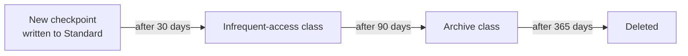
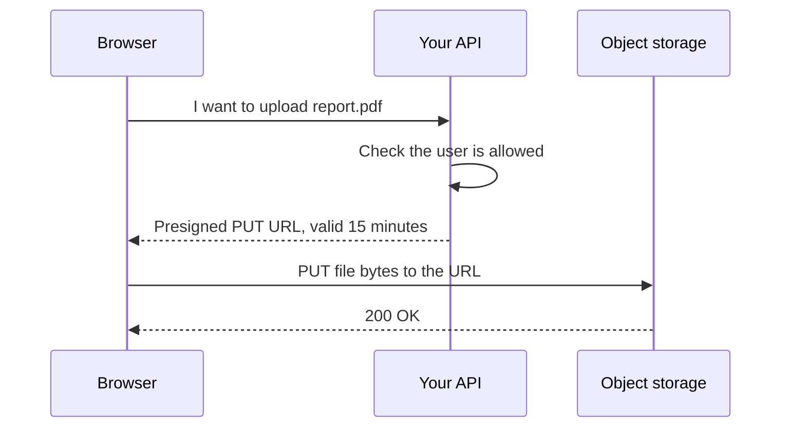

Almost every AI system in the cloud is built around object storage. Training data lands there, checkpoints are written there every few hundred steps, the documents for a RAG system live there, model weights are loaded from there when an endpoint starts, and logs are archived there. Amazon S3, Google Cloud Storage and Azure Blob Storage are cheap per gigabyte, extremely durable and effectively unlimited in size. This lesson teaches the model they share, with `boto3` code for S3 as the worked example.

## Objects, buckets and keys

Object storage is not a file system, even though tools make it look like one. It is a giant key-value store:

- A **bucket** (a **container** inside a **storage account** on Azure) is a named collection of objects. Bucket names on S3 and Cloud Storage are globally unique across all customers.
- An **object** (a **blob** on Azure) is a sequence of bytes plus metadata, such as content type and custom key-value tags.
- A **key** is the object's full name within the bucket, such as `datasets/reviews/2025/part-0001.parquet`.

There are no real directories. The slashes in a key are just characters; consoles and CLIs display them as folders by grouping keys that share a **prefix**. Listing "a folder" means asking for keys that start with a prefix, optionally cut at the next delimiter. This small simulation shows what the storage service does:

```python
keys = [
    "datasets/reviews/train.parquet",
    "datasets/reviews/test.parquet",
    "datasets/images/cat/001.jpg",
    "datasets/images/dog/001.jpg",
    "models/v1/model.safetensors",
]

def list_prefix(keys, prefix, delimiter="/"):
    objects, common_prefixes = [], set()
    for k in keys:
        if not k.startswith(prefix):
            continue
        rest = k[len(prefix):]
        if delimiter in rest:
            common_prefixes.add(prefix + rest.split(delimiter)[0] + delimiter)
        else:
            objects.append(k)
    return sorted(objects), sorted(common_prefixes)  # S3 lists keys in sorted order

print(list_prefix(keys, "datasets/"))
print(list_prefix(keys, "datasets/reviews/"))
```

```output
([], ['datasets/images/', 'datasets/reviews/'])
(['datasets/reviews/test.parquet', 'datasets/reviews/train.parquet'], [])
```

The real S3 `ListObjectsV2` call returns exactly these two lists, as `Contents` and `CommonPrefixes`. Because "folders" are prefixes, renaming a folder means copying and deleting every object under it, which is slow for millions of objects. Design key layouts you will not need to rename.

| Property | File system on a disk | Object storage |
| --- | --- | --- |
| Unit | File, edited in place | Whole object, replaced on write |
| Hierarchy | Real directories | Flat keys with prefixes |
| Access | System calls from one machine | HTTPS API from anywhere with permission |
| Size limits | Disk size | Effectively unlimited bucket; very large individual objects |
| Good for | Scratch space, databases, random writes | Datasets, artefacts, documents, backups, logs |

> [!KEY]
> You cannot append to or modify part of an object. A write replaces the whole object. This is why training jobs write checkpoints as new objects (`step-1000.pt`, `step-2000.pt`) and why log pipelines write many small files and later compact them.

## Working with S3 from Python

`boto3` is the AWS SDK for Python. The client methods below are the ones you will use daily; the other clouds' SDKs (`google-cloud-storage`, `azure-storage-blob`) have direct equivalents.

```python
import boto3

s3 = boto3.client("s3")
BUCKET = "my-ml-datasets"

# Upload and download whole files (multipart transfers handled for you)
s3.upload_file("train.parquet", BUCKET, "datasets/reviews/train.parquet")
s3.download_file(BUCKET, "datasets/reviews/train.parquet", "/tmp/train.parquet")

# Read a small object straight into memory
body = s3.get_object(Bucket=BUCKET, Key="configs/train.yaml")["Body"].read()

# List every key under a prefix; a paginator handles the 1,000-keys-per-page limit
paginator = s3.get_paginator("list_objects_v2")
for page in paginator.paginate(Bucket=BUCKET, Prefix="datasets/images/"):
    for obj in page.get("Contents", []):
        print(obj["Key"], obj["Size"])
```

From the shell, `aws s3 cp` and `aws s3 sync` do the same jobs, and `gcloud storage cp` and `az storage blob upload` are the equivalents on the other clouds.

Two habits make object storage pleasant to work with in ML:

- **Use structured, versioned key layouts**, such as `datasets/<name>/<version>/` and `models/<name>/<run-id>/`, so that a training run can record exactly which data it used. The [DVC](/learn/mlops/dvc) and [model registry](/learn/mlops/model-registry) tools in the MLOps module build on this.
- **Prefer a few large files to millions of tiny ones.** Each request has overhead, so reading 10 million small JPEGs one by one is slow. Packing them into shards (Parquet, WebDataset tar files, TFRecord) and reading shards in parallel is far faster.

## Storage classes

Not all data is read equally often. Each provider offers **storage classes** (Azure calls them **access tiers**) that trade a cheaper monthly storage rate for higher retrieval charges, minimum storage durations or slower access.

| Access pattern | AWS S3 | Google Cloud Storage | Azure Blob Storage |
| --- | --- | --- | --- |
| Frequent | S3 Standard | Standard | Hot |
| Infrequent (roughly monthly) | S3 Standard-IA | Nearline | Cool |
| Rare (roughly quarterly) | S3 Glacier Instant Retrieval | Coldline | Cold |
| Archive, retrieval can take hours | S3 Glacier Flexible Retrieval, S3 Glacier Deep Archive | Archive | Archive |
| Unknown or changing | S3 Intelligent-Tiering | Autoclass | (lifecycle rules) |

Current training data and the weights your endpoints load belong in the frequent tier. Raw data you have already processed, old checkpoints and last year's logs are candidates for colder tiers. Always check the retrieval behaviour before archiving: data in the deepest archive tiers must be restored before it can be read, which can take hours.

## Lifecycle rules

You do not move objects between classes by hand. A **lifecycle rule** tells the service to transition or delete objects automatically based on age and prefix.



The same policy in `boto3`:

```python
s3.put_bucket_lifecycle_configuration(
    Bucket="my-ml-artifacts",
    LifecycleConfiguration={
        "Rules": [
            {
                "ID": "age-out-checkpoints",
                "Filter": {"Prefix": "checkpoints/"},
                "Status": "Enabled",
                "Transitions": [
                    {"Days": 30, "StorageClass": "STANDARD_IA"},
                    {"Days": 90, "StorageClass": "GLACIER"},
                ],
                "Expiration": {"Days": 365},
            }
        ]
    },
)
```

Lifecycle rules are one of the cheapest cost savings available. Checkpoints in particular pile up quickly: a run that saves a multi-gigabyte checkpoint every hour for a week leaves hundreds of gigabytes behind. A rule that deletes intermediate checkpoints after a few weeks, while you copy the final model to a separate prefix, keeps storage under control.

## Presigned URLs

Buckets should be **private** by default. But often a user or another system needs temporary access to one object, for example a browser uploading a PDF to your RAG app or a partner downloading an evaluation report. Rather than making the bucket public or proxying gigabytes through your API server, you generate a **presigned URL**: a normal HTTPS URL carrying a signature that grants one operation on one object until an expiry time.



```python
upload_url = s3.generate_presigned_url(
    "put_object",
    Params={"Bucket": "rag-uploads", "Key": "user-42/report.pdf"},
    ExpiresIn=900,  # seconds
)
download_url = s3.generate_presigned_url(
    "get_object",
    Params={"Bucket": "rag-uploads", "Key": "user-42/report.pdf"},
    ExpiresIn=3600,
)
```

The URL carries the permissions of the identity that signed it, so sign with a role that can access only the relevant prefix, and keep expiry times short. Google Cloud calls these **signed URLs**, and Azure uses **shared access signatures** (SAS).

> [!WARNING]
> Public buckets are a classic source of data leaks. Keep "block public access" settings on (S3 has them on by default for new buckets, and the other clouds have equivalent settings), and share individual objects with presigned URLs instead.

## Durability, versioning and consistency

Object stores replicate data across multiple devices and, depending on the class and location, across availability zones, so losing data to hardware failure is extremely unlikely. They do **not** protect you from yourself: an `aws s3 rm --recursive` with the wrong prefix deletes data reliably too. Turn on **object versioning** for buckets holding anything precious, so overwritten or deleted objects can be recovered (and add a lifecycle rule to expire old versions, or they accumulate cost).

S3, Cloud Storage and Blob Storage all provide strong read-after-write consistency for objects: once a write succeeds, a subsequent read returns the new data.

## Exercises

**1.** Using `list_prefix` from this lesson, what does `list_prefix(keys, "datasets/images/")` return? Work it out before running it.

<details>
<summary>Show solution</summary>

```python
print(list_prefix(keys, "datasets/images/"))
```

```output
([], ['datasets/images/cat/', 'datasets/images/dog/'])
```

No keys sit directly under `datasets/images/`; both images are one more level down, so only the two common prefixes are returned.

</details>

**2.** Write a lifecycle rule (as the `Rules` list for `boto3`) that deletes everything under `tmp/` after 7 days.

<details>
<summary>Show solution</summary>

```python
rules = [
    {
        "ID": "delete-tmp",
        "Filter": {"Prefix": "tmp/"},
        "Status": "Enabled",
        "Expiration": {"Days": 7},
    }
]
```

Pass it as `LifecycleConfiguration={"Rules": rules}`. Note that `put_bucket_lifecycle_configuration` replaces the bucket's whole lifecycle configuration, so include any existing rules too.

</details>

**3.** A web app lets users download their generated reports. The current code streams each file from S3 through the API server, which is now the bottleneck. Propose a change.

<details>
<summary>Show solution</summary>

After checking that the user may access the report, have the API return a short-lived presigned `get_object` URL. The browser downloads directly from S3, so the bytes no longer pass through the API server.

</details>

```quiz
[
  {
    "q": "What is a \"folder\" in S3 or Cloud Storage?",
    "options": [
      "A real directory object that must be created first",
      "A separate bucket",
      "A shared prefix of object keys, displayed as a folder by tools",
      "A storage class"
    ],
    "answer": 2,
    "why": "Keys are flat strings; tools group keys by prefix and delimiter to show folders."
  },
  {
    "q": "Which feature lets a browser upload one file directly to a private bucket for 15 minutes?",
    "options": [
      "A presigned (signed) URL",
      "Making the bucket public",
      "A lifecycle rule",
      "Object versioning"
    ],
    "answer": 0,
    "why": "A presigned URL grants one operation on one object until it expires, without exposing the bucket."
  },
  {
    "q": "Old training checkpoints are rarely read but must be kept for a year. What is the best approach?",
    "options": [
      "Keep them in the frequent-access class forever",
      "Delete them manually each month",
      "Copy them to a VM disk",
      "Use a lifecycle rule to transition them to colder classes and expire them after a year"
    ],
    "answer": 3,
    "why": "Lifecycle rules move and delete objects automatically by age and prefix."
  },
  {
    "q": "Why does object versioning matter even though object storage is extremely durable?",
    "options": [
      "It makes reads faster",
      "Durability protects against hardware failure, not against accidental overwrites or deletions",
      "It is required for presigned URLs",
      "It moves objects to cheaper classes"
    ],
    "answer": 1,
    "why": "Versioning keeps previous versions so you can recover from your own mistakes."
  }
]
```
