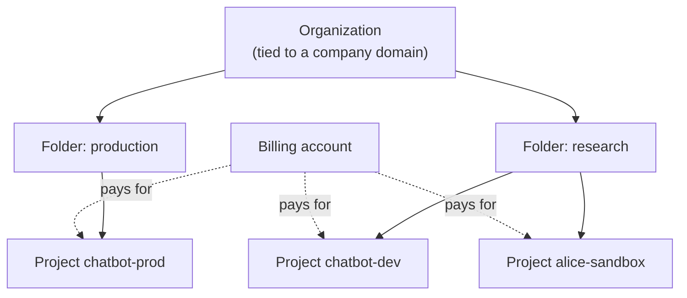
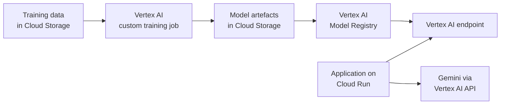

Google Cloud Platform (usually just "Google Cloud" or GCP) is the cloud built by the company behind the Transformer paper, TensorFlow and the TPU. For AI engineers it has three particular draws: **Vertex AI** as a unified ML platform with Google's Gemini models, **TPUs** as an alternative accelerator to GPUs, and **BigQuery** for analytics over very large datasets. This lesson orients you on Google Cloud the way the [AWS lesson](/learn/cloud-computing/aws) did for AWS, so you can map the concepts across and notice the differences that trip people up.

## Projects, folders and the organisation

The central unit in Google Cloud is the **project**. Every resource (a bucket, a VM, a Vertex AI endpoint) belongs to exactly one project, APIs are enabled per project, and permissions are usually granted per project. A project has a human-friendly name, a globally unique **project ID** such as `rag-demo-412309`, and a project number. The project ID is what you type in commands.



Two things differ from AWS:

- **Billing is separate from projects.** A **billing account** holds the payment method, and each project is linked to one billing account. Unlink it and the project's paid resources stop working. Several projects usually share one billing account.
- **APIs must be enabled.** A new project cannot use Compute Engine or Vertex AI until you enable those APIs in it. An error saying an API "has not been used in project ... or it is disabled" means exactly that.

Permissions flow downwards: a role granted on a folder applies to every project inside it. The [IAM and security](/learn/cloud-computing/iam-and-security) lesson explains roles in detail.

> [!TIP]
> Create a fresh project for each experiment or course. When you are done, **shutting down the project** deletes everything in it at once, which is the most reliable way to make sure nothing is left running.

## Regions and zones

Google Cloud regions have names like `us-central1` or `europe-west4`, and each contains zones such as `europe-west4-a`. Resources fall into three scopes:

| Scope | Examples |
| --- | --- |
| Zonal | Compute Engine VMs, their persistent disks, GPUs and TPUs |
| Regional | Cloud SQL instances (optionally with a standby in another zone), Cloud Run services, Vertex AI endpoints |
| Multi-regional or global | Cloud Storage buckets in a multi-region location, global load balancers, IAM |

Accelerators are zonal, so a specific GPU or TPU type may exist in only some zones of a region. If a VM fails to start with a "resource not available" message, trying another zone that offers the same accelerator is a normal fix.

## The core services

| Need | Google Cloud service | Notes for AI work |
| --- | --- | --- |
| Object storage | Cloud Storage | Buckets of objects; storage classes Standard, Nearline, Coldline, Archive |
| Virtual machines | Compute Engine | Machine families for general, compute- and memory-heavy and accelerator workloads |
| Accelerators | GPUs on Compute Engine, Cloud TPU | TPUs work best with JAX, TensorFlow or PyTorch/XLA |
| Relational databases | Cloud SQL, AlloyDB for PostgreSQL | Both support PostgreSQL with the `pgvector` extension |
| NoSQL | Firestore, Bigtable | Firestore for documents, Bigtable for very large key-value workloads |
| Analytics | BigQuery | Serverless SQL warehouse; useful for feature tables and log analysis |
| Container images | Artifact Registry | Stores Docker images and Python packages |
| Containers | Google Kubernetes Engine (GKE), Cloud Run | Cloud Run runs a container per request and scales to zero; it can attach GPUs |
| Functions | Cloud Run functions | Formerly called Cloud Functions |
| ML platform | Vertex AI | Training, endpoints, pipelines, model registry, Model Garden, Gemini API |
| Secrets | Secret Manager | |
| Monitoring | Cloud Monitoring, Cloud Logging, Cloud Trace | |

### Vertex AI

**Vertex AI** brings Google's ML services under one name. The parts you will meet first are:

- **Gemini models through the Vertex AI API**: Google's foundation models, called much like any other LLM API, but billed to your project and governed by your project's IAM and data controls.
- **Model Garden**: a catalogue of Google, partner and open models, some callable as managed APIs and some deployable to an endpoint in your project.
- **Custom training jobs**: you supply a container or Python package, Vertex AI runs it on the machines and accelerators you request, and shuts them down at the end.
- **Endpoints**: deploy a model from the Vertex AI Model Registry behind an HTTPS endpoint with autoscaling.
- **Vector Search**: a managed approximate nearest-neighbour index for embeddings, covered alongside other options in [managed databases](/learn/cloud-computing/managed-databases).



The pattern in the diagram, where Cloud Storage holds both data and artefacts and every step reads and writes there, is the same on every cloud.

## The gcloud CLI

The **Google Cloud CLI** installs the `gcloud` command (plus `bq` for BigQuery). After installing it from the official documentation:

```bash
gcloud auth login                         # sign in as yourself, for gcloud commands
gcloud config set project rag-demo-412309 # default project for later commands
gcloud config set compute/region europe-west4
gcloud auth application-default login     # credentials for client libraries
```

The last line deserves attention. `gcloud auth login` authenticates the `gcloud` tool itself. Python client libraries such as `google-cloud-storage` look for **Application Default Credentials** (ADC) instead, and `gcloud auth application-default login` creates them on your machine. On a VM or Cloud Run, ADC come automatically from the attached service account, so the same code works in both places without any keys:

```python
from google.cloud import storage

client = storage.Client()  # finds Application Default Credentials
bucket = client.bucket("rag-demo-docs")
bucket.blob("raw/handbook.pdf").upload_from_filename("handbook.pdf")
```

Common commands follow the pattern `gcloud <group> <command>`:

```bash
gcloud projects list
gcloud services enable aiplatform.googleapis.com   # enable the Vertex AI API
gcloud storage cp handbook.pdf gs://rag-demo-docs/raw/
gcloud storage ls gs://rag-demo-docs/raw/
```

Cloud Storage paths begin with `gs://`. You will still see the older `gsutil` tool in tutorials; `gcloud storage` is its current replacement for most tasks.

> [!WARNING]
> Avoid downloading **service account keys** (JSON key files). They are long-lived secrets that are easy to leak. Use your own login on your laptop, attached service accounts on Google Cloud resources, and Workload Identity Federation for external systems such as GitHub Actions.

## Free credits and cost safety

Google Cloud has historically offered new accounts a trial credit plus an "always free" allowance on some small resources. The details change, so check the current terms. GPUs and TPUs are not part of any always-free allowance, and new projects typically have a **GPU quota of zero** until you request an increase, which is itself a useful safety net.

| Safeguard | What it does |
| --- | --- |
| Budgets and alerts (Cloud Billing) | Email alerts at percentages of a budget, on actual or forecast spend |
| Billing reports | Spend by project, service and label |
| Labels | Key-value pairs such as `team=search` on resources, for grouping cost |
| Shutting down a project | Deletes all its resources after a short recovery window |

As on AWS, a budget alert does **not** cap spending by itself. Google documents a pattern for automatically disabling billing when a budget is exceeded (using budget notifications to trigger a function), but treat that as a last resort, because disabling billing stops every paid service in the project, production included.

## Exercises

**1.** A colleague's Python script uses `storage.Client()` and fails on your laptop with a credentials error, even though `gcloud storage ls` works for you. Explain why and give the fix.

<details>
<summary>Show solution</summary>

`gcloud storage ls` uses the credentials from `gcloud auth login`. Client libraries look for Application Default Credentials, which are separate. Run:

```bash
gcloud auth application-default login
```

On a Google Cloud VM or Cloud Run service, ADC come from the attached service account, so no command is needed there.

</details>

**2.** You request an A100 VM in `us-central1-a` and get a "resource not available" error. Give two things to try that do not involve changing the code.

<details>
<summary>Show solution</summary>

Try another zone in the same region (or another region) that offers the same accelerator, because GPUs are zonal and capacity varies. Check the project's GPU quota for that region and request an increase if it is zero or too low. A smaller or different GPU type that still fits the model is a third option.

</details>

**3.** Map these AWS ideas to Google Cloud: an AWS account, Amazon S3, AWS Lambda, Amazon Bedrock.

<details>
<summary>Show solution</summary>

AWS account maps most closely to a **project** (with a separate billing account). S3 maps to **Cloud Storage**. Lambda maps to **Cloud Run functions**. Bedrock maps to the foundation-model side of **Vertex AI** (Gemini and Model Garden).

</details>

```quiz
[
  {
    "q": "In Google Cloud, what is linked to a billing account?",
    "options": [
      "Each individual VM",
      "Each project",
      "Each region",
      "Each IAM role"
    ],
    "answer": 1,
    "why": "Projects are linked to a billing account; resources in the project are charged to it."
  },
  {
    "q": "What does `gcloud auth application-default login` set up?",
    "options": [
      "Credentials that client libraries such as `google-cloud-storage` use on your machine",
      "A new service account key file",
      "Login for the web console only",
      "A billing account"
    ],
    "answer": 0,
    "why": "It creates Application Default Credentials, which client libraries look for. `gcloud auth login` authenticates the gcloud tool itself."
  },
  {
    "q": "Why might a GPU VM fail to start in one zone but succeed in another zone of the same region?",
    "options": [
      "Zones use different CPU architectures",
      "The project ID differs between zones",
      "Accelerators are zonal resources and capacity and offerings vary by zone",
      "GPUs are only allowed in zone `a`"
    ],
    "answer": 2,
    "why": "GPUs and TPUs are attached in specific zones, and availability differs."
  },
  {
    "q": "Which is the safest way to clean up everything from a finished experiment in Google Cloud?",
    "options": [
      "Delete the billing account",
      "Remove your own IAM role",
      "Disable the Compute Engine API",
      "Shut down the experiment's dedicated project"
    ],
    "answer": 3,
    "why": "Shutting down a project deletes all its resources. Using one project per experiment makes this possible."
  }
]
```
