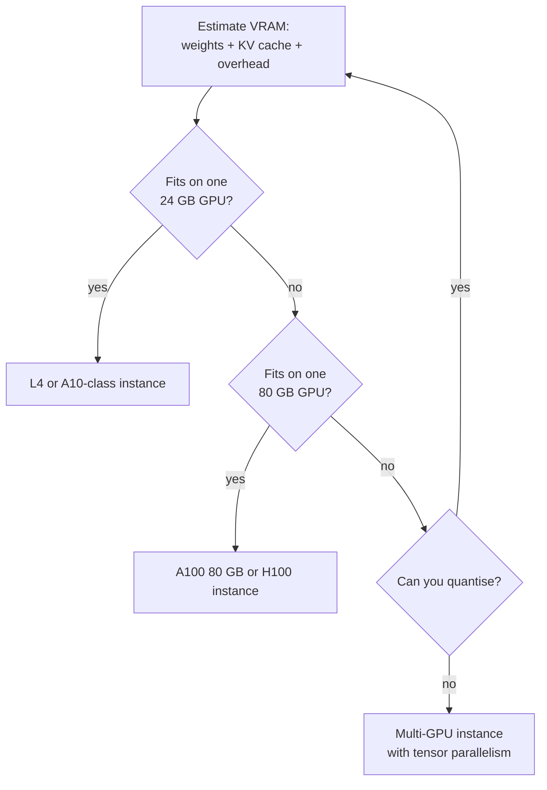

GPUs are the most expensive and most contested resource in the cloud, and the one where a bad choice costs the most. Pick a GPU that is too small and your model will not load; pick one that is far too big and you pay for idle silicon every hour; leave one running over a weekend and you will notice on the bill. This lesson teaches you how to choose a GPU instance for a workload, how to estimate the memory a model needs with arithmetic you can check, and the practical obstacles (quotas, availability, drivers) that stand between you and a working `nvidia-smi`.

You saw how PyTorch moves tensors to a GPU in [GPU acceleration](/learn/pytorch/gpu-acceleration). Here the question is which GPU, rented where.

## GPU families by use case

GPU instances differ in GPU model, GPU count and interconnect speed. Sort them by purpose rather than memorising names.

| Use case | What matters | Typical GPUs | AWS families | Google Cloud | Azure |
| --- | --- | --- | --- | --- | --- |
| Small-model inference, embeddings, dev work | Low cost, enough memory | NVIDIA T4, L4, A10-class | G4dn, G5, G6 | G2 (L4), N1 with T4 | NCasT4_v3, NVadsA10 v5 |
| LLM inference, fine-tuning mid-sized models | Large memory per GPU | A100, H100, L40S-class | P4, P5, G6e | A2, A3 | NC A100 v4, NC H100 v5 |
| Large-scale training | Many GPUs with fast interconnect (NVLink, InfiniBand or equivalent) | A100, H100 and newer | P4d, P5 | A3 | ND A100 v4, ND H100 v5 |
| Provider-designed accelerators | Lower cost for supported models and frameworks | Custom chips | Inferentia (Inf), Trainium (Trn) | TPUs | Maia (limited availability) |

Exact specifications change with every generation, so confirm the GPU model, count and memory on the provider's instance-type page before you choose. The memory figures worth remembering are approximate and stable: a T4 has 16 GB, an L4 and an A10G each have 24 GB, an A100 comes in 40 GB and 80 GB versions, and an H100 has 80 GB.

> [!KEY]
> For inference, **GPU memory (VRAM) is usually the first constraint**: the model must fit before speed matters. For training, the constraints are memory plus the speed of communication between GPUs. Choose the smallest instance that fits with headroom, measure, then scale.

## Sizing VRAM for inference

The memory an LLM needs at inference time has three parts.

**1. Weights.** Every parameter is stored in some number of bytes:

$$
M_{\text{weights}} = N_{\text{params}} \times b
$$

where $N_{\text{params}}$ is the parameter count and $b$ is bytes per parameter: 4 for FP32, 2 for FP16 or BF16, 1 for 8-bit and about 0.5 for 4-bit quantisation (plus a little for scaling factors).

**2. The KV cache.** During generation, each layer stores a key and a value vector for every token in every active sequence, as explained in [KV caching](/learn/advanced-llm-engineering/kv-caching):

$$
M_{\text{KV}} = 2 \times L \times H_{\text{kv}} \times d_{\text{head}} \times b \times T
$$

where the 2 counts keys and values, $L$ is the number of layers, $H_{\text{kv}}$ the number of key-value heads, $d_{\text{head}}$ the dimension of each head, $b$ the bytes per value, and $T$ the total number of tokens held across all concurrent sequences.

**3. Overhead.** The CUDA context, temporary activations and the serving framework's own buffers. A rough allowance of 10 to 20 percent on top is a common starting assumption; measure your own setup.

Here is the arithmetic for an illustrative 7-billion-parameter model with 32 layers, 32 key-value heads and a head dimension of 128 (an older 7B design without grouped-query attention):

```python
GiB = 1024**3

def weights_gib(n_params, bytes_per_param):
    return n_params * bytes_per_param / GiB

def kv_cache_gib(layers, kv_heads, head_dim, bytes_per_value, total_tokens):
    per_token = 2 * layers * kv_heads * head_dim * bytes_per_value
    return per_token, per_token * total_tokens / GiB

n = 7e9
for name, b in [("FP16", 2), ("INT8", 1), ("4-bit", 0.5)]:
    print(f"weights {name:5}: {weights_gib(n, b):6.2f} GiB")

per_token, kv = kv_cache_gib(32, 32, 128, 2, total_tokens=8 * 4096)
print(f"KV per token: {per_token:,} bytes ({per_token / 1024**2} MiB)")
print(f"KV for 8 sequences x 4096 tokens: {kv:.2f} GiB")

total = weights_gib(n, 2) + kv
print(f"FP16 weights + KV: {total:.2f} GiB, with 15% overhead: {total * 1.15:.2f} GiB")
```

```output
weights FP16 :  13.04 GiB
weights INT8 :   6.52 GiB
weights 4-bit:   3.26 GiB
KV per token: 524,288 bytes (0.5 MiB)
KV for 8 sequences x 4096 tokens: 16.00 GiB
FP16 weights + KV: 29.04 GiB, with 15% overhead: 33.39 GiB
```

Note the unit: 7 billion parameters at 2 bytes is 14 GB in decimal gigabytes, which is 13.04 GiB in the binary units that `nvidia-smi` and PyTorch report.

What the numbers tell you:

- The FP16 weights alone (about 13 GiB) fit on a 24 GB GPU with room to spare, so a single short conversation works.
- Serving 8 concurrent 4,096-token sequences needs about 33 GiB, which **does not fit on 24 GB**. You would need a 40 GB or 80 GB GPU, fewer or shorter concurrent sequences, or a quantised KV cache.
- The KV cache can be larger than the weights. Models with **grouped-query attention** use fewer key-value heads than query heads, which shrinks it proportionally: with 8 KV heads instead of 32, the same workload needs 4 GiB of cache instead of 16.

For training, the memory picture is very different: optimiser states, gradients and activations typically need several times the memory of the weights. Full fine-tuning even a 7B model at mixed precision needs far more than inference does, which is why parameter-efficient methods such as [LoRA and QLoRA](/learn/advanced-llm-engineering/lora-and-qlora) are so popular on modest cloud GPUs.

## Choosing an instance



Before any of this, ask whether a model API (Bedrock, Vertex AI, Azure OpenAI) is good enough, and whether the GPU will be busy: one idle most of the time suggests a scale-to-zero option from [model hosting](/learn/cloud-computing/model-hosting).

## Quotas and availability

On all three clouds, new accounts start with **low or zero quota** for GPU instances. Quotas are set per region and per family (AWS counts vCPUs per instance family; Google Cloud counts GPUs per type per region; Azure counts vCPUs per VM family per region). Before you can launch, you request an increase through the provider's quota page and wait for approval, which can take from minutes to days and may be refused for new accounts with no billing history.

Even with quota, **capacity** may not be there: popular GPUs in popular regions sell out, and you will see errors such as "insufficient capacity" or "resource not available". Practical responses:

| Problem | What to try |
| --- | --- |
| Quota is zero | Request an increase early, for the exact region and family you need |
| No capacity in one zone | Try other zones or regions offering the same GPU |
| No capacity anywhere for a large GPU | A different GPU that still fits, possibly with quantisation |
| Need guaranteed capacity for a fixed training window | Capacity reservations or scheduled GPU offerings from the provider |

> [!TIP]
> Request GPU quota the day you open the account, not the day of your deadline. Ask for a modest amount in a region you will actually use.

## Drivers, CUDA and images

A GPU is useless without the **NVIDIA driver** on the host, and your framework needs a compatible **CUDA** runtime. Mismatches produce errors such as `torch.cuda.is_available()` returning `False`. There are three ways to avoid fighting this:

1. **Use a deep learning image** from the provider (AWS Deep Learning AMIs, Google Deep Learning VM images, Azure Data Science VM images), which ship with a working driver, CUDA and frameworks.
2. **Use containers.** The host needs only the driver and the NVIDIA Container Toolkit; the CUDA libraries live inside the image, for example an official `pytorch/pytorch` or `nvidia/cuda` image. Run with `docker run --gpus all ...`. This is how most production GPU workloads are packaged.
3. **Use a managed service** (SageMaker AI, Vertex AI, Azure Machine Learning) that provides the drivers for you.

Your first two commands on any new GPU machine should confirm the stack works:

```bash
nvidia-smi                       # driver loaded? which GPUs, how much memory?
python -c "import torch; print(torch.cuda.is_available(), torch.cuda.get_device_name(0))"
```

> [!WARNING]
> GPU instances are billed while running whether or not the GPU is busy. Shut them down when you finish, set a budget alert, and consider an idle-shutdown script that stops the machine when GPU utilisation has been zero for a period.

## Exercises

**1.** Using `weights_gib` and `kv_cache_gib`, estimate the memory for an illustrative 8-billion-parameter model in BF16 with 32 layers, **8** key-value heads and head dimension 128, serving 16 concurrent sequences of 8,192 tokens. Does it fit on an 80 GB GPU with 15 percent overhead?

<details>
<summary>Show solution</summary>

```python
w = weights_gib(8e9, 2)
per_token, kv = kv_cache_gib(32, 8, 128, 2, total_tokens=16 * 8192)
print(f"weights {w:.2f} GiB, KV {kv:.2f} GiB, total with overhead {(w + kv) * 1.15:.2f} GiB")
```

```output
weights 14.90 GiB, KV 16.00 GiB, total with overhead 35.54 GiB
```

About 36 GiB, which fits comfortably on an 80 GB GPU. It would technically squeeze onto a 40 GB A100, but with almost no headroom for longer prompts or framework buffers, so the 80 GB GPU is the sensible choice.

</details>

**2.** Your team gets "insufficient capacity" errors for H100 instances in your usual region, and your model needs about 30 GiB at the planned load. Suggest two ways forward.

<details>
<summary>Show solution</summary>

The workload does not need an H100: an A100 40 GB or 80 GB, or another GPU with more than about 30 GiB, would fit. Try those, or try other zones and regions that have H100 capacity (and quota). Quantising the weights or KV cache, or lowering concurrency, could even bring the workload down to a 24 GB GPU.

</details>

**3.** `nvidia-smi` works on your VM but `torch.cuda.is_available()` returns `False`. What is the likely cause and the fix?

<details>
<summary>Show solution</summary>

The driver works, so the likely cause is a PyTorch build without CUDA support (a CPU-only wheel) or one built for a CUDA version newer than the driver supports. Install the PyTorch build matching your driver using the selector on the PyTorch website, or run inside an official PyTorch CUDA container.

</details>

```quiz
[
  {
    "q": "Approximately how much memory do the weights of a 13-billion-parameter model need in FP16?",
    "options": [
      "6.5 GB",
      "13 GB",
      "26 GB",
      "52 GB"
    ],
    "answer": 2,
    "why": "13e9 parameters × 2 bytes = 26e9 bytes, about 26 GB (24.2 GiB)."
  },
  {
    "q": "Why can the KV cache matter more than the weights when serving many users?",
    "options": [
      "It grows with the number of tokens across all concurrent sequences, so it can exceed the size of the weights",
      "It is stored in FP32 by default",
      "It is copied to every GPU in the region",
      "It must be recomputed for each layer twice"
    ],
    "answer": 0,
    "why": "KV memory is proportional to total active tokens; long contexts and high concurrency make it large."
  },
  {
    "q": "You need a GPU instance on a brand new cloud account. What is the most likely first obstacle?",
    "options": [
      "GPU instances require a Windows image",
      "GPUs are only available in one region worldwide",
      "Object storage must be disabled",
      "The account's GPU quota is zero or too low, so you must request an increase"
    ],
    "answer": 3,
    "why": "All three clouds start new accounts with little or no GPU quota."
  },
  {
    "q": "What is the main advantage of running GPU workloads in containers such as an official PyTorch CUDA image?",
    "options": [
      "Containers make the GPU faster",
      "The CUDA libraries ship inside the image, so the host only needs a compatible driver",
      "Containers remove the need for any NVIDIA driver",
      "Containers are free on GPU instances"
    ],
    "answer": 1,
    "why": "Packaging CUDA with the application avoids version conflicts on the host; the driver is still required."
  }
]
```
