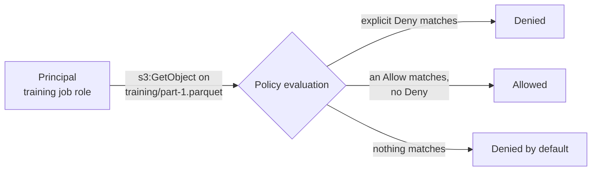
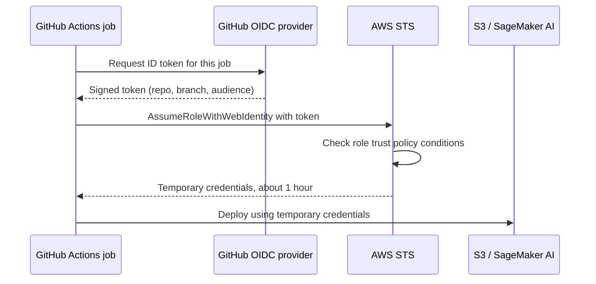

Most cloud security incidents are not clever attacks on the provider. They are a leaked access key in a public repository, a bucket that was made public "temporarily", or a notebook role that could delete everything in the account. AI systems raise the stakes: they handle large amounts of possibly sensitive data, they run on expensive GPUs that attackers love to hijack, and LLM agents may call cloud APIs on your behalf. **Identity and access management** (IAM) is how you decide who can do what to which resource, and getting it right is the single most effective security measure you control. This lesson covers the IAM model shared by all three clouds, a correct minimal policy, keyless authentication for workloads, secrets, network isolation and encryption.

## The model: principals, actions, resources

Every cloud API call is checked the same way: is this **principal** allowed to perform this **action** on this **resource**, in this context?

| Term | Meaning | Examples |
| --- | --- | --- |
| Principal | Who is making the request | A person, a group, a role assumed by a training job, a service account attached to a VM |
| Action | What they want to do | `s3:GetObject`, `storage.objects.get`, `Microsoft.Storage/storageAccounts/read` |
| Resource | What they want to do it to | A bucket, an object, a database, an endpoint |
| Policy or role binding | The rules that connect the three | A JSON policy on AWS, a role granted on a project in Google Cloud, a role assignment at a scope on Azure |



Two rules in that diagram hold on AWS and in spirit everywhere: **everything is denied by default**, and on AWS an **explicit deny always wins** over any allow.

## Users versus roles

There are two kinds of identity, and the distinction matters more than any other in this lesson.

- A **user** has **long-term credentials**: a password, or an access key that never expires on its own.
- A **role** (AWS), **service account** (Google Cloud) or **managed identity** (Azure) is an identity that a person or workload **assumes** to get **short-lived credentials**, typically valid for an hour or less, issued automatically.

| | IAM user with access keys | Role, service account or managed identity |
| --- | --- | --- |
| Credential lifetime | Until someone rotates or deletes it | Minutes to hours, refreshed automatically |
| Where the secret lives | A file, an environment variable, often a laptop or repo | Nowhere you manage; the platform issues it |
| Damage if leaked | Full access until noticed | Expires quickly |
| Use for | Almost nothing, in modern setups | Workloads (VMs, functions, training jobs, CI) and humans via single sign-on |

> [!KEY]
> Prefer roles and short-lived credentials everywhere. Humans sign in through single sign-on (IAM Identity Center, Google accounts, Microsoft Entra ID) and receive temporary credentials. Workloads get an attached role, service account or managed identity. Long-term access keys should be rare exceptions with a written reason.

## Least privilege and a minimal S3 read policy

**Least privilege** means granting only the actions a principal needs, on only the resources it needs. A training job that reads data from one prefix should not be able to write to it, read other prefixes, or touch other buckets.

On AWS, permissions are written as JSON **policy documents**. Here is a correct minimal policy letting a role list and read objects under `training/` in one bucket:

```json
{
  "Version": "2012-10-17",
  "Statement": [
    {
      "Sid": "ListTrainingPrefix",
      "Effect": "Allow",
      "Action": "s3:ListBucket",
      "Resource": "arn:aws:s3:::my-ml-datasets",
      "Condition": {
        "StringLike": { "s3:prefix": ["training/*"] }
      }
    },
    {
      "Sid": "ReadTrainingObjects",
      "Effect": "Allow",
      "Action": "s3:GetObject",
      "Resource": "arn:aws:s3:::my-ml-datasets/training/*"
    }
  ]
}
```

Read it carefully, because it encodes a detail that trips up almost everyone:

- `"Version": "2012-10-17"` is the policy language version, a fixed string, not today's date.
- `s3:ListBucket` is an action **on the bucket**, so its resource is the bucket ARN, `arn:aws:s3:::my-ml-datasets`. The `Condition` restricts listing to keys under `training/`.
- `s3:GetObject` is an action **on objects**, so its resource is an object ARN pattern, `arn:aws:s3:::my-ml-datasets/training/*`.

Swap the two resources and both statements silently grant nothing. The equivalents elsewhere use predefined roles rather than JSON: on Google Cloud you might grant `roles/storage.objectViewer` on the bucket to a service account, and on Azure the **Storage Blob Data Reader** role on a storage account or container to a managed identity.

To see how evaluation works, here is a simplified evaluator in Python. It implements default deny, explicit-deny-wins and wildcard matching, but ignores `Condition` blocks and the many other policy types real AWS combines:

```python
from fnmatch import fnmatchcase

def as_list(x):
    return x if isinstance(x, list) else [x]

def evaluate(policies, action, resource):
    allowed = False
    for policy in policies:
        for stmt in policy["Statement"]:
            if any(fnmatchcase(action, a) for a in as_list(stmt["Action"])) and \
               any(fnmatchcase(resource, r) for r in as_list(stmt["Resource"])):
                if stmt["Effect"] == "Deny":
                    return "DENY (explicit)"
                allowed = True
    return "ALLOW" if allowed else "DENY (implicit)"

read_training = {"Statement": [
    {"Effect": "Allow", "Action": "s3:ListBucket", "Resource": "arn:aws:s3:::my-ml-datasets"},
    {"Effect": "Allow", "Action": "s3:GetObject", "Resource": "arn:aws:s3:::my-ml-datasets/training/*"},
]}
block_restricted = {"Statement": [
    {"Effect": "Deny", "Action": "s3:*", "Resource": "arn:aws:s3:::my-ml-datasets/training/restricted/*"},
]}

policies = [read_training, block_restricted]
tests = [
    ("s3:GetObject", "arn:aws:s3:::my-ml-datasets/training/part-0001.parquet"),
    ("s3:PutObject", "arn:aws:s3:::my-ml-datasets/training/part-0001.parquet"),
    ("s3:GetObject", "arn:aws:s3:::my-ml-datasets/hr/salaries.csv"),
    ("s3:GetObject", "arn:aws:s3:::my-ml-datasets/training/restricted/pii.parquet"),
]
for action, resource in tests:
    print(f"{action:13} {resource.split(':::')[1]:45} {evaluate(policies, action, resource)}")
```

```output
s3:GetObject  my-ml-datasets/training/part-0001.parquet     ALLOW
s3:PutObject  my-ml-datasets/training/part-0001.parquet     DENY (implicit)
s3:GetObject  my-ml-datasets/hr/salaries.csv                DENY (implicit)
s3:GetObject  my-ml-datasets/training/restricted/pii.parquet DENY (explicit)
```

The last line shows why explicit denies are useful as guard rails: even though the allow matches `training/*`, the deny on `training/restricted/*` wins.

## Workload identity and OIDC

How does a workload outside the cloud, such as a GitHub Actions pipeline deploying your model, get credentials without storing an access key? Through **workload identity federation** using **OpenID Connect** (OIDC). The CI platform issues a signed, short-lived token describing the job (which repository, which branch), and the cloud exchanges it for temporary credentials if a trust rule matches.



The role's **trust policy** decides which tokens may assume it. This one allows only workflows on the `main` branch of one repository:

```json
{
  "Version": "2012-10-17",
  "Statement": [
    {
      "Effect": "Allow",
      "Principal": {
        "Federated": "arn:aws:iam::123456789012:oidc-provider/token.actions.githubusercontent.com"
      },
      "Action": "sts:AssumeRoleWithWebIdentity",
      "Condition": {
        "StringEquals": { "token.actions.githubusercontent.com:aud": "sts.amazonaws.com" },
        "StringLike": { "token.actions.githubusercontent.com:sub": "repo:my-org/rag-service:ref:refs/heads/main" }
      }
    }
  ]
}
```

In the workflow, the job requests the token permission and uses the official action:

```yaml
permissions:
  id-token: write
  contents: read

steps:
  - uses: aws-actions/configure-aws-credentials@v4
    with:
      role-to-assume: arn:aws:iam::123456789012:role/rag-service-deploy
      aws-region: eu-west-2
```

Google Cloud calls this **Workload Identity Federation**, and Azure uses **federated credentials** on a managed identity or app registration. Inside the cloud the same idea is automatic: an EC2 instance profile, a service account attached to a Cloud Run service, or a managed identity on an Azure Container App. Pods on Kubernetes get their own identities through EKS Pod Identity or IAM roles for service accounts, GKE Workload Identity Federation, or AKS workload identity.

## Secrets managers

Some secrets cannot be replaced by roles: a third-party LLM API key, a database password, a webhook signing secret. Store them in a **secrets manager**: AWS Secrets Manager, Google Secret Manager or Azure Key Vault. Your code fetches them at runtime using its role, access to each secret is controlled and logged, and you can rotate them without redeploying.

```python
import boto3

secrets = boto3.client("secretsmanager")
api_key = secrets.get_secret_value(SecretId="prod/rag-service/llm-api-key")["SecretString"]
```

Never put secrets in container images, Git, notebook cells or plain environment variables in deployment manifests that are themselves committed. The [AI security module](/learn/ai-security-and-responsible-ai/secure-api-design) returns to secure API design.

## Network isolation and encryption

Identity is the main control, but network design limits the damage when something goes wrong.

- **Private subnets**: databases, vector stores and model servers live in subnets with no route from the internet. Only a load balancer or API gateway is public.
- **Firewall rules**: security groups, VPC firewall rules and network security groups allow only the ports and sources needed.
- **Private endpoints**: reach managed services such as object storage or a model API over the provider's private network rather than the internet (AWS PrivateLink and VPC endpoints, Google Private Service Connect, Azure Private Link).
- **Encryption at rest**: on by default for object storage, disks and managed databases on all three clouds. A key management service (AWS KMS, Cloud KMS, Azure Key Vault) holds the keys; **customer-managed keys** add control and an audit trail when compliance requires it.
- **Encryption in transit**: use TLS (HTTPS) for every connection, including internal ones to databases.

> [!WARNING]
> Never give an LLM agent your own administrator credentials to "let it manage the cloud". Give it a dedicated role with the narrowest permissions its tools need, and require human approval for destructive actions.

## Exercises

**1.** Using `evaluate`, check what happens for `s3:DeleteObject` on `arn:aws:s3:::my-ml-datasets/training/part-0001.parquet`, then add a policy that allows the role to write (but not delete) objects under `outputs/`.

<details>
<summary>Show solution</summary>

```python
print(evaluate(policies, "s3:DeleteObject", "arn:aws:s3:::my-ml-datasets/training/part-0001.parquet"))

write_outputs = {"Statement": [
    {"Effect": "Allow", "Action": "s3:PutObject", "Resource": "arn:aws:s3:::my-ml-datasets/outputs/*"},
]}
policies2 = policies + [write_outputs]
print(evaluate(policies2, "s3:PutObject", "arn:aws:s3:::my-ml-datasets/outputs/run-7/metrics.json"))
print(evaluate(policies2, "s3:DeleteObject", "arn:aws:s3:::my-ml-datasets/outputs/run-7/metrics.json"))
```

```output
DENY (implicit)
ALLOW
DENY (implicit)
```

Delete was never granted, so it is implicitly denied; adding only `s3:PutObject` on `outputs/*` allows writes without deletes.

</details>

**2.** A colleague's policy has `"Action": "s3:ListBucket"` with `"Resource": "arn:aws:s3:::my-ml-datasets/*"`, and listing fails. Why?

<details>
<summary>Show solution</summary>

`s3:ListBucket` is a bucket-level action, so its resource must be the bucket ARN `arn:aws:s3:::my-ml-datasets` (without `/*`). The object-pattern ARN never matches a bucket, so the statement grants nothing. Use a `Condition` on `s3:prefix` to limit which keys can be listed.

</details>

**3.** Your GitHub Actions workflow currently deploys with an access key stored as a repository secret. Describe the replacement and two benefits.

<details>
<summary>Show solution</summary>

Configure OIDC federation: register GitHub's OIDC provider in the cloud account, create a deployment role whose trust policy accepts only tokens for your repository and branch, grant `id-token: write` in the workflow, and use the official credentials action with `role-to-assume`. Benefits: no long-lived key exists to leak or rotate, and the credentials expire after about an hour and can only be obtained by the specified repository and branch.

</details>

```quiz
[
  {
    "q": "On AWS, an identity-based policy allows `s3:*` on a bucket, and another policy explicitly denies `s3:DeleteObject` on it. Can the principal delete objects?",
    "options": [
      "Yes, because the allow is broader",
      "No, because an explicit deny always overrides an allow",
      "Yes, if the allow policy was attached first",
      "Only from the console"
    ],
    "answer": 1,
    "why": "In AWS policy evaluation an explicit deny wins over any allow."
  },
  {
    "q": "Why are roles preferred over IAM users with access keys for workloads?",
    "options": [
      "Roles can use more services",
      "Roles are cheaper",
      "Roles provide short-lived credentials issued automatically, so there is no long-term secret to leak",
      "Users cannot call S3"
    ],
    "answer": 2,
    "why": "Temporary credentials expire quickly and are never stored in code or files you manage."
  },
  {
    "q": "In a minimal S3 read policy, which resource should `s3:GetObject` use?",
    "options": [
      "An object ARN pattern such as `arn:aws:s3:::my-ml-datasets/training/*`",
      "The bucket ARN `arn:aws:s3:::my-ml-datasets`",
      "`*`",
      "The account ID"
    ],
    "answer": 0,
    "why": "`GetObject` acts on objects, so it needs object ARNs; `ListBucket` is the action that uses the bucket ARN."
  },
  {
    "q": "What does OIDC workload identity federation let a CI pipeline do?",
    "options": [
      "Skip all permission checks",
      "Store access keys more securely",
      "Create IAM users automatically",
      "Exchange a short-lived signed token from the CI platform for temporary cloud credentials"
    ],
    "answer": 3,
    "why": "The cloud trusts the CI platform's identity tokens under conditions you set, so no stored keys are needed."
  }
]
```
