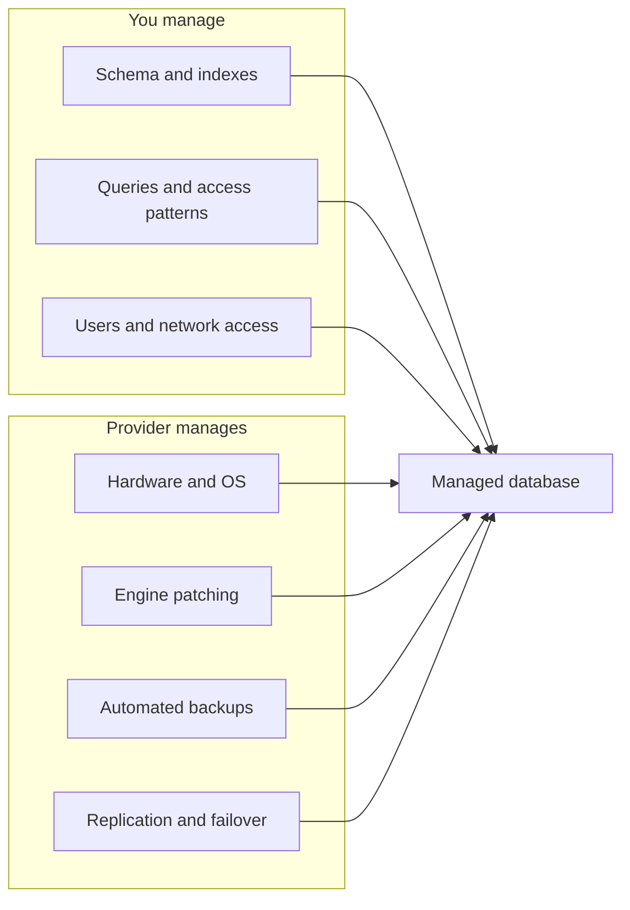
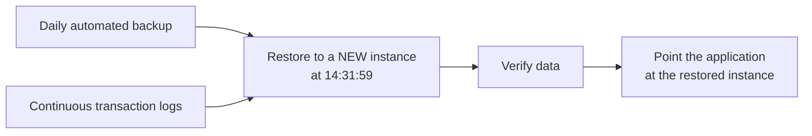
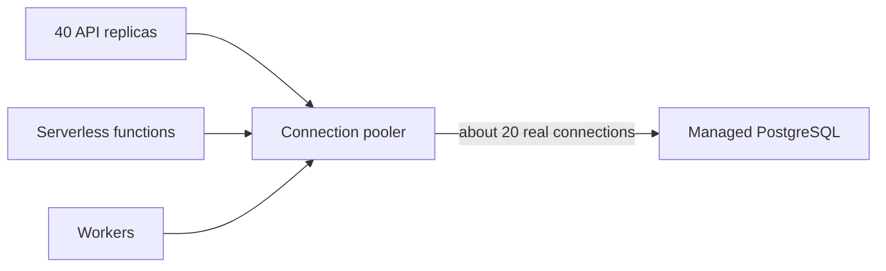

An AI application is rarely just a model. It has users, conversations, feedback ratings, document metadata, job status and, for retrieval systems, millions of embeddings. All of that lives in databases. You could install PostgreSQL on a virtual machine yourself, but then you own the patching, backups, failover, disk growth and 3 a.m. pages. A **managed database** service runs the database engine for you and handles that operational work, leaving you the schema, the queries and the bill. This lesson covers the three families of managed database an AI engineer uses (relational, NoSQL and vector), and the two operational topics that bite most often: backups and connection limits.

The [SQL and Databases](/learn/sql-and-databases/database-fundamentals) and [Vector Databases](/learn/vector-databases/vector-embeddings) modules taught you the engines. Here the question is how to run them in the cloud.

## What "managed" means



You still choose an instance size (or a serverless capacity range), storage, the region, whether to run a standby replica in another availability zone, and the maintenance window. You do not get operating-system access to the host.

## Relational databases

Relational databases are the default home for application data: users, sessions, conversations, documents and their metadata, evaluation results. PostgreSQL is the most common choice in AI work, partly because of the `pgvector` extension.

| Provider | Managed PostgreSQL / MySQL | Cloud-native high-performance option |
| --- | --- | --- |
| AWS | Amazon RDS (PostgreSQL, MySQL, others) | Amazon Aurora (PostgreSQL- and MySQL-compatible) |
| Google Cloud | Cloud SQL (PostgreSQL, MySQL, SQL Server) | AlloyDB for PostgreSQL |
| Azure | Azure Database for PostgreSQL flexible server, Azure Database for MySQL | Azure SQL Database (SQL Server engine) |

Features you configure on all of them:

- **High availability**: a synchronous standby in another zone, promoted automatically if the primary fails. Use it in production; skip it for development to save money.
- **Read replicas**: asynchronous copies that serve read-only queries, useful for analytics or dashboards that should not slow the main database.
- **Private networking**: the database gets an address inside your virtual network and is not reachable from the internet. This should be the default.
- **IAM authentication**: all three providers can let applications sign in with their cloud identity instead of a stored password, as covered in [IAM and security](/learn/cloud-computing/iam-and-security).

## NoSQL databases

Some data fits a key-value or document model better: chat history keyed by session ID, feature lookups keyed by user ID, agent state that changes shape over time. NoSQL services scale horizontally and charge by capacity or by request.

| Provider | Key-value / document | Wide-column, very large scale |
| --- | --- | --- |
| AWS | Amazon DynamoDB | Amazon Keyspaces |
| Google Cloud | Firestore | Bigtable |
| Azure | Azure Cosmos DB | Cosmos DB (Cassandra API) |

The design rule for these services is the opposite of relational design: **start from your access patterns**. In DynamoDB, for example, you choose a partition key (such as `session_id`) and a sort key (such as `timestamp`), and queries are efficient only when they use those keys. "Find all messages in session X in time order" is fast; "find all messages that mention refunds" is a full scan. If you need flexible queries, a relational database is usually the better fit.

## Vector search options

For retrieval-augmented generation you need to store embeddings and find nearest neighbours. In the cloud you have three broad options.

| Option | Examples | Strengths | Watch out for |
| --- | --- | --- | --- |
| Vector extension in your relational DB | `pgvector` on RDS, Aurora, Cloud SQL, AlloyDB, Azure Database for PostgreSQL | One database for metadata and vectors; SQL filters and joins; transactions | Index tuning and memory at very large scale |
| Search engine with vector support | Amazon OpenSearch Service, Azure AI Search, Elasticsearch | Hybrid keyword plus vector search in one query | Another system to run and keep in sync |
| Dedicated managed vector service | Vertex AI Vector Search, Cosmos DB vector search, and third-party services such as [Pinecone](/learn/vector-databases/pinecone) | Built for large-scale approximate nearest neighbour search | Separate data store; metadata filtering varies |

> [!KEY]
> For most projects, start with `pgvector` on the managed PostgreSQL you already need. Document metadata, permissions and vectors stay in one place, and a `WHERE` clause handles filtering. Move to a dedicated vector service when measurements show you need it.

The SQL is the same on every cloud's managed PostgreSQL:

```sql
CREATE EXTENSION IF NOT EXISTS vector;

CREATE TABLE chunks (
    id          bigserial PRIMARY KEY,
    document_id bigint NOT NULL,
    tenant_id   text   NOT NULL,
    content     text   NOT NULL,
    embedding   vector(768)
);

CREATE INDEX ON chunks USING hnsw (embedding vector_cosine_ops);

-- five nearest chunks for one tenant; <=> is cosine distance
SELECT id, content
FROM chunks
WHERE tenant_id = 'acme'
ORDER BY embedding <=> $1
LIMIT 5;
```

Check which `pgvector` version your provider offers, because index types and features have been added over time.

## Backups and recovery

Managed databases take **automated backups** and keep transaction logs, which allows **point-in-time recovery** (PITR): restoring the database to its state at any second within the retention window, for example just before someone ran a bad `DELETE`. You can also take **manual snapshots** before risky changes such as a schema migration; these are kept until you delete them.



Two facts surprise people. First, a restore usually creates a **new** database instance; it does not rewind the existing one, so the application must be repointed (or data copied back). Second, deleting a database may delete its automated backups with it, depending on settings, so take a final snapshot before deleting anything important.

> [!WARNING]
> A backup you have never restored is a hope, not a backup. Practise a point-in-time restore into a test instance once, time it, and write down the steps. That number is your real recovery time.

## Connection limits and pooling

Each database connection consumes memory on the server, so every PostgreSQL instance has a `max_connections` limit that grows with instance size. Cloud applications open connections from many places at once: several API replicas, background workers, and serverless functions that can scale to hundreds of copies, each with its own connection pool. The arithmetic gets out of hand quickly:

```python
def connections_needed(replicas, pool_size, max_overflow, workers=0, worker_pool=0):
    return replicas * (pool_size + max_overflow) + workers * worker_pool

steady = connections_needed(replicas=4, pool_size=5, max_overflow=5, workers=2, worker_pool=5)
spike = connections_needed(replicas=40, pool_size=5, max_overflow=5, workers=2, worker_pool=5)
print(f"steady state: {steady} connections")
print(f"autoscaled to 40 replicas: {spike} connections")
```

```output
steady state: 50 connections
autoscaled to 40 replicas: 410 connections
```

A small instance that handled 50 connections happily will start refusing them when traffic spikes and autoscaling adds replicas, which makes the outage worse exactly when load is highest. Two fixes:

- **Keep each process's pool small** and set a timeout. In SQLAlchemy that is `create_engine(url, pool_size=5, max_overflow=5, pool_pre_ping=True)`; `pool_pre_ping` checks a connection is alive before use, which matters because cloud networks and failovers drop idle connections.
- **Put a connection pooler in front of the database**. A pooler holds a small number of real database connections and multiplexes many client connections over them. Options include **Amazon RDS Proxy**, the built-in **PgBouncer** on Azure Database for PostgreSQL flexible server, and running PgBouncer yourself alongside Cloud SQL or any PostgreSQL.



## Exercises

**1.** Your RAG app needs to store documents, their access permissions, chunk text and 1 million embeddings. You already run Cloud SQL for PostgreSQL. Which vector option do you start with, and why?

<details>
<summary>Show solution</summary>

`pgvector` in the existing Cloud SQL for PostgreSQL instance. Permissions, metadata and vectors live in one database, so a permission filter is a `WHERE` clause in the same query, there is no second system to keep in sync, and a million vectors is well within what `pgvector` with an HNSW index handles. Re-evaluate if latency or scale measurements later demand a dedicated service.

</details>

**2.** Using `connections_needed`, how many replicas (with `pool_size=5, max_overflow=5`, plus the 2 workers with pools of 5) can run before exceeding a `max_connections` of 200, leaving 10 connections for administration?

<details>
<summary>Show solution</summary>

```python
limit = 200 - 10
replicas = 0
while connections_needed(replicas + 1, 5, 5, 2, 5) <= limit:
    replicas += 1
print(replicas, connections_needed(replicas, 5, 5, 2, 5))
```

```output
18 190
```

Eighteen replicas use 190 connections. If autoscaling can go higher than that, add a connection pooler or reduce the per-replica pool.

</details>

**3.** At 14:32 a migration script deletes most rows from the `conversations` table. Describe the recovery.

<details>
<summary>Show solution</summary>

Use point-in-time recovery to restore to a new instance at a time just before 14:32 (for example 14:31). Verify the restored data, then either point the application at the restored instance or copy the lost rows back into the original. In future, take a manual snapshot before running migrations.

</details>

```quiz
[
  {
    "q": "What does point-in-time recovery on a managed database usually create?",
    "options": [
      "A rewind of the existing instance in place",
      "A new database instance restored to the chosen time",
      "A CSV export of every table",
      "A read replica in another region"
    ],
    "answer": 1,
    "why": "Restores create a new instance; you then repoint the application or copy data back."
  },
  {
    "q": "An API autoscales from 4 to 40 replicas during a spike and the database starts refusing connections. What is the best fix?",
    "options": [
      "Increase each replica's connection pool",
      "Turn off automated backups",
      "Put a connection pooler such as RDS Proxy or PgBouncer in front of the database and keep per-process pools small",
      "Move the database to another region"
    ],
    "answer": 2,
    "why": "A pooler multiplexes many client connections over a few real ones, so replica count no longer drives database connections."
  },
  {
    "q": "When designing a DynamoDB or Firestore data model, what should you start from?",
    "options": [
      "The access patterns your application needs",
      "Third normal form",
      "The number of columns",
      "The vector dimension"
    ],
    "answer": 0,
    "why": "NoSQL services are efficient only for queries that use their keys, so design keys around the queries."
  },
  {
    "q": "What is the main advantage of `pgvector` in your existing managed PostgreSQL for a RAG system?",
    "options": [
      "It is always faster than any dedicated vector database",
      "It requires no indexes",
      "It works only on AWS",
      "Metadata, permissions and vectors live in one database, so filters and joins are plain SQL"
    ],
    "answer": 3,
    "why": "Keeping vectors next to relational data avoids a second system and makes filtering simple."
  }
]
```
