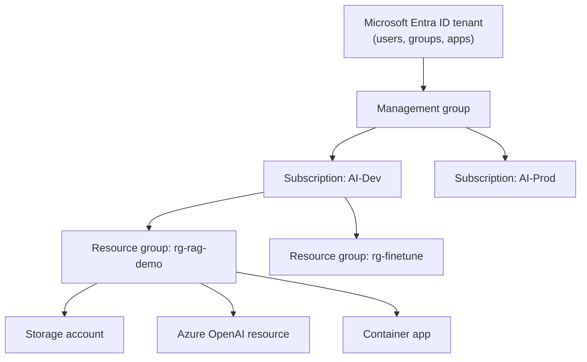
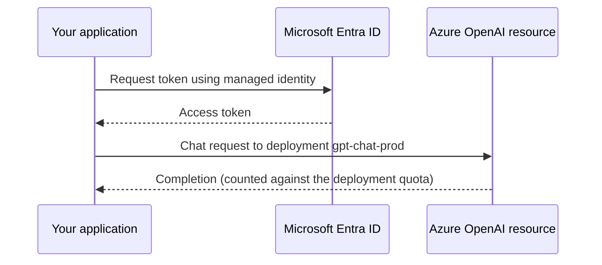

Microsoft Azure is the cloud of choice for many large organisations that already run on Microsoft software, and through Microsoft's partnership with OpenAI it is the place where enterprises most often consume OpenAI models under their own security and compliance controls. If you join a company that uses Microsoft 365 and Active Directory, there is a good chance its AI workloads run on Azure. This lesson gives you the same orientation as the [AWS](/learn/cloud-computing/aws) and [Google Cloud](/learn/cloud-computing/google-cloud-platform) lessons: structure, regions, core services, the CLI and cost safety.

## Tenants, subscriptions and resource groups

Azure has more layers than the other two clouds, and confusing them is the most common beginner problem.



| Layer | What it is | Rough AWS / Google Cloud equivalent |
| --- | --- | --- |
| **Microsoft Entra ID tenant** | The directory of identities (formerly Azure Active Directory) | IAM Identity Center directory / Cloud Identity |
| **Management group** | A folder of subscriptions for applying policy | Organisational unit / folder |
| **Subscription** | The billing and quota boundary; resources are charged to it | Account / project |
| **Resource group** | A logical container for resources that share a lifecycle | No direct equivalent (tags come closest) |
| **Resource** | A VM, storage account, database, endpoint | Resource |

The **resource group** is the Azure idea worth adopting. Every resource must live in exactly one resource group, and deleting the group deletes everything in it. Put each application or experiment in its own group, and cleanup becomes a single command.

Access is controlled with **Azure role-based access control** (Azure RBAC): you assign a role, such as Reader, Contributor or a narrower built-in role, to a user, group or identity at a **scope**, which can be a management group, subscription, resource group or single resource. Assignments are inherited downwards, just as in Google Cloud.

## Regions and availability zones

Azure regions have names such as `westeurope`, `uksouth` or `eastus`. Many regions offer **availability zones**, physically separate data centres within the region. Azure also pairs most regions with another region in the same geography for disaster recovery.

As with the other providers, availability is uneven. Specific GPU VM sizes, and specific Azure OpenAI models and deployment types, are offered only in certain regions, and new models often appear in a few regions first. Check the model and VM availability documentation before committing to a region.

## The core services

| Need | Azure service | Notes for AI work |
| --- | --- | --- |
| Object storage | Azure Blob Storage | Inside a **storage account**; containers hold blobs; access tiers Hot, Cool, Cold, Archive |
| Virtual machines | Azure Virtual Machines | GPU sizes in the N-series families |
| Relational databases | Azure Database for PostgreSQL (flexible server), Azure SQL Database | PostgreSQL supports `pgvector` |
| NoSQL | Azure Cosmos DB | Several APIs; supports vector search |
| Search and vectors | Azure AI Search | Keyword, vector and hybrid search over your documents |
| Container images | Azure Container Registry | |
| Containers | Azure Kubernetes Service (AKS), Azure Container Apps | Container Apps scales to zero and offers serverless GPUs in some regions |
| Functions | Azure Functions | |
| ML platform | Azure Machine Learning | Workspaces, compute clusters, jobs, managed online endpoints |
| Foundation models | Azure OpenAI and other models in Azure AI Foundry | Deploy a model, then call your deployment |
| Secrets and keys | Azure Key Vault | |
| Monitoring | Azure Monitor, Log Analytics, Application Insights | |

### Azure Machine Learning and Azure AI Foundry

Azure splits ML work much like AWS does.

- **Azure Machine Learning** is for your own models. You create a **workspace**, which ties together a storage account, a container registry, a key vault and Application Insights. Inside it you run training **jobs** on **compute clusters** that scale down to zero nodes when idle, register models, and deploy them to **managed online endpoints**.
- **Azure AI Foundry** is Microsoft's platform for building generative AI applications, and it is where you use **Azure OpenAI** models and models from other providers. Microsoft has renamed this area several times (Azure OpenAI Studio, Azure AI Studio, Azure AI Foundry, and more recently Microsoft Foundry), so expect tutorials to use older names for the same ideas.

One concept specific to Azure OpenAI catches newcomers: you do not call a model by its public name alone. You first create a **deployment** of a chosen model in your resource, give the deployment a name, and then send requests to that deployment. Quotas and throughput limits are attached to deployments, per region and subscription.



The diagram shows the recommended way to authenticate: the application uses a **managed identity** to get a token from Entra ID, instead of storing an API key. API keys also work and are common in tutorials, but a key in a configuration file is a secret that can leak.

## The Azure CLI

The Azure CLI installs the `az` command. After installing it from the official documentation:

```bash
az login                                       # sign in through the browser
az account list --output table                 # subscriptions you can use
az account set --subscription "AI-Dev"         # choose the default subscription
az group create --name rg-rag-demo --location westeurope
```

Commands follow the pattern `az <group> <command>`, and `--output table` makes results readable. Two more you will use constantly:

```bash
az group list --output table                   # what resource groups exist?
az group delete --name rg-rag-demo --yes       # delete the group and everything in it
```

In Python, the `azure-identity` package provides `DefaultAzureCredential`, which tries several credential sources in order: environment variables, a managed identity when running in Azure, then your `az login` session on a laptop. The same code works in both places:

```python
from azure.identity import DefaultAzureCredential
from azure.storage.blob import BlobServiceClient

credential = DefaultAzureCredential()
service = BlobServiceClient(
    account_url="https://ragdemostore.blob.core.windows.net",
    credential=credential,
)
container = service.get_container_client("documents")
with open("handbook.pdf", "rb") as f:
    container.upload_blob(name="raw/handbook.pdf", data=f, overwrite=True)
```

> [!KEY]
> All three clouds now share the same credential philosophy: one call (`boto3.Session`, `storage.Client`, `DefaultAzureCredential`) that finds your personal login on a laptop and the attached workload identity in the cloud. Write code that relies on it, and you never need keys in code.

## Free credits and cost safety

Azure has offered new accounts a time-limited credit and some services free for a period, plus a set of always-free services; check the current offer. Students may have access to a separate student offer. GPU VM sizes usually start with a **quota of zero vCPUs** per family and region, so you must request quota before you can create one.

| Safeguard | What it does |
| --- | --- |
| Cost Management budgets | Alerts at thresholds of actual or forecast spend, scoped to a subscription or resource group |
| Cost analysis | Spend by resource group, service and tag |
| Tags | Key-value labels for grouping cost |
| Auto-shutdown on VMs | A scheduled daily shutdown for development VMs |
| One resource group per experiment | `az group delete` cleans up everything |

As on the other clouds, a budget alert does not stop resources on its own. Budgets can trigger action groups that run automation, but the simplest protection is deleting resource groups you no longer need.

> [!WARNING]
> Some resources keep charging while "stopped". A VM that is shut down from inside the operating system is still allocated and billed for compute; stop it from the portal or with `az vm deallocate` so it shows as "Stopped (deallocated)". Its disks are billed either way.

## Exercises

**1.** You finished a workshop that created a storage account, an Azure OpenAI resource and a container app. How would you make sure nothing keeps costing money, and what setup decision makes this easy?

<details>
<summary>Show solution</summary>

If everything was created in one resource group, run `az group delete --name <group> --yes` (with your group name), which deletes all resources in it. The decision that makes this easy is creating one resource group per workshop or experiment at the start. Afterwards, check cost analysis for the subscription to confirm spend has stopped.

</details>

**2.** A tutorial calls an Azure OpenAI model using the model's public name and gets a "deployment not found" error. What is missing?

<details>
<summary>Show solution</summary>

Azure OpenAI requests go to a **deployment** that you create in your resource, under a name you choose. Create a deployment of the model in a region where it is available (with quota), then use the deployment name in the request.

</details>

**3.** Put these in order from largest scope to smallest: resource group, Entra ID tenant, resource, subscription, management group.

<details>
<summary>Show solution</summary>

Entra ID tenant, management group, subscription, resource group, resource.

</details>

```quiz
[
  {
    "q": "What happens when you delete an Azure resource group?",
    "options": [
      "Only the group's tags are removed",
      "All resources in the group are deleted",
      "The subscription is cancelled",
      "Resources move to the default group"
    ],
    "answer": 1,
    "why": "A resource group is a lifecycle container; deleting it deletes its contents, which makes cleanup simple."
  },
  {
    "q": "Which Azure layer is the main billing and quota boundary?",
    "options": [
      "Resource group",
      "Entra ID tenant",
      "Subscription",
      "Availability zone"
    ],
    "answer": 2,
    "why": "Resources are billed to a subscription, and quotas such as GPU vCPUs are set per subscription and region."
  },
  {
    "q": "What does `DefaultAzureCredential` do?",
    "options": [
      "Tries several credential sources in order, such as environment variables, a managed identity and your `az login` session",
      "Creates a new API key and stores it in the code",
      "Always prompts for a password",
      "Only works inside Azure Machine Learning notebooks"
    ],
    "answer": 0,
    "why": "It lets the same code use your login locally and a managed identity in Azure."
  },
  {
    "q": "You want to train your own PyTorch model on a GPU cluster that scales to zero when idle and then deploy it behind an endpoint. Which service fits?",
    "options": [
      "Azure Blob Storage",
      "Azure Key Vault",
      "Azure AI Search",
      "Azure Machine Learning"
    ],
    "answer": 3,
    "why": "Azure Machine Learning provides compute clusters, training jobs, a model registry and managed online endpoints."
  }
]
```
