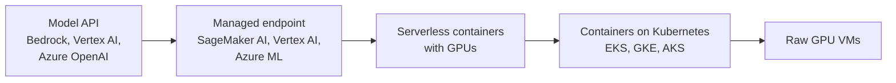
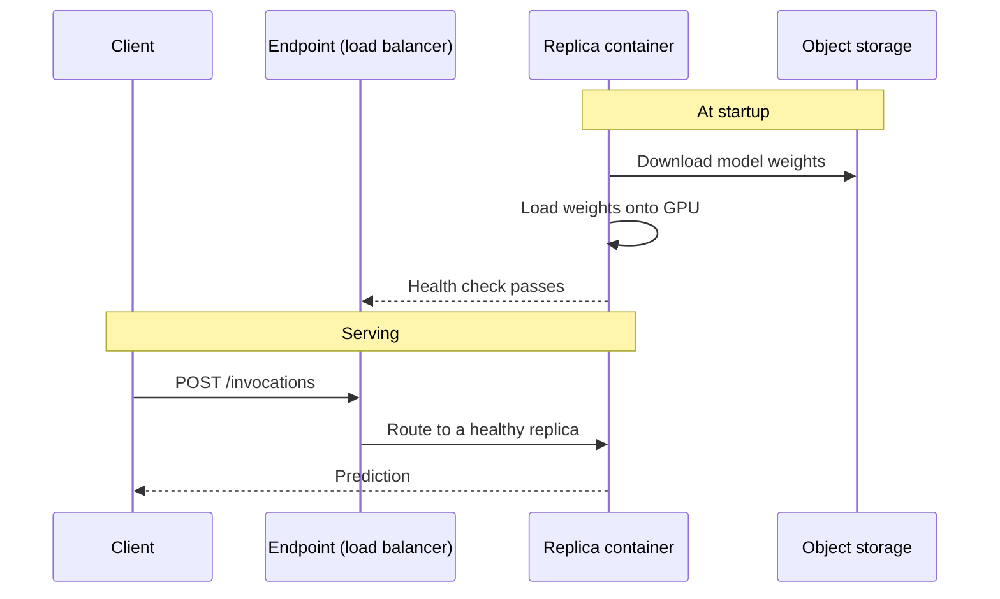

A trained model is only useful once something can call it. **Model hosting** is the job of turning weights on disk into a reliable HTTPS endpoint that answers requests at the latency and cost you need, and keeps answering when traffic doubles at 9 a.m. In the cloud you have a spectrum of choices, from calling a model someone else hosts to running your own Kubernetes cluster of GPU servers. This lesson maps that spectrum, then covers the two mechanisms that decide whether a hosted model is fast and affordable: **autoscaling** and **cold starts**.

How a model server works inside (batching, quantisation, KV caches) is the subject of [Production AI Systems](/learn/production-ai-systems/model-serving). Here the focus is where it runs and how the cloud scales it.

## The hosting spectrum



Moving right gives you more control and usually a lower cost per request at high, steady volume. Moving left gives you less to operate and lower cost when traffic is low or spiky.

| Option | You provide | Provider handles | Scales to zero? | Best when |
| --- | --- | --- | --- | --- |
| Model API (pay per token) | Prompts | Everything | Not applicable, pay per use | A hosted foundation model is good enough |
| Managed endpoint | Model artefacts or a serving container | Machines, health checks, autoscaling, rolling updates | Usually not for real-time; some serverless and async modes can | Your own model, small team, steady traffic |
| Serverless GPU containers (for example Cloud Run with GPUs, Azure Container Apps serverless GPUs, specialist GPU platforms) | A container image | Machines, scaling per request | Yes | Spiky or low traffic for your own model |
| Kubernetes (EKS, GKE, AKS) | Container, manifests, autoscaling rules, often a serving framework such as vLLM or KServe | The control plane | With extra tooling | Many models, high volume, a platform team |
| Raw VMs | Everything | Hardware | No | Experiments, unusual requirements |

## Managed endpoints

Each provider has a managed way to deploy your own model:

- **Amazon SageMaker AI** real-time endpoints, plus **serverless inference** (CPU, scales to zero) and **asynchronous inference** (queued requests, large payloads, can scale to zero).
- **Vertex AI** endpoints, where you deploy a model from the Model Registry with prebuilt or custom serving containers.
- **Azure Machine Learning** managed online endpoints, which split traffic between named **deployments** (for example `blue` and `green`).

The shape is the same on all three: a container image that knows how to load the model and answer HTTP requests, model artefacts in object storage, an instance type, and minimum and maximum instance counts.



Managed endpoints also handle **safe rollouts**: deploy a new model version beside the old one, send it 10 percent of traffic, watch the metrics, then shift the rest. This is the deployment side of the [MLOps](/learn/mlops/model-lifecycle-management) lifecycle and the [continuous delivery](/learn/ci-cd/continuous-delivery) practices you have already met.

## Containers on Kubernetes

Large teams often run inference on managed Kubernetes: **EKS**, **GKE** or **AKS**. You build a container with a serving engine such as vLLM or Text Generation Inference, push it to a registry (ECR, Artifact Registry, Azure Container Registry), and describe a Deployment that requests GPUs. Kubernetes schedules the pods onto GPU nodes, and a node autoscaler adds GPU machines when pods are waiting.

Kubernetes earns its complexity when you host many models, need fine control over GPU sharing and scheduling, or run at a scale where per-request managed pricing becomes expensive. For one model and a small team, a managed endpoint or serverless container is usually the better trade.

## Sizing: how many replicas?

Before autoscaling, estimate the steady-state replica count. **Little's law** says that the average number of requests in flight equals the arrival rate times the average time each request takes:

$$
N_{\text{in flight}} = \lambda \times W
$$

where $\lambda$ is requests per second and $W$ is the average latency in seconds. Divide by how many concurrent requests one replica can serve at acceptable latency (which you measure with a load test) to get the replicas needed:

```python
import math

def replicas_needed(requests_per_second, avg_latency_s, concurrency_per_replica, headroom=0.3):
    in_flight = requests_per_second * avg_latency_s
    return in_flight, math.ceil(in_flight * (1 + headroom) / concurrency_per_replica)

for rps in [2, 20, 60]:
    in_flight, n = replicas_needed(rps, avg_latency_s=2.5, concurrency_per_replica=8)
    print(f"{rps:>3} req/s -> {in_flight:6.1f} in flight -> {n} replicas")
```

```output
  2 req/s ->    5.0 in flight -> 1 replicas
 20 req/s ->   50.0 in flight -> 9 replicas
 60 req/s ->  150.0 in flight -> 25 replicas
```

The 30 percent headroom absorbs bursts while new replicas start. For LLMs, `avg_latency_s` depends heavily on output length, so measure it with realistic prompts.

## Autoscaling

An **autoscaler** watches a metric and adjusts the replica count to keep it near a target. The metric matters more than the algorithm.

| Metric | Good for | Problem |
| --- | --- | --- |
| CPU utilisation | CPU models | Useless for GPU-bound work; CPU may be idle while the GPU is saturated |
| GPU utilisation | Batch inference | Can read 100 percent while latency is still fine, or low while the KV cache is full |
| Concurrent requests per replica | Most online inference | Needs a measured target |
| Queue depth or backlog | Asynchronous and batch jobs | Not suitable for interactive latency |

Step through a target-tracking autoscaler that aims for 4 in-flight requests per replica:

```trace
{
  "title": "target-tracking autoscaler",
  "code": [
    "import math",
    "target = 4  # in-flight requests per replica",
    "replicas = 1",
    "for load in [3, 10, 22, 6]:",
    "    desired = max(1, math.ceil(load / target))",
    "    replicas = desired",
    "    print(load, replicas)"
  ],
  "steps": [
    { "line": 3, "vars": { "target": "4", "replicas": "1" }, "note": "Start with one replica and a target of 4 concurrent requests each." },
    { "line": 5, "vars": { "target": "4", "replicas": "1", "load": "3", "desired": "1" }, "note": "3 / 4 rounds up to 1. One replica is enough." },
    { "line": 7, "vars": { "target": "4", "replicas": "1", "load": "3", "desired": "1" }, "out": ["3 1"], "note": "No change." },
    { "line": 5, "vars": { "target": "4", "replicas": "1", "load": "10", "desired": "3" }, "note": "Load rises to 10: ceil(10 / 4) = 3." },
    { "line": 7, "vars": { "target": "4", "replicas": "3", "load": "10", "desired": "3" }, "out": ["3 1", "10 3"], "note": "Scale out to 3. In reality the new replicas need time to start and load the model." },
    { "line": 7, "vars": { "target": "4", "replicas": "6", "load": "22", "desired": "6" }, "out": ["3 1", "10 3", "22 6"], "note": "ceil(22 / 4) = 6 replicas." },
    { "line": 7, "vars": { "target": "4", "replicas": "2", "load": "6", "desired": "2" }, "out": ["3 1", "10 3", "22 6", "6 2"], "note": "Load drops, so scale in to 2. Real autoscalers wait through a cooldown before scaling in, to avoid flapping." }
  ]
}
```

Real autoscalers add a **minimum and maximum** (the maximum is a cost guard), a **cooldown** before scaling in, and often a slower scale-in than scale-out.

## Cold starts

A **cold start** is the delay between "a new replica is needed" and "it answers its first request". For a web API it is a second or two. For a GPU model it can be minutes:

1. Acquire a GPU machine (if no node is free).
2. Pull the container image, which for CUDA-based images can be several gigabytes.
3. Download the weights from object storage or a model hub.
4. Load the weights onto the GPU and warm up.

Every step is proportional to size, so a large model has long cold starts. This is the central trade-off of scale-to-zero hosting: you save money while idle, and the first user after a quiet period waits.

> [!KEY]
> Reduce cold starts by attacking each step: keep a minimum of one warm replica for latency-sensitive services, keep images small, store weights in the same region (or bake them into the image or a cache volume), use formats that load fast such as safetensors, and scale out on a leading signal before replicas are saturated.

> [!WARNING]
> Set a **maximum** replica count on every autoscaled GPU deployment. A traffic spike, a retry storm or a bot can otherwise scale you to dozens of GPUs, and the cloud will happily bill for all of them.

## Exercises

**1.** A model serves 30 requests per second with an average latency of 1.2 seconds, and a load test shows one replica handles 6 concurrent requests at acceptable latency. Using `replicas_needed` with 30 percent headroom, how many replicas do you need?

<details>
<summary>Show solution</summary>

```python
print(replicas_needed(30, 1.2, 6))
```

```output
(36.0, 8)
```

36 requests in flight on average; with headroom, 8 replicas.

</details>

**2.** An internal document classifier gets about 200 requests a day in bursts, and a 30-second delay on the first request after a quiet hour is acceptable. Which hosting option fits, and why?

<details>
<summary>Show solution</summary>

A scale-to-zero option: a serverless container (with a GPU only if the model needs one; a classifier may run fine on CPU) or a managed serverless or asynchronous endpoint. Traffic is tiny and bursty, so paying for an always-on replica would waste most of its hours, and the cold start is acceptable.

</details>

**3.** Your autoscaler uses CPU utilisation, but during peaks users see slow responses while CPU stays at 15 percent. What is wrong, and what metric would you use instead?

<details>
<summary>Show solution</summary>

The model is GPU-bound, so CPU does not reflect load and the autoscaler never scales out. Scale on concurrent requests per replica (or queue length or a latency-related metric) with a target taken from a load test.

</details>

```quiz
[
  {
    "q": "What is the main cost of scale-to-zero hosting for a large model?",
    "options": [
      "Higher price per request at all times",
      "It cannot use GPUs",
      "Cold starts: the first request after idle waits while a replica starts and loads the weights",
      "It requires Kubernetes"
    ],
    "answer": 2,
    "why": "Scaling to zero saves money while idle but pays a startup delay that grows with model and image size."
  },
  {
    "q": "By Little's law, how many requests are in flight on average at 10 requests per second with 3 seconds average latency?",
    "options": [
      "30",
      "3.3",
      "13",
      "0.3"
    ],
    "answer": 0,
    "why": "In flight = arrival rate × latency = 10 × 3 = 30."
  },
  {
    "q": "Why is CPU utilisation a poor autoscaling metric for GPU inference?",
    "options": [
      "CPU metrics are not available in the cloud",
      "It changes too slowly",
      "Autoscalers cannot read CPU metrics from containers",
      "The work happens on the GPU, so CPU can stay low while the service is overloaded"
    ],
    "answer": 3,
    "why": "Scale on a metric that reflects the bottleneck, such as concurrent requests per replica."
  },
  {
    "q": "When does running inference on managed Kubernetes (EKS, GKE, AKS) usually make most sense?",
    "options": [
      "For a single small model with occasional traffic",
      "For many models at high volume, with a team able to operate the platform",
      "When you want to avoid containers",
      "When you only call a hosted foundation model API"
    ],
    "answer": 1,
    "why": "Kubernetes gives control and efficiency at scale but needs operational effort."
  }
]
```
