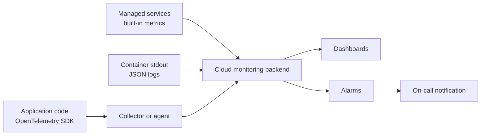
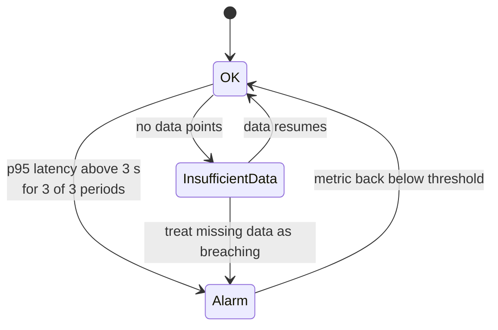

Once your model is deployed, the questions change from "does it work?" to "is it still working, for everyone, right now, and what is it costing?". You cannot SSH into a serverless function or watch a terminal on forty autoscaled replicas, so the only way to answer is through the telemetry your system emits and the cloud collects. This lesson covers the three signals (metrics, logs and traces), the provider services that store them, alarms that wake the right person for the right reasons, and cost monitoring, which for GPU-heavy AI systems is as important as uptime.

The [logging](/learn/software-engineering/logging) and [error monitoring](/learn/software-engineering/error-monitoring) lessons covered the application side. Here the focus is the cloud side.

## The three signals

| Signal | What it is | Answers | Example |
| --- | --- | --- | --- |
| **Metrics** | Numbers aggregated over time | Is something wrong? How much? | Requests per second, p95 latency, GPU utilisation, error rate |
| **Logs** | Timestamped records of individual events | What exactly happened? | `request_id=abc model=v3 status=500 error="CUDA out of memory"` |
| **Traces** | The path of one request through many services, as timed spans | Where did the time go? | API 40 ms → retrieval 120 ms → LLM call 2,100 ms |

They work together: a metric shows latency is high, a trace shows the LLM call is slow, and logs show those requests all hit one overloaded replica.

| Signal | AWS | Google Cloud | Azure |
| --- | --- | --- | --- |
| Metrics and dashboards | Amazon CloudWatch metrics | Cloud Monitoring | Azure Monitor metrics |
| Logs | CloudWatch Logs (Logs Insights for queries) | Cloud Logging (Log Explorer, Log Analytics) | Azure Monitor Logs in a Log Analytics workspace (queried with KQL) |
| Traces and APM | AWS X-Ray, CloudWatch Application Signals | Cloud Trace | Application Insights |
| Audit of API calls | AWS CloudTrail | Cloud Audit Logs | Azure Activity Log |
| Alerts | CloudWatch alarms | Alerting policies | Azure Monitor alerts and action groups |

Managed services emit many metrics and logs automatically; your application adds its own. The vendor-neutral way to instrument code is **OpenTelemetry**, an open standard with SDKs for Python that all three clouds can ingest, so your instrumentation does not tie you to one provider.



## Structured logs

In the cloud, logs from many replicas end up in one store, and you search them with a query language. Free-text log lines are hard to query; **structured logs**, written as one JSON object per line, can be filtered by any field. Most cloud logging agents parse JSON written to standard output automatically.

```python
import json, logging, sys, time

class JsonFormatter(logging.Formatter):
    def format(self, record):
        entry = {
            "severity": record.levelname,
            "message": record.getMessage(),
            "logger": record.name,
        }
        entry.update(getattr(record, "fields", {}))
        return json.dumps(entry)

handler = logging.StreamHandler(sys.stdout)
handler.setFormatter(JsonFormatter())
log = logging.getLogger("rag-api")
log.addHandler(handler)
log.setLevel(logging.INFO)

log.info("completion served", extra={"fields": {
    "request_id": "req-7f3a", "model": "chat-v3", "latency_ms": 1840,
    "input_tokens": 1250, "output_tokens": 310, "status": 200}})
log.error("generation failed", extra={"fields": {
    "request_id": "req-7f3b", "model": "chat-v3", "error": "upstream timeout", "status": 504}})
```

```output
{"severity": "INFO", "message": "completion served", "logger": "rag-api", "request_id": "req-7f3a", "model": "chat-v3", "latency_ms": 1840, "input_tokens": 1250, "output_tokens": 310, "status": 200}
{"severity": "ERROR", "message": "generation failed", "logger": "rag-api", "request_id": "req-7f3b", "model": "chat-v3", "error": "upstream timeout", "status": 504}
```

A field called `severity` is recognised by Google Cloud Logging as the log level; on other platforms, the field names are yours to choose, so keep them consistent across services. Now "all 504s from `chat-v3` in the last hour" is a one-line query.

> [!WARNING]
> Do not log full prompts, completions or documents by default. They may contain personal or confidential data, logs are widely readable and retained for a long time, and at scale they are expensive to store. Log IDs, sizes and token counts; if you must keep content for debugging or evaluation, store it separately with restricted access and a retention limit.

Set a **retention period** on every log group: some services keep logs indefinitely by default, and storage cost grows quietly.

## Metrics that matter for AI services

Beyond the usual request rate, errors and latency, AI workloads need a few specific metrics.

| Metric | Why |
| --- | --- |
| Latency percentiles (p50, p95, p99) | Averages hide the slow tail that users notice |
| Time to first token | For streaming LLMs, the latency users actually perceive |
| Input and output tokens per request | Drives cost for model APIs and latency for self-hosted models |
| GPU utilisation and GPU memory used | Is the expensive hardware busy? Close to out-of-memory? (Collected with NVIDIA DCGM or the provider's GPU agent) |
| Queue depth and concurrent requests | Leading indicators for autoscaling |
| Model API throttling (HTTP 429) | Quota exhaustion on Bedrock, Vertex AI or Azure OpenAI |
| Quality signals | User feedback, guardrail triggers, empty retrievals |

Percentiles deserve emphasis. With synthetic latencies in which most requests are fast but a few hit a slow path:

```python
import numpy as np

rng = np.random.default_rng(0)
latency_ms = np.concatenate([rng.normal(800, 100, 950), rng.normal(6000, 800, 50)])

print(f"mean: {latency_ms.mean():.0f} ms")
for p in [50, 95, 99]:
    print(f"p{p}: {np.percentile(latency_ms, p):.0f} ms")
```

```output
mean: 1043 ms
p50: 800 ms
p95: 1245 ms
p99: 6270 ms
```

The mean of about one second looks fine. The p99 shows that one request in a hundred takes over six seconds, which a user will notice. Alarm on percentiles, not means. Model-quality metrics such as drift are a topic of their own, covered in [model monitoring](/learn/mlops/model-monitoring).

## Alarms

An **alarm** (alert) watches a metric and notifies someone or triggers an action when a condition holds. Good alarms are few, actionable and tied to what users experience.



Requiring several consecutive **evaluation periods** stops one slow minute from paging someone at night. Handle **missing data** deliberately: if a crashed service stops sending metrics, "no data" should usually raise an alarm, not hide one.

```python
def alarm_state(values, threshold, periods):
    """Alarm if the last `periods` values all exceed the threshold."""
    recent = values[-periods:]
    if len(recent) < periods:
        return "INSUFFICIENT_DATA"
    return "ALARM" if all(v > threshold for v in recent) else "OK"

p95_by_minute = [1.9, 2.2, 3.4, 2.1, 3.2, 3.6, 3.9]
for t in range(1, len(p95_by_minute) + 1):
    print(t, p95_by_minute[t - 1], alarm_state(p95_by_minute[:t], threshold=3.0, periods=3))
```

```output
1 1.9 INSUFFICIENT_DATA
2 2.2 INSUFFICIENT_DATA
3 3.4 OK
4 2.1 OK
5 3.2 OK
6 3.6 OK
7 3.9 ALARM
```

The single spike at minute 3 did not fire; three bad minutes in a row at minutes 5 to 7 did.

| Alarm on | Do not alarm on |
| --- | --- |
| User-facing error rate and latency percentiles | Every individual error log line |
| Endpoint or function failing health checks | CPU above 80 percent on its own |
| Spend forecast exceeding budget | Metrics nobody knows how to act on |

> [!TIP]
> Every alarm should have a short **runbook** linked from its description: what it means, how to check, and the first things to try. An alarm that wakes someone who does not know what to do is only noise.

## Cost monitoring

For AI systems, cost is an operational metric. A GPU endpoint left at its maximum replica count, a retry loop calling a model API, or an evaluation job that re-embeds the whole corpus nightly can each burn through a monthly budget in days.

- **Budgets with alerts** on actual and forecast spend: AWS Budgets, Cloud Billing budgets, Azure Cost Management budgets. Set them per account, project or subscription, and per team.
- **Tags and labels** on every resource (`team`, `service`, `environment`) so spend can be broken down. Untagged spend is unexplained spend.
- **Anomaly detection**: AWS Cost Anomaly Detection and similar features in the other clouds flag unusual daily spend patterns.
- **Billing export** to a warehouse (such as BigQuery billing export) for analysis with SQL.
- **Application-level cost**: multiply your logged token counts by your model API rates to get cost per request, per user and per feature, which no cloud bill shows you.

> [!KEY]
> Billing data typically arrives with a delay of hours, so a budget alert can only tell you about yesterday's problem. Pair budgets with real-time guards: maximum replica counts, function concurrency limits and per-user rate limits.

## Exercises

**1.** Add a `user_tier` field to the first log call and write the error call so it includes the exception type. Why put these in fields rather than in the message text?

<details>
<summary>Show solution</summary>

```python
log.info("completion served", extra={"fields": {
    "request_id": "req-7f3c", "model": "chat-v3", "latency_ms": 920, "user_tier": "free", "status": 200}})
try:
    raise TimeoutError("upstream timeout")
except TimeoutError as e:
    log.error("generation failed", extra={"fields": {
        "request_id": "req-7f3d", "error_type": type(e).__name__, "error": str(e), "status": 504}})
```

```output
{"severity": "INFO", "message": "completion served", "logger": "rag-api", "request_id": "req-7f3c", "model": "chat-v3", "latency_ms": 920, "user_tier": "free", "status": 200}
{"severity": "ERROR", "message": "generation failed", "logger": "rag-api", "request_id": "req-7f3d", "error_type": "TimeoutError", "error": "upstream timeout", "status": 504}
```

Fields can be filtered and aggregated directly in the log query language (for example, error rate by `user_tier`), while text inside a message would need fragile pattern matching.

</details>

**2.** Using `alarm_state` with `threshold=3.0`, which of these series fire with `periods=3`, and which with `periods=2`? `[3.5, 3.1, 2.9, 3.3]` and `[2.0, 3.1, 3.2, 3.4]`.

<details>
<summary>Show solution</summary>

```python
for series in ([3.5, 3.1, 2.9, 3.3], [2.0, 3.1, 3.2, 3.4]):
    print(series, alarm_state(series, 3.0, 3), alarm_state(series, 3.0, 2))
```

```output
[3.5, 3.1, 2.9, 3.3] OK OK
[2.0, 3.1, 3.2, 3.4] ALARM ALARM
```

The first series dipped to 2.9 inside the window, so neither setting fires on its final state. The second has three consecutive breaches at the end, so both fire.

</details>

**3.** Monthly spend doubled, and the bill shows the increase under "compute" with no tags. List the steps you would take to find the cause and prevent a repeat.

<details>
<summary>Show solution</summary>

Break down the compute spend by region, instance type and resource in the cost tool to find the running resources responsible (often a GPU instance or endpoint left running, or autoscaling stuck high). Check the audit log (CloudTrail, Cloud Audit Logs, Activity Log) to see who created them. Stop or right-size them. To prevent a repeat: enforce tagging, add budgets with forecast alerts and anomaly detection, set maximum replica counts, and adopt a cleanup routine for experiments.

</details>

```quiz
[
  {
    "q": "Which signal best shows where time is spent inside a single slow request that passes through several services?",
    "options": [
      "A trace",
      "An aggregated metric",
      "A budget alert",
      "An audit log"
    ],
    "answer": 0,
    "why": "Traces record timed spans for one request across services, showing which step was slow."
  },
  {
    "q": "Why should latency alarms use percentiles such as p95 or p99 rather than the mean?",
    "options": [
      "Percentiles are cheaper to store",
      "The mean is not available in cloud monitoring tools",
      "A few very slow requests barely move the mean but strongly affect the users who hit them",
      "Percentiles never fluctuate"
    ],
    "answer": 2,
    "why": "The slow tail is what users notice, and the mean hides it."
  },
  {
    "q": "Why require a threshold breach for several consecutive evaluation periods before an alarm fires?",
    "options": [
      "To save money on metrics",
      "To avoid paging someone for a single brief spike",
      "Because metrics are only reported every hour",
      "Because alarms cannot read a single data point"
    ],
    "answer": 1,
    "why": "Multiple periods filter transient noise so alarms reflect sustained problems."
  },
  {
    "q": "Why are budget alerts alone not enough to prevent runaway AI costs?",
    "options": [
      "Budgets only cover storage",
      "Budgets cannot send email",
      "Budgets automatically delete resources",
      "Billing data arrives with a delay, so real-time limits such as maximum replicas and concurrency caps are also needed"
    ],
    "answer": 3,
    "why": "Budgets report on spend that has already happened; guards in the system stop it happening."
  }
]
```
