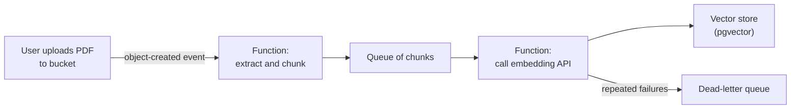
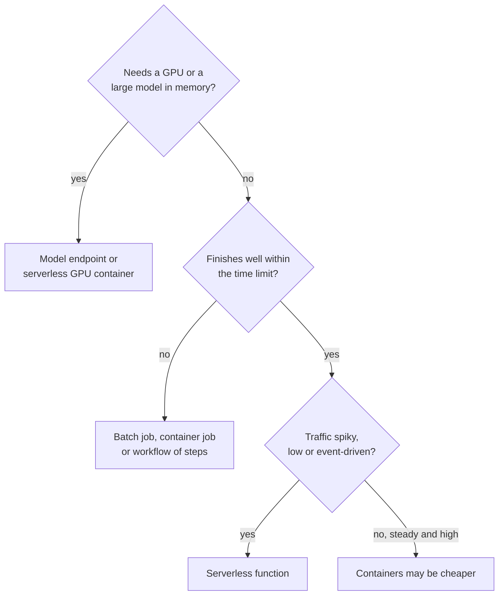

Serverless computing lets you run code without provisioning or managing any servers: you upload a function or a container, say what should trigger it, and the provider runs as many copies as there are events, then scales to zero when there are none. You pay for the time your code actually runs. For an AI engineer this is ideal for the glue around models (reacting to a file upload, calling an LLM API, running a nightly evaluation) and a poor fit for the models themselves when they need GPUs or long runtimes. Knowing exactly where that line falls is the point of this lesson.

## What "serverless" means

There are still servers, of course. "Serverless" means the provider owns them, and the unit you deploy and pay for is a function invocation or a request, not a machine.

| Property | Virtual machine | Serverless function |
| --- | --- | --- |
| You deploy | An OS image, then your app | Code or a container image |
| Scaling | You configure it | Automatic, per event, including to zero |
| Billing | Per second the VM exists | Per invocation and per unit of compute time used |
| Idle cost | Full price | None (for the compute itself) |
| Limits | Hardware you chose | Strict limits on duration, memory and package size |
| State | Disk persists | Stateless; anything kept must go to storage or a database |

The services:

| Kind | AWS | Google Cloud | Azure |
| --- | --- | --- | --- |
| Functions | AWS Lambda | Cloud Run functions | Azure Functions |
| Serverless containers | AWS Fargate (with ECS), AWS App Runner | Cloud Run | Azure Container Apps |
| Event routing and queues | Amazon EventBridge, Amazon SQS | Eventarc, Pub/Sub | Event Grid, Service Bus |
| Workflow orchestration | AWS Step Functions | Workflows | Durable Functions, Logic Apps |

Serverless containers blur the line: Cloud Run and Azure Container Apps run any container image with per-request scaling and scale-to-zero, and both can attach GPUs in supported regions. Functions are the narrower, more event-oriented tool.

## The event-driven pattern

The natural shape of serverless code is "when X happens, do Y". A common AI example is ingestion for a RAG system: when a document lands in a bucket, extract its text, split it into chunks, embed them and write the vectors to the database.



The queue between the two functions is deliberate. It smooths bursts (a user uploads 5,000 files at once), lets the embedding step retry failures without redoing extraction, and sends messages that keep failing to a **dead-letter queue** for inspection instead of retrying forever.

## A Lambda handler

A function is an ordinary Python function with a fixed signature. On AWS Lambda it receives the **event** (a dictionary describing what happened) and a **context** object (runtime information such as remaining time). Keep the business logic in plain functions so you can test it locally:

```python
import json
from urllib.parse import unquote_plus

def keys_from_s3_event(event):
    """Return (bucket, key) pairs from an S3 object-created event."""
    pairs = []
    for record in event.get("Records", []):
        bucket = record["s3"]["bucket"]["name"]
        key = unquote_plus(record["s3"]["object"]["key"])  # keys arrive URL-encoded
        pairs.append((bucket, key))
    return pairs

def chunk(text, size=40, overlap=10):
    step = size - overlap
    return [text[i:i + size] for i in range(0, max(len(text) - overlap, 1), step)]

def handler(event, context):
    results = []
    for bucket, key in keys_from_s3_event(event):
        # In the real function: download the object with boto3 and extract its text
        text = f"Contents of {key} would be extracted here and split into chunks."
        results.append({"key": key, "chunks": len(chunk(text))})
    return {"statusCode": 200, "body": json.dumps(results)}

sample_event = {
    "Records": [
        {"s3": {"bucket": {"name": "rag-uploads"},
                "object": {"key": "user-42/Annual+Report+2025.pdf"}}}
    ]
}
print(keys_from_s3_event(sample_event))
print(handler(sample_event, context=None))
```

```output
[('rag-uploads', 'user-42/Annual Report 2025.pdf')]
{'statusCode': 200, 'body': '[{"key": "user-42/Annual Report 2025.pdf", "chunks": 3}]'}
```

Note the `unquote_plus`: S3 event notifications URL-encode object keys, so a space arrives as `+`. Forgetting this is a classic bug: the function works in testing with simple names and fails in production on the first file with a space in its name.

> [!TIP]
> Create expensive clients (a `boto3` client, a database connection pool, a loaded tokenizer) **outside** the handler, at module level. The runtime reuses a warm execution environment across invocations, so module-level objects are created once per environment instead of once per request.

## Limits that shape what you can do

Serverless platforms enforce hard limits. These are the AWS Lambda limits at the time of writing, which have been stable for some time; always check the current quotas page.

| Limit | AWS Lambda |
| --- | --- |
| Maximum run time per invocation | 15 minutes |
| Memory | 128 MB to 10,240 MB (CPU is allocated in proportion to memory) |
| Deployment package (zip) | 50 MB zipped for direct upload, 250 MB unzipped including layers |
| Container image | Up to 10 GB |
| Temporary disk (`/tmp`) | Configurable up to 10,240 MB |
| Synchronous request and response payload | 6 MB |
| GPUs | None |

The other providers differ in the details. Cloud Run services allow much longer request timeouts (up to 60 minutes) and more memory, and can attach GPUs; Azure Functions limits depend on the hosting plan, with the classic Consumption plan capping runs at 10 minutes and other plans allowing longer. The pattern is the same everywhere: functions are for short, bounded work.

These limits explain the AI-specific failures:

- **Package size**: `torch` alone is far larger than a 250 MB unzipped package. Container images avoid the zip limit but a large image makes cold starts slow.
- **No GPU** on Lambda or classic function plans, so running anything but small models is impractical.
- **Duration**: a 15-minute ceiling rules out training and long batch jobs, and a long LLM call holds the function, billed, for its whole wall-clock time.
- **Statelessness**: loading a model on every cold start, then losing it when the environment is recycled, wastes time and money.

## When serverless fits AI workloads



| Good fit | Poor fit |
| --- | --- |
| Reacting to uploads: extract, chunk, enqueue | Hosting a 7B model for low-latency chat |
| Calling hosted model APIs (Bedrock, Vertex AI, Azure OpenAI) for low-volume tasks | Training or fine-tuning |
| Webhooks, Slack bots, small tool endpoints for agents | Workloads with very steady, high traffic (always-on containers can be cheaper) |
| Scheduled jobs: nightly evaluation runs, data refreshes, cleanup | Jobs that need large local state between requests |
| Small CPU models (a scikit-learn classifier, a tiny ONNX model) | Long streaming responses at high volume, where you pay for wall time spent waiting |

> [!KEY]
> Serverless functions are excellent at **orchestrating** AI work and poor at **doing** heavy AI work. Let functions handle events and call out to model endpoints or APIs, which are built for the heavy part.

## Pitfalls

- **Concurrency floods downstream systems.** If 1,000 events arrive, the platform may start hundreds of copies at once, each opening a database connection or calling a rate-limited LLM API. Cap the function's concurrency, put a queue in front, and use a connection pooler, as described in [managed databases](/learn/cloud-computing/managed-databases).
- **Retries cause duplicates.** Asynchronous invocations are retried on failure, so a function may process the same event twice. Make handlers **idempotent**: for example, derive the chunk ID from the document key and chunk index, so a retry overwrites rather than duplicates.
- **Recursive triggers.** A function triggered by uploads to a bucket that writes its output to the same bucket can trigger itself in a loop. Write outputs to a different bucket or prefix and filter the trigger.
- **Timeouts on slow APIs.** Set the function timeout above the slowest expected LLM call, and set client-side timeouts on the call itself, so a hung request fails cleanly.

> [!WARNING]
> A recursive trigger or an unbounded retry loop can invoke a function millions of times very quickly. Set reserved or maximum concurrency on functions and keep a budget alert active.

## Exercises

**1.** What does `keys_from_s3_event` return for an event whose object key is `reports/Q3+%26+Q4.pdf`? Predict, then run it.

<details>
<summary>Show solution</summary>

```python
event = {"Records": [{"s3": {"bucket": {"name": "b"}, "object": {"key": "reports/Q3+%26+Q4.pdf"}}}]}
print(keys_from_s3_event(event))
```

```output
[('b', 'reports/Q3 & Q4.pdf')]
```

`+` becomes a space and `%26` decodes to `&`.

</details>

**2.** A team wants to put a 7-billion-parameter model inside a Lambda function so their chatbot "has no servers". Give three reasons this will not work well and propose an alternative.

<details>
<summary>Show solution</summary>

Lambda has no GPU, so generation on CPU would be very slow; the model's weights (around 14 GB in FP16) exceed the 10 GB container image limit and the maximum memory; and every cold start would have to load gigabytes of weights. Instead, call a hosted model API from the function, or host the model on a GPU endpoint (managed endpoint or serverless GPU container) and let the function call it.

</details>

**3.** Your embedding function sometimes runs twice for the same chunk and creates duplicate rows in the vector table. How do you fix this?

<details>
<summary>Show solution</summary>

Make the write idempotent. Give each chunk a deterministic ID such as `<document key>#<chunk index>` (or a hash of it), make it the primary key, and use an upsert (`INSERT ... ON CONFLICT (id) DO UPDATE`) so a retry overwrites the existing row instead of adding a new one.

</details>

```quiz
[
  {
    "q": "What is the maximum duration of a single AWS Lambda invocation?",
    "options": [
      "1 minute",
      "15 minutes",
      "1 hour",
      "Unlimited"
    ],
    "answer": 1,
    "why": "Lambda invocations time out after at most 15 minutes, which rules out training and long batch jobs."
  },
  {
    "q": "Why should you create a `boto3` client at module level rather than inside the handler?",
    "options": [
      "Handlers cannot import libraries",
      "Module-level code runs on every invocation",
      "It is required for IAM permissions",
      "Warm execution environments reuse module-level objects across invocations, saving setup time"
    ],
    "answer": 3,
    "why": "Module-level initialisation happens once per execution environment, not once per request."
  },
  {
    "q": "Which task is the best fit for a serverless function?",
    "options": [
      "Chunking a newly uploaded document and enqueueing the chunks for embedding",
      "Fine-tuning a model for six hours",
      "Serving a large LLM with low latency on a GPU",
      "Holding a 20 GB index in memory between requests"
    ],
    "answer": 0,
    "why": "Short, event-driven, CPU-light work is what functions do well."
  },
  {
    "q": "Why should serverless handlers be idempotent?",
    "options": [
      "To reduce memory use",
      "Because functions cannot write to databases otherwise",
      "Because failed asynchronous invocations are retried, so the same event may be processed more than once",
      "Because cold starts erase the handler's code"
    ],
    "answer": 2,
    "why": "Retries are normal; idempotent handlers make duplicates harmless."
  }
]
```
