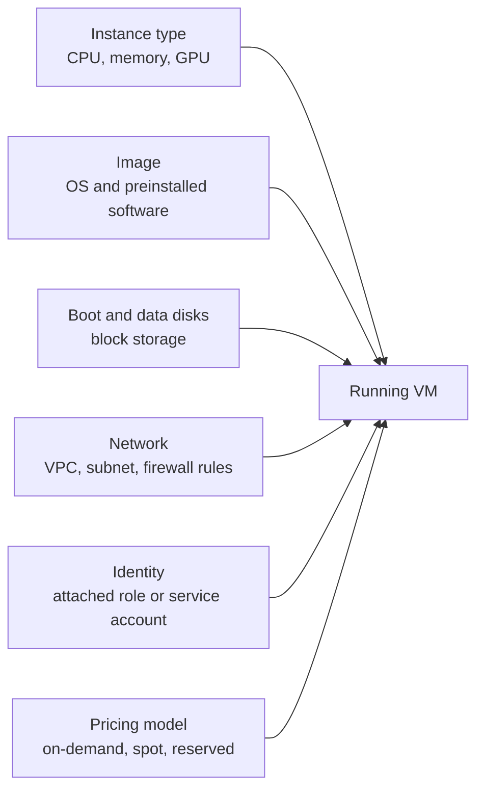

A virtual machine (VM) is a computer you rent by the second or hour: you choose how many CPUs, how much memory, which operating system and which disk, and a few minutes later you can SSH into it as if it were a server in your office. Managed services hide VMs from you, but underneath almost everything in the cloud is a VM. As an AI engineer you will use them directly for jobs that do not fit anywhere else: a long data-processing run, a development box with a GPU, a self-hosted vector database, or an experiment that needs a specific driver version. This lesson covers how to choose, start, reach and pay for one.

The service names are **Amazon EC2** (instances), **Google Compute Engine** (VM instances) and **Azure Virtual Machines**. The concepts are identical.

## What you choose when you create a VM



Each box is a separate decision, and the rest of this lesson takes them in turn.

## Instance types

An **instance type** (AWS), **machine type** (Google Cloud) or **VM size** (Azure) fixes the hardware. Providers group them into **families** optimised for different balances of CPU, memory and accelerators.

| Family purpose | Typical use in AI work | AWS example | Google Cloud example | Azure example |
| --- | --- | --- | --- | --- |
| General purpose | API servers, small vector DBs, dev boxes | M family, e.g. `m7i.large` | E2, N2, N4 series | D series, e.g. `Standard_D4s_v5` |
| Compute optimised | CPU inference of small models, data preprocessing | C family | C2, C3 series | F series |
| Memory optimised | Large in-memory indexes, big pandas or Spark jobs | R and X families | M series | E and M series |
| Burstable | Low-traffic tools that idle most of the time | T family | E2 shared-core | B series |
| Accelerated | Training and inference with GPUs or custom chips | P, G, Inf, Trn families | A2, A3, G2 series, TPUs | N series |

Names encode the family, generation and size. In `m7i.large`, `m` is the family, `7` the generation, `i` the processor variant (Intel) and `large` the size; `xlarge`, `2xlarge` and so on roughly double the resources each step. Newer generations usually give more performance for the money, so prefer them unless you have a reason not to.

> [!TIP]
> Size from measurements, not guesses. Start a modest instance, run your real workload, and watch CPU, memory and disk usage. If memory is near full and CPU is idle, switch to a memory-optimised family rather than a bigger general one. The [monitoring and logging](/learn/cloud-computing/monitoring-and-logging) lesson shows where those numbers come from.

## Images

An **image** is the template for the boot disk: an operating system plus whatever software was installed on it. AWS calls them **AMIs** (Amazon Machine Images). For AI work there are three useful kinds:

- **Plain OS images** such as Ubuntu LTS: you install everything yourself, best for reproducibility when combined with a setup script.
- **Deep learning images** maintained by the provider: AWS Deep Learning AMIs, Google's Deep Learning VM images, and Azure's Data Science Virtual Machine images. They come with NVIDIA drivers, CUDA and common frameworks preinstalled, which saves a frustrating hour on GPU machines.
- **Your own custom images**, created from a configured VM, so a fleet of identical machines starts in a known state.

A setup script that runs on first boot (called **user data** on AWS, a **startup script** on Google Cloud, and **custom data** or cloud-init on Azure) makes VMs reproducible without building images. In practice, most teams also run their code in **containers** on the VM, as you learned in the [Docker module](/learn/docker-and-containers/docker-fundamentals), so the image only needs Docker and drivers.

## Disks: block storage

A VM's disks are **block storage** volumes: Amazon EBS, Google Persistent Disk or Hyperdisk, Azure Managed Disks. They behave like local drives, attach over the network, and survive reboots. Some instance types also have **local NVMe SSDs** physically attached to the host, which are much faster but are wiped when the instance stops.

| Storage | Survives stop/start? | Typical use |
| --- | --- | --- |
| Boot disk (block storage) | Yes | OS, installed packages |
| Extra data disk (block storage) | Yes | Datasets being worked on, model cache |
| Local NVMe (instance store) | No | Scratch space, shuffled training shards |
| Object storage (S3, GCS, Blob) | Independent of the VM | The source of truth for data and artefacts |

Treat the VM as disposable and object storage as permanent. Copy results to a bucket as they are produced; then losing the VM loses nothing.

## Networking and SSH

Every VM sits in a **virtual private network**: a VPC on AWS and Google Cloud, a VNet on Azure, divided into **subnets**. Firewall rules decide what traffic may reach it: **security groups** on AWS, **VPC firewall rules** on Google Cloud, **network security groups** on Azure. The default for a new VM should be: no inbound access except what you explicitly need.

The classic way in is SSH with a key pair. You keep the private key; the public key is placed on the VM.

```bash
chmod 600 ~/.ssh/ml-dev.pem
ssh -i ~/.ssh/ml-dev.pem ubuntu@203.0.113.25
```

The default username depends on the image (`ubuntu` on Ubuntu images, `ec2-user` on Amazon Linux). Each cloud also offers a way in that avoids opening port 22 to the internet, which is better:

| Cloud | Keyless or port-free access |
| --- | --- |
| AWS | Systems Manager Session Manager; EC2 Instance Connect |
| Google Cloud | `gcloud compute ssh` with OS Login, optionally tunnelled through Identity-Aware Proxy |
| Azure | Azure Bastion; Microsoft Entra ID login for Linux VMs |

For a Jupyter server or a Gradio demo on the VM, do not open its port to the world. Use SSH port forwarding and browse to `localhost` on your own machine:

```bash
ssh -i ~/.ssh/ml-dev.pem -L 8888:localhost:8888 ubuntu@203.0.113.25
```

> [!WARNING]
> Never allow SSH (port 22) or Jupyter (port 8888) from `0.0.0.0/0`, meaning the whole internet. Exposed Jupyter servers are scanned for constantly and hijacked to mine cryptocurrency on your bill. Restrict access to your own IP, or use the provider's tunnelling tools.

## Pricing models: on-demand, reserved and spot

| Model | How it works | Fits |
| --- | --- | --- |
| **On-demand** | Pay per second or hour, start and stop any time | Development, unpredictable workloads |
| **Commitments** (Reserved Instances, Savings Plans, committed use discounts, Azure reservations) | Commit to usage for one or three years for a discount | Steady production load |
| **Spot** (AWS Spot Instances, Google Spot VMs, Azure Spot VMs) | Use spare capacity at a large discount, but the provider can reclaim it at short notice | Fault-tolerant batch work, training with checkpoints |

Spot capacity is the big lever for AI training costs, and the catch is **interruption**. AWS gives a two-minute warning before reclaiming a Spot Instance; Google Cloud and Azure give roughly 30 seconds. Google's older name for this was **preemptible VMs**, which you will still see in documentation.

The rule for running training on spot is: **checkpoint regularly to object storage and make the job resumable**. On restart, the job looks for the latest checkpoint and continues from there. This simulation shows the logic, with a dictionary standing in for the bucket:

```python
bucket = {}  # stands in for s3://my-ml-artifacts/checkpoints/

def train(total_steps, checkpoint_every, interrupt_at=None):
    start = max(bucket) if bucket else 0          # resume from latest checkpoint
    state = bucket.get(start, {"loss": 10.0})
    print(f"starting at step {start}")
    for step in range(start + 1, total_steps + 1):
        if step == interrupt_at:
            print(f"interrupted at step {step}")
            return
        state = {"loss": round(state["loss"] * 0.9, 4)}
        if step % checkpoint_every == 0:
            bucket[step] = state                  # write checkpoint
    print(f"finished, loss={state['loss']}")

train(total_steps=10, checkpoint_every=3, interrupt_at=8)
train(total_steps=10, checkpoint_every=3)
```

```output
starting at step 0
interrupted at step 8
starting at step 6
finished, loss=3.4868
```

The first run was reclaimed at step 8, so steps 7 and 8 were lost and redone; everything before the checkpoint at step 6 was kept. The final loss matches what an uninterrupted run would produce (10 × 0.9¹⁰ ≈ 3.4868). The checkpoint interval is a trade-off: frequent checkpoints waste less work on interruption but spend more time writing.

## Stop, terminate and the bill

| Action | Compute charged? | Disks charged? | Data kept? |
| --- | --- | --- | --- |
| Running | Yes | Yes | Yes |
| Stopped (deallocated on Azure) | No | Yes | Yes, on block storage |
| Terminated / deleted | No | No (unless disks were set to persist) | No |

Stopping is for "I will continue tomorrow". Terminating is for "I am done". Static public IP addresses and snapshots can also keep charging after the VM is gone, so check for leftovers.

## Exercises

**1.** Your preprocessing job on a general-purpose instance runs out of memory while CPU usage stays around 20%. What change do you make?

<details>
<summary>Show solution</summary>

Move to a **memory-optimised** family (R on AWS, M series on Google Cloud, E series on Azure) with enough RAM, rather than a larger general-purpose instance. The workload is memory-bound, so extra CPUs would be wasted. Alternatively, change the job to process the data in chunks.

</details>

**2.** Run the `train` simulation with `checkpoint_every=5` and `interrupt_at=9`. Which step does the second run start from, and how many steps of work were lost?

<details>
<summary>Show solution</summary>

Reset the bucket first so the earlier checkpoints do not interfere:

```python
bucket.clear()
train(total_steps=10, checkpoint_every=5, interrupt_at=9)
train(total_steps=10, checkpoint_every=5)
```

```output
starting at step 0
interrupted at step 9
starting at step 5
finished, loss=3.4868
```

It resumes from step 5. Steps 6, 7 and 8 were completed and lost, and step 9 never finished, so steps 6 to 9 are redone.

</details>

**3.** A colleague wants to run a Jupyter server on a GPU VM and share it with the team by opening port 8888 to the internet. Suggest a safer approach.

<details>
<summary>Show solution</summary>

Keep port 8888 closed. Each person connects with SSH port forwarding (`ssh -L 8888:localhost:8888 ...`) or through the provider's tunnelling (Session Manager, IAP, Bastion), authenticated with their own identity. Better still, use a managed notebook service, which handles authentication for you.

</details>

```quiz
[
  {
    "q": "What happens to data on a local NVMe instance store when the instance is stopped?",
    "options": [
      "It is copied to object storage automatically",
      "It is kept until the instance is terminated",
      "It is lost",
      "It moves to the boot disk"
    ],
    "answer": 2,
    "why": "Instance store disks are physically attached to the host and are wiped when the instance stops."
  },
  {
    "q": "Why are spot instances a good fit for training jobs that checkpoint regularly?",
    "options": [
      "They are discounted, and checkpoints let the job resume after an interruption with little lost work",
      "They are never interrupted",
      "They have faster GPUs than on-demand instances",
      "They do not need a disk"
    ],
    "answer": 0,
    "why": "Spot capacity can be reclaimed at short notice; resumable checkpoints turn that from a disaster into a small delay."
  },
  {
    "q": "Which is the safest way to reach a Jupyter server running on a cloud VM?",
    "options": [
      "Open port 8888 to `0.0.0.0/0` with a long token",
      "Give the VM a public DNS name",
      "Disable the firewall temporarily",
      "SSH port forwarding or the provider's tunnelling service"
    ],
    "answer": 3,
    "why": "Forwarding keeps the port closed to the internet and authenticates every user."
  },
  {
    "q": "A stopped VM with a 500 GB data disk is still appearing on the bill. Why?",
    "options": [
      "Stopped VMs are billed for compute",
      "Block storage disks are charged while they exist, even when the VM is stopped",
      "The image is billed hourly",
      "SSH keys are charged per day"
    ],
    "answer": 1,
    "why": "Stopping ends compute charges but disks persist and are billed until deleted."
  }
]
```
