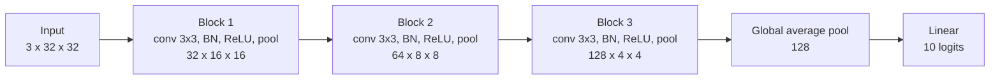

A convolutional neural network (CNN) is a neural network whose main layers are learned convolutions. In [image processing](/learn/computer-vision/image-processing) you slid a hand-designed edge kernel over an image; a CNN stacks dozens of layers of such kernels and learns every weight by gradient descent. For roughly a decade CNNs were the default architecture for every vision task, and they remain the practical choice for many production systems because they are efficient, data-friendly and well understood. To use them well you need to be able to compute shapes and parameter counts in your head, and that is what this lesson drills.

## Why not a plain fully connected network?

Connect a $224 \times 224$ RGB image (150,528 values) to a hidden layer of 1,000 units and you need over 150 million weights in the first layer alone. Worse, those weights know nothing about images: a cat in the top left and a cat in the bottom right use completely different weights.

A convolutional layer fixes both problems with two ideas:

- **Local connectivity**: each output value looks only at a small neighbourhood (for example $3 \times 3$) of the input.
- **Weight sharing**: the same kernel is applied at every position, so a feature detector learned in one place works everywhere.

Together these give **translation equivariance**: shift the input and the feature map shifts with it. The cost of the layer no longer depends on the image size at all.

## The convolutional layer in PyTorch

`nn.Conv2d(in_channels, out_channels, kernel_size, stride, padding)` holds `out_channels` kernels, each of shape `in_channels × k × k`. Every kernel spans **all** input channels and produces one output channel, called a **feature map**.

```python
import torch
from torch import nn

conv = nn.Conv2d(in_channels=3, out_channels=16, kernel_size=3, stride=1, padding=1)
x = torch.randn(8, 3, 32, 32)          # a batch of 8 RGB 32x32 images (NCHW)
y = conv(x)

print(conv.weight.shape)   # (out, in, k, k)
print(conv.bias.shape)
print(y.shape)
```

```output
torch.Size([16, 3, 3, 3])
torch.Size([16])
torch.Size([8, 16, 32, 32])
```

### Output size

For an input of size $I$ (height or width), kernel size $K$, padding $P$ and stride $S$, the output size is

$$
O = \left\lfloor \frac{I + 2P - K}{S} \right\rfloor + 1
$$

**Padding** adds $P$ rows and columns of zeros around the border; **stride** is how many pixels the kernel jumps between positions. Two configurations are worth memorising:

| Configuration | Effect on size | Typical use |
| --- | --- | --- |
| $K=3, P=1, S=1$ | unchanged ("same") | most conv layers |
| $K=3, P=1, S=2$ | roughly halved | downsampling instead of pooling |
| $K=2, S=2$ pooling | halved | classic downsampling |
| $K=7, P=3, S=2$ | roughly halved | the first layer of ResNet-style networks |

```python
def conv_out(i, k, p=0, s=1):
    return (i + 2 * p - k) // s + 1

print(conv_out(32, k=3, p=1, s=1))
print(conv_out(32, k=3, p=1, s=2))
print(conv_out(224, k=7, p=3, s=2))
print(conv_out(4, k=3))              # the 4x4 valid convolution from the previous lesson
```

```output
32
16
112
2
```

### Parameter count

Each of the $C_{\text{out}}$ kernels has $K \times K \times C_{\text{in}}$ weights plus one bias:

$$
\text{params} = (K \cdot K \cdot C_{\text{in}} + 1) \cdot C_{\text{out}}
$$

For the layer above: $(3 \cdot 3 \cdot 3 + 1) \cdot 16 = 448$. Compare that with the 150 million weights of the fully connected layer, and note that it would be the same 448 for a $1000 \times 1000$ image.

```python
print(sum(p.numel() for p in conv.parameters()))
```

```output
448
```

## Pooling

A **pooling** layer downsamples each feature map independently, with no learned weights. **Max pooling** keeps the largest value in each window; **average pooling** keeps the mean.

```python
fmap = torch.tensor([[[[1., 3., 2., 0.],
                       [4., 6., 1., 1.],
                       [0., 2., 5., 7.],
                       [1., 1., 8., 2.]]]])
print(nn.MaxPool2d(kernel_size=2, stride=2)(fmap))
print(nn.AvgPool2d(kernel_size=2, stride=2)(fmap))
```

```output
tensor([[[[6., 2.],
          [2., 8.]]]])
tensor([[[[3.5000, 1.0000],
          [1.0000, 5.5000]]]])
```

Max pooling says "the feature was present somewhere in this window" and discards exactly where, which adds a little robustness to small shifts. It also halves the height and width, which cuts the computation of every later layer by a factor of four. At the very end of a network, **global average pooling** (`nn.AdaptiveAvgPool2d(1)`) averages each whole feature map to a single number, turning a $C \times H \times W$ tensor into a vector of length $C$ regardless of the input size.

## Receptive field

The **receptive field** of a unit is the region of the input image that can affect it. One $3 \times 3$ conv sees a $3 \times 3$ patch. A second $3 \times 3$ conv on top sees $3 \times 3$ positions of the first layer, which together cover $5 \times 5$ input pixels. Downsampling makes it grow faster, because each step of a later layer jumps several input pixels.

For layer $l$ with kernel $k_l$ and stride $s_l$, track the receptive field $r$ and the **jump** $j$ (the distance in input pixels between neighbouring units):

$$
r_l = r_{l-1} + (k_l - 1)\, j_{l-1}, \qquad j_l = j_{l-1}\, s_l, \qquad r_0 = 1,\; j_0 = 1
$$

```python
layers = [("conv3", 3, 1), ("conv3", 3, 1), ("pool2", 2, 2),
          ("conv3", 3, 1), ("conv3", 3, 1), ("pool2", 2, 2), ("conv3", 3, 1)]
r, j = 1, 1
for name, k, s in layers:
    r = r + (k - 1) * j
    j = j * s
    print(f"{name}: receptive field {r:2d}, jump {j}")
```

```output
conv3: receptive field  3, jump 1
conv3: receptive field  5, jump 1
pool2: receptive field  6, jump 2
conv3: receptive field 10, jump 2
conv3: receptive field 14, jump 2
pool2: receptive field 16, jump 4
conv3: receptive field 24, jump 4
```

This is the heart of the CNN design: early layers see small patches and learn edges and colours, middle layers see larger regions and combine edges into textures and parts, and late layers see most of the image and respond to whole objects.

> [!KEY]
> Stacking small kernels with downsampling builds a **hierarchy** of features. Two stacked $3 \times 3$ convs see the same $5 \times 5$ region as one $5 \times 5$ conv, with fewer parameters ($2 \cdot 9 = 18$ versus $25$ per channel pair) and an extra non-linearity in between.

## A small CNN, shape by shape

The standard pattern is a few blocks of convolution, normalisation, activation and pooling, followed by global pooling and a linear classifier.



```python
def block(c_in, c_out):
    return nn.Sequential(
        nn.Conv2d(c_in, c_out, kernel_size=3, padding=1, bias=False),
        nn.BatchNorm2d(c_out),
        nn.ReLU(),
        nn.MaxPool2d(2),
    )

class SmallCNN(nn.Module):
    def __init__(self, num_classes=10):
        super().__init__()
        self.features = nn.Sequential(block(3, 32), block(32, 64), block(64, 128))
        self.pool = nn.AdaptiveAvgPool2d(1)
        self.head = nn.Linear(128, num_classes)

    def forward(self, x):
        x = self.features(x)
        x = self.pool(x).flatten(1)
        return self.head(x)

model = SmallCNN()
x = torch.randn(4, 3, 32, 32)
for i, layer in enumerate(model.features):
    x = layer(x)
    print(f"after block {i + 1}: {tuple(x.shape)}")
print("logits:", tuple(model(torch.randn(4, 3, 32, 32)).shape))
print("parameters:", sum(p.numel() for p in model.parameters()))
```

```output
after block 1: (4, 32, 16, 16)
after block 2: (4, 64, 8, 8)
after block 3: (4, 128, 4, 4)
logits: (4, 10)
parameters: 94762
```

Points to notice:

- The conv layers use `bias=False` because the following `BatchNorm2d` has its own learnable shift, which would make a conv bias redundant (see [batch normalisation](/learn/neural-network-fundamentals/batch-normalization)).
- Channels go up (3, 32, 64, 128) as spatial size goes down (32, 16, 8, 4). This keeps the computation per layer roughly balanced while features become more abstract.
- Thanks to `AdaptiveAvgPool2d`, the same model accepts $64 \times 64$ inputs without any change.

Training this model uses exactly the loop from [training loops](/learn/pytorch/training-loops): the architecture is the only thing that changed.

## Landmark architectures

You do not need to memorise these, but the names appear everywhere and each introduced an idea that is still in use.

| Architecture | Key idea |
| --- | --- |
| LeNet | conv, pool, conv, pool, fully connected: the original template, for digits |
| AlexNet | the same template, much deeper and trained on GPUs with ReLU and dropout |
| VGG | only $3 \times 3$ convs, stacked deep in uniform blocks |
| GoogLeNet / Inception | parallel branches with different kernel sizes in one block |
| ResNet | **residual connections** $y = F(x) + x$, which make very deep networks trainable |
| MobileNet / EfficientNet | depthwise separable convs and careful scaling for cheap inference |
| ConvNeXt | a modernised ResNet that borrows design choices from Vision Transformers |

The residual connection is the one to understand: each block learns a correction $F(x)$ to its input rather than a whole new representation, and the identity path lets gradients flow straight back through dozens of layers.

> [!TIP]
> When a CNN throws a shape error at the first `nn.Linear`, insert `print(x.shape)` before it, or run a dummy batch through `model.features` as above. Using global average pooling before the head removes the problem entirely.

## Exercises

**1.** A $128 \times 128$ input passes through: conv $K=5, P=2, S=1$; max pool $2 \times 2$; conv $K=3, P=0, S=2$. What is the spatial size after each layer?

<details>
<summary>Show solution</summary>

```python
s1 = conv_out(128, k=5, p=2, s=1)
s2 = conv_out(s1, k=2, p=0, s=2)
s3 = conv_out(s2, k=3, p=0, s=2)
print(s1, s2, s3)
```

```output
128 64 31
```

The first conv keeps the size (padding 2 compensates for a 5-wide kernel), pooling halves it, and the strided conv gives $\lfloor (64 - 3) / 2 \rfloor + 1 = 31$.

</details>

**2.** How many parameters does `nn.Conv2d(64, 128, kernel_size=3)` have? Check your answer in PyTorch.

<details>
<summary>Show solution</summary>

$(3 \cdot 3 \cdot 64 + 1) \cdot 128 = 73{,}856$.

```python
print(sum(p.numel() for p in nn.Conv2d(64, 128, kernel_size=3).parameters()))
```

```output
73856
```

</details>

**3.** Adapt `SmallCNN` for the $1 \times 8 \times 8$ scikit-learn digits from [image classification](/learn/computer-vision/image-classification). Which arguments must change, and how many blocks can you keep before the feature map shrinks to $1 \times 1$?

<details>
<summary>Show solution</summary>

The first block must take 1 input channel: `block(1, 32)`. Each block halves the spatial size: $8 \to 4 \to 2 \to 1$, so all three blocks still fit, ending at $128 \times 1 \times 1$.

```python
class DigitsCNN(SmallCNN):
    def __init__(self):
        super().__init__(num_classes=10)
        self.features[0] = block(1, 32)

print(tuple(DigitsCNN()(torch.randn(2, 1, 8, 8)).shape))
```

```output
(2, 10)
```

A fourth block would fail, because max pooling cannot halve a $1 \times 1$ map. Drop that model into the digits training loop and compare its test accuracy with the fully connected network.

</details>

```quiz
[
  {
    "q": "What is the output width of a conv layer with input width 64, kernel 3, padding 1 and stride 2?",
    "options": ["64", "31", "32", "33"],
    "answer": 2,
    "why": "floor((64 + 2 - 3) / 2) + 1 = floor(31.5) + 1 = 32."
  },
  {
    "q": "How many learnable parameters does `nn.Conv2d(3, 16, kernel_size=3)` have?",
    "options": ["448", "144", "432", "27"],
    "answer": 0,
    "why": "Each of 16 kernels has 3 x 3 x 3 = 27 weights plus a bias: 28 x 16 = 448."
  },
  {
    "q": "Which property lets a CNN detect a feature regardless of where it appears in the image?",
    "options": [
      "Dropout",
      "Weight sharing: the same kernel is applied at every position",
      "Softmax output",
      "Using a large learning rate"
    ],
    "answer": 1,
    "why": "Because one kernel is slid over the whole image, a detector learned in one place responds in every place."
  },
  {
    "q": "Why do conv layers followed by `BatchNorm2d` often set `bias=False`?",
    "options": [
      "Biases are not allowed in convolutional layers",
      "It makes the receptive field larger",
      "BatchNorm requires integer inputs",
      "BatchNorm subtracts the mean and adds its own learned shift, so a conv bias would be redundant"
    ],
    "answer": 3,
    "why": "Any constant added by the conv is removed by BatchNorm's mean subtraction, and BatchNorm's beta parameter provides the shift instead."
  }
]
```
