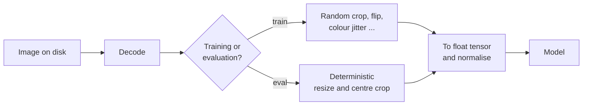

Collecting and labelling images is slow and expensive, and vision models are hungry for data. **Data augmentation** stretches the data you have: every time the model sees a training image, you apply a random transformation (a crop, a flip, a colour shift) that changes the pixels but not the label. Over many epochs the model sees thousands of plausible variations of each photo, which teaches it the invariances you want and reduces overfitting. It is one of the cheapest accuracy gains in computer vision, and one of the easiest to get subtly wrong.

## The idea in one picture

Augmentation lives inside the data pipeline, not in the model. It runs on the fly in the `Dataset`, so each epoch produces different versions of the same file and nothing extra is stored on disk.



The key constraint is that a transform must be **label-preserving**: a human looking at the augmented image should still give it the same label. A horizontally flipped dog is still a dog. A horizontally flipped "b" is a "d".

## torchvision.transforms.v2

torchvision's current transforms API lives in `torchvision.transforms.v2`. It works on Pillow images and tensors, handles batches, and, unlike the older API, can transform bounding boxes and masks together with the image. A typical training pipeline for a pretrained classifier:

```python
import torch
from torchvision.transforms import v2

train_tfm = v2.Compose([
    v2.RandomResizedCrop(224, scale=(0.6, 1.0)),   # random crop, resized to 224x224
    v2.RandomHorizontalFlip(p=0.5),
    v2.ColorJitter(brightness=0.2, contrast=0.2, saturation=0.2),
    v2.ToImage(),                                   # PIL or ndarray -> tensor image (CHW)
    v2.ToDtype(torch.float32, scale=True),          # uint8 [0, 255] -> float [0, 1]
    v2.Normalize(mean=[0.485, 0.456, 0.406], std=[0.229, 0.224, 0.225]),
])

eval_tfm = v2.Compose([
    v2.Resize(256),                                 # shorter side to 256
    v2.CenterCrop(224),
    v2.ToImage(),
    v2.ToDtype(torch.float32, scale=True),
    v2.Normalize(mean=[0.485, 0.456, 0.406], std=[0.229, 0.224, 0.225]),
])
```

`ToImage` plus `ToDtype(..., scale=True)` replaces the older `ToTensor`. The `scale=True` flag is what divides by 255; forget it and your floats stay in $[0, 255]$.

### The common transforms

| Transform | What it does | Teaches invariance to |
| --- | --- | --- |
| `RandomResizedCrop(size, scale)` | crops a random area fraction and aspect ratio, then resizes | position, scale, framing |
| `RandomHorizontalFlip(p)` | mirrors left to right with probability `p` | left/right orientation |
| `RandomRotation(degrees)` | rotates by a random angle in the range | small camera tilt |
| `ColorJitter(...)` | random brightness, contrast, saturation, hue | lighting and camera colour |
| `RandomGrayscale(p)` | drops colour with probability `p` | reliance on colour |
| `GaussianBlur(kernel_size)` | blurs | focus and motion blur |
| `RandomErasing(p)` | blanks a random rectangle (on tensors, after normalising) | occlusion |
| `RandAugment()`, `TrivialAugmentWide()` | apply randomly chosen operations from a fixed list | general robustness with few knobs |

Seeing what a transform does on a tiny tensor removes any doubt. Setting `p=1.0` makes a random flip deterministic:

```python
x = torch.arange(6).reshape(1, 2, 3)        # one channel, 2x3
print(x)
print(v2.RandomHorizontalFlip(p=1.0)(x))
print(v2.RandomVerticalFlip(p=1.0)(x))
```

```output
tensor([[[0, 1, 2],
         [3, 4, 5]]])
tensor([[[2, 1, 0],
         [5, 4, 3]]])
tensor([[[3, 4, 5],
         [0, 1, 2]]])
```

## Augment the training set only

Evaluation must measure the model on images as they will arrive in production, and must be repeatable. Random transforms on the validation set make your metric noisy and biased. Use **deterministic** preprocessing (resize, centre crop, normalise) for validation, test and inference.

A common bug comes from `random_split`: both subsets share the **same** underlying dataset object, so they share its transform. Setting a transform on one changes both.

```python
from torch.utils.data import Dataset, random_split

class Tiny(Dataset):
    def __init__(self, transform=None):
        self.transform = transform
    def __len__(self):
        return 10
    def __getitem__(self, i):
        x = torch.full((1, 2, 2), float(i))
        return (self.transform(x) if self.transform else x), i % 2

full = Tiny()
train_ds, val_ds = random_split(full, [8, 2], generator=torch.Generator().manual_seed(0))
train_ds.dataset.transform = v2.RandomHorizontalFlip(p=1.0)
print(val_ds.dataset.transform)            # the validation set got it too
```

```output
RandomHorizontalFlip(p=1.0)
```

The fix is to create two dataset objects with different transforms and split their **indices** identically:

```python
from torch.utils.data import Subset

idx = torch.randperm(10, generator=torch.Generator().manual_seed(0)).tolist()
train_ds = Subset(Tiny(transform=v2.RandomHorizontalFlip(p=0.5)), idx[:8])
val_ds = Subset(Tiny(transform=None), idx[8:])
print(len(train_ds), len(val_ds), val_ds.dataset.transform)
```

```output
8 2 None
```

With `ImageFolder` the same pattern applies: build `datasets.ImageFolder(root, transform=train_tfm)` and `datasets.ImageFolder(root, transform=eval_tfm)`, then wrap each in a `Subset` with the same index split, or keep separate `train/` and `val/` folders.

> [!WARNING]
> Never fit augmentation choices on the test set, and never apply random augmentation when computing validation metrics. If you want test-time augmentation (averaging predictions over a few flips or crops), make it a deliberate, deterministic step that you also use in production.

## Choosing transforms for your domain

Augmentations encode assumptions about the world. Pick the ones that match how your images actually vary, and avoid any that could change the label.

| Domain | Usually safe | Be careful with |
| --- | --- | --- |
| Everyday photos | crops, horizontal flips, colour jitter | vertical flips (the sky is rarely below) |
| Digits and text | small rotations, small shifts, blur | flips (6 and 9, b and d), large rotations |
| Satellite and microscopy | flips, 90-degree rotations | colour shifts if colour carries meaning |
| Medical scans | small intensity and geometric changes | left-right flips when anatomy side matters |
| Product defects | lighting changes | crops that might cut out the defect |

Start with crops and flips, train a baseline, then add one augmentation at a time and keep it only if validation performance improves. Too much augmentation is possible: if training accuracy stays far below what the model should manage, the training images may have become harder than the real ones.

## Augmenting boxes and masks

For detection and segmentation, a geometric transform must move the labels too. Flip an image and the bounding box must flip with it. `transforms.v2` does this automatically when you wrap labels in `tv_tensors`:

```python
from torchvision import tv_tensors

image = tv_tensors.Image(torch.zeros(3, 100, 200, dtype=torch.uint8))   # H=100, W=200
boxes = tv_tensors.BoundingBoxes([[10, 20, 60, 80]], format="XYXY", canvas_size=(100, 200))

tfm = v2.Compose([v2.Resize((50, 100)), v2.RandomHorizontalFlip(p=1.0)])
new_image, new_boxes = tfm(image, boxes)
print(new_image.shape)
print(new_boxes.tolist())
```

```output
torch.Size([3, 50, 100])
[[70, 10, 95, 40]]
```

The box was halved by the resize, then mirrored: its left edge moved from $x=5$ to $100 - 30 = 70$. Doing this arithmetic by hand for every transform is error-prone, which is exactly why you should let the library do it. Masks work the same way with `tv_tensors.Mask`. You will use these in [object detection](/learn/computer-vision/object-detection) and [image segmentation](/learn/computer-vision/image-segmentation).

## Mixing images: MixUp and CutMix

Two batch-level augmentations blend **different** images and their labels:

- **MixUp** forms $\tilde{x} = \lambda x_i + (1 - \lambda) x_j$ and $\tilde{y} = \lambda y_i + (1 - \lambda) y_j$, where $x_i, x_j$ are two images, $y_i, y_j$ their one-hot labels, and $\lambda \in [0, 1]$ is drawn at random.
- **CutMix** pastes a rectangle from image $j$ into image $i$ and sets $\lambda$ to the fraction of the area that still comes from image $i$.

Because they act on batches and produce soft labels, they run after the `DataLoader`, not inside the dataset:

```python
cutmix = v2.CutMix(num_classes=10)
images = torch.rand(4, 3, 32, 32)
labels = torch.tensor([0, 1, 2, 3])
mixed_images, soft_labels = cutmix(images, labels)
print(mixed_images.shape, soft_labels.shape)
print(soft_labels.sum(dim=1))
```

```output
torch.Size([4, 3, 32, 32]) torch.Size([4, 10])
tensor([1., 1., 1., 1.])
```

Each soft label sums to 1. `nn.CrossEntropyLoss` accepts such probability targets directly.

> [!KEY]
> Augmentation is a statement about which changes do not matter. The model will learn to ignore exactly those changes, so choose them to match the variation your deployed model will face.

## Exercises

**1.** You are classifying road signs, including "turn left" and "turn right". Which of these augmentations are safe: horizontal flip, small rotation, brightness jitter, random crop that keeps most of the sign?

<details>
<summary>Show solution</summary>

Small rotations, brightness jitter and mild random crops are safe. A horizontal flip turns a "turn left" sign into a "turn right" sign, changing the label, so it must not be used (or the label must be swapped accordingly, which only works for symmetric pairs).

</details>

**2.** A teammate's validation accuracy changes by a percentage point or two every time they evaluate the same checkpoint. What is the likely cause and the fix?

<details>
<summary>Show solution</summary>

Random augmentation is being applied to the validation data, probably because the validation set shares the training transform (for example through `random_split`). Give the validation set its own deterministic transform, such as resize, centre crop and normalise, using separate dataset objects.

</details>

**3.** Predict the box after applying `v2.RandomHorizontalFlip(p=1.0)` alone to the original 200-pixel-wide image with box `[10, 20, 60, 80]`, then check it.

<details>
<summary>Show solution</summary>

A horizontal flip maps $x \mapsto W - x$, so the new left edge is $200 - 60 = 140$ and the new right edge $200 - 10 = 190$. The $y$ coordinates do not change.

```python
_, flipped = v2.RandomHorizontalFlip(p=1.0)(image, boxes)
print(flipped.tolist())
```

```output
[[140, 20, 190, 80]]
```

</details>

```quiz
[
  {
    "q": "Where should random augmentation be applied?",
    "options": [
      "To the training data only, on the fly",
      "To training, validation and test data",
      "Once, saving augmented copies over the originals",
      "Only to the test set"
    ],
    "answer": 0,
    "why": "Random augmentation is a training-time regulariser. Evaluation needs deterministic preprocessing that matches production."
  },
  {
    "q": "In `transforms.v2`, what does `v2.ToDtype(torch.float32, scale=True)` do to a `uint8` image?",
    "options": [
      "Normalises it with the ImageNet mean and std",
      "Converts it to float without changing the values",
      "Converts it to float and rescales from [0, 255] to [0, 1]",
      "Resizes it"
    ],
    "answer": 2,
    "why": "`scale=True` rescales integer pixel values to the [0, 1] float range. Without it the values remain 0 to 255."
  },
  {
    "q": "Why is a horizontal flip a poor choice for handwritten letter recognition?",
    "options": [
      "Flips are too slow",
      "It can change the label, for example turning b into d",
      "It changes the image size",
      "Letters are grayscale"
    ],
    "answer": 1,
    "why": "Augmentations must be label-preserving. A mirrored letter can be a different letter."
  },
  {
    "q": "What do MixUp and CutMix produce as labels?",
    "options": [
      "The label of the first image only",
      "A new random class",
      "No labels; they are unsupervised",
      "Soft labels that mix the two images' one-hot labels in proportion to their contribution"
    ],
    "answer": 3,
    "why": "The target is a weighted mix of both labels, with weights given by lambda (the blend factor or area fraction)."
  }
]
```
