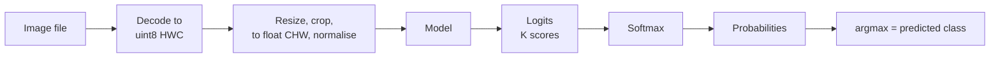

Image classification answers one question about a whole image: which of a fixed set of categories does it belong to? Is this X-ray normal or abnormal, is this product photo a shoe or a bag, is this leaf healthy or diseased? It is the simplest vision task to state and the foundation for the rest: detection, segmentation and Vision Transformers all reuse the classification backbone and its training recipe. This lesson sets up the task end to end, from folder layout to metrics, using a deliberately simple model so the pipeline is clear before CNNs arrive in the next lesson.

## The task, precisely

A classifier is a function $f$ that maps an image $x$ of shape $C \times H \times W$ to a vector of $K$ scores (**logits**), one per class. Softmax turns the logits $z$ into probabilities:

$$
p_k = \frac{e^{z_k}}{\sum_{j=1}^{K} e^{z_j}}
$$

where $p_k$ is the predicted probability of class $k$. The prediction is the class with the highest probability, and training minimises the cross-entropy loss $-\log p_y$, where $y$ is the true class. This is exactly the setup from [loss functions](/learn/pytorch/loss-functions); the only new thing is that the input is an image.

| Variant | Output | Loss | Example |
| --- | --- | --- | --- |
| Binary | one logit | `BCEWithLogitsLoss` | defect or no defect |
| Multi-class | $K$ logits, exactly one true class | `CrossEntropyLoss` | which of 10 digits |
| Multi-label | $K$ logits, any number true | `BCEWithLogitsLoss` per class | which objects appear in a photo |



## Organising an image dataset

The convention almost every tool understands is **one folder per class**:

```text
data/
  train/
    cat/  0001.jpg  0002.jpg ...
    dog/  0001.jpg ...
  val/
    cat/ ...
    dog/ ...
```

torchvision reads this layout directly with `ImageFolder`, which assigns class indices in sorted folder-name order and returns `(image, label)` pairs. It plugs into the `DataLoader` you met in [Dataset and DataLoader](/learn/pytorch/dataset-and-dataloader):

```python
from torchvision import datasets, transforms
from torch.utils.data import DataLoader

tfm = transforms.Compose([
    transforms.Resize((224, 224)),
    transforms.ToTensor(),          # uint8 HWC -> float CHW in [0, 1]
    transforms.Normalize([0.485, 0.456, 0.406], [0.229, 0.224, 0.225]),
])

train_ds = datasets.ImageFolder("data/train", transform=tfm)
train_dl = DataLoader(train_ds, batch_size=32, shuffle=True, num_workers=4)
print(train_ds.classes)        # e.g. ['cat', 'dog']
```

Keep the split **by source**, not just by file. If the same patient, product or scene appears in both train and validation, near-duplicate images leak across the split and your validation accuracy will be optimistic.

> [!WARNING]
> Look at class balance before training. If 95% of your images are "normal", a model that always answers "normal" scores 95% accuracy and is useless. Check `collections.Counter(train_ds.targets)` first.

## A first baseline: pixels as features

Before reaching for deep learning, it is worth seeing how far a linear model on raw pixels gets. scikit-learn ships a small dataset of $8 \times 8$ grayscale handwritten digits:

```python
import numpy as np
from sklearn.datasets import load_digits
from sklearn.linear_model import LogisticRegression
from sklearn.model_selection import train_test_split

digits = load_digits()
print(digits.images.shape, digits.images.min(), digits.images.max())

X = digits.images.reshape(len(digits.images), -1) / 16.0   # flatten 8x8 -> 64 features
y = digits.target
X_train, X_test, y_train, y_test = train_test_split(
    X, y, test_size=0.25, random_state=0, stratify=y)

clf = LogisticRegression(max_iter=2000)
clf.fit(X_train, y_train)
print(f"test accuracy: {clf.score(X_test, y_test):.3f}")
```

```output
(1797, 8, 8) 0.0 16.0
test accuracy: 0.969
```

That is a strong result for tiny, centred, clean digits. It does not carry over to real photographs. Flattening throws away the 2D structure: the model sees 64 unrelated numbers, and it has no notion that neighbouring pixels belong together. Shift a digit two pixels to the right and every feature changes. A $224 \times 224$ RGB photo has 150,528 values, objects appear anywhere and at any size, and lighting varies. That is why vision moved to convolutional networks, which build in locality and translation equivariance.

## The same pipeline in PyTorch

Here is the digits task as a PyTorch training loop with a small fully connected network. The structure (tensors, model, loss, optimiser, loop, evaluation) is identical to what you will use for CNNs; only the model changes.

```python
import torch
from torch import nn

torch.manual_seed(0)
Xtr = torch.tensor(X_train, dtype=torch.float32).reshape(-1, 1, 8, 8)   # NCHW
Xte = torch.tensor(X_test, dtype=torch.float32).reshape(-1, 1, 8, 8)
ytr = torch.tensor(y_train)
yte = torch.tensor(y_test)

model = nn.Sequential(
    nn.Flatten(),             # (N, 1, 8, 8) -> (N, 64)
    nn.Linear(64, 64),
    nn.ReLU(),
    nn.Linear(64, 10),        # 10 logits
)
loss_fn = nn.CrossEntropyLoss()
opt = torch.optim.Adam(model.parameters(), lr=1e-2)

for epoch in range(30):
    model.train()
    perm = torch.randperm(len(Xtr))
    for start in range(0, len(Xtr), 64):
        idx = perm[start:start + 64]
        loss = loss_fn(model(Xtr[idx]), ytr[idx])
        opt.zero_grad()
        loss.backward()
        opt.step()

model.eval()
with torch.no_grad():
    preds = model(Xte).argmax(dim=1)
print(f"test accuracy: {(preds == yte).float().mean().item():.3f}")
```

```output
test accuracy: 0.978
```

Your exact figure may differ slightly across PyTorch versions and hardware. Note the two habits: `model.eval()` and `torch.no_grad()` for evaluation, and inputs kept in NCHW layout even for a model that flattens them, so you can swap in a CNN without touching the data code.

## Measuring a classifier

Accuracy is the headline number, but it hides which classes fail. Always look at a **confusion matrix**, as in [model evaluation](/learn/model-evaluation/confusion-matrix):

```python
from sklearn.metrics import confusion_matrix

cm = confusion_matrix(y_test, clf.predict(X_test))
errors = cm - np.diag(np.diag(cm))
i, j = np.unravel_index(errors.argmax(), errors.shape)
print(f"most common mistake: true {i} predicted as {j} ({errors[i, j]} times)")
```

```output
most common mistake: true 8 predicted as 1 (3 times)
```

For datasets with many fine-grained classes, such as ImageNet with 1,000 classes, you will also see **top-k accuracy**: the prediction counts as correct if the true class is among the $k$ highest-scoring classes.

```python
logits = torch.tensor([
    [2.0, 1.0, 0.1, 3.0],   # true class 1
    [0.5, 2.5, 0.2, 0.1],   # true class 1
    [1.0, 0.2, 0.3, 0.9],   # true class 3
])
targets = torch.tensor([1, 1, 3])

top1 = (logits.argmax(dim=1) == targets).float().mean()
top2_idx = logits.topk(2, dim=1).indices
top2 = (top2_idx == targets[:, None]).any(dim=1).float().mean()
print(f"top-1: {top1:.3f}  top-2: {top2:.3f}")
```

```output
top-1: 0.333  top-2: 0.667
```

Only the second image is right at top-1. The third image has its true class (score 0.9) in second place, so it counts at top-2, while the first image's true class is only third, so top-2 accuracy is 2 out of 3.

## What makes vision hard

The pixel values of one object change enormously with conditions that do not change its label. A good classifier must be **invariant** to all of these:

| Variation | Example | Main remedy |
| --- | --- | --- |
| Position | object in a corner instead of the centre | convolution and pooling |
| Scale | close-up versus far away | multi-scale features, random crops |
| Viewpoint and pose | a cat from the side or from above | more data, augmentation |
| Lighting | indoor, outdoor, night | colour augmentation, normalisation |
| Occlusion | half the object hidden | random erasing, more data |
| Background clutter | busy street versus plain wall | more varied data |

The next lessons address these in order: [CNNs](/learn/computer-vision/convolutional-neural-networks-cnns) build position invariance into the architecture, [augmentation](/learn/computer-vision/image-augmentation) manufactures variation, and [transfer learning](/learn/computer-vision/transfer-learning) borrows features learned on millions of images.

> [!TIP]
> Before trusting a classifier, look at the images it gets wrong, sorted by confidence. Confident mistakes often reveal mislabelled data or a shortcut, such as a model that learned "snow means wolf" because every wolf photo had a snowy background.

## Exercises

**1.** You are building a model that tags product photos with every material present (leather, metal, fabric, plastic). Which output layer and loss do you use, and how do you turn outputs into predictions?

<details>
<summary>Show solution</summary>

This is multi-label: a photo can contain several materials. Use 4 output logits with `nn.BCEWithLogitsLoss` and float targets such as `[1., 1., 0., 0.]`. At inference apply `torch.sigmoid` to each logit independently and predict every material whose probability exceeds a threshold (0.5 by default, tuned on validation data). Softmax would be wrong because it forces the probabilities to compete and sum to 1.

</details>

**2.** Using `cm` from the lesson, compute the per-class recall (the diagonal divided by the row sums) and print the worst class.

<details>
<summary>Show solution</summary>

```python
recall = np.diag(cm) / cm.sum(axis=1)
print(recall.round(3))
print("worst class:", recall.argmin())
```

```output
[1.    0.978 0.977 0.978 0.956 0.978 0.956 1.    0.884 0.978]
worst class: 8
```

</details>

**3.** A colleague reports 99% validation accuracy on a dataset of photos where each object was photographed ten times in a burst, and the split was made by shuffling individual files. Why should you doubt the number, and how should you re-split?

<details>
<summary>Show solution</summary>

Burst photos are near-duplicates. A random file-level split puts nearly identical images in both train and validation, so the model is partly tested on images it has effectively seen. Group the files by object (or burst), and split by group, for example with scikit-learn's `GroupShuffleSplit`, so every image of one object lands on the same side.

</details>

```quiz
[
  {
    "q": "Which loss suits a classifier where each image has exactly one of 10 labels?",
    "options": ["`nn.MSELoss`", "`nn.BCEWithLogitsLoss`", "`nn.CrossEntropyLoss` on 10 logits", "`nn.L1Loss`"],
    "answer": 2,
    "why": "Single-label multi-class classification uses softmax cross-entropy, which `nn.CrossEntropyLoss` computes from raw logits."
  },
  {
    "q": "How does `torchvision.datasets.ImageFolder` decide the class index of each image?",
    "options": [
      "From the sorted names of the sub-folders the images are in",
      "From a `labels.csv` file",
      "From the image file names",
      "From EXIF metadata"
    ],
    "answer": 0,
    "why": "Each sub-folder is a class, and classes are indexed in sorted folder-name order (see `ds.classes`)."
  },
  {
    "q": "A model's top-1 accuracy is 70% and its top-5 accuracy is 92%. What does that tell you?",
    "options": [
      "The model is overfitting",
      "For 92% of images the true class is among its five highest-scoring guesses",
      "The model is wrong on 92% of images",
      "Five models were averaged"
    ],
    "answer": 1,
    "why": "Top-k accuracy counts a prediction as correct if the true class is anywhere in the top k scores."
  },
  {
    "q": "Why does logistic regression on flattened pixels struggle on real photographs?",
    "options": [
      "It cannot output probabilities",
      "Photographs have too few pixels",
      "It needs a GPU",
      "Flattening discards spatial structure, so shifting an object changes every feature"
    ],
    "answer": 3,
    "why": "Each pixel position is a separate feature with its own weight, so the model has no built-in notion of locality or translation."
  }
]
```
