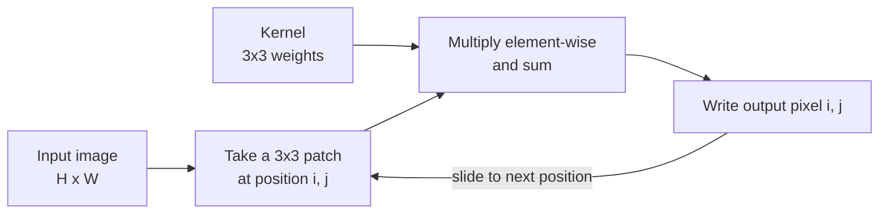

To a computer, a photograph is not a scene. It is a grid of numbers. Every vision model you will meet in this module, from a small CNN to a Vision Transformer, starts by receiving those numbers in a specific shape, data type and scale. Most bugs in vision code are not deep: a channel axis in the wrong place, an image that was never divided by 255, a colour image passed where grayscale was expected. This lesson teaches you to see images as arrays, manipulate them with NumPy and Pillow, and compute the convolution operation by hand, which is the building block of everything that follows.

## Images are arrays

A grayscale image of height $H$ and width $W$ is a 2D array with $H$ rows and $W$ columns. Each entry is a **pixel intensity**. A colour image adds a third axis for the **channels**, usually red, green and blue (RGB).

```python
import numpy as np

# A tiny 2x3 RGB image: two rows, three columns, three channels
img = np.array([
    [[255, 0, 0], [0, 255, 0], [0, 0, 255]],
    [[0, 0, 0], [128, 128, 128], [255, 255, 255]],
], dtype=np.uint8)

print(img.shape)      # (H, W, C)
print(img.dtype)
print(img[0, 2])      # the pixel at row 0, column 2
print(img[..., 0])    # the red channel only
```

```output
(2, 3, 3)
uint8
[  0   0 255]
[[255   0   0]
 [  0 128 255]]
```

The top row is pure red, pure green and pure blue; the bottom row is black, mid-grey and white. Indexing is always `img[row, column]`, which means `img[y, x]`, not `img[x, y]`. Mixing these up is a classic source of transposed crops and boxes.

### Channels-last versus channels-first

Two layouts are in common use, and you will convert between them constantly.

| Layout | Shape | Used by |
| --- | --- | --- |
| Channels-last (HWC) | `(H, W, C)` | NumPy, Pillow, OpenCV, Matplotlib, TensorFlow by default |
| Channels-first (CHW) | `(C, H, W)` | PyTorch and torchvision |
| Batched, channels-first (NCHW) | `(N, C, H, W)` | Inputs to PyTorch `nn.Conv2d` |

```python
chw = img.transpose(2, 0, 1)    # HWC -> CHW
print(chw.shape)
batch = chw[np.newaxis]          # add a batch axis -> NCHW
print(batch.shape)
```

```output
(3, 2, 3)
(1, 3, 2, 3)
```

In PyTorch the same move is `tensor.permute(2, 0, 1)` followed by `tensor.unsqueeze(0)`, as you saw in [tensor operations](/learn/pytorch/tensor-operations).

### uint8 versus float

Images are stored on disk as 8-bit unsigned integers (`uint8`), with values from 0 to 255. Neural networks want floating-point inputs on a small scale. Integer arithmetic also has a trap: `uint8` wraps around on overflow.

```python
a = np.array([200, 100], dtype=np.uint8)
print(a + a)                       # wraps around modulo 256
print(a.astype(np.float32) / 255)  # the safe conversion to [0, 1]
```

```output
[144 200]
[0.78431374 0.39215687]
```

> [!WARNING]
> Always convert to `float32` before doing arithmetic on pixel values. `200 + 200` in `uint8` is `144`, silently. When you convert back for saving, clip to the valid range first with `np.clip(x, 0, 255).astype(np.uint8)`.

## Normalisation

After scaling to $[0, 1]$, most pipelines **standardise** each channel using a mean $\mu_c$ and standard deviation $\sigma_c$:

$$
x'_{c,i,j} = \frac{x_{c,i,j} - \mu_c}{\sigma_c}
$$

Here $x_{c,i,j}$ is the value of channel $c$ at row $i$, column $j$, and $x'$ is the normalised value. Centring the inputs around zero with unit spread helps gradient descent, for the same reasons as feature scaling in classical machine learning. Models pretrained on ImageNet expect the ImageNet statistics, which you will see in nearly every torchvision example:

```python
mean = np.array([0.485, 0.456, 0.406], dtype=np.float32)
std = np.array([0.229, 0.224, 0.225], dtype=np.float32)

x = img.astype(np.float32) / 255.0      # HWC in [0, 1]
x_norm = (x - mean) / std               # broadcasting over the last axis
print(x_norm[1, 1].round(3))            # the mid-grey pixel
```

```output
[0.074 0.205 0.426]
```

The rule to remember: use whatever statistics the model was trained with, and apply exactly the same preprocessing at training and inference time.

## Basic operations with Pillow

Pillow (`PIL`) loads and saves files and does geometric operations. You move between Pillow and NumPy with `Image.fromarray` and `np.asarray`. Here we build a synthetic image so the example runs without a file; with a real photo you would write `Image.open("cat.jpg").convert("RGB")`.

```python
from PIL import Image

arr = np.zeros((60, 80, 3), dtype=np.uint8)
arr[:, 40:] = [200, 50, 50]                  # right half reddish
pil = Image.fromarray(arr)
print(pil.size, pil.mode)                    # Pillow reports (width, height)

small = pil.resize((40, 30))                 # (width, height)
crop = pil.crop((30, 10, 70, 50))            # (left, top, right, bottom)
gray = pil.convert("L")                      # single channel

print(np.asarray(small).shape)
print(np.asarray(crop).shape)
print(np.asarray(gray).shape, np.asarray(gray)[0, 79])
```

```output
(80, 60) RGB
(30, 40, 3)
(40, 40, 3)
(60, 80) 95
```

Notice that Pillow speaks in `(width, height)` while NumPy shapes are `(height, width, channels)`. The grayscale value 95 comes from Pillow's luminance formula, a weighted sum that reflects how sensitive the eye is to each colour:

$$
L = 0.299\,R + 0.587\,G + 0.114\,B
$$

For $(R, G, B) = (200, 50, 50)$ this gives $59.8 + 29.35 + 5.7 = 94.85$, which rounds to 95. You can do the same in NumPy with `x @ np.array([0.299, 0.587, 0.114])` on a float array.

## Convolution: sliding a kernel over an image

A **kernel** (or filter) is a small grid of weights, typically $3 \times 3$. To convolve an image with a kernel, you place the kernel over each position, multiply the overlapping values element by element, and sum the products. That sum becomes one output pixel.



Formally, for a kernel $K$ of size $k \times k$, the output at row $i$ and column $j$ is

$$
Y_{i,j} = \sum_{m=0}^{k-1} \sum_{n=0}^{k-1} X_{i+m,\, j+n}\, K_{m,n}
$$

where $X$ is the input image. Strictly this is **cross-correlation**; textbook convolution flips the kernel first. Deep learning libraries, including PyTorch, compute cross-correlation and call it convolution. Because the kernel weights are learned, the flip makes no difference.

Here is a direct implementation, applied to a $4 \times 4$ image with a vertical edge and the **Sobel-x** kernel, which responds to changes from left to right:

```python
def conv2d(image, kernel):
    k = kernel.shape[0]
    out_h = image.shape[0] - k + 1
    out_w = image.shape[1] - k + 1
    out = np.zeros((out_h, out_w))
    for i in range(out_h):
        for j in range(out_w):
            patch = image[i:i + k, j:j + k]
            out[i, j] = np.sum(patch * kernel)
    return out

image = np.array([
    [10, 10, 10, 0],
    [10, 10, 10, 0],
    [10, 10, 10, 0],
    [10, 10, 10, 0],
], dtype=float)

sobel_x = np.array([
    [-1, 0, 1],
    [-2, 0, 2],
    [-1, 0, 1],
], dtype=float)

print(conv2d(image, sobel_x))
```

```output
[[  0. -40.]
 [  0. -40.]]
```

Step through the four output positions to see where each number comes from.

```trace
{
  "title": "Convolving a 4x4 image with a 3x3 Sobel-x kernel",
  "code": [
    "out = np.zeros((2, 2))",
    "for i in range(2):",
    "    for j in range(2):",
    "        patch = image[i:i+3, j:j+3]",
    "        out[i, j] = np.sum(patch * sobel_x)",
    "print(out)"
  ],
  "steps": [
    { "line": 1, "vars": { "out": "[[0, 0], [0, 0]]" }, "note": "A 4x4 image and a 3x3 kernel give a (4-3+1) x (4-3+1) = 2x2 output." },
    { "line": 4, "vars": { "i": "0", "j": "0", "patch": "[[10,10,10],[10,10,10],[10,10,10]]" }, "note": "The first patch covers rows 0-2 and columns 0-2. It is perfectly flat." },
    { "line": 5, "vars": { "i": "0", "j": "0", "out": "[[0, 0], [0, 0]]" }, "note": "Each row contributes -10 + 0 + 10 (weighted 1, 2, 1), so the sum is 0. No edge here." },
    { "line": 4, "vars": { "i": "0", "j": "1", "patch": "[[10,10,0],[10,10,0],[10,10,0]]" }, "note": "Slide one column right: the patch now includes the dark column on its right." },
    { "line": 5, "vars": { "i": "0", "j": "1", "out": "[[0, -40], [0, 0]]" }, "note": "Each row gives -10 + 0 + 0, weighted 1, 2, 1: -10 - 20 - 10 = -40. A bright-to-dark edge gives a strong negative response." },
    { "line": 5, "vars": { "i": "1", "j": "0", "out": "[[0, -40], [0, 0]]" }, "note": "Second row of outputs: rows 1-3, columns 0-2. Flat again, so 0." },
    { "line": 5, "vars": { "i": "1", "j": "1", "out": "[[0, -40], [0, -40]]" }, "note": "Rows 1-3, columns 1-3 contain the same edge, so -40 again." },
    { "line": 6, "vars": { "out": "[[0, -40], [0, -40]]" }, "out": ["[[  0. -40.]", " [  0. -40.]]"], "note": "The output lights up exactly where the edge is. The sign tells you the direction of the change." }
  ]
}
```

### A small kernel zoo

Different weights detect different things. The classic hand-designed kernels:

| Kernel | Weights | Effect |
| --- | --- | --- |
| Box blur | all entries $\tfrac{1}{9}$ | Averages each neighbourhood, smoothing noise |
| Gaussian blur | centre-weighted, sums to 1 | Smoother blur with fewer artefacts |
| Sobel-x | `[[-1,0,1],[-2,0,2],[-1,0,1]]` | Vertical edges (horizontal change) |
| Sobel-y | transpose of Sobel-x | Horizontal edges |
| Sharpen | `[[0,-1,0],[-1,5,-1],[0,-1,0]]` | Boosts the centre relative to neighbours |

```python
blur = np.ones((3, 3)) / 9
noisy = np.array([
    [0, 0, 0, 0],
    [0, 9, 0, 0],
    [0, 0, 0, 0],
    [0, 0, 0, 0],
], dtype=float)
print(conv2d(noisy, blur))
```

```output
[[1. 1.]
 [1. 1.]]
```

The single bright speck of 9 is spread into a soft blob of 1s. Blur kernels sum to 1, so overall brightness is preserved; edge kernels sum to 0, so flat regions produce 0.

> [!KEY]
> A convolutional neural network does not use hand-designed kernels. It starts with random kernel weights and **learns** them by gradient descent. Early layers usually end up learning edge and colour detectors very like the ones in this table.

## Doing it efficiently

The double loop is clear but slow. In practice you use an optimised routine: `scipy.signal.correlate2d` in SciPy, or `torch.nn.functional.conv2d` on tensors. Checking your hand implementation against a library is a good habit:

```python
from scipy.signal import correlate2d

print(np.allclose(correlate2d(image, sobel_x, mode="valid"), conv2d(image, sobel_x)))
```

```output
True
```

`mode="valid"` means "only positions where the kernel fits entirely", which is why the output shrinks. Padding the border, which you will meet in the next lessons, keeps the output the same size as the input.

## Exercises

**1.** A Pillow image reports `size == (640, 480)`. What will `np.asarray(img).shape` be for an RGB image, and what shape would PyTorch expect for a batch of 16 such images?

<details>
<summary>Show solution</summary>

Pillow's size is `(width, height)`, so the NumPy array is `(480, 640, 3)` (height, width, channels). A PyTorch batch of 16 is `(16, 3, 480, 640)`: batch, channels, height, width.

</details>

**2.** Convolve the `image` from this lesson with the Sobel-y kernel (`sobel_x.T`). Before running it, predict the output and explain why.

<details>
<summary>Show solution</summary>

```python
print(conv2d(image, sobel_x.T))
```

```output
[[0. 0.]
 [0. 0.]]
```

Sobel-y measures change from top to bottom. Every column of the image is constant vertically, so there is no horizontal edge and the response is zero everywhere.

</details>

**3.** Write `to_model_input(arr)` that takes an HWC `uint8` RGB array and returns a float32 NCHW array with batch size 1, scaled to $[0, 1]$ and normalised with the ImageNet mean and standard deviation.

<details>
<summary>Show solution</summary>

```python
def to_model_input(arr):
    x = arr.astype(np.float32) / 255.0
    x = (x - mean) / std             # normalise while still HWC, so broadcasting works
    x = x.transpose(2, 0, 1)         # CHW
    return x[np.newaxis]             # NCHW

out = to_model_input(img)
print(out.shape, out.dtype)
```

```output
(1, 3, 2, 3) float32
```

Normalising before the transpose lets the length-3 `mean` and `std` broadcast over the last axis. After the transpose you would need shapes `(3, 1, 1)` instead.

</details>

```quiz
[
  {
    "q": "A NumPy image has shape `(224, 224, 3)`. Which layout is it in?",
    "options": ["CHW", "NCHW", "HWC (channels-last)", "WHC"],
    "answer": 2,
    "why": "Height, width, then channels. PyTorch would want it permuted to `(3, 224, 224)`."
  },
  {
    "q": "What is `np.array([250], dtype=np.uint8) + np.array([10], dtype=np.uint8)`?",
    "options": ["`[260]`", "`[4]`", "`[255]`", "An OverflowError"],
    "answer": 1,
    "why": "`uint8` arithmetic wraps modulo 256, so 260 becomes 4, silently. Convert to float before arithmetic."
  },
  {
    "q": "Why does a 3x3 edge-detection kernel such as Sobel-x produce 0 on a flat region of the image?",
    "options": [
      "Its weights sum to 0, so equal input values cancel out",
      "It only looks at the centre pixel",
      "PyTorch clips negative values to 0",
      "Flat regions are skipped by the sliding window"
    ],
    "answer": 0,
    "why": "With all input values equal to v, the output is v times the sum of the weights, which is 0 for an edge kernel."
  },
  {
    "q": "You fine-tune a model pretrained on ImageNet. Which normalisation should you use for your images?",
    "options": [
      "Mean and std computed on your test set",
      "No normalisation, since the model will adapt",
      "Divide by 127.5 and subtract 1, always",
      "The same statistics the model was pretrained with, at both training and inference"
    ],
    "answer": 3,
    "why": "The pretrained weights expect inputs on the scale they were trained on. Any mismatch between training and inference preprocessing hurts accuracy."
  }
]
```
