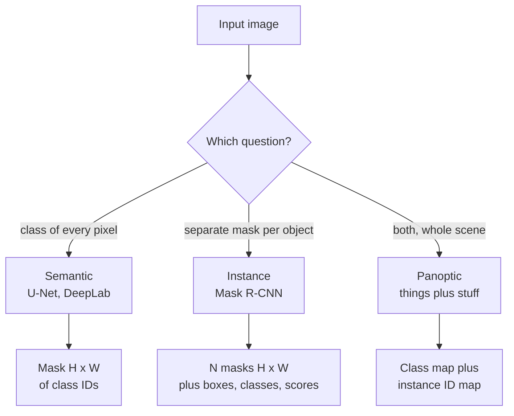
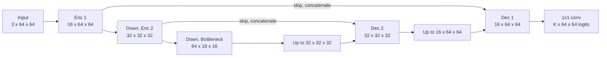

A bounding box is a crude description of shape. A tumour, a road, a crack in a weld or a person's outline is not a rectangle. **Image segmentation** labels every pixel, producing a mask that traces objects exactly. It is the task behind medical image analysis, background removal in video calls, autonomous-driving scene understanding, satellite land-use mapping and photo-editing tools that select an object with one click. This lesson covers the three kinds of segmentation, how masks are represented, the U-Net architecture, and the metrics and losses that make segmentation models trainable.

## Three kinds of segmentation

| Task | Question it answers | Output | Distinguishes two touching people? |
| --- | --- | --- | --- |
| Semantic segmentation | Which class is each pixel? | one class ID per pixel | No: both are just "person" |
| Instance segmentation | Which object instance is each pixel, for countable objects? | one mask, class and score per object | Yes |
| Panoptic segmentation | Both at once | every pixel gets a class, and countable "things" also get an instance ID | Yes, and also labels "stuff" like sky and road |

The terms **things** (countable objects: cars, people, cells) and **stuff** (amorphous regions: sky, grass, road) come from panoptic segmentation, which unifies the other two.



## Masks as arrays

A semantic mask is an integer array of shape $H \times W$ holding a class ID per pixel. A binary mask (object or background) is the special case with two classes.

```python
import numpy as np
import torch
from torch import nn

# 0 = background, 1 = road, 2 = car
mask = np.array([
    [0, 0, 0, 0, 0],
    [0, 0, 2, 2, 0],
    [1, 1, 2, 2, 1],
    [1, 1, 1, 1, 1],
])
classes, counts = np.unique(mask, return_counts=True)
print(dict(zip(classes.tolist(), counts.tolist())))
print((mask == 2).astype(int))      # binary mask for "car"
```

```output
{0: 8, 1: 8, 2: 4}
[[0 0 0 0 0]
 [0 0 1 1 0]
 [0 0 1 1 0]
 [0 0 0 0 0]]
```

Two practical points. First, masks must be resized with **nearest-neighbour** interpolation: bilinear interpolation would blend class 0 and class 2 into a meaningless class 1 at the boundary. Second, datasets often mark uncertain or unlabelled pixels with a special value such as 255, to be ignored by the loss.

## Per-pixel classification

A semantic segmentation model is a classifier applied at every pixel. For $K$ classes it outputs logits of shape $(N, K, H, W)$, and the target is an integer tensor of shape $(N, H, W)$. `nn.CrossEntropyLoss` handles this layout directly, averaging over all pixels:

```python
torch.manual_seed(0)
N, K, H, W = 2, 3, 4, 5
logits = torch.randn(N, K, H, W)
target = torch.from_numpy(mask).long().unsqueeze(0).repeat(N, 1, 1)   # (N, H, W)
target[1, 0, 0] = 255                                                 # an unlabelled pixel

loss_fn = nn.CrossEntropyLoss(ignore_index=255)
print(logits.shape, target.shape)
print(f"loss: {loss_fn(logits, target).item():.4f}")

pred = logits.argmax(dim=1)          # (N, H, W) predicted class per pixel
print(pred.shape)
```

```output
torch.Size([2, 3, 4, 5]) torch.Size([2, 4, 5])
loss: 1.4620
torch.Size([2, 4, 5])
```

The model's job is to produce those logits at full resolution, which raises the central design problem of segmentation.

## U-Net: encoder, decoder and skip connections

A classification CNN shrinks the image to get a large receptive field and abstract features, but segmentation needs an output as large as the input. **U-Net** resolves this with two paths:

- An **encoder** (contracting path) of conv blocks and downsampling, like a classification backbone. It learns what is in the image.
- A **decoder** (expanding path) that upsamples back to full resolution. It learns where things are.
- **Skip connections** that concatenate encoder feature maps with decoder feature maps of the same size. These carry fine spatial detail, such as exact edges, that was lost during downsampling.



Upsampling uses a **transposed convolution** (`nn.ConvTranspose2d`), a learned upsampling whose output size is

$$
O = (I - 1)\,S - 2P + K
$$

for input size $I$, stride $S$, padding $P$ and kernel $K$. With $K = 2$, $S = 2$, $P = 0$ it exactly doubles the size: $O = 2I$. An alternative is `nn.Upsample(scale_factor=2)` followed by a normal conv.

Here is a compact two-level U-Net:

```python
def double_conv(c_in, c_out):
    return nn.Sequential(
        nn.Conv2d(c_in, c_out, 3, padding=1), nn.BatchNorm2d(c_out), nn.ReLU(),
        nn.Conv2d(c_out, c_out, 3, padding=1), nn.BatchNorm2d(c_out), nn.ReLU(),
    )

class TinyUNet(nn.Module):
    def __init__(self, in_ch=3, num_classes=3):
        super().__init__()
        self.enc1 = double_conv(in_ch, 16)
        self.enc2 = double_conv(16, 32)
        self.bottleneck = double_conv(32, 64)
        self.pool = nn.MaxPool2d(2)
        self.up2 = nn.ConvTranspose2d(64, 32, kernel_size=2, stride=2)
        self.dec2 = double_conv(64, 32)          # 32 upsampled + 32 from the skip
        self.up1 = nn.ConvTranspose2d(32, 16, kernel_size=2, stride=2)
        self.dec1 = double_conv(32, 16)          # 16 upsampled + 16 from the skip
        self.out = nn.Conv2d(16, num_classes, kernel_size=1)

    def forward(self, x):
        e1 = self.enc1(x)
        e2 = self.enc2(self.pool(e1))
        b = self.bottleneck(self.pool(e2))
        d2 = self.dec2(torch.cat([self.up2(b), e2], dim=1))
        d1 = self.dec1(torch.cat([self.up1(d2), e1], dim=1))
        return self.out(d1)

net = TinyUNet()
y = net(torch.randn(2, 3, 64, 64))
print(y.shape)
print(sum(p.numel() for p in net.parameters()))
```

```output
torch.Size([2, 3, 64, 64])
117715
```

The output has the same height and width as the input, with one channel of logits per class. Input sizes must be divisible by $2^{\text{depth}}$ (here 4) so that the skip connections line up; otherwise the concatenation fails with a size mismatch. In practice the encoder is usually a pretrained classification backbone, which brings the benefits of [transfer learning](/learn/computer-vision/transfer-learning) to segmentation.

> [!KEY]
> Segmentation needs both "what" (deep, low-resolution features) and "where" (shallow, high-resolution features). Skip connections are how U-Net combines them, and variants of the idea appear in nearly every dense-prediction model.

## Measuring overlap: IoU and Dice

Pixel accuracy is misleading for the same reason as accuracy on imbalanced classes: if 95% of an image is background, predicting "background everywhere" scores 95%. Segmentation is measured per class with overlap metrics. For a predicted mask $P$ and a true mask $T$ (sets of pixels):

$$
\text{IoU} = \frac{|P \cap T|}{|P \cup T|}, \qquad \text{Dice} = \frac{2\,|P \cap T|}{|P| + |T|}
$$

Dice is equivalent to the F1 score over pixels. The two are monotonically related, $\text{Dice} = \frac{2\,\text{IoU}}{1 + \text{IoU}}$, and Dice is always at least as large as IoU. **mIoU**, the mean IoU over classes, is the standard semantic segmentation benchmark.

A worked example: the true object covers 6 pixels, the prediction covers 5, and 4 pixels agree.

```python
true = np.array([
    [0, 1, 1, 0],
    [0, 1, 1, 0],
    [0, 1, 1, 0],
    [0, 0, 0, 0],
], dtype=bool)
pred = np.array([
    [0, 0, 1, 0],
    [0, 1, 1, 1],
    [0, 1, 0, 0],
    [0, 0, 0, 0],
], dtype=bool)

inter = np.logical_and(pred, true).sum()
union = np.logical_or(pred, true).sum()
print(f"|P|={pred.sum()} |T|={true.sum()} intersection={inter} union={union}")
print(f"IoU  = {inter / union:.3f}")
print(f"Dice = {2 * inter / (pred.sum() + true.sum()):.3f}")
```

```output
|P|=5 |T|=6 intersection=4 union=7
IoU  = 0.571
Dice = 0.727
```

By hand: IoU $= 4/7 \approx 0.571$ and Dice $= 8/11 \approx 0.727$, and indeed $2(0.571)/(1.571) \approx 0.727$.

### Dice as a loss

When the object is tiny, such as a lesion covering 0.1% of a scan, cross-entropy is dominated by the easy background pixels. A **soft Dice loss** optimises the overlap directly, using predicted probabilities in place of hard masks so that it is differentiable:

```python
def soft_dice_loss(logits, target, eps=1.0):
    """Binary case. logits, target: (N, 1, H, W); target holds 0s and 1s."""
    probs = torch.sigmoid(logits)
    inter = (probs * target).sum(dim=(1, 2, 3))
    total = probs.sum(dim=(1, 2, 3)) + target.sum(dim=(1, 2, 3))
    dice = (2 * inter + eps) / (total + eps)
    return 1 - dice.mean()

t = torch.from_numpy(true).float().reshape(1, 1, 4, 4)
confident_right = (t * 2 - 1) * 10          # large positive logits on the object, negative elsewhere
print(f"{soft_dice_loss(confident_right, t).item():.4f}")
print(f"{soft_dice_loss(torch.zeros(1, 1, 4, 4), t).item():.4f}")
```

```output
0.0001
0.5333
```

The smoothing term `eps` avoids division by zero on images with no object. A common, robust choice is to add cross-entropy (or binary cross-entropy) and Dice loss together.

## Instance segmentation and pretrained models

Instance segmentation is usually built on a detector. **Mask R-CNN** extends Faster R-CNN from [object detection](/learn/computer-vision/object-detection) with a third head that predicts a small mask inside each detected box. torchvision provides it, along with semantic models such as DeepLabV3:

```python
from torchvision.models.detection import maskrcnn_resnet50_fpn, MaskRCNN_ResNet50_FPN_Weights

weights = MaskRCNN_ResNet50_FPN_Weights.DEFAULT
model = maskrcnn_resnet50_fpn(weights=weights).eval()
# model([image_tensor])[0] has "boxes", "labels", "scores" and "masks";
# masks has shape (num_objects, 1, H, W) with per-pixel probabilities.
# Threshold them (for example > 0.5) to get binary masks.
```

Labelling data is the real cost of segmentation: drawing a polygon around every object takes far longer than drawing a box. Promptable segmentation models, which produce a mask from a click or a box, are now widely used to speed up annotation, with a human correcting the results.

> [!WARNING]
> Every geometric augmentation must be applied identically to the image and its mask, and masks must never be colour-jittered or normalised. Wrapping the mask in `tv_tensors.Mask` makes `transforms.v2` handle this, as shown in [image augmentation](/learn/computer-vision/image-augmentation).

## Exercises

**1.** A model predicts a 30-pixel mask; the true object has 50 pixels; they share 25 pixels. Compute IoU and Dice.

<details>
<summary>Show solution</summary>

Union $= 30 + 50 - 25 = 55$, so IoU $= 25/55 \approx 0.455$. Dice $= 50/80 = 0.625$. Check: $2(0.455)/1.455 \approx 0.625$.

</details>

**2.** Write `miou(pred, true, num_classes)` for integer masks, averaging IoU over the classes that appear in either mask. Test it on `mask` and a copy where the car has been predicted as road.

<details>
<summary>Show solution</summary>

```python
def miou(pred, true, num_classes):
    ious = []
    for c in range(num_classes):
        p, t = pred == c, true == c
        union = np.logical_or(p, t).sum()
        if union > 0:
            ious.append(np.logical_and(p, t).sum() / union)
    return float(np.mean(ious))

wrong = mask.copy()
wrong[wrong == 2] = 1            # every car pixel predicted as road
print(round(miou(mask, mask, 3), 3), round(miou(wrong, mask, 3), 3))
```

```output
1.0 0.556
```

Background is still perfect (IoU 1), road gains the 4 car pixels as false positives (IoU 8/12), and the car is missed entirely (IoU 0), so mIoU drops sharply even though pixel accuracy is 16/20 = 80%.

</details>

**3.** Using the transposed convolution formula, what output size does `nn.ConvTranspose2d(64, 32, kernel_size=4, stride=2, padding=1)` give for a 16-pixel input? Verify in PyTorch.

<details>
<summary>Show solution</summary>

$O = (16 - 1) \cdot 2 - 2 \cdot 1 + 4 = 32$: another common way to double the size.

```python
up = nn.ConvTranspose2d(64, 32, kernel_size=4, stride=2, padding=1)
print(up(torch.randn(1, 64, 16, 16)).shape)
```

```output
torch.Size([1, 32, 32, 32])
```

</details>

```quiz
[
  {
    "q": "Two people stand side by side. Which task gives each person a separate mask?",
    "options": ["Semantic segmentation", "Image classification", "Instance segmentation", "Pixel accuracy"],
    "answer": 2,
    "why": "Semantic segmentation labels both as 'person' in one region; instance segmentation separates individual objects."
  },
  {
    "q": "What is the role of the skip connections in U-Net?",
    "options": [
      "They pass high-resolution encoder features to the decoder to recover precise spatial detail",
      "They make the network shallower",
      "They replace the loss function",
      "They skip the decoder at inference time"
    ],
    "answer": 0,
    "why": "Downsampling loses fine detail; concatenating same-size encoder features into the decoder restores it."
  },
  {
    "q": "A predicted mask and a true mask have IoU 0.5. What is their Dice coefficient?",
    "options": ["0.5", "0.25", "0.75", "0.667"],
    "answer": 3,
    "why": "Dice = 2 IoU / (1 + IoU) = 1 / 1.5 = 0.667."
  },
  {
    "q": "How should you resize a segmentation mask of class IDs?",
    "options": [
      "Bilinear interpolation, then round",
      "Nearest-neighbour interpolation",
      "Normalise with the ImageNet mean first",
      "Bicubic interpolation"
    ],
    "answer": 1,
    "why": "Interpolating between class IDs invents classes at boundaries. Nearest-neighbour keeps every value a valid class."
  }
]
```
