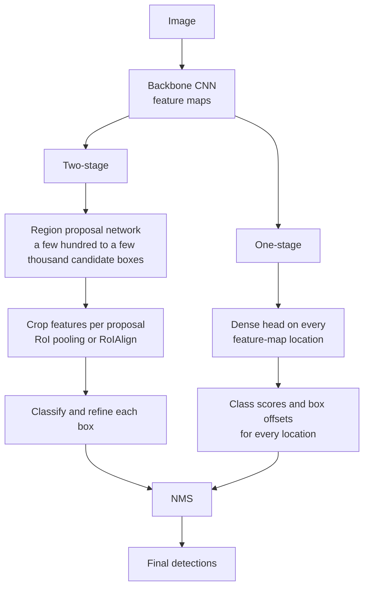

Classification says what is in an image. **Object detection** says what is in it and where: it outputs a list of objects, each with a class label, a confidence score and a **bounding box**. Detection powers self-checkout cameras, vehicle and pedestrian tracking, shelf auditing, document layout analysis and counting anything from cells to cars. The model architectures vary, but they all share a small set of ideas you can compute by hand: box formats, intersection over union, non-maximum suppression, anchors and mean average precision. Master those and every detector's documentation becomes readable.

## Bounding boxes and their formats

A bounding box is an axis-aligned rectangle given by four numbers, in pixels or as fractions of the image size. Three formats are common, and mixing them up is the most frequent detection bug.

| Format | Numbers | Used by |
| --- | --- | --- |
| `xyxy` | left $x_1$, top $y_1$, right $x_2$, bottom $y_2$ | torchvision models, Pascal VOC |
| `xywh` | left $x$, top $y$, width $w$, height $h$ | COCO annotation files |
| `cxcywh` | centre $c_x$, centre $c_y$, width, height | YOLO label files (normalised to 0-1), DETR |

Image coordinates start at the top-left corner, with $y$ increasing downwards. torchvision converts between formats for you:

```python
import numpy as np
import torch
from torchvision.ops import box_convert

box = torch.tensor([[10.0, 20.0, 50.0, 60.0]])          # xyxy
print(box_convert(box, in_fmt="xyxy", out_fmt="xywh"))
print(box_convert(box, in_fmt="xyxy", out_fmt="cxcywh"))
```

```output
tensor([[10., 20., 40., 40.]])
tensor([[30., 40., 40., 40.]])
```

## Intersection over Union

To decide whether a predicted box matches a ground-truth box, detection uses **Intersection over Union** (IoU), also called the Jaccard index:

$$
\text{IoU}(A, B) = \frac{|A \cap B|}{|A \cup B|} = \frac{|A \cap B|}{|A| + |B| - |A \cap B|}
$$

where $|A|$ is the area of box $A$. IoU is 1 for identical boxes and 0 for boxes that do not touch.

A worked example: box $A = (10, 10, 50, 50)$ and box $B = (30, 20, 70, 60)$, both in `xyxy`.

1. Each box is $40 \times 40$, so $|A| = |B| = 1600$.
2. The intersection runs from $x = \max(10, 30) = 30$ to $\min(50, 70) = 50$, width 20, and from $y = \max(10, 20) = 20$ to $\min(50, 60) = 50$, height 30. Area $= 600$.
3. Union $= 1600 + 1600 - 600 = 2600$, so $\text{IoU} = 600 / 2600 \approx 0.231$.

```python
def iou(a, b):
    x1, y1 = max(a[0], b[0]), max(a[1], b[1])
    x2, y2 = min(a[2], b[2]), min(a[3], b[3])
    inter = max(0, x2 - x1) * max(0, y2 - y1)     # 0 if the boxes do not overlap
    area_a = (a[2] - a[0]) * (a[3] - a[1])
    area_b = (b[2] - b[0]) * (b[3] - b[1])
    return inter / (area_a + area_b - inter)

A = [10, 10, 50, 50]
B = [30, 20, 70, 60]
print(round(iou(A, B), 4))
```

```output
0.2308
```

The library version computes all pairs at once and should agree:

```python
from torchvision.ops import box_iou
print(box_iou(torch.tensor([A], dtype=torch.float32), torch.tensor([B], dtype=torch.float32)))
```

```output
tensor([[0.2308]])
```

A detection usually counts as correct when its IoU with an unmatched ground-truth box of the same class is at least 0.5. The `max(0, ...)` in the code matters: without it, two distant boxes would get a negative "intersection".

## Non-maximum suppression

Detectors make many overlapping predictions for the same object. **Non-maximum suppression** (NMS) cleans them up: keep the highest-scoring box, delete every remaining box that overlaps it by more than a threshold, and repeat.

```python
boxes = np.array([
    [10, 10, 50, 50],    # 0
    [12, 12, 52, 52],    # 1: almost the same as 0
    [60, 60, 100, 100],  # 2
    [62, 58, 100, 98],   # 3: almost the same as 2
    [30, 20, 70, 60],    # 4: overlaps 0, but only a little
])
scores = np.array([0.9, 0.75, 0.8, 0.6, 0.5])

def nms(boxes, scores, thresh=0.5):
    order = list(np.argsort(-scores))      # indices, highest score first
    keep = []
    while order:
        best = order.pop(0)
        keep.append(int(best))
        order = [i for i in order if iou(boxes[best], boxes[i]) < thresh]
    return keep

print(nms(boxes, scores))
```

```output
[0, 2, 4]
```

```trace
{
  "title": "Non-maximum suppression with an IoU threshold of 0.5",
  "code": [
    "order = list(np.argsort(-scores))",
    "keep = []",
    "while order:",
    "    best = order.pop(0)",
    "    keep.append(int(best))",
    "    order = [i for i in order if iou(boxes[best], boxes[i]) < thresh]",
    "print(keep)"
  ],
  "steps": [
    { "line": 1, "vars": { "order": "[0, 2, 1, 3, 4]" }, "note": "Sort by score: 0.9, 0.8, 0.75, 0.6, 0.5." },
    { "line": 4, "vars": { "order": "[2, 1, 3, 4]", "best": "0" }, "note": "Box 0 has the highest remaining score." },
    { "line": 5, "vars": { "keep": "[0]", "best": "0" }, "note": "The best box is always kept." },
    { "line": 6, "vars": { "keep": "[0]", "order": "[2, 3, 4]" }, "note": "IoU with box 0: box 2 is 0.0, box 1 is 0.822 (removed), box 3 is 0.0, box 4 is 0.231 (kept, below 0.5)." },
    { "line": 4, "vars": { "order": "[3, 4]", "best": "2" }, "note": "Next best is box 2, a different object." },
    { "line": 6, "vars": { "keep": "[0, 2]", "order": "[4]" }, "note": "Box 3 overlaps box 2 with IoU 0.862, so it is removed. Box 4 does not touch box 2." },
    { "line": 6, "vars": { "keep": "[0, 2, 4]", "order": "[]" }, "note": "Box 4 is kept and nothing is left to compare." },
    { "line": 7, "vars": { "keep": "[0, 2, 4]" }, "out": ["[0, 2, 4]"], "note": "Three detections survive: the two duplicates were suppressed." }
  ]
}
```

In practice use `torchvision.ops.nms`, which takes float tensors and returns kept indices sorted by score:

```python
from torchvision.ops import nms as tv_nms
print(tv_nms(torch.tensor(boxes, dtype=torch.float32), torch.tensor(scores, dtype=torch.float32), 0.5))
```

```output
tensor([0, 2, 4])
```

NMS is applied **per class** (`torchvision.ops.batched_nms` does this), so a person and the bicycle they ride do not suppress each other. The threshold is a trade-off: too low and genuinely overlapping objects, such as people in a crowd, get merged; too high and duplicates survive.

## How detectors predict boxes

A detector cannot know in advance how many objects there are, so it makes a fixed, large number of candidate predictions and lets the scores and NMS sort them out. Two design families exist.



| | Two-stage (Faster R-CNN family) | One-stage (YOLO, SSD, RetinaNet) |
| --- | --- | --- |
| How | propose regions, then classify and refine each | predict classes and boxes densely in one pass |
| Speed | slower | faster, suited to real time |
| Strengths | historically strong accuracy, especially on small objects | simple pipeline, easy to deploy |
| Typical use | offline analysis where accuracy matters most | video, edge devices, robotics |

The gap between the families has narrowed considerably over the years; choose by measuring on your own data and hardware.

### Anchors

Many detectors predict boxes relative to **anchors**: a fixed set of reference boxes of several sizes and aspect ratios, placed at every feature-map location. Instead of predicting raw coordinates, the network predicts small **offsets** from each anchor plus a class score. Anchors that overlap a ground-truth box with high IoU are trained as positives for that object; those with low IoU are trained as background. Newer **anchor-free** designs predict the box directly from each location (for example, distances from the location to the four box edges), which removes the need to hand-tune anchor shapes.

## A torchvision detector

torchvision includes ready-made detectors. Their interface is worth knowing because many libraries copy it: the model takes a **list** of image tensors (which may have different sizes) and, in evaluation mode, returns a list of dictionaries.

```python
from torchvision.models.detection import fasterrcnn_resnet50_fpn, FasterRCNN_ResNet50_FPN_Weights

weights = FasterRCNN_ResNet50_FPN_Weights.DEFAULT
model = fasterrcnn_resnet50_fpn(weights=weights).eval()
preprocess = weights.transforms()

images = [preprocess(img)]            # img: a uint8 CHW tensor, e.g. from torchvision.io.read_image
with torch.no_grad():
    out = model(images)[0]
# out["boxes"]: (N, 4) xyxy in pixels, out["labels"]: (N,), out["scores"]: (N,)
keep = out["scores"] > 0.5
categories = weights.meta["categories"]
for box, label in zip(out["boxes"][keep], out["labels"][keep]):
    print(categories[label], box.round().tolist())
```

For training, you pass the targets too, as a list of dictionaries with `"boxes"` (float, `xyxy`) and `"labels"` (int64), and the model returns a dictionary of losses in training mode.

## Evaluating detectors: mAP

Accuracy does not work for detection, because there is no fixed number of predictions. Instead:

1. Sort all detections of a class by score, highest first.
2. Mark each as a true positive (TP) if it matches an unmatched ground-truth box with IoU at least the threshold, otherwise a false positive (FP).
3. Walk down the list, computing precision and recall after each detection. This traces a **precision-recall curve**.
4. **Average precision** (AP) is the area under that curve, after making precision monotonically decreasing.

```python
# 6 detections sorted by score, 5 ground-truth objects in total
is_tp = np.array([1, 1, 0, 1, 0, 1])
n_gt = 5

tp = np.cumsum(is_tp)
fp = np.cumsum(1 - is_tp)
precision = tp / (tp + fp)
recall = tp / n_gt
print("precision", precision.round(3))
print("recall   ", recall.round(3))

# make precision non-increasing from right to left, then sum the area
p = np.concatenate([[0], precision, [0]])
r = np.concatenate([[0], recall, [recall[-1]]])
for i in range(len(p) - 2, -1, -1):
    p[i] = max(p[i], p[i + 1])
ap = np.sum((r[1:] - r[:-1]) * p[1:])
print(f"AP = {ap:.3f}")
```

```output
precision [1.    1.    0.667 0.75  0.6   0.667]
recall    [0.2 0.4 0.4 0.6 0.6 0.8]
AP = 0.683
```

One object was never found, so recall stops at 0.8 and AP cannot reach 1. **mAP** (mean average precision) is the mean of AP over all classes. Benchmarks differ in the IoU threshold: "mAP@0.5" uses IoU 0.5 (the Pascal VOC convention), while the COCO metric averages mAP over thresholds from 0.5 to 0.95 in steps of 0.05, rewarding tightly placed boxes. Always state which one you report.

> [!KEY]
> Detection quality has two parts: finding the object (recall) and placing the box well (IoU). mAP over several IoU thresholds measures both, which is why it is the standard metric.

> [!TIP]
> Before trusting any detection pipeline, draw the ground-truth boxes on a few training images. Wrong box formats, swapped $x$ and $y$, or normalised coordinates treated as pixels all become obvious in a picture and invisible in a loss curve.

## Exercises

**1.** Compute the IoU of $(0, 0, 10, 10)$ and $(5, 5, 15, 15)$ by hand, then check with `iou`.

<details>
<summary>Show solution</summary>

Each area is 100; the intersection is the $5 \times 5$ square from 5 to 10, area 25; union $= 175$; IoU $= 25/175 \approx 0.143$.

```python
print(round(iou([0, 0, 10, 10], [5, 5, 15, 15]), 4))
```

```output
0.1429
```

Notice how strict IoU is: two boxes offset by half their size score only 0.14.

</details>

**2.** Rerun the NMS example with thresholds 0.2 and 0.9. Explain each result.

<details>
<summary>Show solution</summary>

```python
print(nms(boxes, scores, thresh=0.2))
print(nms(boxes, scores, thresh=0.9))
```

```output
[0, 2]
[0, 2, 1, 3, 4]
```

At 0.2, box 4 (IoU 0.231 with box 0) is also suppressed, which would be a mistake if it were a separate, overlapping object. At 0.9, no pair overlaps that much, so every duplicate survives.

</details>

**3.** Convert the COCO-style box `[x=40, y=30, w=100, h=50]` in a $640 \times 480$ image into a YOLO-style normalised `cxcywh` box.

<details>
<summary>Show solution</summary>

The centre is $(40 + 50, 30 + 25) = (90, 55)$. Divide $x$ values by the width 640 and $y$ values by the height 480.

```python
x, y, w, h = 40, 30, 100, 50
W, H = 640, 480
print([round(v, 4) for v in ((x + w / 2) / W, (y + h / 2) / H, w / W, h / H)])
```

```output
[0.1406, 0.1146, 0.1562, 0.1042]
```

</details>

```quiz
[
  {
    "q": "Two boxes of area 100 each overlap in an area of 50. What is their IoU?",
    "options": ["0.5", "0.25", "0.333", "0.667"],
    "answer": 2,
    "why": "Union = 100 + 100 - 50 = 150, so IoU = 50 / 150 = 0.333."
  },
  {
    "q": "What does non-maximum suppression do?",
    "options": [
      "Removes lower-scoring boxes that overlap a higher-scoring box above an IoU threshold",
      "Removes boxes with scores below 0.5",
      "Merges all boxes into one",
      "Rescales boxes to the image size"
    ],
    "answer": 0,
    "why": "NMS keeps the best box among overlapping duplicates. Score thresholding is a separate step."
  },
  {
    "q": "What is the main structural difference between two-stage and one-stage detectors?",
    "options": [
      "Two-stage detectors do not use a backbone",
      "Two-stage detectors first propose candidate regions, then classify and refine each; one-stage detectors predict densely in a single pass",
      "One-stage detectors cannot detect more than one object",
      "One-stage detectors do not need NMS"
    ],
    "answer": 1,
    "why": "Faster R-CNN uses a region proposal network then a second head; YOLO-style models predict boxes and classes at every location at once."
  },
  {
    "q": "A paper reports COCO-style mAP. How is that different from mAP@0.5?",
    "options": [
      "It only counts large objects",
      "It uses accuracy instead of precision",
      "It ignores false positives",
      "It averages mAP over IoU thresholds from 0.5 to 0.95, so it rewards precise box placement"
    ],
    "answer": 3,
    "why": "Averaging over stricter IoU thresholds penalises boxes that are roughly right but poorly aligned."
  }
]
```
