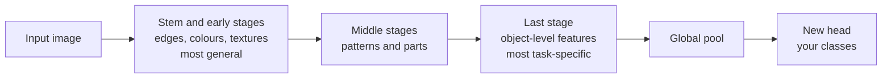

Training a CNN from scratch needs a large labelled dataset and a lot of compute. Most real vision projects have neither: a few hundred defect photos, a few thousand medical images, a product catalogue. **Transfer learning** solves this by starting from a network already trained on a large, general dataset such as ImageNet and adapting it to your task. It is the default way to build an image classifier in practice. The mechanics (loading weights, freezing parameters, replacing the head) were covered in [PyTorch transfer learning](/learn/pytorch/transfer-learning). This lesson is about the vision-specific decisions: which backbone, which layers to train, how to preprocess, and what to do when your images do not look like ImageNet.

## Why vision features transfer

A trained CNN builds a hierarchy. The first layers learn edge, colour and texture detectors; middle layers learn patterns and parts; the last layers learn combinations specific to the training classes. Edges and textures are useful for almost any image, so the early layers transfer well even to very different tasks. The later the layer, the more task-specific it is.



In torchvision's ResNet models those stages are named `conv1`, `layer1` to `layer4`, then `avgpool` and the classifier `fc`. Transfer learning means keeping the backbone, replacing `fc`, and deciding how much of the backbone to update.

## Choosing a strategy

The right amount of fine-tuning depends on how much data you have and how similar it is to the pretraining images.

| Your data | Similar to ImageNet (photos of objects) | Different (X-rays, satellite, microscopy) |
| --- | --- | --- |
| Small (hundreds of images) | Feature extraction: freeze the backbone, train the head | Freeze early stages, fine-tune the last stage or two, with strong augmentation |
| Medium (thousands) | Fine-tune the last stages, then possibly all, with a small learning rate | Fine-tune most or all layers |
| Large (hundreds of thousands) | Fine-tune everything | Fine-tune everything; training from scratch becomes an option |

When in doubt, start with feature extraction as a fast baseline, then unfreeze more and see whether validation performance improves.

## Loading a backbone with its preprocessing

Every set of torchvision pretrained weights carries the preprocessing it was trained with. Use it: a mismatch in resizing or normalisation is one of the most common reasons a pretrained model underperforms.

```python
import torch
from torch import nn
from torchvision.models import resnet18, ResNet18_Weights

weights = ResNet18_Weights.DEFAULT
preprocess = weights.transforms()
print(preprocess)
```

```output
ImageClassification(
    crop_size=[224]
    resize_size=[256]
    mean=[0.485, 0.456, 0.406]
    std=[0.229, 0.224, 0.225]
    interpolation=InterpolationMode.BILINEAR
)
```

`preprocess` is the evaluation transform. For training, build your own augmentation pipeline (see [image augmentation](/learn/computer-vision/image-augmentation)) and end it with the same normalisation values and a similar final size.

Then load the model and replace the head. `resnet18(weights=weights)` downloads the weights on first use; here we show the architecture with `weights=None` so that the counts are clear.

```python
model = resnet18(weights=None)      # in practice: resnet18(weights=weights)
print(model.fc)
model.fc = nn.Linear(model.fc.in_features, 5)    # 5 classes in your task

total = sum(p.numel() for p in model.parameters())
print(f"total parameters: {total:,}")
```

```output
Linear(in_features=512, out_features=1000, bias=True)
total parameters: 11,179,077
```

## Feature extraction: freeze the backbone

Freeze every parameter, then unfreeze the new head:

```python
for p in model.parameters():
    p.requires_grad = False
for p in model.fc.parameters():
    p.requires_grad = True

trainable = sum(p.numel() for p in model.parameters() if p.requires_grad)
print(f"trainable parameters: {trainable:,}")
```

```output
trainable parameters: 2,565
```

Only $512 \times 5 + 5 = 2{,}565$ of the 11 million parameters will be trained. Pass only those to the optimiser: `torch.optim.AdamW(model.fc.parameters(), lr=1e-3)`.

### The BatchNorm trap

Freezing parameters with `requires_grad = False` stops the BatchNorm **weights** from changing, but in `model.train()` mode BatchNorm layers still update their **running mean and variance** from your batches. With small batches of unusual images this can quietly damage the pretrained features. When you freeze a backbone, keep its BatchNorm layers in evaluation mode:

```python
def set_train_mode(model):
    model.train()
    for m in model.modules():
        if isinstance(m, nn.BatchNorm2d) and not m.weight.requires_grad:
            m.eval()            # frozen BN: use the stored ImageNet statistics

set_train_mode(model)
print(model.bn1.training, model.fc.training)
```

```output
False True
```

Call `set_train_mode(model)` at the start of every training epoch, in place of `model.train()`.

## Fine-tuning: unfreeze the top stages

With more data, unfreeze the last stage as well. Give the pretrained layers a smaller learning rate than the new head, because they already hold useful weights and large updates would destroy them. Optimisers accept **parameter groups** for exactly this:

```python
for p in model.layer4.parameters():
    p.requires_grad = True

optimizer = torch.optim.AdamW([
    {"params": model.layer4.parameters(), "lr": 1e-4},
    {"params": model.fc.parameters(), "lr": 1e-3},
], weight_decay=1e-4)

for group in optimizer.param_groups:
    n = sum(p.numel() for p in group["params"])
    print(f"lr={group['lr']:.0e}  params={n:,}")
```

```output
lr=1e-04  params=8,393,728
lr=1e-03  params=2,565
```

A common recipe is two phases: train the head alone for a few epochs until it produces sensible outputs, then unfreeze more layers and continue with a lower learning rate. Fine-tuning the backbone while the head is still random sends large, noisy gradients into the pretrained weights.

> [!KEY]
> Use **discriminative learning rates**: smallest for early layers, larger for later layers, largest for the new head. The more general and valuable a layer's features, the more gently you change them.

## Vision-specific choices

### Picking a backbone

| Consideration | Lean towards |
| --- | --- |
| Small data, fast iteration | a small CNN backbone such as ResNet-18 or a MobileNet |
| Edge or mobile deployment | MobileNet or EfficientNet families, then measure latency on the target device |
| Plenty of data and compute, best accuracy | larger CNNs (ConvNeXt) or Vision Transformers |
| Very small data | a backbone pretrained on a larger or more diverse dataset matters more than its size |

Bigger is not automatically better: a large model on a few hundred images overfits faster and trains slower. Benchmark two or three candidates on your own validation set rather than trusting leaderboard numbers.

### Inputs that do not look like ImageNet

- **Grayscale images.** The pretrained first conv expects 3 channels. The simple fix is to repeat the channel three times (`v2.Grayscale(num_output_channels=3)`). Alternatively, replace `conv1` with a 1-channel conv whose weights are the pretrained weights summed over the input-channel axis.
- **More than 3 channels** (satellite bands, depth). Build a new `conv1` with more input channels, copy the pretrained RGB weights into the first three, and initialise the rest small.
- **Resolution.** CNNs with global pooling accept other input sizes, but features are tuned to objects at ImageNet-like scales. If your objects are tiny (cells, defects), use a higher input resolution rather than shrinking images to 224.
- **Domain gap.** For X-rays or microscopy, ImageNet colour statistics are less meaningful, and you will usually need to fine-tune more layers. Backbones pretrained on in-domain data, where available, are worth trying.

> [!WARNING]
> Do not compute your own normalisation statistics and use them with a pretrained backbone unless you also fine-tune the whole network. The first layer's weights were learned for inputs normalised with the original statistics.

## Exercises

**1.** With `resnet18` and a 10-class head, how many parameters are trainable when only `fc` is unfrozen? Compute it by hand, then check in code.

<details>
<summary>Show solution</summary>

The head maps 512 features to 10 logits: $512 \times 10 + 10 = 5{,}130$.

```python
m = resnet18(weights=None)
m.fc = nn.Linear(512, 10)
for p in m.parameters():
    p.requires_grad = False
for p in m.fc.parameters():
    p.requires_grad = True
print(sum(p.numel() for p in m.parameters() if p.requires_grad))
```

```output
5130
```

</details>

**2.** Replace `conv1` of a ResNet-18 with a version that accepts 1-channel images while reusing the pretrained weights. Check that it produces logits for a grayscale batch.

<details>
<summary>Show solution</summary>

Sum the RGB weights over the input-channel axis, so a gray image with value $g$ in every channel gives the same response as before.

```python
m = resnet18(weights=None)               # in practice, the pretrained model
old = m.conv1
new = nn.Conv2d(1, old.out_channels, kernel_size=old.kernel_size,
                stride=old.stride, padding=old.padding, bias=False)
with torch.no_grad():
    new.weight.copy_(old.weight.sum(dim=1, keepdim=True))
m.conv1 = new
print(new.weight.shape, m(torch.randn(2, 1, 224, 224)).shape)
```

```output
torch.Size([64, 1, 7, 7]) torch.Size([2, 1000])
```

</details>

**3.** You have 400 labelled chest X-rays in two classes. Outline a transfer-learning plan: backbone, preprocessing, which layers to train in which order, and what to watch.

<details>
<summary>Show solution</summary>

A reasonable plan: a small pretrained CNN such as ResNet-18; grayscale converted to 3 channels with the backbone's own normalisation; mild augmentation (small rotations, brightness and contrast changes, no left-right flips if laterality matters). Phase 1: freeze the backbone with BatchNorm in eval mode and train the head. Phase 2: unfreeze `layer4` (and perhaps `layer3`) with a learning rate around ten times lower than the head. Split by patient, watch validation loss for overfitting with early stopping, and report recall for the abnormal class, not only accuracy.

</details>

```quiz
[
  {
    "q": "Which layers of a pretrained CNN are generally the most transferable to a new vision task?",
    "options": [
      "The final classification layer",
      "The early layers, which detect edges, colours and textures",
      "The last residual stage",
      "None; all layers are equally task-specific"
    ],
    "answer": 1,
    "why": "Early features are generic and useful across image domains; later features become specific to the original classes."
  },
  {
    "q": "Why should you use `weights.transforms()` (or equivalent settings) when evaluating a torchvision pretrained model?",
    "options": [
      "It applies random augmentation",
      "It is required to download the weights",
      "It reproduces the resizing and normalisation the weights were trained with",
      "It converts the model to half precision"
    ],
    "answer": 2,
    "why": "Pretrained weights expect inputs preprocessed the way they saw during training. A mismatch silently hurts accuracy."
  },
  {
    "q": "You freeze a backbone with `requires_grad = False` but call `model.train()`. What can still change in the backbone?",
    "options": [
      "BatchNorm running mean and variance",
      "Conv weights",
      "Nothing at all",
      "The number of layers"
    ],
    "answer": 0,
    "why": "BatchNorm updates its running statistics in training mode regardless of `requires_grad`. Put frozen BatchNorm layers in eval mode."
  },
  {
    "q": "When fine-tuning, why give the new head a larger learning rate than the pretrained layers?",
    "options": [
      "The head has more parameters",
      "Pretrained layers cannot be trained",
      "Larger learning rates always generalise better",
      "The head starts from random weights, while pretrained layers already hold useful features that large updates would destroy"
    ],
    "answer": 3,
    "why": "Discriminative learning rates change valuable pretrained features gently while letting the new head learn quickly."
  }
]
```
