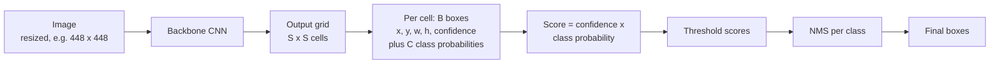

YOLO ("You Only Look Once") is the best-known family of one-stage object detectors. Its founding idea was to treat detection as a single regression problem: one forward pass of one network maps an image straight to boxes and class probabilities, with no separate region-proposal stage. That made real-time detection practical on ordinary hardware, and the family has been iterated on many times since, by many groups. Today, "train a YOLO model" is often the fastest route from a folder of labelled images to a working detector. This lesson explains the grid-prediction idea that all versions share, the label format, and how to use the Ultralytics library to run and train a model.

## The grid idea

The original YOLO divides the input image into an $S \times S$ grid. The cell that contains the **centre** of an object is responsible for detecting it. Each cell predicts:

- $B$ boxes, each with 5 numbers: $x, y$ (the box centre, as an offset within the cell), $w, h$ (box size, relative to the whole image), and a **confidence** that the box contains an object and fits it well;
- $C$ class probabilities, conditional on there being an object in the cell.

So the network's output is a tensor of shape

$$
S \times S \times (B \cdot 5 + C)
$$

In the original paper, $S = 7$, $B = 2$ and $C = 20$ (the Pascal VOC classes), giving a $7 \times 7 \times 30$ output. At inference, each box's class-specific score is its confidence multiplied by the class probability; low scores are discarded and [non-maximum suppression](/learn/computer-vision/object-detection) removes duplicates.



### Which cell is responsible?

With normalised coordinates (fractions of the image width and height), finding the responsible cell is a floor operation:

```python
import numpy as np

S = 7
cx, cy = 0.62, 0.31           # object centre as fractions of image width and height
col = int(cx * S)             # cells along x
row = int(cy * S)             # cells along y
x_in_cell = cx * S - col      # offset within the cell, between 0 and 1
y_in_cell = cy * S - row
print(row, col)
print(round(x_in_cell, 3), round(y_in_cell, 3))
```

```output
2 4
0.34 0.17
```

The network is trained to output exactly those in-cell offsets for that cell. Decoding at inference reverses the arithmetic:

```python
def decode(row, col, x_off, y_off, w, h, S, img_w, img_h):
    cx = (col + x_off) / S * img_w
    cy = (row + y_off) / S * img_h
    bw, bh = w * img_w, h * img_h
    return [round(v, 1) for v in (cx - bw / 2, cy - bh / 2, cx + bw / 2, cy + bh / 2)]

# cell (2, 4) predicts offsets (0.34, 0.17) and size (0.25, 0.4) on a 640x480 image
print(decode(2, 4, 0.34, 0.17, 0.25, 0.4, S, 640, 480))
```

```output
[316.8, 52.8, 476.8, 244.8]
```

The result is an `xyxy` box in pixels, ready for IoU and NMS.

> [!KEY]
> The grid turns "find an unknown number of objects" into "fill in a fixed-size tensor". Every cell makes the same kind of prediction with the same weights, which is why one convolutional pass is enough.

## What later versions changed

The original design had clear weaknesses: each cell could only predict a couple of objects, so small objects in groups (a flock of birds) were missed, and coarse $7 \times 7$ cells limited localisation. Later YOLO versions, and other one-stage detectors, addressed this with ideas that are now standard:

| Idea | Problem it solves |
| --- | --- |
| Predictions on several feature maps of different resolutions | Small objects are detected on fine grids, large ones on coarse grids |
| Feature pyramid style necks that mix deep and shallow features | Fine grids get semantic information, coarse grids get spatial detail |
| Anchor boxes, and later anchor-free heads | Better box shape priors, then simpler heads without hand-tuned anchors |
| IoU-based box losses | Optimise the overlap metric that evaluation actually uses |
| Heavy augmentation such as mosaic (four images tiled into one) | More objects and contexts per training image |

Version numbers and the exact choices differ between releases and maintainers, so treat any specific version as an implementation of these shared ideas rather than as a fixed design.

## The YOLO label format

YOLO-style datasets store one text file per image, with the same base name, and one line per object:

```text
<class_id> <cx> <cy> <w> <h>
```

All four box numbers are normalised to the range 0 to 1 by the image width and height, using the centre-size (`cxcywh`) format from [object detection](/learn/computer-vision/object-detection). Converting from pixel `xyxy` boxes is a few lines:

```python
def to_yolo_line(class_id, box, img_w, img_h):
    x1, y1, x2, y2 = box
    cx = (x1 + x2) / 2 / img_w
    cy = (y1 + y2) / 2 / img_h
    w = (x2 - x1) / img_w
    h = (y2 - y1) / img_h
    return f"{class_id} {cx:.6f} {cy:.6f} {w:.6f} {h:.6f}"

print(to_yolo_line(0, (100, 50, 300, 250), 640, 480))
print(to_yolo_line(2, (400, 300, 480, 460), 640, 480))
```

```output
0 0.312500 0.312500 0.312500 0.416667
2 0.687500 0.791667 0.125000 0.333333
```

A typical directory layout puts images and labels side by side, with matching sub-folders:

```text
dataset/
  images/
    train/  img001.jpg  img002.jpg ...
    val/    ...
  labels/
    train/  img001.txt  img002.txt ...
    val/    ...
```

A small YAML file tells the trainer where things are and what the class IDs mean:

```yaml
path: /data/dataset          # dataset root
train: images/train          # relative to path
val: images/val
names:
  0: person
  1: bicycle
  2: car
```

An image with no objects gets an empty label file (or none at all), which teaches the model what background looks like.

## Using the Ultralytics library

The `ultralytics` Python package (`pip install ultralytics`) wraps YOLO models behind a short API. The model is created from a checkpoint file name: a `.pt` file loads pretrained weights (downloaded on first use), while a `.yaml` file builds an untrained model from an architecture description. Checkpoint names change between releases, so take the current names from the [Ultralytics documentation](https://docs.ultralytics.com); the one below is an example.

### Prediction

```python
from ultralytics import YOLO

model = YOLO("yolov8n.pt")          # a small pretrained detection checkpoint

results = model.predict("street.jpg", conf=0.25)
for r in results:                   # one Results object per image
    for box, score, cls in zip(r.boxes.xyxy, r.boxes.conf, r.boxes.cls):
        print(r.names[int(cls)], round(float(score), 2), box.tolist())
```

`predict` accepts a file path, a list of paths, a directory, a URL, a NumPy array or a PIL image. Each result's `boxes` holds tensors of pixel coordinates (`xyxy`), confidences (`conf`) and class IDs (`cls`); NMS has already been applied. `r.plot()` returns the image with boxes drawn, as a NumPy array. Calling `model("street.jpg")` is a shorthand for `predict`.

### Training on your own data

```python
from ultralytics import YOLO

model = YOLO("yolov8n.pt")          # start from pretrained weights: transfer learning
model.train(data="data.yaml", epochs=50, imgsz=640, batch=16)

metrics = model.val()               # evaluate on the val split from data.yaml
print(metrics.box.map50, metrics.box.map)   # mAP@0.5 and COCO-style mAP@0.5:0.95

model.export(format="onnx")         # export for deployment
```

Training writes checkpoints, plots and metrics to a run directory and prints its location. Starting from pretrained weights is almost always better than training from scratch, for the reasons covered in [transfer learning](/learn/computer-vision/transfer-learning). `imgsz` sets the training resolution: raise it if your objects are small, at the cost of speed and memory.

> [!WARNING]
> The library makes training easy, so the quality of the result depends almost entirely on the labels. Before a long run, draw a few label files on their images and check the boxes sit on the objects. Swapped width and height, pixel instead of normalised coordinates, or class IDs that do not match `names` all train without errors and produce a useless model.

## Choosing thresholds in practice

Two thresholds control what you see at inference:

| Threshold | Raise it to | Lower it to |
| --- | --- | --- |
| Confidence (`conf`) | reduce false positives | find more objects, including faint ones |
| NMS IoU (`iou`) | keep more overlapping boxes (crowds) | merge more duplicates |

Choose them on the validation set for your use case. A safety system that must not miss a pedestrian wants a low confidence threshold and accepts more false alarms; a counting system that reports to a dashboard may prefer the opposite.

> [!TIP]
> Evaluate per class. A good overall mAP can hide one rare class with near-zero recall, and that class is often the one the business cares about.

## Exercises

**1.** With $S = 13$, $B = 3$ and $C = 80$, what is the shape of an original-style YOLO output, and how many numbers is that?

<details>
<summary>Show solution</summary>

Each cell predicts $3 \cdot 5 + 80 = 95$ numbers, so the output is $13 \times 13 \times 95$, which is $16{,}055$ numbers.

```python
print(13 * 13 * (3 * 5 + 80))
```

```output
16055
```

</details>

**2.** Write `from_yolo_line(line, img_w, img_h)` that turns a label line back into a class ID and a pixel `xyxy` box, and check that it inverts `to_yolo_line`.

<details>
<summary>Show solution</summary>

```python
def from_yolo_line(line, img_w, img_h):
    c, cx, cy, w, h = line.split()
    cx, w = float(cx) * img_w, float(w) * img_w
    cy, h = float(cy) * img_h, float(h) * img_h
    return int(c), [round(cx - w / 2, 2), round(cy - h / 2, 2), round(cx + w / 2, 2), round(cy + h / 2, 2)]

print(from_yolo_line(to_yolo_line(0, (100, 50, 300, 250), 640, 480), 640, 480))
```

```output
(0, [100.0, 50.0, 300.0, 250.0])
```

</details>

**3.** Two people stand so close that both centres fall in the same $7 \times 7$ grid cell, and a third, much smaller person stands in the same cell. Why would the original YOLO struggle, and which later idea addresses this?

<details>
<summary>Show solution</summary>

Each cell in the original design predicts only $B = 2$ boxes and one set of class probabilities, so a cell cannot represent three objects; at least one is lost. Finer grids on high-resolution feature maps (multi-scale prediction) give each object its own cell, and the small person would be handled by the finest grid.

</details>

```quiz
[
  {
    "q": "In the original YOLO, which grid cell is responsible for detecting an object?",
    "options": [
      "Every cell the box overlaps",
      "The top-left cell of the box",
      "The cell containing the centre of the object",
      "The cell with the highest class probability anywhere"
    ],
    "answer": 2,
    "why": "Assigning each object to the cell containing its centre gives every object exactly one responsible cell."
  },
  {
    "q": "What does each line of a YOLO-format label file contain?",
    "options": [
      "Class ID, then centre x, centre y, width, height, normalised to 0-1",
      "Class name, then x1, y1, x2, y2 in pixels",
      "x, y, width, height in pixels, then class ID",
      "A run-length-encoded mask"
    ],
    "answer": 0,
    "why": "YOLO labels are `class cx cy w h`, with all box values divided by the image width or height."
  },
  {
    "q": "For an original-style YOLO with S = 7, B = 2 and C = 20, what is the output shape?",
    "options": ["7 x 7 x 20", "7 x 7 x 22", "7 x 7 x 40", "7 x 7 x 30"],
    "answer": 3,
    "why": "Each cell predicts B x 5 + C = 10 + 20 = 30 numbers."
  },
  {
    "q": "Your detector reports many false positives on background clutter. Which change helps most directly?",
    "options": [
      "Lower the confidence threshold",
      "Raise the confidence threshold",
      "Raise the NMS IoU threshold",
      "Reduce the image size"
    ],
    "answer": 1,
    "why": "A higher confidence threshold discards low-scoring detections, trading some recall for fewer false positives."
  }
]
```
