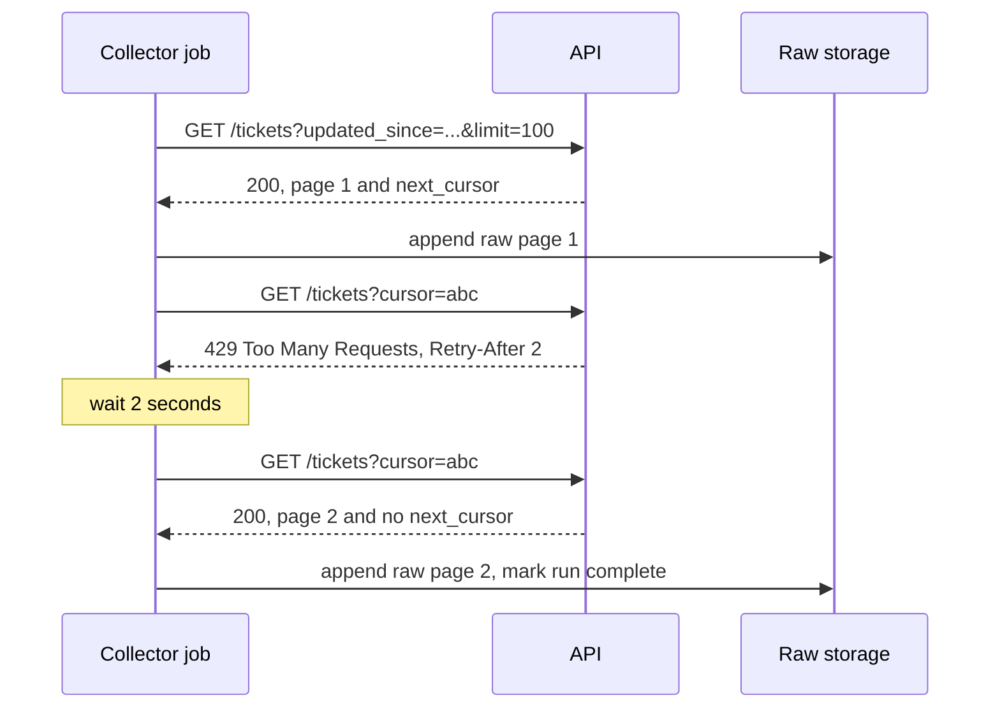

A large share of the data AI systems use arrives over HTTP: tickets from a help-desk API, articles from a content management system, product data from a partner, public pages from the web. Calling an API once is easy, and you did it in [Working with APIs](/learn/python-programming/working-with-apis). Collecting **all** of a dataset, every day, without missing pages, without getting blocked, and without breaking the provider's rules is a different job. This lesson covers the patterns that make API collection reliable: pagination, rate limits, retries, storing raw responses, and collecting responsibly.

## The shape of a collection job



Four concerns appear in that diagram: following pages until the end, handling refusals politely, retrying transient errors, and saving what came back before doing anything clever with it.

## Pagination

APIs return large collections in pages. Three schemes are common:

| Scheme | Request looks like | Strength | Weakness |
| --- | --- | --- | --- |
| Offset / limit | `?offset=200&limit=100` | Simple, can jump to any page | Rows inserted during the crawl shift pages, causing skips or duplicates; slow for deep offsets |
| Page number | `?page=3&per_page=100` | Simple | Same shifting problem as offset |
| Cursor | `?cursor=eyJpZCI6...` | Stable while data changes; efficient | Can only go forward; cursor is opaque |

With cursor pagination the server returns a token pointing at the next page, and you stop when it returns none. Step through the loop:

```trace
{
  "title": "following a cursor until the last page",
  "code": [
    "cursor = None",
    "ids = []",
    "while True:",
    "    page = api(cursor)",
    "    ids += page['ids']",
    "    cursor = page['next']",
    "    if cursor is None:",
    "        break",
    "print(ids)"
  ],
  "steps": [
    { "line": 1, "vars": { "cursor": "None" }, "note": "No cursor yet: the first request asks for the start of the collection." },
    { "line": 4, "vars": { "cursor": "None", "page": "{'ids': [1, 2, 3], 'next': '3'}" }, "note": "The server returns three items and a cursor for the next page." },
    { "line": 6, "vars": { "ids": "[1, 2, 3]", "cursor": "'3'" }, "note": "Keep the items and remember the cursor." },
    { "line": 4, "vars": { "ids": "[1, 2, 3]", "cursor": "'3'", "page": "{'ids': [4, 5, 6], 'next': '6'}" }, "note": "The second request passes the cursor back to the server." },
    { "line": 6, "vars": { "ids": "[1, 2, 3, 4, 5, 6]", "cursor": "'6'" }, "note": "Still a cursor, so there is more to fetch." },
    { "line": 4, "vars": { "ids": "[1, 2, 3, 4, 5, 6]", "cursor": "'6'", "page": "{'ids': [7], 'next': None}" }, "note": "The last page is short and has no next cursor." },
    { "line": 8, "vars": { "ids": "[1, 2, 3, 4, 5, 6, 7]", "cursor": "None" }, "note": "No cursor means the collection is exhausted. Leave the loop." },
    { "line": 9, "vars": { "ids": "[1, 2, 3, 4, 5, 6, 7]" }, "out": ["[1, 2, 3, 4, 5, 6, 7]"], "note": "All seven items collected." }
  ]
}
```

> [!TIP]
> Combine pagination with an incremental filter when the API offers one, such as `updated_since=<watermark>`. Paging through only what changed since the last run is far cheaper than re-downloading everything, and it is the API equivalent of the watermark pattern from [Data ingestion](/learn/data-engineering-fundamentals/data-ingestion).

## Rate limits and retries

Providers limit how many requests you may make per second, minute or day. When you exceed the limit they answer **429 Too Many Requests**, often with a `Retry-After` header saying how many seconds to wait. Servers also fail transiently with 500, 502, 503 or 504. These are worth retrying. Errors such as 400 (bad request), 401 (unauthenticated), 403 (forbidden) and 404 (not found) will fail again identically, so retrying them only wastes your quota.

When no `Retry-After` is given, wait longer after each failure (**exponential backoff**) and add randomness (**jitter**) so that many clients that failed together do not retry together. The delay before attempt $k$ (counting from 0) is

$$
d_k = \min(c,\; b \cdot 2^{k}) \cdot u, \qquad u \sim \text{Uniform}(0.5, 1)
$$

where $b$ is the base delay in seconds, $c$ is a cap on the delay, and $u$ is the random jitter factor. With $b = 1$ the waits are roughly 1, 2, 4, 8 seconds, scaled down by the jitter.

The example below uses a fake API so it runs anywhere. It paginates with a cursor and rate-limits the second call; the collector honours `Retry-After` and records its sleeps instead of actually sleeping.

```python
import random

ITEMS = [{"id": i, "title": f"item {i}"} for i in range(1, 8)]
calls = {"n": 0}

def fake_api(cursor=None, limit=3):
    """Pretend server: cursor pagination, and it rate-limits the 2nd call."""
    calls["n"] += 1
    if calls["n"] == 2:
        return 429, {"Retry-After": "2"}, None
    start = 0 if cursor is None else int(cursor)
    page = ITEMS[start:start + limit]
    nxt = str(start + limit) if start + limit < len(ITEMS) else None
    return 200, {}, {"data": page, "next_cursor": nxt}

rng = random.Random(0)
slept = []

def get_with_retries(cursor, max_attempts=5, base=1.0, cap=30.0):
    for attempt in range(max_attempts):
        status, headers, body = fake_api(cursor)
        if status == 200:
            return body
        if status in (429, 500, 502, 503, 504):
            if "Retry-After" in headers:
                delay = float(headers["Retry-After"])
            else:
                delay = min(cap, base * 2 ** attempt) * rng.uniform(0.5, 1.0)
            slept.append(delay)          # real code: time.sleep(delay)
            continue
        raise RuntimeError(f"permanent error {status}")
    raise RuntimeError("gave up after retries")

def fetch_all():
    cursor = None
    while True:
        body = get_with_retries(cursor)
        yield from body["data"]
        cursor = body["next_cursor"]
        if cursor is None:
            break

ids = [item["id"] for item in fetch_all()]
print("ids:", ids)
print("calls:", calls["n"], "slept:", slept)
```

```output
ids: [1, 2, 3, 4, 5, 6, 7]
calls: 4 slept: [2.0]
```

Four calls fetched three pages: one was refused, waited for, and retried. With a real HTTP client the structure is the same. Using `requests`, always set a timeout so a hung connection cannot stall the job for ever, and read credentials from the environment rather than the code:

```python
import os
import requests

session = requests.Session()
session.headers["Authorization"] = f"Bearer {os.environ['TICKETS_API_TOKEN']}"

resp = session.get(
    "https://api.example.com/v1/tickets",
    params={"updated_since": "2026-11-01T00:00:00Z", "limit": 100},
    timeout=30,
)
if resp.status_code == 429:
    wait = float(resp.headers.get("Retry-After", "1"))   # assumes seconds; it may also be an HTTP date
resp.raise_for_status()
body = resp.json()
```

Besides reacting to 429s, pace yourself proactively: if the documented limit is 10 requests per second, leave at least 0.1 seconds between requests, and run fewer concurrent workers than the limit allows.

> [!WARNING]
> Retrying a `POST` that creates something can create it twice if the first attempt actually succeeded but the response was lost. Collection jobs mostly use `GET`, which is safe to retry. For writes, use the provider's idempotency key mechanism if it has one.

## Store raw responses first

Save each response body exactly as received, with metadata, **before** parsing it. Parsing code has bugs; the API may not let you fetch last month's data again; and a raw archive lets you re-parse everything when you discover a field you need.

```python
import gzip, json, tempfile
from datetime import datetime, timezone
from pathlib import Path

def save_raw(pages, out_dir: Path, source: str, run_id: str, fetched_at: str) -> Path:
    path = out_dir / f"source={source}" / f"run={run_id}.jsonl.gz"
    path.parent.mkdir(parents=True, exist_ok=True)
    with gzip.open(path, "wt", encoding="utf-8") as f:   # one run, one file: re-runs overwrite
        for i, body in enumerate(pages):
            record = {"source": source, "page": i, "fetched_at": fetched_at,
                      "body": body}
            f.write(json.dumps(record) + "\n")
    return path

out = Path(tempfile.mkdtemp())
fetched_at = datetime(2026, 11, 2, 2, 0, tzinfo=timezone.utc).isoformat()
p = save_raw([{"data": [{"id": 1}], "next_cursor": "3"},
              {"data": [{"id": 4}], "next_cursor": None}],
             out, "tickets", "2026-11-02", fetched_at)
print(p.relative_to(out))
with gzip.open(p, "rt") as f:
    print(f.readline().strip())
```

```output
source=tickets/run=2026-11-02.jsonl.gz
{"source": "tickets", "page": 0, "fetched_at": "2026-11-02T02:00:00+00:00", "body": {"data": [{"id": 1}], "next_cursor": "3"}}
```

Compressed JSON Lines keeps the archive small and easy to stream. Parsing into typed tables is then a separate, re-runnable step that reads from this raw layer.

## Collecting from the web responsibly

Scraping web pages raises questions that APIs mostly answer for you through their documentation and keys.

| Question | What to do |
| --- | --- |
| Is there an official API or data export? | Prefer it: it is stable, sanctioned and usually cheaper for everyone |
| What do the terms of service say? | Many sites forbid automated collection or reuse; follow them |
| What does robots.txt allow? | Do not fetch paths it disallows for your user agent; honour any crawl delay |
| Who are you? | Send an honest User-Agent so the site can identify and contact you |
| How fast? | Throttle requests; never put noticeable load on someone else's server |
| Is it personal or copyrighted data? | Personal data carries legal obligations, and copyright and licences govern reuse, including for model training. Ask your legal or privacy team when in doubt |

Python's standard library can parse `robots.txt`:

```python
from urllib import robotparser

robots_txt = """
User-agent: *
Disallow: /private/
Disallow: /search
Crawl-delay: 5
""".splitlines()

rp = robotparser.RobotFileParser()
rp.parse(robots_txt)

agent = "course-research-bot"
for url in ["https://example.com/docs/intro",
            "https://example.com/private/report",
            "https://example.com/search?q=llm"]:
    print(rp.can_fetch(agent, url), url)
print("crawl delay:", rp.crawl_delay(agent))
```

```output
True https://example.com/docs/intro
False https://example.com/private/report
False https://example.com/search?q=llm
crawl delay: 5
```

In a real crawler you would call `rp.set_url("https://example.com/robots.txt")` and `rp.read()` to fetch the live file instead of parsing a string.

> [!KEY]
> robots.txt is a minimum courtesy, not a permission slip. A page that robots.txt allows may still be covered by terms of service, copyright or privacy law that restrict what you can do with it.

## Exercises

**1.** Extend `get_with_retries` so that it raises immediately with a clear message on 401 and 403, telling the operator to check credentials.

<details>
<summary>Show solution</summary>

Add this check before the retryable branch:

```python
if status in (401, 403):
    raise RuntimeError(f"auth error {status}: check the API token and its permissions")
```

These errors will not fix themselves, so retrying them only delays the alert and spends quota.

</details>

**2.** Using the backoff formula with $b = 1$, $c = 30$, what is the largest possible delay before attempts $k = 0, 1, 2, 5$ and $6$?

<details>
<summary>Show solution</summary>

The largest delay occurs when $u = 1$: $\min(30, 2^k)$ gives 1, 2, 4, 30 and 30 seconds. At $k = 5$, $2^5 = 32$ exceeds the cap, so the cap applies from there on.

</details>

**3.** An API supports only offset pagination, and new tickets are inserted at the top of the list while your job runs. What goes wrong, and how can you mitigate it?

<details>
<summary>Show solution</summary>

Each insertion shifts every later item down by one, so the next offset page repeats an item you already have; deletions shift items up and cause skips. Mitigations: sort by a stable key in ascending order and filter on it (for example `id > last_id`) instead of using offsets; or fetch a fixed time window (`updated_before=<run start>`) so new items do not enter the result set, and deduplicate by ID when loading.

</details>

```quiz
[
  {
    "q": "Which HTTP status should a collector generally NOT retry?",
    "options": [
      "429 Too Many Requests",
      "503 Service Unavailable",
      "404 Not Found",
      "502 Bad Gateway"
    ],
    "answer": 2,
    "why": "404 will fail the same way every time. 429 and 5xx errors are often transient."
  },
  {
    "q": "Why add jitter to exponential backoff?",
    "options": [
      "So many clients that failed together do not all retry at the same instant",
      "To make the delay shorter on average than the server requested",
      "Because servers require random delays",
      "To avoid needing a timeout"
    ],
    "answer": 0,
    "why": "Randomness spreads retries out, avoiding a synchronised burst that would trigger the limit again."
  },
  {
    "q": "What is the main advantage of cursor pagination over offset pagination?",
    "options": [
      "You can jump to any page directly",
      "Pages stay consistent even when items are inserted during the crawl",
      "It needs no authentication",
      "It returns more items per page"
    ],
    "answer": 1,
    "why": "A cursor points at a position in a stable ordering, so insertions do not shift what the next page contains."
  },
  {
    "q": "Why store raw API responses before parsing them?",
    "options": [
      "Parsed data is always larger",
      "APIs require it",
      "Raw responses are faster to query",
      "You can re-parse after fixing a bug or needing a new field, even if the API cannot serve old data again"
    ],
    "answer": 3,
    "why": "The raw archive is your source of truth for everything the API sent."
  }
]
```
