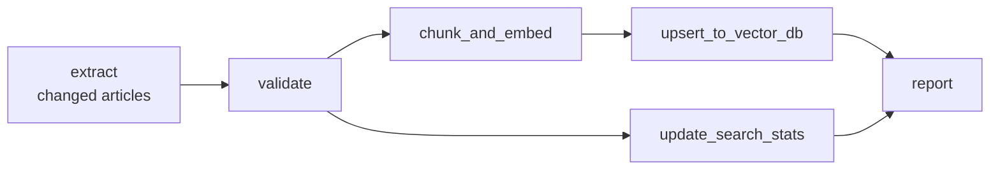
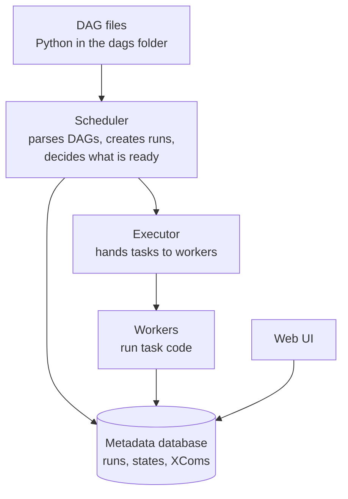
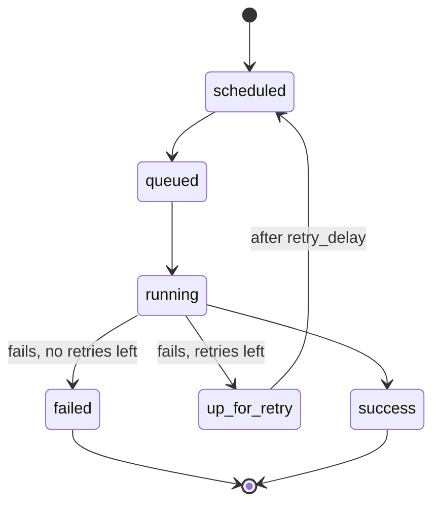

Once you have several pipeline steps, something has to run them in the right order, at the right time, retry them when they fail, and show you what happened. A cron job calling a script works until the day step 3 fails at 02:14 and nobody notices that steps 4 to 7 ran on stale data. **Apache Airflow** is a widely used open-source **orchestrator**: you describe your workflow in Python, and Airflow schedules it, tracks every run, retries failures and lets you re-run any past interval. Many teams use it to refresh training data, rebuild feature tables and keep RAG indexes in sync.

## Core concepts

| Concept | Meaning |
| --- | --- |
| DAG | A workflow: a set of tasks plus the dependencies between them, with no cycles (directed acyclic graph) |
| Task | One unit of work in a DAG, such as "extract articles" |
| Operator | A template for a kind of task: run Python, run a shell command, run SQL, wait for a file |
| DAG run | One execution of the DAG for one data interval |
| Task instance | One execution of one task within one DAG run, with its own state and logs |
| Data interval | The time window a DAG run is responsible for |
| XCom | A small message passed from one task to another, such as a file path |

A DAG for a RAG ingestion pipeline might look like this. Airflow runs a task only when all of its upstream tasks have succeeded, and runs independent tasks in parallel.



> [!KEY]
> Airflow orchestrates; it does not process data itself. Tasks should do their heavy work elsewhere (a database, Spark, a separate service, files in object storage) and pass only small references, such as paths and row counts, between each other.

## How Airflow runs your code



The **scheduler** repeatedly parses your DAG files, creates DAG runs when their interval is due and queues tasks whose dependencies are met. The **executor** decides where tasks run: in local processes, on a pool of workers, or as pods in Kubernetes. Everything is recorded in the **metadata database**, which the **web UI** reads to show you graphs, logs and the history of every run.

Because the scheduler re-parses DAG files frequently, **top-level code in a DAG file runs over and over**. Keep it cheap: no database queries, API calls or large imports at module level, only inside tasks.

## A TaskFlow DAG

Airflow 2 introduced the **TaskFlow API**, where plain Python functions decorated with `@task` become tasks and their return values flow to downstream tasks through XCom automatically. The example below refreshes a help-centre vector index daily. The helper functions it imports (`fetch_articles`, `validate_articles` and so on) stand for your own pipeline code; Airflow's job is the wiring around them. It is shown for structure and not run here.

```python
from datetime import timedelta

import pendulum
from airflow.decorators import dag, task
from airflow.operators.python import get_current_context

from my_pipeline import fetch_articles, validate_articles, chunk_and_embed_file, upsert_vectors


@dag(
    dag_id="help_centre_to_vector_index",
    schedule="@daily",
    start_date=pendulum.datetime(2026, 11, 1, tz="UTC"),
    catchup=False,
    max_active_runs=1,
    default_args={
        "retries": 3,
        "retry_delay": timedelta(minutes=5),
        "retry_exponential_backoff": True,
    },
    tags=["rag"],
)
def help_centre_to_vector_index():

    @task
    def extract() -> str:
        ctx = get_current_context()
        start, end = ctx["data_interval_start"], ctx["data_interval_end"]
        path = f"raw/help_centre/dt={ctx['ds']}/articles.jsonl"
        fetch_articles(updated_from=start, updated_to=end, out_path=path)  # overwrites path
        return path                       # a small string, passed via XCom

    @task
    def validate(path: str) -> str:
        failures = validate_articles(path)
        if failures:
            raise ValueError(f"validation failed: {failures}")  # task fails, run stops
        return path

    @task
    def chunk_and_embed(path: str) -> str:
        return chunk_and_embed_file(path)  # returns the path of the embeddings file

    @task
    def upsert(embeddings_path: str) -> int:
        return upsert_vectors(embeddings_path)  # upsert keyed by chunk ID, returns count

    @task
    def report(n: int) -> None:
        print(f"upserted {n} chunks")

    report(upsert(chunk_and_embed(validate(extract()))))


help_centre_to_vector_index()
```

Things to notice:

- Calling one task function with another's result, `validate(extract())`, both passes the value and declares the dependency.
- The function decorated with `@dag` must be called at the bottom of the file, or Airflow does not register the DAG.
- The task reads its **data interval** from the context instead of the clock, so any run, including a re-run months later, processes the same window.
- Every task overwrites or upserts its output, so retries and re-runs are safe.

> [!NOTE]
> Airflow 3 keeps these concepts, but moves the authoring interface: the decorators are imported from `airflow.sdk`, and some CLI commands changed. The examples here use Airflow 2 style; check the documentation for the version you run.

## Classic operators

Before TaskFlow, every task was an operator instance, and many tasks still are, because operators wrap common jobs. You can mix both styles and set dependencies with `>>`:

```python
from airflow.operators.bash import BashOperator

build_tables = BashOperator(
    task_id="build_tables",
    bash_command="dbt run --select orders_daily",
)

checked = validate(extract())
checked >> build_tables      # build_tables runs after validate succeeds
```

| Operator kind | Examples | Use |
| --- | --- | --- |
| Python | `@task`, `PythonOperator` | Custom logic |
| Shell | `BashOperator` | Running a CLI tool or script |
| SQL and cloud | From provider packages for databases, warehouses and cloud services | Running a query or job in another system |
| Sensors | Wait for a file, a partition or another DAG | Starting only when the input exists |

Provider packages add operators and hooks for many external systems; install only those you need.

## Scheduling, data intervals and catchup

The `schedule` can be a preset (`"@hourly"`, `"@daily"`, `"@weekly"`), a cron expression such as `"0 2 * * *"` (02:00 every day), or `None` for manual-only DAGs.

Airflow's scheduling model trips up almost everyone once. A DAG run for a daily schedule is created **at the end** of its data interval. The run labelled 2 November (its **logical date**, available as `ds`) covers 2 November 00:00 to 3 November 00:00 and starts shortly after midnight on 3 November. That way it processes a complete day of data.

With `catchup=True`, when you deploy a DAG whose `start_date` is in the past, or unpause one after a break, the scheduler creates runs for **every** missed interval. With `catchup=False`, it creates only the most recent one. Leave catchup off unless you want that history, and use an explicit backfill instead.

> [!WARNING]
> Never set `start_date` to a dynamic value like `datetime.now()`. The start moves every time the file is parsed, and the scheduler may never consider an interval complete. Use a fixed date.

## Retries, task states and backfills

Each task instance moves through states recorded in the metadata database:



`retries` and `retry_delay` handle transient problems such as a network blip or a rate limit. Tasks downstream of a failed task are marked `upstream_failed` and do not run, so bad data does not flow on. You can also set `execution_timeout` on a task so that a hung call fails instead of blocking the run for ever.

To reprocess history you have two tools:

```bash
# Re-run every daily interval in October (Airflow 2 CLI)
airflow dags backfill --start-date 2026-10-01 --end-date 2026-10-31 help_centre_to_vector_index

# Run one DAG run locally for a given logical date, for testing
airflow dags test help_centre_to_vector_index 2026-11-01
```

In the web UI you can also **clear** a task instance, which resets it so the scheduler runs it again, for example after fixing a bug in a downstream task.

## Good habits

| Habit | Why |
| --- | --- |
| Make every task idempotent | Retries, clears and backfills re-run tasks routinely |
| Derive windows from the data interval | Re-runs process the same data as the original run |
| Pass references through XCom, not data | XComs live in the metadata database and are meant to be small |
| Keep tasks fairly small and focused | A failure re-runs only the part that failed |
| Keep secrets in Airflow connections or a secrets backend | Credentials stay out of DAG code |
| Fail loudly on validation errors | Downstream tasks are skipped instead of consuming bad data |

## Exercises

**1.** A DAG has `schedule="@daily"`, `start_date` set to 1 October 2026, and `catchup=True`. It is first unpaused on 11 October 2026 at noon. Roughly how many DAG runs does the scheduler create, and what would change with `catchup=False`?

<details>
<summary>Show solution</summary>

With catchup it creates one run for each complete daily interval since 1 October: the intervals starting 1 October to 10 October, so 10 runs. With `catchup=False` it creates only the run for the most recent interval (10 October) and then continues daily from there.

</details>

**2.** This task is retried after failing half way through. What is wrong, and how would you fix it?

```python
@task
def load():
    ctx = get_current_context()
    rows = read_staging(ctx["ds"])
    insert_rows("orders", rows)   # plain INSERT
```

<details>
<summary>Show solution</summary>

Rows inserted before the failure are inserted again on retry, creating duplicates. Make the load idempotent: either delete that day's rows and insert, within one transaction, or upsert on the primary key:

```python
@task
def load():
    ctx = get_current_context()
    rows = read_staging(ctx["ds"])
    replace_partition("orders", day=ctx["ds"], rows=rows)  # delete + insert in one transaction
```

</details>

**3.** A colleague's `extract` task returns a pandas DataFrame with two million rows so that `transform` can use it. Why is this a problem in Airflow, and what should it return instead?

<details>
<summary>Show solution</summary>

TaskFlow return values are stored as XComs in the metadata database, which is designed for small values. A large DataFrame bloats the database and slows the scheduler and UI, or fails outright. Write the data to storage (for example Parquet under a path that includes the logical date) and return only the path.

</details>

```quiz
[
  {
    "q": "In a TaskFlow DAG, what does `validate(extract())` do?",
    "options": [
      "Runs both functions immediately when the file is parsed",
      "Declares that `validate` depends on `extract` and passes extract's return value via XCom",
      "Runs `extract` twice",
      "Creates two separate DAGs"
    ],
    "answer": 1,
    "why": "Calling a task with another task's output wires the dependency and the XCom value; nothing runs at parse time."
  },
  {
    "q": "A daily DAG run has logical date 2026-11-02. When does it normally start?",
    "options": [
      "At 00:00 on 2 November",
      "At noon on 2 November",
      "Shortly after its data interval ends, at 00:00 on 3 November",
      "Whenever a user clicks Run"
    ],
    "answer": 2,
    "why": "Airflow creates a run after its interval closes, so the run for 2 November processes the complete day."
  },
  {
    "q": "Which component decides which tasks are ready to run?",
    "options": [
      "The scheduler",
      "The web UI",
      "The DAG file itself",
      "XCom"
    ],
    "answer": 0,
    "why": "The scheduler parses DAGs, creates runs and queues tasks whose upstream dependencies are met."
  },
  {
    "q": "Why should you avoid database queries at the top level of a DAG file?",
    "options": [
      "Airflow cannot connect to databases",
      "Top-level code only runs once",
      "It disables retries",
      "The scheduler parses DAG files repeatedly, so that code runs over and over"
    ],
    "answer": 3,
    "why": "Expensive top-level code slows parsing and puts constant load on the systems it touches."
  }
]
```
