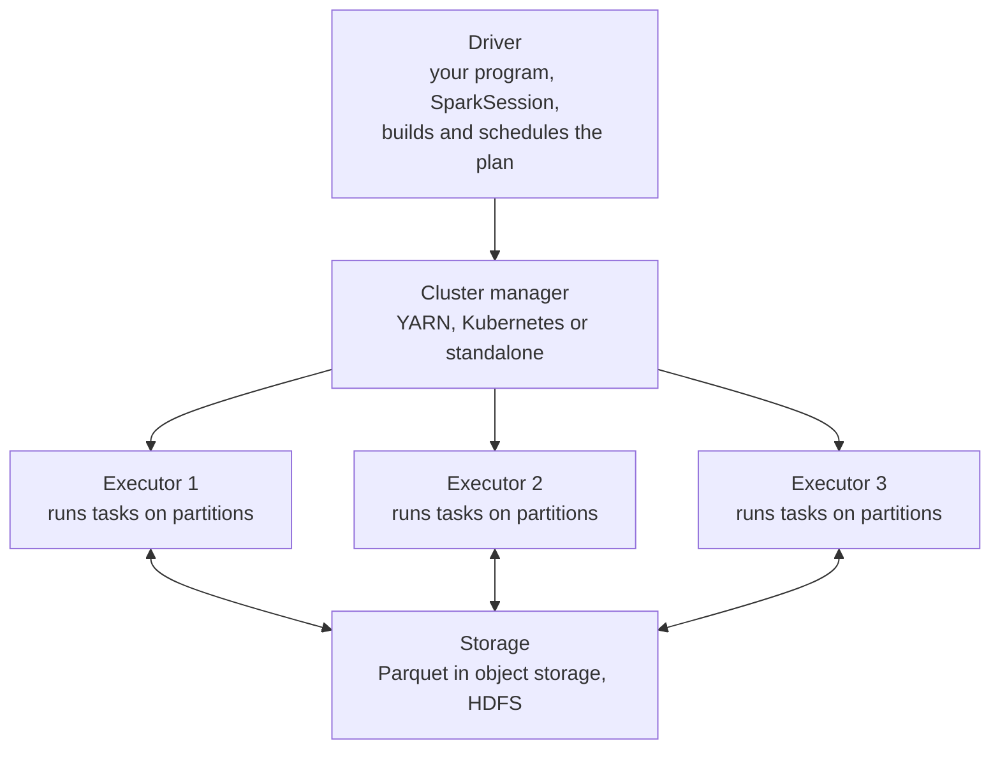
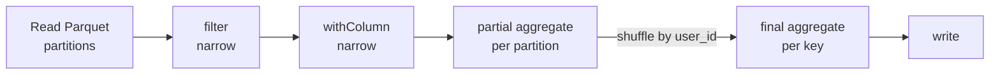

pandas works on one machine, in that machine's memory. When the data is hundreds of gigabytes or more (a year of clickstream events, a web-scale text corpus for training, every support ticket a large company has ever received), you need to spread the work across many machines. **Apache Spark** is the most widely used open-source engine for that: you write DataFrame code that looks a lot like pandas or SQL, and Spark splits the data into partitions, runs the work in parallel on a cluster, and combines the results. This lesson explains how Spark executes your code, which is what you need to write Spark jobs that are correct and do not crawl.

## Driver, executors and partitions

A Spark application has one **driver** and many **executors**.



| Component | Role |
| --- | --- |
| Driver | Runs your script, turns DataFrame operations into an execution plan, splits it into tasks and collects small results |
| Cluster manager | Allocates machines and processes for the application |
| Executor | A worker process that runs tasks and holds cached data in memory |
| Partition | A slice of the dataset; the unit of parallelism |
| Task | The work for one partition in one stage, run by one executor core |

A DataFrame with 400 partitions on a cluster with 100 executor cores is processed roughly 100 partitions at a time. The data itself never passes through the driver unless you explicitly ask for it, which is why you should be careful with operations that bring results back.

## Lazy evaluation: transformations and actions

Spark operations come in two kinds.

| | Transformations | Actions |
| --- | --- | --- |
| Examples | `select`, `filter`, `withColumn`, `groupBy().agg()`, `join`, `orderBy` | `show`, `count`, `collect`, `take`, `toPandas`, `write...` |
| Returns | A new DataFrame (a plan) | A result, or data written to storage |
| Runs anything? | No, only records the step | Yes, triggers execution of the whole plan |

Transformations are **lazy**: Spark only adds them to a logical plan. When an action runs, Spark's optimiser looks at the whole plan at once and improves it before executing, for example by reading only the columns you use (**column pruning**) and pushing filters down into the file scan so that whole files or partitions are skipped (**predicate pushdown**). This is why a long chain of transformations returns instantly, and the time is spent at the action.

> [!WARNING]
> Each action re-runs the plan from the source unless you cache. Calling `df.count()`, then `df.show()`, then `df.write...` on the same expensive DataFrame computes it three times. If you genuinely reuse a DataFrame, call `df.cache()` before the first action, and `df.unpersist()` when done.

## A PySpark DataFrame example

This job computes per-user daily features from partitioned event data. It is shown for structure; running it needs a Spark installation (`pip install pyspark` gives you a local single-machine Spark, which also needs Java).

```python
from pyspark.sql import SparkSession
from pyspark.sql import functions as F

spark = SparkSession.builder.appName("daily-user-features").getOrCreate()

events = spark.read.parquet("lake/events")      # partitioned by dt; reads metadata only

daily = (
    events
    .filter(F.col("dt") == "2026-11-02")        # transformation: partition pruning
    .filter(F.col("event_type") == "purchase")
    .withColumn("amount_gbp", F.col("amount_pence") / 100)
    .groupBy("user_id")
    .agg(
        F.count("*").alias("n_purchases"),
        F.sum("amount_gbp").alias("spend_gbp"),
        F.max("event_ts").alias("last_purchase_ts"),
    )
    .withColumn("dt", F.lit("2026-11-02"))
)                                                # still nothing has run

daily.show(3)                                    # action: runs the plan

spark.conf.set("spark.sql.sources.partitionOverwriteMode", "dynamic")
(daily.write
      .mode("overwrite")
      .partitionBy("dt")
      .parquet("lake/features/user_daily"))      # action: overwrites only dt=2026-11-02

spark.stop()
```

The output of `show` looks like the following; the values are illustrative, since they depend entirely on your data:

```output
+-------+-----------+---------+-------------------+
|user_id|n_purchases|spend_gbp|   last_purchase_ts|
+-------+-----------+---------+-------------------+
|  u1042|          3|    57.97|2026-11-02 18:21:07|
|  u2210|          1|     4.99|2026-11-02 09:03:44|
|  u0007|          2|    31.50|2026-11-02 21:40:12|
+-------+-----------+---------+-------------------+
only showing top 3 rows
```

Note the idempotent write. With dynamic partition overwrite, `mode("overwrite")` replaces only the partitions present in the new data, here `dt=2026-11-02`; without that setting, it would replace the entire output directory. Re-running the job for one day is then safe, exactly like the partition overwrite pattern from [Data ingestion](/learn/data-engineering-fundamentals/data-ingestion).

If you prefer SQL, register the DataFrame as a view and query it; both routes produce the same plan:

```python
daily.createOrReplaceTempView("user_daily")
big_spenders = spark.sql("""
    SELECT user_id, spend_gbp
    FROM user_daily
    WHERE spend_gbp > 100
    ORDER BY spend_gbp DESC
""")
```

## Narrow and wide transformations: the shuffle

Some transformations can be done on each partition independently: `filter`, `select` and `withColumn` only need the rows already in that partition. These are **narrow**. Others need rows with the same key brought together from every partition: `groupBy`, `join`, `orderBy`, `distinct`. These are **wide**, and they require a **shuffle**: every executor writes its rows out, grouped by key, and every executor reads the pieces it needs over the network.



Spark splits a job into **stages** at each shuffle. Within a stage, narrow transformations are pipelined together in one pass over the data. Shuffles are usually the most expensive part of a job, because data is written to disk and sent across the network. Notice the partial aggregate before the shuffle: for sums and counts, Spark combines within each partition first, so far less data crosses the network. This is the same idea as combining sums and counts in [Batch processing](/learn/data-engineering-fundamentals/batch-processing).

You can see the stages and shuffles (shown as `Exchange`) in the physical plan with `daily.explain()`, and in the Spark web UI while a job runs.

| Problem | Symptom | Common remedy |
| --- | --- | --- |
| Too many shuffles | Many stages, long run time | Filter and select early; avoid unnecessary `orderBy` and `distinct` |
| Skewed keys | One task runs far longer than the others | Handle hot keys separately, or salt them; adaptive query execution can help |
| Joining a big table with a small one | Large shuffle for a tiny table | Broadcast the small table with `F.broadcast(small_df)` |
| Too many tiny output files | Slow later reads | `repartition` or `coalesce` before writing |

## Moving data to the driver

Actions like `collect()` and `toPandas()` copy the **entire** result to the driver. On a large DataFrame this exhausts the driver's memory and the application fails. Bring back only small results, such as aggregates or `limit(1000)` samples, and write large results to storage instead.

> [!KEY]
> Think of the driver as a coordinator with a small desk. Executors do the heavy lifting where the data lives; only summaries should ever come back to the driver.

## Built-in functions versus Python UDFs

Spark runs on the Java Virtual Machine. Built-in functions in `pyspark.sql.functions` run inside the JVM and are optimised. A plain Python user-defined function (UDF) forces every row to be sent to a Python process and back, which is much slower. Prefer built-in functions; reach for UDFs only for logic that has no built-in equivalent, and consider the vectorised pandas UDFs that PySpark offers, which exchange data in batches.

## Spark in AI workloads, and when not to use it

Spark is common for preparing large training datasets: deduplicating and filtering web-scale text, joining event logs into features, and computing statistics over billions of rows. It is also used to run batch inference or embedding over very large document sets, with partitions processed in parallel and results written back as Parquet.

But a cluster has real overhead: start-up time, configuration, cost and harder debugging. If your data fits comfortably on one machine, pandas, or single-machine engines such as DuckDB and Polars, will usually be simpler and often faster. A useful rule of thumb is to reach for Spark when the data or the computation clearly outgrows one large machine, not before.

## Exercises

**1.** Label each operation as a transformation or an action, and as narrow or wide where relevant: `filter`, `groupBy("user_id").count()`, `show()`, `withColumn`, `join`, `write.parquet(...)`.

<details>
<summary>Show solution</summary>

| Operation | Kind | Narrow or wide |
| --- | --- | --- |
| `filter` | Transformation | Narrow |
| `groupBy("user_id").count()` | Transformation | Wide (shuffle) |
| `show()` | Action | Not applicable |
| `withColumn` | Transformation | Narrow |
| `join` | Transformation | Usually wide; a broadcast join avoids shuffling the large side |
| `write.parquet(...)` | Action | Not applicable |

</details>

**2.** A colleague's job runs `df = spark.read.parquet(path)` followed by ten transformations, then calls `print(df.count())`, `df.show()` and `df.write.parquet(out)`. The job takes three times longer than expected. Explain why, and fix it.

<details>
<summary>Show solution</summary>

Each of the three actions executes the full plan from the source files, so all the work is done three times. Cache the DataFrame before the first action if it is reused (`df = df.cache()`), or drop the debugging actions. Often the simplest fix is to write once and then compute the count from the written output or from job metrics.

</details>

**3.** Translate this pandas code into PySpark: `df[df["country"] == "GB"].groupby("product")["price"].mean()`.

<details>
<summary>Show solution</summary>

```python
from pyspark.sql import functions as F

result = (
    df.filter(F.col("country") == "GB")
      .groupBy("product")
      .agg(F.avg("price").alias("mean_price"))
)
result.show()
```

`result` is lazy until `show()`, which is the action.

</details>

```quiz
[
  {
    "q": "What happens when you call `df.filter(...).withColumn(...)` in PySpark?",
    "options": [
      "Spark reads all the data and filters it immediately",
      "Spark records the steps in a plan; nothing runs until an action",
      "The driver downloads the data to filter it",
      "Spark writes a temporary file"
    ],
    "answer": 1,
    "why": "Transformations are lazy. Execution starts only when an action such as `show`, `count` or `write` is called."
  },
  {
    "q": "Which operation causes a shuffle?",
    "options": [
      "`groupBy(\"user_id\").agg(...)`",
      "`filter(F.col(\"x\") > 0)`",
      "`select(\"a\", \"b\")`",
      "`withColumn(\"y\", F.col(\"x\") * 2)`"
    ],
    "answer": 0,
    "why": "Grouping needs all rows with the same key in one place, so data must be redistributed across executors."
  },
  {
    "q": "Why is `toPandas()` on a very large DataFrame dangerous?",
    "options": [
      "It deletes the source data",
      "It is not supported in PySpark",
      "It copies the entire result into the driver's memory",
      "It disables caching"
    ],
    "answer": 2,
    "why": "The driver is a single process; pulling a large dataset into it can exhaust its memory."
  },
  {
    "q": "With `partitionOverwriteMode` set to `dynamic`, what does `write.mode(\"overwrite\").partitionBy(\"dt\")` replace?",
    "options": [
      "The entire output directory",
      "Nothing; it appends",
      "Only the files whose names match",
      "Only the partitions present in the data being written"
    ],
    "answer": 3,
    "why": "Dynamic partition overwrite replaces just the affected partitions, which makes per-day jobs idempotent."
  }
]
```
