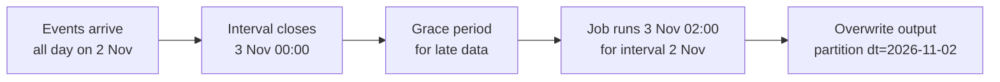
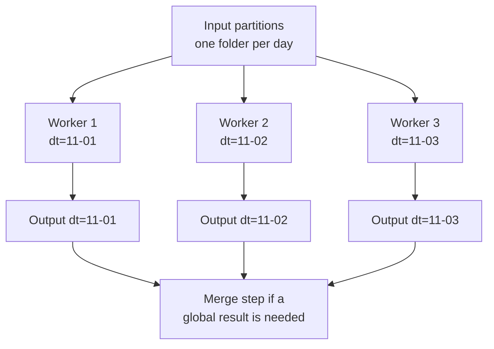

**Batch processing** means collecting data over a period and processing it together as one bounded unit: last night's orders, this hour's log files, the full document set for a weekly re-index. Most of the data work behind AI systems is batch work: building training sets, computing features, embedding documents, scoring customers overnight. Batch jobs are simpler to build, test and re-run than streaming systems, and doing them well comes down to a few ideas: define each batch precisely, make it fit in memory, combine partial results correctly, and be able to reprocess any batch on demand.

## What makes a batch

A batch is defined by its **boundaries**, not by when it runs. A daily job that runs at 02:00 on 3 November processes the **data interval** from 2 November 00:00 up to, but not including, 3 November 00:00.



| Term | Meaning |
| --- | --- |
| Data interval | The half-open time window `[start, end)` the batch covers |
| Logical date | The label of the batch, usually the interval start |
| Run time | When the job actually executes, after the interval ends |
| Grace period | Extra waiting time so late-arriving records are included |

Half-open intervals matter: if one batch covers `[00:00, 24:00)` and the next starts at `24:00`, a record at exactly midnight belongs to exactly one batch. Using `<=` on both ends counts it twice.

Writing each job as a function of its interval makes every run reproducible and makes reprocessing a loop:

```python
import pandas as pd

def run_for_day(day: str) -> str:
    # extract rows for [day, day + 1), transform, overwrite output for `day`
    start = pd.Timestamp(day)
    end = start + pd.Timedelta(days=1)
    return f"processed [{start:%Y-%m-%d %H:%M}, {end:%Y-%m-%d %H:%M})"

for day in pd.date_range("2026-10-29", "2026-11-01", freq="D"):
    print(day.date(), run_for_day(str(day.date())))
```

```output
2026-10-29 processed [2026-10-29 00:00, 2026-10-30 00:00)
2026-10-30 processed [2026-10-30 00:00, 2026-10-31 00:00)
2026-10-31 processed [2026-10-31 00:00, 2026-11-01 00:00)
2026-11-01 processed [2026-11-01 00:00, 2026-11-02 00:00)
```

Running a job for a range of past intervals is called a **backfill**. You backfill when you add a new pipeline and need history, when you fix a bug and must rebuild old outputs, or when a source re-delivers corrected data. Backfills are only safe if every run is idempotent, which is why the output for each day is overwritten rather than appended.

## Batch versus streaming

| | Batch | Micro-batch | Streaming |
| --- | --- | --- | --- |
| Unit | Hours or days of data | Seconds to minutes of data | Each event |
| Latency | High | Medium | Low |
| Reprocessing | Re-run the interval | Re-run small intervals | Replay the event log |
| Operational effort | Low | Medium | High |
| AI examples | Training sets, nightly embeddings, offline scoring | Near-real-time dashboards | Fraud scores, live recommendations |

> [!TIP]
> Ask how fresh the result actually needs to be. "Real time" requests often turn out to mean "updated every hour", which a batch job delivers at a fraction of the complexity.

## When the data does not fit in memory

pandas loads a whole file into RAM. For a file larger than memory, process it in **chunks** and combine the partial results. `read_csv` with `chunksize` returns an iterator of DataFrames:

```python
import io
import numpy as np
import pandas as pd

rng = np.random.default_rng(42)
big = pd.DataFrame({
    "country": rng.choice(["GB", "DE", "FR"], size=10_000),
    "amount": rng.integers(1, 100, size=10_000),
})
csv_file = io.StringIO(big.to_csv(index=False))   # stands in for a large file

totals = pd.Series(dtype="int64")
counts = pd.Series(dtype="int64")
for chunk in pd.read_csv(csv_file, chunksize=2_500):
    g = chunk.groupby("country")["amount"]
    totals = totals.add(g.sum(), fill_value=0)
    counts = counts.add(g.count(), fill_value=0)

result = pd.DataFrame({"total": totals, "n": counts}).astype("int64")
result["mean"] = (result["total"] / result["n"]).round(2)
print(result)
print(big.groupby("country")["amount"].mean().round(2).equals(result["mean"]))
```

```output
          total     n   mean
country                     
DE       164184  3333  49.26
FR       163393  3268  50.00
GB       169037  3399  49.73
True
```

Only 2,500 rows were in memory at a time, and the result matches the all-in-memory calculation exactly.

## Combining partial results correctly

The chunked code kept **sums and counts**, not means, and divided only at the end. That was deliberate. If chunk $i$ has $n_i$ rows with mean $\bar{x}_i$, the overall mean is the weighted average

$$
\bar{x} = \frac{\sum_i n_i \bar{x}_i}{\sum_i n_i}
$$

not the plain average of the chunk means. With one chunk of 10 rows averaging 2 and another of 90 rows averaging 1, the true mean is $(10 \cdot 2 + 90 \cdot 1) / 100 = 1.1$, while averaging the two means gives 1.5.

| Statistic | Combine partial results by | Safe to combine directly? |
| --- | --- | --- |
| Count, sum, min, max | Adding counts and sums; min of mins; max of maxes | Yes |
| Mean | Keeping sum and count, dividing at the end | Only via sum and count |
| Variance | Keeping count, sum and sum of squares (or a numerically stable merge) | Only via those parts |
| Median, distinct count | Exact answers need all the data; use sketches for approximations | No |

> [!KEY]
> This split into a per-chunk step that produces combinable partial results, followed by a merge step, is the core idea of MapReduce and of engines like [Spark](/learn/data-engineering-fundamentals/basic-spark). If you can express an aggregate this way, you can distribute it across many machines.

## Parallelising batches

When work is independent per partition (per day, per file, per customer group), you can process partitions in parallel and write each one's output separately.



On one machine, `concurrent.futures.ProcessPoolExecutor` from the standard library runs CPU-bound partitions on separate cores. For I/O-bound work, such as calling an API per partition, threads or [async code](/learn/python-programming/asynchronous-programming) work well. Beyond one machine, distributed engines take over.

## Batching calls to models and APIs

Embedding thousands of chunks or scoring a table with a model is also batch work. Most embedding and inference APIs accept a list of inputs per call, which is far faster than one call per item. Group items with `itertools.batched` (Python 3.12 and later):

```python
from itertools import batched   # Python 3.12+

def fake_embed(texts):
    """Stands in for an embedding API that accepts a list of texts."""
    return [[float(len(t)), float(t.count(" "))] for t in texts]

chunks = [f"chunk number {i}" for i in range(7)]
vectors = []
for batch in batched(chunks, 3):
    vectors.extend(fake_embed(list(batch)))
    print(f"embedded {len(batch)} chunks")
print(len(vectors), vectors[0])
```

```output
embedded 3 chunks
embedded 3 chunks
embedded 1 chunks
7 [14.0, 2.0]
```

In a real job, write each batch's results out as soon as they return (keyed by chunk ID) rather than holding everything until the end. If the job dies at batch 900 of 1,000, the re-run can skip the chunks already embedded instead of paying for them again. Some providers also offer asynchronous batch endpoints that process large request files at a lower price in exchange for slower turnaround; check your provider's documentation.

## Late data and reprocessing windows

Records sometimes arrive after their interval has been processed: a mobile app uploads events when it reconnects, a partner re-sends a corrected file. Common strategies:

- **Grace period**: wait before processing an interval (the 02:00 start above).
- **Rolling reprocessing**: each run also re-processes the previous few intervals, overwriting them; idempotency makes this safe.
- **Event time versus processing time**: partition by when the event happened, and keep the arrival time as a separate column so late arrivals can be measured.

> [!WARNING]
> If a dashboard or a model's training set has already consumed an interval that you later reprocess, those consumers now hold stale numbers. Record which interval versions each training run used, so you can tell whether a model needs retraining.

## Exercises

**1.** A batch job selects rows with `ts >= start AND ts <= end`, where `end` is the next interval's `start`. What goes wrong, and what is the fix?

<details>
<summary>Show solution</summary>

A record whose timestamp is exactly on the boundary matches both intervals, so it is counted twice. Use a half-open interval: `ts >= start AND ts < end`.

</details>

**2.** Extend the chunked aggregation to also compute the maximum `amount` per country.

<details>
<summary>Show solution</summary>

Keep a running maximum and combine with the element-wise maximum:

```python
maxes = pd.Series(dtype="int64")
for chunk in pd.read_csv(csv_file, chunksize=2_500):
    m = chunk.groupby("country")["amount"].max()
    maxes = m if maxes.empty else maxes.combine(m, max, fill_value=0)
```

The maximum of the chunk maxima is the overall maximum, so this combines correctly. (Remember to rewind `csv_file` with `csv_file.seek(0)` if you reuse it.)

</details>

**3.** Three chunks have $(n, \bar{x})$ of $(50, 4)$, $(30, 6)$ and $(20, 10)$. Compute the overall mean and the naive mean of means.

<details>
<summary>Show solution</summary>

Overall: $(50 \cdot 4 + 30 \cdot 6 + 20 \cdot 10) / 100 = (200 + 180 + 200) / 100 = 5.8$. The mean of means is $(4 + 6 + 10) / 3 \approx 6.67$, which over-weights the small third chunk.

</details>

```quiz
[
  {
    "q": "A daily job runs at 02:00 on 3 November. Which data interval does it normally process?",
    "options": [
      "3 November 00:00 to 4 November 00:00",
      "2 November 00:00 up to, but not including, 3 November 00:00",
      "The last 24 hours before 02:00 on 3 November",
      "Everything up to 3 November 02:00"
    ],
    "answer": 1,
    "why": "A batch processes a completed interval; the run happens after the interval closes, often with a grace period."
  },
  {
    "q": "Why does the chunked aggregation keep sums and counts rather than per-chunk means?",
    "options": [
      "Means cannot be computed in pandas",
      "Sums use less memory than means",
      "Averaging chunk means is wrong when chunks have different sizes",
      "Counts are needed for the CSV format"
    ],
    "answer": 2,
    "why": "The overall mean is a weighted average of chunk means. Keeping sums and counts makes the combination exact."
  },
  {
    "q": "Which statistic cannot be computed exactly by combining small per-chunk summaries?",
    "options": [
      "Median",
      "Sum",
      "Maximum",
      "Count"
    ],
    "answer": 0,
    "why": "An exact median needs the whole distribution. Sum, count and maximum combine trivially."
  },
  {
    "q": "What property makes a backfill over 90 past days safe to run?",
    "options": [
      "The job runs in parallel",
      "The job uses streaming",
      "The job reads from CSV",
      "Each daily run is idempotent and overwrites only its own output"
    ],
    "answer": 3,
    "why": "If each run replaces its own slice, re-running any day, any number of times, gives the same result."
  }
]
```
