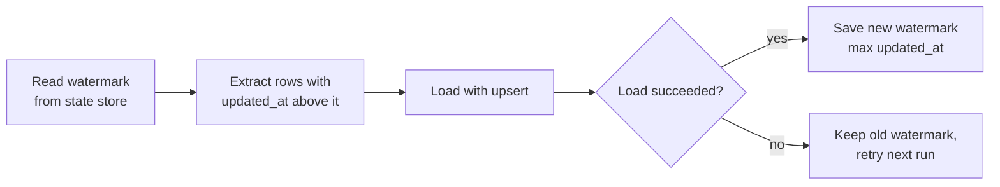

**Data ingestion** is the first step of every pipeline: getting data out of the systems that produce it and into storage you control. It sounds like copying, but the decisions you make here (how often, how much, in what format, laid out how) decide whether everything downstream is fast and trustworthy or slow and fragile. A training set that silently lost the leading zeros of every product code, or a RAG index that re-embeds a million unchanged documents every night, are both ingestion problems.

## Where data comes from

| Source | How you ingest | Watch out for |
| --- | --- | --- |
| Operational database | SQL query, database export, change data capture | Load on a production system, long-running queries |
| REST API | Paginated HTTP requests | Rate limits, retries, partial failures |
| Files dropped by partners | List a folder or bucket, process new files | Inconsistent formats, re-sent files |
| Application events | Message queue or event stream | Duplicates, events arriving late or out of order |
| Web pages | Crawling and parsing | Terms of service, robots.txt, changing layouts |

APIs get their own lesson, [APIs and data collection](/learn/data-engineering-fundamentals/apis-and-data-collection). Here the focus is on the decisions shared by every source.

## Full loads and incremental loads

A **full load** copies everything every time. It is simple and self-correcting, but its cost grows with the total size of the source. An **incremental load** copies only what is new or changed since the last run. It needs a way to tell what changed:

| Method | How it detects changes | Limitation |
| --- | --- | --- |
| Watermark on a timestamp | `WHERE updated_at > last_seen` | Needs a reliable `updated_at`; misses hard deletes |
| Watermark on an increasing ID | `WHERE id > last_id` | Only sees inserts, not updates |
| Change data capture (CDC) | Reads the database's own change log | More infrastructure, but sees inserts, updates and deletes |
| File listing | Process files not seen before | Needs a record of processed files |

The watermark pattern stores the largest timestamp seen so far and asks only for rows beyond it:



```python
import pandas as pd

source = pd.DataFrame({
    "id": [1, 2, 3, 4, 5],
    "updated_at": pd.to_datetime([
        "2026-11-01 08:00", "2026-11-01 09:30", "2026-11-01 11:00",
        "2026-11-02 07:15", "2026-11-02 10:45",
    ]),
})

state = {"watermark": pd.Timestamp("2026-11-01 09:00")}

def incremental_extract(source, watermark):
    return source[source["updated_at"] > watermark]

batch = incremental_extract(source, state["watermark"])
print(batch)
if not batch.empty:
    state["watermark"] = batch["updated_at"].max()
print("new watermark:", state["watermark"])

print(len(incremental_extract(source, state["watermark"])), "rows on the next run")
```

```output
   id          updated_at
1   2 2026-11-01 09:30:00
2   3 2026-11-01 11:00:00
3   4 2026-11-02 07:15:00
4   5 2026-11-02 10:45:00
new watermark: 2026-11-02 10:45:00
0 rows on the next run
```

Two details make this robust in production. First, save the new watermark **only after** the load has succeeded; otherwise a failed load skips data for ever. Second, rows can commit late, with an `updated_at` slightly earlier than rows you have already seen. The usual defence is a **lookback window**: extract from `watermark - 1 hour` and rely on an idempotent upsert to absorb the overlap.

> [!WARNING]
> Timestamp watermarks never see rows that are deleted at the source. If deletions matter, for example a document removed from a knowledge base that must also leave your RAG index, use CDC, soft-delete flags, or a periodic full comparison of keys.

## File formats: CSV, JSON Lines and Parquet

Where you land the data matters as much as how you fetch it. Three formats cover most needs.

| | CSV | JSON Lines | Parquet |
| --- | --- | --- | --- |
| Layout | Text, one row per line | Text, one JSON object per line | Binary, columnar |
| Schema and types | None: everything is text | Per record, loosely typed | Stored in the file |
| Nested data | No | Yes | Yes |
| Size | Large | Larger | Small (compressed by column) |
| Read a few columns | Must read every byte | Must read every byte | Reads only those columns |
| Human readable | Yes | Yes | No |
| Typical use | Exchange with spreadsheets and partners | Raw API responses, LLM training and evaluation data | Analytics, clean and curated layers |

### Why CSV loses information

A CSV file carries no types, so the reader has to guess:

```python
import io
import pandas as pd

csv_text = """zip,customer_id,signup_date,score
02139,007,2026-11-01,0.5
10001,042,2026-11-02,
"""
df = pd.read_csv(io.StringIO(csv_text))
print(df)
print(df.dtypes)
```

```output
     zip  customer_id signup_date  score
0   2139            7  2026-11-01    0.5
1  10001           42  2026-11-02    NaN
zip              int64
customer_id      int64
signup_date        str
score          float64
dtype: object
```

The ZIP code and the customer ID lost their leading zeros, and the date is plain text. (This output is from pandas 3; older versions show `object` instead of `str`.) Declaring the types fixes it:

```python
df = pd.read_csv(
    io.StringIO(csv_text),
    dtype={"zip": "string", "customer_id": "string", "score": "float64"},
    parse_dates=["signup_date"],
)
print(df)
print(df.dtypes)
```

```output
     zip customer_id signup_date  score
0  02139         007  2026-11-01    0.5
1  10001         042  2026-11-02    NaN
zip                    string
customer_id            string
signup_date    datetime64[us]
score                 float64
dtype: object
```

### JSON Lines for raw and nested records

JSON Lines (`.jsonl`) puts one complete JSON object on each line. Commas and quotes inside text cannot break the format, nested lists survive, and you can append or stream the file line by line. This is why it is the common format for LLM fine-tuning and evaluation datasets.

```python
records = pd.DataFrame({
    "doc_id": ["a1", "a2"],
    "text": ["First line, with a comma", "Second \"quoted\" text"],
    "tags": [["faq", "billing"], []],
})
buf = io.StringIO()
records.to_json(buf, orient="records", lines=True)
print(buf.getvalue(), end="")

back = pd.read_json(io.StringIO(buf.getvalue()), lines=True)
print(back.loc[0, "tags"])
```

```output
{"doc_id":"a1","text":"First line, with a comma","tags":["faq","billing"]}
{"doc_id":"a2","text":"Second \"quoted\" text","tags":[]}
['faq', 'billing']
```

### Parquet for everything you query

Parquet stores each column separately, with its type and compression. A query that needs two columns of a fifty-column table reads only those two, and types survive the round trip. Reading and writing Parquet with pandas needs the `pyarrow` package installed.

> [!KEY]
> A sensible default: land raw API and event data as JSON Lines (exactly what arrived), and store everything after the validation step as Parquet. Use CSV only at the edges, when a person or partner system needs it.

## Partitioning

**Partitioning** splits a dataset into folders by the value of a column, usually a date. The common Hive-style layout puts the column name and value in the path:

```text
lake/events/
    dt=2026-11-01/part-0.parquet
    dt=2026-11-02/part-0.parquet
    dt=2026-11-03/part-0.parquet
```

Partitions help in two ways. Readers that filter on the partition column skip whole folders (**partition pruning**), and a daily job can overwrite exactly one folder, which makes it idempotent.

```python
import pandas as pd

events = pd.DataFrame({
    "event_id": [1, 2, 3, 4],
    "dt": ["2026-11-01", "2026-11-01", "2026-11-02", "2026-11-02"],
    "user": ["u1", "u2", "u1", "u3"],
    "value": [3.5, 1.0, 2.25, 4.0],
})

events.to_parquet("lake/events", partition_cols=["dt"], index=False)

one_day = pd.read_parquet("lake/events", filters=[("dt", "=", "2026-11-02")])
print(one_day)
```

```output
   event_id user  value          dt
0         3   u1   2.25  2026-11-02
1         4   u3   4.00  2026-11-02
```

Be careful: writing to a partitioned dataset like this **adds** new files with unique names, so running the same write twice doubles the rows. To make it idempotent, delete the target partition folder (for example with `shutil.rmtree`) before writing it.

| Partitioning guideline | Reason |
| --- | --- |
| Partition by the column you filter on most, usually date | Pruning only works on partition columns |
| Avoid high-cardinality columns such as user ID | Millions of tiny folders and files are slow to list and read |
| Aim for fairly large files rather than many tiny ones | Each file has fixed overhead to open |

## Schemas and schema drift

Every source has a schema, written down or not. Sources change: a column is renamed, a type changes from integer to string, a new field appears. Decide in advance what happens:

- **New optional columns**: usually accept and store them in raw.
- **Missing required columns or changed types**: fail the run loudly, before bad data reaches consumers.

Writing these expectations down as an agreement with the source team is called a **data contract**, covered in [Data validation](/learn/data-engineering-fundamentals/data-validation).

## Exercises

**1.** Your incremental job saves the new watermark before loading the batch. The load then fails. What happens on the next run, and how do you fix the job?

<details>
<summary>Show solution</summary>

The next run asks only for rows newer than the saved watermark, so the batch that failed to load is skipped permanently. Save the watermark only after the load has committed successfully, ideally in the same transaction as the load when the state lives in the same database.

</details>

**2.** A partner sends a CSV of product codes like `00451`, prices, and a launch date. Write the `pd.read_csv` call that keeps the codes intact and parses the date.

<details>
<summary>Show solution</summary>

```python
df = pd.read_csv(
    "products.csv",
    dtype={"product_code": "string", "price": "float64"},
    parse_dates=["launch_date"],
)
```

</details>

**3.** You are storing documents for a RAG system: each has an ID, a title, a list of section headings and the full text. You will append new documents daily and later read them back in Python. Which format would you land them in, and why?

<details>
<summary>Show solution</summary>

JSON Lines. Each document is one line, so appending is trivial; the list of headings is stored natively; and commas, quotes and newlines in the text cannot break the format, unlike CSV. Once validated, you might also write a Parquet copy for fast analytical queries.

</details>

```quiz
[
  {
    "q": "What does a timestamp watermark NOT detect?",
    "options": [
      "Rows inserted since the last run",
      "Rows updated since the last run",
      "Rows deleted at the source",
      "Rows with a later `updated_at`"
    ],
    "answer": 2,
    "why": "A deleted row no longer exists to be selected, so a `WHERE updated_at > watermark` query cannot see it."
  },
  {
    "q": "Why does Parquet usually make analytical queries faster than CSV?",
    "options": [
      "It is a text format",
      "It is columnar, typed and compressed, so readers fetch only the columns they need",
      "It sorts rows alphabetically",
      "It stores one JSON object per line"
    ],
    "answer": 1,
    "why": "Columnar storage lets a reader skip unneeded columns entirely, and compression reduces bytes read."
  },
  {
    "q": "Which partition column is usually the worst choice?",
    "options": [
      "Event date",
      "Country",
      "Event month",
      "User ID with millions of distinct values"
    ],
    "answer": 3,
    "why": "High-cardinality partitions create huge numbers of tiny files and folders, which are slow to list and read."
  },
  {
    "q": "Why is JSON Lines a popular format for LLM fine-tuning data?",
    "options": [
      "One self-contained JSON record per line handles nested fields and text with commas or quotes",
      "It is smaller than Parquet",
      "It enforces a schema",
      "Spreadsheets open it natively"
    ],
    "answer": 0,
    "why": "Each line is an independent JSON object, so messages lists and arbitrary text are stored safely and appending is easy."
  }
]
```
