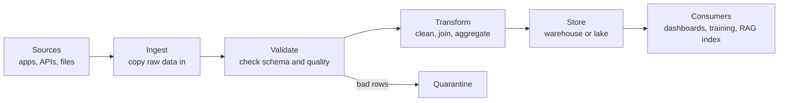
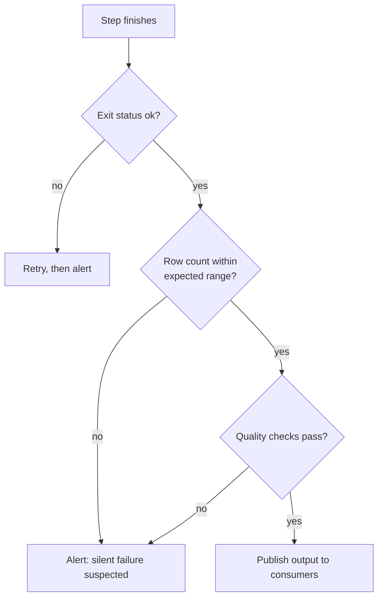

Every model you train and every retrieval system you build sits on top of data that someone moved, cleaned and stored. A **data pipeline** is the code that does that work: it takes data from where it is produced, turns it into a shape that is useful, and puts it where it is needed, on a schedule and without a human pressing buttons. When a model's quality drops overnight, the cause is more often a broken pipeline than a broken model. This lesson gives you the vocabulary and the design principles that the rest of the module builds on.

## What a pipeline is

A pipeline is a sequence of steps, each of which reads some input, does one job and writes an output that the next step reads. You already know the pieces: reading files with [pandas](/learn/pandas/reading-csv-excel-and-json), cleaning data, and querying [databases](/learn/sql-and-databases/database-fundamentals). A pipeline wires them together so they run reliably, repeatedly and unattended.



| Stage | Question it answers | Example |
| --- | --- | --- |
| Ingest | How does data get in? | Pull yesterday's orders from an API |
| Validate | Can we trust it? | Every order has an ID and a non-negative amount |
| Transform | What shape do consumers need? | One row per customer per day |
| Store | Where does it live? | A table in PostgreSQL, Parquet files in object storage |
| Serve | Who uses it? | A training job, a dashboard, a vector index |

The same structure appears in AI work. A training-data pipeline ingests raw text, filters and deduplicates it, and writes training files. A RAG ingestion pipeline loads documents, parses and chunks them, computes embeddings and writes them to a vector database. Different tools, same shape.

## Layers: raw, clean, curated

Most teams keep data in several layers rather than transforming it in place. Names vary (bronze/silver/gold, raw/staging/marts), but the idea is constant.

| Layer | Contents | Rule |
| --- | --- | --- |
| Raw | An exact copy of what the source sent | Never edited, only appended |
| Clean | Typed, validated, deduplicated records | Rebuilt from raw at any time |
| Curated | Tables shaped for a specific use | Rebuilt from clean at any time |

> [!KEY]
> Keep the raw data. If you discover a bug in your cleaning code three months from now, you can fix it and rebuild every downstream layer from raw. If you only kept the cleaned output, the original information is gone for good.

## Idempotency: the most important property

A pipeline step is **idempotent** if running it twice with the same input leaves the world in the same state as running it once. This matters because pipelines are re-run constantly: a task fails half way and is retried, an engineer re-runs last Tuesday after fixing a bug, a scheduler fires twice after a restart.

Here is a tiny pipeline run twice for the same day, once with an appending load and once with an overwriting load:

```python
import tempfile
from pathlib import Path
import pandas as pd

SOURCE = [
    {"order_id": 1, "day": "2026-11-01", "amount": "19.99"},
    {"order_id": 2, "day": "2026-11-01", "amount": "5.00"},
    {"order_id": 3, "day": "2026-11-02", "amount": "12.50"},
]

def extract(day):
    return pd.DataFrame([r for r in SOURCE if r["day"] == day])

def transform(df):
    return df.assign(amount=df["amount"].astype(float))

def load_append(df, path):
    df.to_csv(path, mode="a", header=not path.exists(), index=False)

def load_overwrite(df, out_dir, day):
    df.to_csv(out_dir / f"orders_{day}.csv", index=False)

out = Path(tempfile.mkdtemp())
for attempt in (1, 2):                      # the job runs twice (a retry)
    df = transform(extract("2026-11-01"))
    load_append(df, out / "all_orders.csv")
    load_overwrite(df, out, "2026-11-01")

print("append:   ", len(pd.read_csv(out / "all_orders.csv")), "rows")
print("overwrite:", len(pd.read_csv(out / "orders_2026-11-01.csv")), "rows")
```

```output
append:    4 rows
overwrite: 2 rows
```

The appending version silently doubled the day's revenue. The overwriting version is idempotent because each run **replaces the output for exactly the slice of data it is responsible for**. The three standard ways to achieve this are:

| Technique | How it works | Typical use |
| --- | --- | --- |
| Overwrite a partition | Delete and rewrite the output for one day, hour or batch | Files and data lakes |
| Upsert (merge) | Insert new keys, update existing ones | Database tables with a primary key |
| Deduplicate on read | Append freely, keep the latest row per key when reading | Event logs |

You will see upserts in [ETL and ELT](/learn/data-engineering-fundamentals/etl-and-elt) and partitions in [Data ingestion](/learn/data-engineering-fundamentals/data-ingestion).

## Determinism and parameters

Idempotency is much easier when a step is **deterministic**: same inputs, same outputs. Two habits get you most of the way:

- **Pass the time window in, never read the clock inside.** A step called with `day="2026-11-01"` processes that day whether it runs today or next month. A step that calls `datetime.now()` processes whatever "today" happens to be, which makes re-runs and backfills impossible.
- **Fix every source of randomness.** Sampling, shuffling and train/test splits need a fixed seed or, better, a split derived from a stable key (shown in [Data preprocessing](/learn/data-engineering-fundamentals/data-preprocessing)).

> [!TIP]
> Write each step as a function with explicit inputs and outputs, `run(day, input_path, output_path)`, rather than a script that reaches for globals. Such functions are easy to test, easy to re-run for any date, and easy to wrap in an orchestrator like [Airflow](/learn/data-engineering-fundamentals/basic-apache-airflow) later.

## Atomic writes

A job that crashes half way through writing a file can leave a truncated output that the next step happily reads. Write to a temporary location first and then rename, because a rename within one file system is atomic: readers see either the old file or the new one, never half of one.

```python
import os

def write_atomically(df, target):
    tmp = f"{target}.tmp"
    df.to_csv(tmp, index=False)
    os.replace(tmp, target)      # atomic swap on the same file system
```

Databases give you the same guarantee with transactions: do the delete and the insert inside one transaction, and either both happen or neither does.

## Batch and streaming

| | Batch | Streaming |
| --- | --- | --- |
| Unit of work | A bounded chunk: a day, an hour, a file | Individual events as they arrive |
| Latency | Minutes to hours | Seconds or less |
| Complexity | Lower: easy to re-run and reason about | Higher: ordering, late events, state |
| Typical AI use | Training sets, nightly re-indexing, reports | Fraud scoring, live feature updates |

Most pipelines that feed models are batch pipelines, and this module focuses on them (see [Batch processing](/learn/data-engineering-fundamentals/batch-processing)). Choose streaming only when the business genuinely needs low latency.

## Observability: knowing that it worked

A pipeline that fails loudly is annoying. A pipeline that "succeeds" while writing empty or wrong data is dangerous. Record, for every run:

- **Row counts** in and out of each step, so you notice when 10,000 rows become 12.
- **Run metadata**: which time window, which code version, start and end times.
- **Lineage**: which inputs produced which outputs, so you can trace a bad number back to its source.
- **Freshness**: when each table was last successfully updated.



> [!WARNING]
> Exit code zero only means the code did not crash. Treat "zero rows loaded" or "row count dropped by 90%" as failures, because downstream they look exactly like a sudden change in the world.

## Exercises

**1.** A pipeline step loads each day's sensor readings into a table with `INSERT INTO readings SELECT * FROM staging`. It is retried after a network error. What goes wrong, and give two ways to fix it.

<details>
<summary>Show solution</summary>

The retry inserts the same rows a second time, so every reading for that day is duplicated and any average or sum is distorted. Fixes:

- Make the load replace its slice: in one transaction, `DELETE FROM readings WHERE day = :day`, then insert that day's rows.
- Give the table a primary key, such as `(sensor_id, ts)`, and use an upsert so repeated rows update rather than duplicate.

</details>

**2.** Rewrite this function so it can be re-run for any past day.

```python
from datetime import date

def build_daily_report():
    day = date.today().isoformat()
    df = load_events(day)
    df.to_csv("report.csv", index=False)
```

<details>
<summary>Show solution</summary>

Take the day as a parameter and write one output per day, so re-running one day cannot overwrite another:

```python
def build_daily_report(day: str, out_dir: str) -> None:
    df = load_events(day)
    df.to_csv(f"{out_dir}/report_{day}.csv", index=False)
```

The scheduler decides which day to pass. A backfill is then a loop over dates.

</details>

**3.** Sketch the stages of a pipeline that keeps a RAG system's vector index in sync with a folder of company policy documents. For each stage, name one check you would add.

<details>
<summary>Show solution</summary>

1. **Ingest**: list new or changed files since the last run. Check that the file count is plausible.
2. **Parse**: extract text from PDFs and HTML. Check that no document produced empty text.
3. **Clean and chunk**: normalise whitespace, split into chunks. Check chunk length bounds.
4. **Embed**: compute embeddings. Check the vector dimension and that there are no missing vectors.
5. **Load**: upsert chunks keyed by `(document_id, chunk_number)` and delete chunks of removed documents. Check that the index count matches the expected chunk count.

</details>

```quiz
[
  {
    "q": "What makes a pipeline step idempotent?",
    "options": [
      "It runs in under a second",
      "Running it twice with the same input leaves the same result as running it once",
      "It never raises an exception",
      "It always appends new rows"
    ],
    "answer": 1,
    "why": "Idempotency means repeated runs are safe, which is essential because retries and re-runs are routine."
  },
  {
    "q": "Why do teams keep an unmodified raw layer?",
    "options": [
      "Raw data is faster to query",
      "It is required by SQL",
      "So downstream layers can be rebuilt after a bug in the transformation code is fixed",
      "So that consumers can read untyped data"
    ],
    "answer": 2,
    "why": "Raw data is the source of truth. Clean and curated layers are derived and can be regenerated from it."
  },
  {
    "q": "A step calls `datetime.now()` to decide which day to process. What is the main problem?",
    "options": [
      "It cannot be re-run or backfilled for a past day",
      "`datetime.now()` is slow",
      "It returns the wrong time zone on Linux",
      "Pandas cannot parse its output"
    ],
    "answer": 0,
    "why": "The window should be passed in as a parameter so the same code can process any day deterministically."
  },
  {
    "q": "Why write to a temporary file and then rename it?",
    "options": [
      "Renamed files compress better",
      "It makes the CSV smaller",
      "It avoids needing a schema",
      "Readers never see a half-written output if the job crashes"
    ],
    "answer": 3,
    "why": "A rename on the same file system is atomic, so consumers see either the old or the complete new file."
  }
]
```
