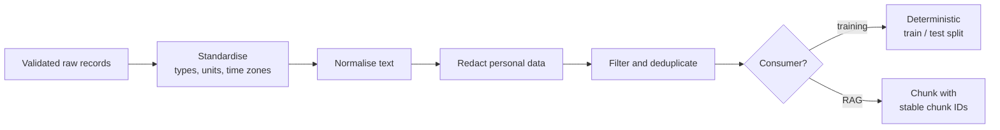

Once data is ingested and validated, it still rarely has the shape a model or an index needs. **Data preprocessing** in a pipeline means the repeatable transformations that turn trustworthy raw records into consistent, model-ready ones: standard types, units and time zones, normalised text, duplicates removed, personal data handled, and the data split or chunked for its consumer. You met interactive cleaning in [pandas data cleaning](/learn/pandas/data-cleaning), and the modelling side (scaling, encoding) is covered in [ML data preprocessing](/learn/machine-learning-fundamentals/data-preprocessing). This lesson is about doing it **inside a pipeline**: deterministic, re-runnable and identical every time.

## Notebook cleaning versus pipeline preprocessing

| In a notebook | In a pipeline |
| --- | --- |
| You look at the data and fix what you see | Code must handle data nobody has looked at |
| Run once | Runs every day, for every backfill |
| Order of cells can drift | Steps run in a fixed, versioned order |
| A mistake affects one analysis | A mistake affects every model trained afterwards |

The guiding rule: **every preprocessing step is a pure function of its input** (plus versioned configuration). Same raw input in, same output out, no matter when or how often it runs.



## Standardise types, units and time zones

Different sources disagree on representation. Pick one canonical form per concept and convert at the boundary:

| Concept | Canonical choice | Why |
| --- | --- | --- |
| Timestamps | UTC, time-zone aware | Comparisons and sorting work across sources |
| Money | Integer minor units (pence) or decimal, plus currency code | Floats accumulate rounding errors |
| Identifiers | Strings | Leading zeros and very long IDs survive |
| Categories | Lower-case, from a fixed vocabulary | `"Paid"`, `"PAID"` and `"paid"` become one value |

Time zones cause particularly quiet bugs. Two events that look an hour apart may be simultaneous:

```python
import pandas as pd

events = pd.DataFrame({
    "user": ["u1", "u2"],
    "ts": ["2026-11-01 09:00:00+00:00", "2026-11-01 10:00:00+01:00"],
})
events["ts_utc"] = pd.to_datetime(events["ts"], utc=True)
print(events)
```

```output
  user                         ts                    ts_utc
0   u1  2026-11-01 09:00:00+00:00 2026-11-01 09:00:00+00:00
1   u2  2026-11-01 10:00:00+01:00 2026-11-01 09:00:00+00:00
```

> [!WARNING]
> Timestamps with no offset at all are the worst case: you cannot know their time zone from the data. Find out from the source's documentation or owner and record the assumption in code, for example `.dt.tz_localize("Europe/London").dt.tz_convert("UTC")`.

## Normalise text, redact personal data, deduplicate

Text from the web, PDFs and user input is full of invisible variation: repeated spaces, trailing newlines, full-width characters, different Unicode forms of the same letter. If you deduplicate before normalising, near-identical copies survive. Unicode **NFKC** normalisation folds many such variants into one form.

Personal data needs a decision too. Training a model on email addresses and phone numbers risks it reproducing them, and putting them in a RAG index exposes them to anyone who can query it. Simple patterns catch the obvious cases; dedicated PII detection tools catch more.

```python
import hashlib
import re
import unicodedata
import pandas as pd

docs = pd.DataFrame({
    "doc_id": ["d1", "d2", "d3", "d4", "d5"],
    "text": [
        "Reset your password from the  Settings page.",
        "Reset your password from the Settings page.\n",
        "Ｒｅｓｅｔ your password from the Settings page.",
        "Contact ada@example.com or call 020 7946 0958.",
        "ok",
    ],
})

def normalise(text: str) -> str:
    text = unicodedata.normalize("NFKC", text)   # full-width letters -> ASCII, etc.
    text = re.sub(r"\s+", " ", text).strip()     # collapse all whitespace
    return text

EMAIL = re.compile(r"[\w.+-]+@[\w-]+\.[\w.]+")
PHONE = re.compile(r"\b\d{3}[ -]?\d{4}[ -]?\d{4}\b")

def redact(text: str) -> str:
    return PHONE.sub("[PHONE]", EMAIL.sub("[EMAIL]", text))

clean = docs.assign(text=docs["text"].map(normalise).map(redact))
clean["hash"] = clean["text"].map(
    lambda t: hashlib.sha256(t.lower().encode()).hexdigest()[:12]
)
clean = clean[clean["text"].str.len() >= 10]                 # drop near-empty docs
clean = clean.drop_duplicates(subset="hash", keep="first")   # exact dedup after normalising
print(clean.to_string(index=False))
```

```output
doc_id                                        text         hash
    d1 Reset your password from the Settings page. 5cf36e0711fc
    d4            Contact [EMAIL] or call [PHONE]. 247e1ba0619c
```

Three spellings of the same sentence collapsed into one, the contact details were masked, and the two-character document was dropped. Hashing the normalised text gives a compact key for deduplication across millions of documents and across runs: store the hashes you have already processed and skip repeats.

| Deduplication level | How | Catches |
| --- | --- | --- |
| Exact | Hash of the raw bytes | Identical files re-sent |
| Normalised exact | Hash after normalising whitespace, case, Unicode | Trivial formatting differences |
| Near-duplicate | MinHash or embedding similarity | Boilerplate variations, lightly edited copies |

> [!KEY]
> Duplicates are not just wasted compute. If the same example appears in both training and test data, your evaluation measures memorisation rather than generalisation. Deduplicate **before** you split.

## Deterministic splits

A random split with `sample(frac=0.8)` changes every time the dataset grows, so an example in yesterday's test set may land in today's training set. Derive the split from a hash of a stable key instead:

```python
import hashlib

def split_for(key: str, test_percent: int = 20) -> str:
    bucket = int(hashlib.sha256(key.encode()).hexdigest(), 16) % 100
    return "test" if bucket < test_percent else "train"

for user in ["u1", "u2", "u3", "u4", "u5", "u6"]:
    print(user, split_for(user))
```

```output
u1 test
u2 train
u3 train
u4 train
u5 train
u6 train
```

Each key always lands in the same bucket, and new keys spread roughly in the requested proportion over many keys (six is far too few to show 20%). Hash the **entity** that must not leak, such as the user or document, rather than the row, so all of one user's rows stay on the same side.

Statistics learned from data, such as the mean used for scaling or a vocabulary, must be computed **on the training split only** and then applied to the others. Computing them over everything leaks test information into training. In a pipeline, save these fitted values as an artefact with a version, so training and serving use exactly the same numbers.

## Chunking for RAG

A RAG pipeline splits documents into chunks small enough to embed and retrieve. A simple strategy uses a fixed number of words with some overlap so that a sentence cut at a boundary still appears whole in one chunk. Step through it:

```trace
{
  "title": "word chunking with overlap (size 5, overlap 2)",
  "code": [
    "words = text.split()",
    "step = size - overlap",
    "chunks = []",
    "for start in range(0, len(words), step):",
    "    chunks.append(' '.join(words[start:start + size]))",
    "    if start + size >= len(words):",
    "        break",
    "print(len(chunks), 'chunks')"
  ],
  "steps": [
    { "line": 1, "vars": { "len(words)": "11", "size": "5", "overlap": "2" }, "note": "The text has 11 words: one, two, ..., eleven." },
    { "line": 2, "vars": { "len(words)": "11", "step": "3" }, "note": "Each new chunk starts 3 words after the previous one, so consecutive chunks share 2 words." },
    { "line": 5, "vars": { "start": "0", "chunks": "['one two three four five']" }, "note": "First chunk: words 0 to 4." },
    { "line": 6, "vars": { "start": "0", "start + size": "5" }, "note": "5 is less than 11, so there is more text. Continue." },
    { "line": 5, "vars": { "start": "3", "chunks": "[..., 'four five six seven eight']" }, "note": "Second chunk starts at word 3 and repeats 'four five' from the first." },
    { "line": 5, "vars": { "start": "6", "chunks": "[..., 'seven eight nine ten eleven']" }, "note": "Third chunk: words 6 to 10." },
    { "line": 7, "vars": { "start": "6", "start + size": "11" }, "note": "This chunk reached the end of the text, so stop. Without this check the loop would emit a fourth chunk, 'ten eleven', that is entirely contained in the third." },
    { "line": 8, "vars": { "len(chunks)": "3" }, "out": ["3 chunks"], "note": "Three overlapping chunks cover all eleven words." }
  ]
}
```

The full function and its result:

```python
def chunk_words(text: str, size: int, overlap: int) -> list[str]:
    if not 0 <= overlap < size:
        raise ValueError("need 0 <= overlap < size")
    words = text.split()
    step = size - overlap
    chunks = []
    for start in range(0, len(words), step):
        chunks.append(" ".join(words[start:start + size]))
        if start + size >= len(words):
            break
    return chunks

text = "one two three four five six seven eight nine ten eleven"
for i, c in enumerate(chunk_words(text, size=5, overlap=2)):
    print(i, c)
```

```output
0 one two three four five
1 four five six seven eight
2 seven eight nine ten eleven
```

Real systems count tokens rather than words and prefer to cut at paragraph or sentence boundaries; [chunking strategies](/learn/rag-fundamentals/chunking-strategies) covers the options. The pipeline concern is identity: give each chunk an ID such as `f"{doc_id}:{i}"`, plus a hash of its text, so a re-run can upsert unchanged chunks without re-embedding them and delete chunks that no longer exist.

## Version the preprocessing

When you change a normalisation rule, every downstream dataset changes. Record the preprocessing code version (a Git commit) and its configuration alongside each output dataset, so you can always answer "which rules produced the data this model was trained on?".

## Exercises

**1.** Modify `normalise` so that it also lower-cases text and replaces curly quotes (`’`) with straight ones (`'`). Why might lower-casing be fine for deduplication keys but harmful for the stored training text?

<details>
<summary>Show solution</summary>

```python
def normalise(text: str) -> str:
    text = unicodedata.normalize("NFKC", text)
    text = text.replace("’", "'")
    text = re.sub(r"\s+", " ", text).strip()
    return text.lower()
```

Case carries meaning (names, acronyms, sentence starts) that a language model should learn, so lower-casing the stored text throws information away. For a deduplication key, discarding case is useful because it merges copies that differ only in capitalisation. The usual compromise is to lower-case only when computing the hash, as the lesson code does.

</details>

**2.** Your dataset has several rows per customer. A colleague splits with `df.sample(frac=0.8, random_state=0)` for training. Name two problems and fix them with `split_for`.

<details>
<summary>Show solution</summary>

Rows from the same customer land on both sides, leaking customer-specific patterns into the test set; and when new rows arrive the random sample changes, so examples move between splits across runs.

```python
df["split"] = df["customer_id"].astype(str).map(split_for)
train = df[df["split"] == "train"]
test = df[df["split"] == "test"]
```

</details>

**3.** What does `chunk_words("a b c", size=5, overlap=2)` return, and what does `chunk_words("a b c d e f", size=3, overlap=3)` do?

<details>
<summary>Show solution</summary>

The first returns `['a b c']`: one chunk, because the text is shorter than the chunk size. The second raises `ValueError`, because an overlap equal to the size would give a step of 0 and the loop would never advance.

</details>

```quiz
[
  {
    "q": "Why should deduplication happen before the train/test split?",
    "options": [
      "Duplicates make files larger",
      "Otherwise copies of an example can land on both sides, inflating test scores",
      "Splitting is faster on more rows",
      "Hashes cannot be computed after splitting"
    ],
    "answer": 1,
    "why": "A test example that also appears in training measures memorisation, not generalisation."
  },
  {
    "q": "What is the advantage of splitting by a hash of a stable key over random sampling?",
    "options": [
      "Each entity always lands in the same split, even as the dataset grows",
      "It guarantees exactly 20% test data on any size",
      "It is more random",
      "It removes duplicates"
    ],
    "answer": 0,
    "why": "The hash of a key never changes, so assignment is deterministic and stable across runs."
  },
  {
    "q": "Where should the mean used to standardise a feature be computed?",
    "options": [
      "On the whole dataset",
      "On the test split",
      "Separately on each split",
      "On the training split only, then applied to all splits"
    ],
    "answer": 3,
    "why": "Fitting on everything leaks test information into training. Fit on train, apply everywhere."
  },
  {
    "q": "Why give each RAG chunk a stable ID such as `doc_id:chunk_number`?",
    "options": [
      "Vector databases reject chunks without numeric IDs",
      "It makes embeddings more accurate",
      "Re-runs can upsert or delete chunks instead of duplicating them",
      "It shortens the chunk text"
    ],
    "answer": 2,
    "why": "Stable IDs make the load into the index idempotent and let removed content be deleted."
  }
]
```
