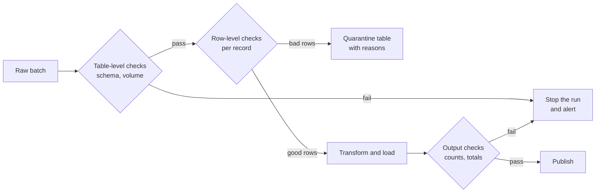

Code that crashes tells you it is broken. Data that is wrong usually does not: a model trains happily on labels shifted by one row, a dashboard shows revenue in pence as if it were pounds, and a RAG index fills up with empty pages from a parser that failed quietly. **Data validation** is the habit of stating what correct data looks like and checking it automatically, at the boundary where data enters your system, before anyone downstream relies on it.

## Where validation sits

Validate as early as possible, and again before publishing. Each check that fails should either stop the run or divert the offending rows, never pass them on silently.



Two kinds of failure need different responses:

- **Structural failures** (a required column is missing, the table is empty, a type changed) mean the whole batch is suspect. Stop.
- **Record failures** (one order with a negative amount) usually mean a few bad rows. Quarantine them with a reason, load the rest, and alert if the bad fraction is high.

## Kinds of checks

| Check | Question | Example |
| --- | --- | --- |
| Schema | Are the expected columns present with the right types? | `amount` is numeric, `created_at` is a timestamp |
| Completeness | Are required fields filled? | No null `customer_id` |
| Uniqueness | Are keys unique? | `order_id` appears once |
| Validity | Are values in the allowed set or range? | `currency` in `{GBP, EUR, USD}`, `amount >= 0` |
| Referential | Do foreign keys point at something? | Every `customer_id` exists in `customers` |
| Consistency | Do fields agree with each other? | `shipped_at` is not before `ordered_at` |
| Volume | Is the row count plausible? | Within the normal range for this weekday |
| Freshness | Is the data recent? | Newest `created_at` is less than 26 hours old |

## Table-level checks in plain pandas

You do not need a framework to start. A function that returns a list of failure messages is easy to read, test and log:

```python
import pandas as pd

df = pd.DataFrame({
    "order_id": [101, 102, 102, 104, 105],
    "customer_id": ["c1", "c2", "c2", None, "c5"],
    "amount": [19.99, 5.00, 5.00, -3.00, 250000.0],
    "currency": ["GBP", "EUR", "EUR", "GBP", "XYZ"],
})

REQUIRED = {"order_id", "customer_id", "amount", "currency"}
CURRENCIES = {"GBP", "EUR", "USD"}

def check_table(df):
    """Table-level checks: return a list of human-readable failures."""
    failures = []
    missing = REQUIRED - set(df.columns)
    if missing:
        return [f"missing columns: {sorted(missing)}"]  # nothing else is safe to check
    if len(df) == 0:
        failures.append("table is empty")
    if not pd.api.types.is_numeric_dtype(df["amount"]):
        failures.append(f"amount has dtype {df['amount'].dtype}, expected numeric")
    dupes = df["order_id"].duplicated().sum()
    if dupes:
        failures.append(f"order_id not unique: {dupes} duplicate(s)")
    nulls = df["customer_id"].isna().sum()
    if nulls:
        failures.append(f"customer_id has {nulls} null(s)")
    if (df["amount"] < 0).any():
        failures.append("amount has negative values")
    bad = ~df["currency"].isin(CURRENCIES)
    if bad.any():
        failures.append(f"unknown currency codes: {sorted(df.loc[bad, 'currency'].unique())}")
    return failures

for f in check_table(df):
    print("FAIL", f)
```

```output
FAIL order_id not unique: 1 duplicate(s)
FAIL customer_id has 1 null(s)
FAIL amount has negative values
FAIL unknown currency codes: ['XYZ']
```

Notice what the checks did **not** catch: an order of 250,000. It is valid by every rule above, yet probably a mistake. Rules catch what you anticipated; statistical checks, below, catch some of what you did not.

## Row-level checks and quarantine

Rather than failing the whole batch for a few bad records, label each failing row with its reasons and set it aside:

```python
def split_valid(df):
    rules = {
        "null customer_id": df["customer_id"].isna(),
        "negative amount": df["amount"] < 0,
        "unknown currency": ~df["currency"].isin(CURRENCIES),
        "duplicate order_id": df["order_id"].duplicated(keep="first"),
    }
    reasons = pd.Series("", index=df.index)
    for name, failed in rules.items():
        reasons[failed] += name + "; "
    bad = reasons != ""
    quarantine = df[bad].assign(reason=reasons[bad].str.rstrip("; "))
    return df[~bad], quarantine

valid, quarantine = split_valid(df)
print(valid)
print(quarantine[["order_id", "reason"]])
print(f"quarantined {len(quarantine) / len(df):.0%} of rows")
```

```output
   order_id customer_id  amount currency
0       101          c1   19.99      GBP
1       102          c2    5.00      EUR
   order_id                             reason
2       102                 duplicate order_id
3       104  null customer_id; negative amount
4       105                   unknown currency
quarantined 60% of rows
```

Write the quarantine table somewhere people can inspect it, and set a threshold: quarantining 0.1% of rows is routine, 60% means something upstream broke and the run should fail.

> [!TIP]
> Store the reason with each quarantined row. "3,000 rows failed" sends someone digging; "3,000 rows failed: unknown currency" usually points straight at the cause.

## Statistical checks: volume and distribution

Some problems only show up compared with history. A simple volume check compares today's row count $n$ with the counts from recent comparable runs, using their mean $\mu$ and standard deviation $\sigma$:

$$
z = \frac{n - \mu}{\sigma}
$$

If $|z|$ is large (a threshold of 3 is a common starting point), the count is unusual and worth an alert. The same idea applies to the mean of a column, the null rate, or the share of each category. Compare like with like: Mondays with Mondays if traffic is weekly.

## Validating single records with Pydantic

When records arrive one at a time, from an API or a queue, it is natural to validate each as an object. [Pydantic](/learn/fastapi/pydantic) v2 models declare types, coerce compatible inputs (the string `"101"` becomes the integer `101`) and run custom validators:

```python
from datetime import datetime
from pydantic import BaseModel, ValidationError, field_validator

class Order(BaseModel):
    order_id: int
    customer_id: str
    amount: float
    currency: str
    created_at: datetime

    @field_validator("amount")
    @classmethod
    def amount_not_negative(cls, v: float) -> float:
        if v < 0:
            raise ValueError("amount must not be negative")
        return v

    @field_validator("currency")
    @classmethod
    def known_currency(cls, v: str) -> str:
        v = v.upper()
        if v not in {"GBP", "EUR", "USD"}:
            raise ValueError(f"unknown currency {v}")
        return v

good = Order(order_id="101", customer_id="c1", amount="19.99",
             currency="gbp", created_at="2026-11-01T09:30:00Z")
print(good)

try:
    Order(order_id=102, customer_id="c2", amount=-3,
          currency="XYZ", created_at="yesterday")
except ValidationError as e:
    for err in e.errors():
        print(err["loc"], err["msg"])
```

```output
order_id=101 customer_id='c1' amount=19.99 currency='GBP' created_at=datetime.datetime(2026, 11, 1, 9, 30, tzinfo=TzInfo(0))
('amount',) Value error, amount must not be negative
('currency',) Value error, unknown currency XYZ
('created_at',) Input should be a valid datetime or date, input is too short
```

This output is from Pydantic 2.14; the exact wording of messages and the time-zone representation can differ slightly between versions. Note that Pydantic reports **all** failing fields at once rather than stopping at the first.

## Libraries and data contracts

As checks multiply, dedicated tools help. **pandera** declares a schema for a whole DataFrame (column types, value checks) and validates it in one call. **Great Expectations** manages suites of "expectations" with generated reports, aimed at teams. SQL-based transformation tools such as dbt support tests like "unique" and "not null" on warehouse tables. They all implement the same checks you wrote above; learn the ideas first and the APIs from each tool's documentation.

A **data contract** is the written agreement behind those checks: the producer of a dataset promises a schema, meanings, allowed values and freshness, and the consumers rely on it. It typically records:

| Contract item | Example |
| --- | --- |
| Owner | The checkout team |
| Schema | `order_id: int, unique`; `amount: decimal, >= 0`; `currency: ISO 4217 code` |
| Semantics | `amount` includes VAT and is in major units (pounds, not pence) |
| Freshness | Available by 03:00 UTC for the previous day |
| Change policy | Breaking changes announced in advance, with a new version |

> [!KEY]
> A contract turns "the data looks weird" into "the producer broke promise X", which is far easier to fix. Your validation code is the contract's executable form.

## Validation for AI data

Training and RAG data need extra checks: text not empty and within length bounds, labels from the known set, no duplicate examples across train and test splits, the language you expect, and embedding vectors of the correct dimension with no `NaN` values. A cheap check that catches a broken PDF parser, such as "fewer than 1% of documents have under 50 characters", saves a confusing debugging session later.

## Exercises

**1.** Add a consistency check to `check_table` for a new column `shipped_at`, which must not be earlier than `created_at` when both are present.

<details>
<summary>Show solution</summary>

```python
both = df["shipped_at"].notna() & df["created_at"].notna()
early = both & (df["shipped_at"] < df["created_at"])
if early.any():
    failures.append(f"{early.sum()} order(s) shipped before they were created")
```

</details>

**2.** The last seven Monday runs loaded 10,200, 9,800, 10,050, 9,950, 10,100, 9,900 and 10,000 rows. Today, a Monday, loaded 6,000. Compute the z-score with pandas and decide whether to alert using a threshold of 3.

<details>
<summary>Show solution</summary>

```python
import pandas as pd

history = pd.Series([10200, 9800, 10050, 9950, 10100, 9900, 10000])
z = (6000 - history.mean()) / history.std()
print(round(z, 1))
```

```output
-30.2
```

The count is far outside the normal range, so alert. A quick look upstream, for example at a source that delivered only part of the day, is the likely next step.

</details>

**3.** Write a Pydantic model `TrainingExample` with fields `text: str` and `label: str`, where `text` must have at least 20 characters after stripping whitespace and `label` must be one of `"positive"`, `"negative"`, `"neutral"`.

<details>
<summary>Show solution</summary>

```python
from pydantic import BaseModel, field_validator

class TrainingExample(BaseModel):
    text: str
    label: str

    @field_validator("text")
    @classmethod
    def long_enough(cls, v: str) -> str:
        v = v.strip()
        if len(v) < 20:
            raise ValueError("text must have at least 20 characters")
        return v

    @field_validator("label")
    @classmethod
    def known_label(cls, v: str) -> str:
        if v not in {"positive", "negative", "neutral"}:
            raise ValueError(f"unknown label {v}")
        return v
```

</details>

```quiz
[
  {
    "q": "A batch arrives without its `amount` column. What is the appropriate response?",
    "options": [
      "Fill the column with zeros and continue",
      "Quarantine every row and continue",
      "Stop the run and alert, because the whole batch is structurally wrong",
      "Drop the column from the target table"
    ],
    "answer": 2,
    "why": "A structural failure means the batch cannot be trusted. Quarantine is for a minority of bad records."
  },
  {
    "q": "Which check would catch an order amount of 250,000 that passes all type and range rules?",
    "options": [
      "A uniqueness check",
      "A statistical or distribution check against historical values",
      "A not-null check",
      "A schema check"
    ],
    "answer": 1,
    "why": "The value is valid by rule but unusual compared with history, which only a statistical check can flag."
  },
  {
    "q": "What does a data contract describe?",
    "options": [
      "The schema, meaning, allowed values and freshness a data producer promises its consumers",
      "The legal licence of a dataset",
      "The SQL used to create a table",
      "The price of storing the data"
    ],
    "answer": 0,
    "why": "A contract is an agreement between producer and consumers; validation code enforces it."
  },
  {
    "q": "In Pydantic v2, what does `field_validator(\"amount\")` attach a function to?",
    "options": [
      "Every field in the model",
      "Only the model's `__init__`",
      "The JSON serialiser",
      "Validation of the `amount` field"
    ],
    "answer": 3,
    "why": "`field_validator` registers a class method that runs when that named field is validated."
  }
]
```
