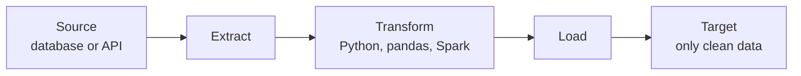
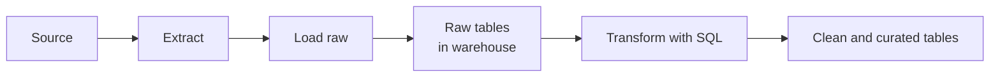
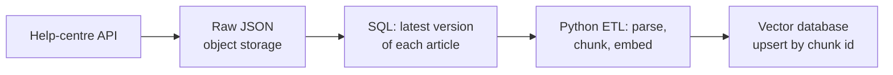

**ETL** (extract, transform, load) and **ELT** (extract, load, transform) are the two classic shapes of a data pipeline. The letters are the same; the order differs, and the order decides where your transformation code runs, what you keep, and how easily you can change your mind later. As an AI engineer you will meet both: an ETL job that cleans text before writing training files, and an ELT setup where raw API dumps land in a warehouse and SQL models build the feature tables your models read.

## The three verbs

| Verb | Meaning | Example |
| --- | --- | --- |
| Extract | Read data out of a source system | Query an orders database, call a REST API, list new files in a bucket |
| Transform | Change its shape or content | Cast types, drop bad rows, join customers to orders, aggregate per day |
| Load | Write it into a target system | Insert into a warehouse table, write Parquet files, upsert into a vector store |

## ETL: transform before loading

In ETL, data is transformed in a separate processing layer (a Python script, a Spark job) and only the finished result is loaded into the target.



ETL was the norm when warehouse storage and compute were expensive: you only stored what you had already cleaned. It is still the right choice when:

- the target cannot run transformations (a vector database, a folder of training shards, a search index);
- the transformation needs Python, not SQL (tokenising text, calling an embedding model, parsing PDFs);
- sensitive fields must be removed **before** data reaches the target, for privacy or compliance reasons.

A small ETL step in pandas:

```python
import pandas as pd

def etl(raw_rows: list[dict], con) -> None:
    df = pd.DataFrame(raw_rows)                                  # extract (already fetched)
    df = df.assign(                                              # transform
        customer=df["customer"].str.strip(),
        amount=df["amount"].astype(float),
        status=df["status"].str.lower(),
    )
    df.to_sql("orders", con, if_exists="append", index=False)    # load
```

## ELT: load first, transform inside the target

In ELT, raw data is loaded more or less as it arrived, and the transformation happens afterwards **inside** the target system, usually as SQL running in a data warehouse.



ELT became popular as cloud warehouses made storage cheap and SQL compute scalable. Its big advantage is that the raw data is kept: when requirements change, you write a new SQL transformation over the same raw tables rather than re-extracting from the source. Tools such as dbt are built around this pattern: version-controlled SQL `SELECT` statements that build tables from other tables.

Here is ELT in miniature with SQLite from the standard library. Raw JSON payloads are loaded untouched, then SQL builds a clean table:

```python
import json
import sqlite3

con = sqlite3.connect(":memory:")
con.execute("CREATE TABLE raw_orders (payload TEXT, loaded_at TEXT)")

raw = [
    {"id": 1, "customer": " Ada ", "amount": "19.99", "status": "PAID"},
    {"id": 2, "customer": "Grace", "amount": "5.00", "status": "paid"},
    {"id": 3, "customer": "Alan", "amount": "12.50", "status": "REFUNDED"},
]
con.executemany(
    "INSERT INTO raw_orders VALUES (?, ?)",
    [(json.dumps(r), "2026-11-02T02:00:00Z") for r in raw],
)

con.execute("""
CREATE TABLE orders AS
SELECT
    json_extract(payload, '$.id')                   AS id,
    trim(json_extract(payload, '$.customer'))       AS customer,
    CAST(json_extract(payload, '$.amount') AS REAL) AS amount,
    lower(json_extract(payload, '$.status'))        AS status
FROM raw_orders
""")
for row in con.execute("SELECT * FROM orders"):
    print(row)
```

```output
(1, 'Ada', 19.99, 'paid')
(2, 'Grace', 5.0, 'paid')
(3, 'Alan', 12.5, 'refunded')
```

`raw_orders` still holds the exact payloads plus a `loaded_at` timestamp. If you later need a field you ignored, such as a discount code, it is already there.

## Choosing between them

| | ETL | ELT |
| --- | --- | --- |
| Where transformation runs | Outside the target (Python, Spark) | Inside the target (SQL in the warehouse) |
| Raw data kept in target | Usually not | Yes |
| Changing logic later | Often needs re-extraction | Re-run SQL over raw tables |
| Language | Any | Mostly SQL |
| Good for | Text, images, embeddings, privacy filtering | Tabular analytics, reporting, feature tables |
| Risk | Lost information if the transform was wrong | Raw tables with sensitive data, warehouse costs |

> [!KEY]
> In practice most systems are hybrids. A common pattern is: extract and land raw data in object storage (ELT style), transform tabular data with SQL in the warehouse, and run Python ETL jobs for the parts SQL cannot do, such as chunking and embedding documents for RAG.

## Making the load step idempotent: upserts

Loads are where duplicates are born. If a table has a primary key, an **upsert** inserts rows with new keys and updates rows whose keys already exist, so replaying a batch is harmless. PostgreSQL and SQLite both support `INSERT ... ON CONFLICT`:

```python
import sqlite3

con = sqlite3.connect(":memory:")
con.execute("""
CREATE TABLE orders (
    id INTEGER PRIMARY KEY,
    customer TEXT,
    amount REAL,
    status TEXT
)""")

UPSERT = """
INSERT INTO orders (id, customer, amount, status)
VALUES (?, ?, ?, ?)
ON CONFLICT (id) DO UPDATE SET
    customer = excluded.customer,
    amount   = excluded.amount,
    status   = excluded.status
"""

batch = [(1, "Ada", 19.99, "paid"), (2, "Grace", 5.0, "paid")]
con.executemany(UPSERT, batch)
con.executemany(UPSERT, batch)                       # retried: no duplicates
con.executemany(UPSERT, [(2, "Grace", 5.0, "refunded")])  # a later change

for row in con.execute("SELECT * FROM orders ORDER BY id"):
    print(row)
```

```output
(1, 'Ada', 19.99, 'paid')
(2, 'Grace', 5.0, 'refunded')
```

`excluded` refers to the row that was proposed for insertion. Warehouses offer the same idea through a `MERGE` statement. Notice that the earlier pandas `to_sql(..., if_exists="append")` is **not** idempotent: replaying it duplicates rows. Either load into a staging table and merge from there, or delete the batch's slice first inside a transaction.

> [!WARNING]
> `if_exists="replace"` in `to_sql` drops and recreates the whole table, including any indexes and constraints you defined. It is idempotent, but only safe for small tables that are fully rebuilt on every run.

## Full refresh or incremental

Each run of either pattern can process all data (**full refresh**) or only what changed (**incremental**).

| | Full refresh | Incremental |
| --- | --- | --- |
| Logic | Rebuild the whole table every run | Process only new or changed rows |
| Correctness | Simple and self-healing | Needs a watermark or change tracking |
| Cost | Grows with total data | Grows with the size of the change |

Start with full refresh while tables are small; switch to incremental when the run time or cost starts to hurt. [Data ingestion](/learn/data-engineering-fundamentals/data-ingestion) shows how incremental extraction works.

## Where AI pipelines fit



The SQL step is ELT: it runs over raw data in the warehouse. The embedding step is ETL: Python transforms the data and loads it into a target that cannot transform anything itself. The final upsert, keyed by a stable chunk ID, keeps the index idempotent when the job re-runs.

## Exercises

**1.** For each case, say whether ETL or ELT fits better and why: (a) a daily revenue table built from an orders database; (b) turning scanned PDFs into text chunks with embeddings; (c) loading user messages that contain email addresses into a shared analytics warehouse where analysts must not see them.

<details>
<summary>Show solution</summary>

(a) ELT: load the orders into the warehouse and aggregate with SQL; raw orders stay available for future questions.
(b) ETL: OCR, chunking and embedding need Python and models; the vector store cannot do these itself.
(c) ETL, at least for the sensitive field: redact or hash email addresses before loading so they never reach the shared warehouse.

</details>

**2.** Write a SQLite upsert for a table `embeddings(chunk_id TEXT PRIMARY KEY, doc_id TEXT, vector TEXT)` so that re-running an embedding job replaces old vectors.

<details>
<summary>Show solution</summary>

```sql
INSERT INTO embeddings (chunk_id, doc_id, vector)
VALUES (?, ?, ?)
ON CONFLICT (chunk_id) DO UPDATE SET
    doc_id = excluded.doc_id,
    vector = excluded.vector;
```

</details>

**3.** An ELT pipeline's SQL transformation had a bug that lower-cased product codes, which are case-sensitive. How do you repair the clean table, and why is this easier than in an ETL pipeline that did not keep raw data?

<details>
<summary>Show solution</summary>

Fix the SQL and re-run it over the raw tables to rebuild the clean table (a full refresh). Because the raw payloads were loaded untouched, the original codes still exist. In an ETL pipeline that only stored transformed data, the original case would be lost and you would have to re-extract from the source, if the source still has it.

</details>

```quiz
[
  {
    "q": "What distinguishes ELT from ETL?",
    "options": [
      "ELT does not extract data",
      "ELT loads raw data first and transforms it inside the target system",
      "ELT can only be used with CSV files",
      "ELT transforms data twice"
    ],
    "answer": 1,
    "why": "In ELT the target, usually a warehouse, stores raw data and runs the transformations, typically in SQL."
  },
  {
    "q": "In `INSERT ... ON CONFLICT (id) DO UPDATE SET amount = excluded.amount`, what is `excluded`?",
    "options": [
      "The row that was proposed for insertion",
      "The row that was deleted",
      "A table of rejected rows",
      "The previous value in the table"
    ],
    "answer": 0,
    "why": "`excluded` holds the values from the attempted insert, which are used to update the existing row."
  },
  {
    "q": "Which task is the strongest case for ETL rather than ELT?",
    "options": [
      "Summing sales per region",
      "Joining two warehouse tables",
      "Removing personal data before it reaches a shared warehouse",
      "Filtering rows with a WHERE clause"
    ],
    "answer": 2,
    "why": "If sensitive data must never reach the target, it has to be transformed before loading."
  },
  {
    "q": "Why is `df.to_sql(\"orders\", con, if_exists=\"append\")` risky in a pipeline?",
    "options": [
      "It cannot write floats",
      "It drops the table first",
      "It only works with PostgreSQL",
      "Re-running it inserts the same rows again"
    ],
    "answer": 3,
    "why": "Appending is not idempotent. Use a staging table plus merge, an upsert, or delete-then-insert in a transaction."
  }
]
```
