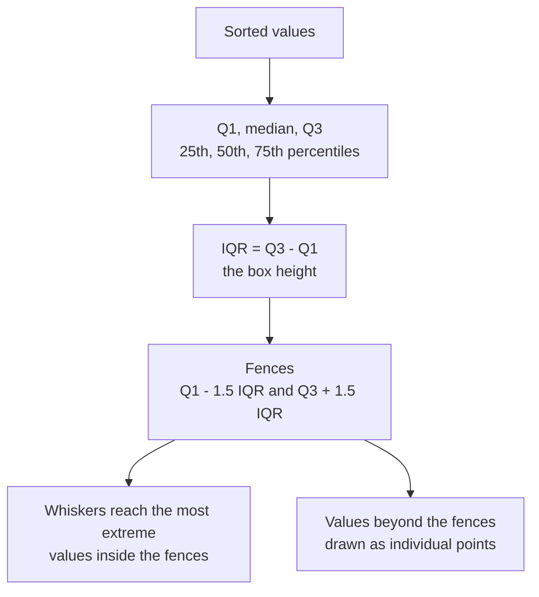

A box plot summarises a distribution with five numbers and draws them compactly enough that you can put ten or twenty distributions side by side. Its question is "how does a numeric variable compare across groups?" Which model has the lowest median latency, and which has the worst tail? Does a feature differ between classes? How much does a metric vary across cross-validation folds or random seeds? Is a model's error larger for one user group than another? A row of histograms answers these clumsily; a row of boxes answers them at a glance. The price is that a box plot hides shape, and knowing exactly what it hides is half of using it well.

## Anatomy of a box plot

A box plot is built from quartiles, which you met alongside the [median](/learn/probability-and-statistics/mean-median-and-mode) and [variance](/learn/probability-and-statistics/variance-and-standard-deviation).



- The **box** spans the first quartile $Q_1$ to the third quartile $Q_3$, so it contains the middle 50% of the data.
- The **line inside** the box is the median.
- The **interquartile range** is $\text{IQR} = Q_3 - Q_1$.
- The **whiskers** extend to the most extreme data points that lie within the fences $Q_1 - 1.5\,\text{IQR}$ and $Q_3 + 1.5\,\text{IQR}$.
- Points beyond the fences are drawn individually and are often called **outliers** (Matplotlib calls them "fliers").

The calculation by hand, for ten request latencies in milliseconds:

```python
import numpy as np

latency = np.array([82, 95, 101, 110, 118, 124, 131, 140, 155, 410])
q1, median, q3 = np.percentile(latency, [25, 50, 75])
iqr = q3 - q1
low_fence, high_fence = q1 - 1.5 * iqr, q3 + 1.5 * iqr

print(f"Q1={q1:.1f}  median={median:.1f}  Q3={q3:.1f}  IQR={iqr:.1f}")
print(f"fences: {low_fence:.1f} to {high_fence:.1f}")
print("outliers:", latency[(latency < low_fence) | (latency > high_fence)])
print(f"mean={latency.mean():.1f}")
```

```output
Q1=103.2  median=121.0  Q3=137.8  IQR=34.5
fences: 51.5 to 189.5
outliers: [410]
mean=146.6
```

One slow request at 410 ms pulls the mean to 146.6, above nine of the ten values, while the median and quartiles barely notice it. That robustness is why box plots are built from quartiles: they describe the typical case and show extremes separately rather than letting them distort the summary.

> [!NOTE]
> The 1.5 IQR rule is a convention (the default `whis=1.5` in both Matplotlib and seaborn), not a statistical test. A point beyond the whisker is "unusual relative to this sample", not necessarily an error. For a normal distribution, roughly 0.7% of values fall outside the fences by chance, so a dataset of 100,000 rows will show hundreds of "outliers" that are perfectly genuine.

## Comparing groups, and what boxes hide

Here are simulated latencies for three model sizes. The `large` model is deliberately unusual: most requests hit a cache and return in about 450 ms, but a third miss and take about 900 ms.

```python
import numpy as np
import pandas as pd
import seaborn as sns
import matplotlib.pyplot as plt

rng = np.random.default_rng(7)
latency = pd.DataFrame({
    "model": np.repeat(["small", "medium", "large"], 300),
    "latency_ms": np.concatenate([
        rng.gamma(4, 30, 300),                                   # fast, right-skewed
        rng.gamma(6, 40, 300),
        np.concatenate([rng.normal(450, 40, 200),                # two modes: cache hit
                        rng.normal(900, 60, 100)]),              # and cache miss
    ]),
})

fig, axes = plt.subplots(1, 3, figsize=(9, 3.2), sharey=True)
sns.boxplot(data=latency, x="model", y="latency_ms", ax=axes[0])
axes[0].set_title("Box plot")
sns.violinplot(data=latency, x="model", y="latency_ms", ax=axes[1])
axes[1].set_title("Violin plot")
sns.boxplot(data=latency, x="model", y="latency_ms", showfliers=False,
            color="white", ax=axes[2])
sns.stripplot(data=latency, x="model", y="latency_ms", size=2, alpha=0.4, ax=axes[2])
axes[2].set_title("Box + every point")
for ax in axes:
    ax.set_xlabel("")
axes[0].set_ylabel("latency (ms)")
fig.tight_layout()
fig.savefig("box-violin-strip.png", dpi=110, bbox_inches="tight", facecolor="white")
print(latency.groupby("model")["latency_ms"].describe()[["25%", "50%", "75%"]].round(0))
```

```output
          25%    50%    75%
model                      
large   437.0  481.0  847.0
medium  164.0  218.0  285.0
small    67.0   99.0  133.0
```


The box plot alone tells you the order of the medians and that the small and medium models have right-skewed latency (the median sits low in the box and outliers sit above). For the large model it tells you something misleading: a tall box suggests latencies spread evenly from 440 to 850 ms. In fact almost no requests take 600 ms. There are two separate populations, cache hits and misses, and the quartiles happen to fall in each. The violin and the strip plot both reveal it.

> [!KEY]
> A box plot reduces a distribution to five numbers, so it cannot show multiple peaks, gaps or clusters. When the sample is small enough, overlay the raw points; when it is large, check a violin plot or histogram at least once before trusting the boxes.

| Chart | Shows | Weakness | When to use |
| --- | --- | --- | --- |
| Box plot | Median, quartiles, range, outliers | Hides shape and sample size | Many groups, robust summary |
| Violin plot | Full density shape, mirrored | Smoothing invents shape in sparse data and can extend past real limits | Medium or large samples where shape matters |
| Strip or swarm plot | Every individual value | Unreadable for thousands of points | Small samples (for example, 5 folds or 10 seeds) |
| Box plus strip | Summary and raw data together | Busier | The honest default for small to medium data |

## Box plots in AI work

**Variation across runs.** Training the same model with five random seeds gives five scores. Comparing two models by their single best run hides the spread; a box (or strip) per model shows whether their ranges overlap. If they do, the "improvement" may be noise.

**Feature against class.** `sns.boxplot(data=df, x="label", y="n_words")` shows whether a feature separates the classes before you train anything. Boxes that barely overlap mean a useful feature; identical boxes mean the feature carries little information about the label on its own.

**Error by subgroup.** Plot the absolute prediction error grouped by region, device type or demographic group. A model with good average error can be much worse for one group, and a row of boxes makes that visible. This is a basic fairness check.

**Latency and cost.** Production metrics care about tails. A median of 100 ms means little if the 99th percentile is 3 seconds. Boxes show the bulk; outlier points and violins show the tail. Report tail percentiles as numbers too.

## Making box plots readable

```python
order = latency.groupby("model")["latency_ms"].median().sort_values().index
fig, ax = plt.subplots(figsize=(6, 3))
sns.boxplot(data=latency, y="model", x="latency_ms", order=order, ax=ax)
ax.set(xlabel="latency (ms)", ylabel="")
```

- **Sort the groups** by median unless they have a natural order (model sizes, epochs).
- **Go horizontal** (categories on the y-axis) when there are many groups or long names, so labels do not overlap.
- **Show the sample size**, for example in the tick labels (`"large (n=300)"`). A box from 4 points looks exactly as authoritative as a box from 4,000.
- **Use a log axis** (`ax.set_xscale("log")`) when groups differ by orders of magnitude.
- **Do not truncate** the axis so that outliers fall off the chart without saying so.

## Exercises

**1.** For the values `[3, 4, 4, 5, 5, 5, 6, 6, 7, 30]`, compute the quartiles with `np.percentile`, the fences, and which points a box plot would draw individually.

<details>
<summary>Show solution</summary>

```python
import numpy as np

v = np.array([3, 4, 4, 5, 5, 5, 6, 6, 7, 30])
q1, q3 = np.percentile(v, [25, 75])
iqr = q3 - q1
print(q1, q3, q1 - 1.5 * iqr, q3 + 1.5 * iqr)
print(v[(v < q1 - 1.5 * iqr) | (v > q3 + 1.5 * iqr)])
```

```output
4.25 6.0 1.625 8.625
[30]
```

Only 30 is beyond the fences. Note that NumPy interpolates between data points, so quartiles may be values that do not appear in the data.

</details>

**2.** Two models are each trained with 5 seeds. Model A's F1 scores range from 0.81 to 0.86 with median 0.84; model B's range from 0.82 to 0.85 with median 0.835. Your manager asks which is better. What would you plot, and what would you say?

<details>
<summary>Show solution</summary>

Plot a strip plot of all ten scores, grouped by model, with a box or a median marker for each. The ranges overlap almost completely, so with five seeds there is no evidence that either model is better. Model B is slightly more consistent. To claim a difference you would need more seeds or a [statistical test](/learn/probability-and-statistics/hypothesis-testing).

</details>

**3.** Why can a violin plot be misleading for a group with only 8 observations?

<details>
<summary>Show solution</summary>

The violin is a kernel density estimate, a smooth curve fitted through 8 points. Its bumps and its tails reflect the smoothing bandwidth as much as the data, and it can extend beyond the smallest and largest observed values. With so few points, a strip plot of the raw values is more honest.

</details>

```quiz
[
  {
    "q": "What does the box in a standard box plot contain?",
    "options": ["The middle 50% of the data, from Q1 to Q3", "All data within one standard deviation of the mean", "The middle 95% of the data", "Every value except outliers"],
    "answer": 0,
    "why": "The box runs from the 25th to the 75th percentile, the interquartile range."
  },
  {
    "q": "With Q1 = 20 and Q3 = 40, beyond which upper value is a point drawn individually by default?",
    "options": ["40", "60", "70", "80"],
    "answer": 2,
    "why": "IQR is 20, and the upper fence is Q3 + 1.5 times IQR = 40 + 30 = 70."
  },
  {
    "q": "A latency distribution has two separate clusters at 450 ms and 900 ms. What will a box plot show?",
    "options": ["Two boxes", "A tall box that suggests values spread evenly between the clusters, with no sign of the gap", "Only the outliers", "An error"],
    "answer": 1,
    "why": "Quartiles cannot represent multiple peaks; a violin, histogram or strip plot reveals the gap."
  },
  {
    "q": "Why are box plots built on the median and quartiles rather than the mean and standard deviation?",
    "options": ["They are faster to compute", "Matplotlib cannot compute a mean", "They only work for normal data", "They are robust: a few extreme values barely move them"],
    "answer": 3,
    "why": "Quartiles describe the typical data even when outliers would pull the mean and inflate the standard deviation."
  }
]
```
