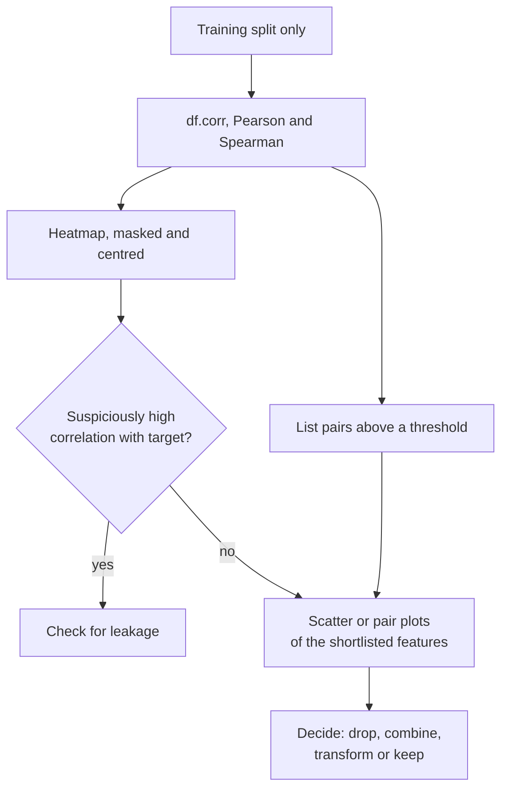

Before you train a model on a table of features, you want to know how those features relate to each other and to the target. Which features move with the target? Which pairs are near-duplicates that add nothing but instability? Is any feature suspiciously good, a sign that it leaks the answer? Correlation visualisation answers these questions for dozens of features at once, combining the heatmap and scatter plot techniques from earlier in this module. It is one of the first things to do on a new dataset, and it prevents some of the most embarrassing modelling mistakes.

## Correlation in one paragraph

The [correlation and covariance lesson](/learn/probability-and-statistics/correlation-and-covariance) introduced the Pearson correlation coefficient between two variables $x$ and $y$ measured on $n$ observations:

$$
r = \frac{\sum_{i=1}^{n} (x_i - \bar{x})(y_i - \bar{y})}{\sqrt{\sum_{i=1}^{n} (x_i - \bar{x})^2}\,\sqrt{\sum_{i=1}^{n} (y_i - \bar{y})^2}}
$$

where $\bar{x}$ and $\bar{y}$ are the means. It ranges from $-1$ (perfect falling straight line) through $0$ (no *linear* relationship) to $+1$ (perfect rising straight line). **Spearman's** correlation $\rho$ is the Pearson correlation of the *ranks* of the values, so it measures any **monotonic** relationship (one that only ever rises, or only ever falls), not just a straight line, and is far less sensitive to outliers.

| Method | Measures | Sensitive to outliers | pandas |
| --- | --- | --- | --- |
| Pearson $r$ | Linear association | Very | `df.corr()` (the default) |
| Spearman $\rho$ | Monotonic association | Much less | `df.corr(method="spearman")` |

## The correlation heatmap

`df.corr()` returns a square matrix, one row and column per numeric feature. Drawn as a [heatmap](/learn/data-visualization/heatmaps) it becomes a map of the whole dataset. The simulated house-price data below includes one deliberate near-duplicate: floor area in both square feet and square metres.

```python
import numpy as np
import pandas as pd
import seaborn as sns
import matplotlib.pyplot as plt

rng = np.random.default_rng(8)
n = 500
sqft = rng.normal(1500, 400, n)
df = pd.DataFrame({
    "sqft": sqft,
    "rooms": (sqft / 400 + rng.normal(0, 0.7, n)).round(),
    "sqm": sqft * 0.0929 + rng.normal(0, 1, n),        # near-duplicate of sqft
    "age": rng.uniform(0, 80, n),
    "dist_centre": rng.exponential(8, n),
})
df["price"] = 150 * df["sqft"] - 800 * df["age"] - 4000 * df["dist_centre"] + rng.normal(0, 40000, n)

corr = df.corr(method="pearson")
mask = np.triu(np.ones_like(corr, dtype=bool))      # hide the redundant upper triangle

fig, ax = plt.subplots(figsize=(6, 4.8))
sns.heatmap(corr, mask=mask, annot=True, fmt=".2f", cmap="RdBu_r",
            vmin=-1, vmax=1, center=0, square=True, linewidths=0.5, ax=ax)
ax.set_title("Feature correlations (Pearson)")
fig.savefig("correlation-heatmap.png", dpi=110, bbox_inches="tight", facecolor="white")
print(corr["price"].drop("price").sort_values(key=abs, ascending=False).round(2))
```

```output
sqm            0.75
sqft           0.75
rooms          0.61
dist_centre   -0.40
age           -0.24
Name: price, dtype: float64
```


The choices in the code are the ones that make correlation heatmaps readable:

- **Diverging colour map, fixed to the full range.** `cmap="RdBu_r", vmin=-1, vmax=1, center=0` makes positive red, negative blue and zero white, and keeps colours comparable between datasets.
- **Mask the upper triangle.** The matrix is symmetric and its diagonal is always 1, so half of it is redundant. `np.triu` builds a boolean mask that hides the upper triangle including the diagonal.
- **Annotate** with two decimals when there are fewer than about 15 features. For more, drop annotations and sort or cluster the features (`sns.clustermap(corr, cmap="RdBu_r", center=0)` reorders rows and columns so correlated groups sit together).

Reading this one: `sqft` and `sqm` are the same information (correlation 1.00), so a linear model given both will have unstable coefficients; keep one. `rooms` is strongly tied to area (0.81). `price` relates positively to size and negatively to age and distance from the centre.

## Finding problem pairs in code

With 200 features you cannot eyeball a 200 by 200 heatmap. List the strongest pairs instead:

```python
import numpy as np
import pandas as pd

rng = np.random.default_rng(8)
n = 500
sqft = rng.normal(1500, 400, n)
df = pd.DataFrame({
    "sqft": sqft,
    "rooms": (sqft / 400 + rng.normal(0, 0.7, n)).round(),
    "sqm": sqft * 0.0929 + rng.normal(0, 1, n),
    "age": rng.uniform(0, 80, n),
})

corr = df.corr().abs()
upper = corr.where(np.triu(np.ones(corr.shape, dtype=bool), k=1))
pairs = upper.stack().sort_values(ascending=False)
print(pairs[pairs > 0.8])
```

```output
sqft   sqm      0.999652
       rooms    0.810992
rooms  sqm      0.810347
dtype: float64
```

`k=1` in `np.triu` excludes the diagonal, `where` keeps each pair once, and `stack` turns the matrix into a list of pairs. The output is a shortlist to look at, not an automatic rule: whether to drop, combine or keep correlated features depends on the model (tree ensembles mostly cope; linear models and their coefficient interpretations do not). The [feature selection lesson](/learn/machine-learning-fundamentals/feature-selection) returns to this.

> [!WARNING]
> A feature with a correlation of 0.99 with the target is more often a bug than a breakthrough. Typical causes are a column computed from the target (a "total" that includes the value you predict), information recorded after the outcome (a "refund issued" flag when predicting fraud) or a duplicated ID that encodes the label. Investigate before celebrating. Also compute correlations on the training split only, so that test data does not influence any decision.

## Always look at the scatter plot

A correlation coefficient is a single number, and very different relationships can produce the same number, or hide behind a misleading one.

```python
import numpy as np
import matplotlib.pyplot as plt

rng = np.random.default_rng(9)
n = 200
x = rng.uniform(-2, 2, n)
noise_x, noise_y = rng.normal(0, 1, (2, n - 1))

panels = [
    ("linear", x, 0.5 * x + rng.normal(0, 0.55, n)),
    ("curved", x, x**2 + rng.normal(0, 0.3, n)),
    ("one outlier", np.append(noise_x, 12), np.append(noise_y, 12)),
]

fig, axes = plt.subplots(1, 3, figsize=(9, 2.8))
for ax, (name, xs, ys) in zip(axes, panels):
    r = np.corrcoef(xs, ys)[0, 1]
    ax.scatter(xs, ys, s=8, alpha=0.6)
    ax.set_title(f"{name}: r = {r:.2f}")
fig.tight_layout()
fig.savefig("correlation-pitfalls.png", dpi=110, bbox_inches="tight", facecolor="white")
```


- **Curved:** $y$ depends almost entirely on $x$, yet $r \approx 0$, because the relationship is not a straight line. A correlation near zero means "no linear relationship", never "no relationship".
- **One outlier:** 199 points with no relationship and one extreme point produce $r = 0.41$. One bad row (a unit error, a sentinel value like 99999) can create or destroy a correlation.

Spearman correlation handles monotonic curves, though not U shapes:

```python
import numpy as np
import pandas as pd

rng = np.random.default_rng(10)
x = rng.uniform(0, 5, 300)
df = pd.DataFrame({
    "x": x,
    "exp_x": np.exp(x),                         # monotonic but very non-linear
    "x_squared_centered": (x - 2.5) ** 2,       # U-shaped
})

print(df.corr(method="pearson")["x"].round(2))
print(df.corr(method="spearman")["x"].round(2))
```

```output
x                     1.00
exp_x                 0.87
x_squared_centered    0.08
Name: x, dtype: float64
x                     1.0
exp_x                 1.0
x_squared_centered   -0.0
Name: x, dtype: float64
```

For the exponential relationship, Pearson says 0.87 while Spearman correctly reports a perfect monotonic relationship (1.0). For the U shape both are about zero (the `-0.0` is a tiny negative value rounded), even though the dependence is perfect. Only a plot reveals it.

> [!KEY]
> Use the correlation matrix to decide *where to look*, then look at the scatter plots. The number summarises; the picture explains.

## Pair plots

A pair plot draws a scatter plot for every pair of features and a distribution for each feature on the diagonal, optionally coloured by class. It is the visual counterpart of the correlation matrix. With the classic iris dataset bundled in scikit-learn:

```python
import pandas as pd
import seaborn as sns
from sklearn.datasets import load_iris

iris = load_iris(as_frame=True)
df = iris.frame.rename(columns=lambda c: c.replace(" (cm)", "").replace(" ", "_"))
df["species"] = iris.target_names[iris.target]

g = sns.pairplot(df, hue="species", vars=["sepal_length", "sepal_width", "petal_length"],
                 height=1.9, plot_kws={"s": 12, "alpha": 0.7})
g.figure.savefig("iris-pairplot.png", dpi=110, bbox_inches="tight", facecolor="white")
```


The pair plot shows things a correlation matrix cannot. Petal length separates setosa perfectly from the other species, a strong feature for classification. And sepal length against sepal width has an overall Pearson correlation of -0.12, which suggests no relationship, yet within each species the correlation is clearly positive (0.74, 0.53 and 0.46). The species clusters sit in different places and mask the within-group trend. When a relationship within groups differs from, or reverses, the relationship across all the data, it is called **Simpson's paradox**, and colouring by group is how you catch it. Pair plots grow quadratically with the number of features, so use them on a shortlist of 3 to 6 features chosen from the correlation matrix.

## A pre-modelling workflow



Correlation also has hard limits. It only covers numeric variables (categorical ones need other measures, such as comparing group means with box plots); it only measures pairs, so a feature useful only in combination with another can look useless; and it says nothing about causation.

## Exercises

**1.** Write code that, given a DataFrame `df` with a numeric `target` column, prints the five features with the largest absolute Pearson correlation with the target, along with the sign.

<details>
<summary>Show solution</summary>

```python
corr_with_target = df.corr()["target"].drop("target")
top5 = corr_with_target.reindex(corr_with_target.abs().sort_values(ascending=False).index)[:5]
print(top5.round(2))
```

Sorting by absolute value ranks strong negative correlations alongside positive ones, while printing the original values keeps the sign.

</details>

**2.** A feature has Pearson correlation 0.02 with the target. A colleague proposes dropping it as useless. What two checks would you do first?

<details>
<summary>Show solution</summary>

Plot the target against the feature (a scatter plot, or box plots if the feature takes few values) to look for a non-linear relationship such as a U shape, and compute Spearman correlation to catch monotonic but non-linear patterns. Also consider whether it might matter in combination with other features, which a tree-based model's feature importance or a quick ablation would reveal.

</details>

```quiz
[
  {
    "q": "Two variables have a Pearson correlation of 0.01. What can you conclude?",
    "options": ["They are independent", "There is no straight-line relationship, but there could still be a strong non-linear one", "One causes the other", "The data contains errors"],
    "answer": 1,
    "why": "Pearson measures linear association only; a U-shaped relationship can give r near zero."
  },
  {
    "q": "Why mask the upper triangle of a correlation heatmap?",
    "options": ["Upper-triangle values are wrong", "seaborn requires it", "The matrix is symmetric, so the upper triangle repeats the lower one", "It changes the correlations"],
    "answer": 2,
    "why": "corr(a, b) equals corr(b, a), and the diagonal is always 1, so masking removes redundancy without losing information."
  },
  {
    "q": "A new feature correlates 0.995 with the target in the training set. What should you do first?",
    "options": ["Check whether it leaks information about the target", "Use it as the only feature", "Remove all other features", "Switch to Spearman correlation"],
    "answer": 0,
    "why": "Near-perfect correlation with the target usually signals leakage, such as a column derived from the target or recorded after the outcome."
  },
  {
    "q": "When is Spearman correlation preferable to Pearson?",
    "options": ["When the data is perfectly linear", "When the variables are categorical", "Never; they always agree", "When the relationship is monotonic but curved, or outliers are present"],
    "answer": 3,
    "why": "Spearman works on ranks, so it captures any monotonic trend and limits the influence of extreme values."
  }
]
```
