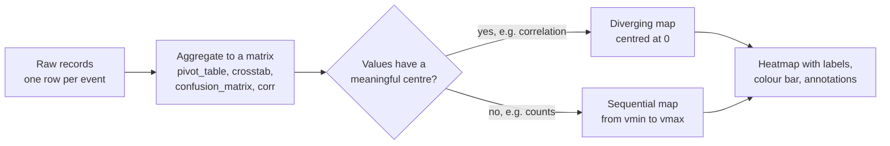

A heatmap shows a matrix of numbers as a grid of coloured cells, with colour standing for value. It answers the question "how does a value vary across two dimensions?", where each dimension is a set of categories or ordered steps rather than a continuous axis. Heatmaps are everywhere in AI: the confusion matrix that shows which classes a classifier mixes up, the correlation matrix you check before modelling, the grid of validation scores from a hyperparameter search, and the attention weights that show which tokens a transformer looks at. Because a heatmap relies entirely on colour, the colour map you choose decides whether it informs or misleads.

## What a heatmap answers

| Heatmap | Rows | Columns | Cell value |
| --- | --- | --- | --- |
| Confusion matrix | True class | Predicted class | Count or rate |
| Correlation matrix | Feature | Feature | Correlation, -1 to 1 |
| Hyperparameter grid | Learning rate | Batch size | Validation score |
| Attention map | Query token | Key token | Attention weight |

If both of your variables are continuous and you have raw points, you want a scatter plot or a 2D histogram instead. If one dimension is time and you have a few series, a line plot is clearer. A heatmap shines when you already have a table of values indexed by two discrete variables.

## Two ways to draw one

| | `ax.imshow(matrix)` | `sns.heatmap(data)` |
| --- | --- | --- |
| Input | 2D NumPy array (also images) | 2D array or DataFrame (uses its index and columns as labels) |
| Labels | Set ticks yourself | Automatic from a DataFrame |
| Cell values written in | Manual `ax.text` loop | `annot=True`, formatted by `fmt` |
| Colour bar | `fig.colorbar(im)` | Included by default |
| Origin | Row 0 at the top (images); `origin="lower"` flips | Row 0 at the top |
| Best for | Large matrices, images, attention maps | Labelled tables up to roughly 20 by 20 |



## The confusion matrix

A confusion matrix counts, for each true class, how many examples the model predicted as each class. The diagonal holds correct predictions; everything off the diagonal is an error, and its position tells you which error.

```python
import numpy as np
import matplotlib.pyplot as plt
import seaborn as sns
from sklearn.metrics import confusion_matrix

rng = np.random.default_rng(6)
classes = ["cat", "dog", "fox", "owl"]
y_true = rng.choice(4, size=800, p=[0.35, 0.35, 0.2, 0.1])
# Simulated classifier: mostly right, but often calls a fox a dog
y_pred = y_true.copy()
flip = rng.random(800) < 0.15
y_pred[flip] = rng.integers(0, 4, flip.sum())
dog_fox = (y_true == 2) & (rng.random(800) < 0.3)
y_pred[dog_fox] = 1

cm = confusion_matrix(y_true, y_pred)
cm_norm = cm / cm.sum(axis=1, keepdims=True)    # each row sums to 1 (recall view)

fig, (ax1, ax2) = plt.subplots(1, 2, figsize=(9, 3.6))
sns.heatmap(cm, annot=True, fmt="d", cmap="Blues", cbar=False,
            xticklabels=classes, yticklabels=classes, ax=ax1)
ax1.set(title="Counts", xlabel="predicted", ylabel="true")

sns.heatmap(cm_norm, annot=True, fmt=".2f", cmap="Blues", vmin=0, vmax=1,
            xticklabels=classes, yticklabels=classes, ax=ax2)
ax2.set(title="Row-normalised (recall per class)", xlabel="predicted", ylabel="true")

fig.tight_layout()
fig.savefig("confusion-matrix-heatmap.png", dpi=110, bbox_inches="tight", facecolor="white")
print(cm)
```

```output
[[250   8   6  11]
 [  7 258   7   6]
 [  5  51 109   5]
 [  2   4   0  71]]
```


Read it row by row. The `fox` row says that of 170 real foxes, 109 were correct and 51 were called `dog`. Columns tell the reverse story: the `dog` column collects predictions, so the 51 foxes there lower the precision for `dog`.

The two panels show why **normalisation** matters. Raw counts make big classes look dark and small classes faint: the `owl` diagonal (71) is paler than `cat` (250), even though owls are classified just as well. Dividing each row by its total turns each cell into a rate; the diagonal becomes per-class **recall**, and the weak class (fox, 0.64) stands out at once. Use `vmin=0, vmax=1` so the colours mean the same thing in every plot you make.

> [!KEY]
> State the orientation on the axes. Scikit-learn's `confusion_matrix` puts true labels on rows and predictions on columns, but other tools and papers differ. Without "true" and "predicted" labels, a reader can easily confuse precision with recall.

## Colour maps

The colour map (`cmap`) translates numbers into colours. It must match the kind of data:

| Type | Use when | Examples |
| --- | --- | --- |
| Sequential | Values run from low to high with no special midpoint (counts, probabilities) | `"viridis"`, `"Blues"`, `"magma"` |
| Diverging | Values have a meaningful centre, usually 0 (correlations, differences, residuals) | `"RdBu_r"`, `"coolwarm"`, `"vlag"` |
| Qualitative | Categories with no order (not for heatmaps of numbers) | `"tab10"`, `"Set2"` |

The same signed data, a positive bump and a negative dip, drawn with three colour maps:

```python
import numpy as np
import matplotlib.pyplot as plt

x = np.linspace(-3, 3, 200)
X, Y = np.meshgrid(x, x)
Z = np.exp(-(X**2 + Y**2) / 2) - np.exp(-((X - 1.5)**2 + (Y - 1)**2))

fig, axes = plt.subplots(1, 3, figsize=(9, 2.8))
for ax, cmap in zip(axes, ["jet", "viridis", "RdBu_r"]):
    lim = np.abs(Z).max()
    im = ax.imshow(Z, cmap=cmap, vmin=-lim, vmax=lim, origin="lower")
    ax.set_title(cmap)
    ax.set_xticks([]); ax.set_yticks([])
    fig.colorbar(im, ax=ax, shrink=0.8)
fig.tight_layout()
fig.savefig("colormap-comparison.png", dpi=110, bbox_inches="tight", facecolor="white")
```


- **`jet`** (a rainbow map) is not perceptually uniform: brightness rises and falls along the scale, so you see sharp yellow and cyan bands that are not in the data, while real differences in the green region vanish. It is also hard to read for people with red-green colour blindness and fails when printed in greyscale. Avoid rainbow maps.
- **`viridis`** is perceptually uniform and colour-blind friendly, an excellent sequential map. But for signed data it gives zero no special colour, so you cannot tell positive from negative at a glance.
- **`RdBu_r`** is diverging: white at zero, red for positive, blue for negative. With `vmin=-lim, vmax=lim` (or `center=0` in seaborn) the midpoint lands exactly on zero.

> [!WARNING]
> A diverging map that is not centred lies. If correlations range from -0.2 to 0.9 and you let the map stretch from min to max, white lands at about 0.35, and a modest positive correlation looks like zero. Fix the limits (`vmin=-1, vmax=1, center=0`).

## Hyperparameter grids

A grid search produces one score per combination of settings, which `pivot_table` reshapes into a matrix:

```python
import numpy as np
import pandas as pd

rng = np.random.default_rng(12)
rows = []
for lr in [0.0001, 0.001, 0.01, 0.1]:
    for batch in [16, 32, 64, 128]:
        acc = 0.9 - 0.04 * abs(np.log10(lr) + 2.5) - 0.01 * abs(np.log2(batch) - 5)
        rows.append({"lr": lr, "batch_size": batch, "val_acc": acc + rng.normal(0, 0.005)})
sweep = pd.DataFrame(rows)

grid = sweep.pivot_table(index="lr", columns="batch_size", values="val_acc")
print(grid.round(3))
```

```output
batch_size    16     32     64     128
lr                                    
0.0001      0.830  0.845  0.834  0.824
0.0010      0.878  0.874  0.867  0.853
0.0100      0.869  0.885  0.870  0.862
0.1000      0.820  0.841  0.825  0.829
```

`sns.heatmap(grid, annot=True, fmt=".3f", cmap="viridis")` turns this into a picture where the good region (learning rate 0.001 to 0.01, batch size 32) glows. Annotating the cells matters here, because the differences are small and colour alone cannot show whether 0.885 beats 0.878. Remember also that each cell is one noisy run; a "best" cell that differs from its neighbours by less than seed-to-seed variation is not a real winner.

## Pitfalls checklist

| Pitfall | Fix |
| --- | --- |
| Rainbow colour map | Use `viridis` (sequential) or `RdBu_r` (diverging) |
| Uncentred diverging map | `center=0` or symmetric `vmin`/`vmax` |
| Different colour limits across panels compared side by side | Fix `vmin` and `vmax` |
| Raw counts with imbalanced classes | Row-normalise, and show counts separately |
| Annotations on a 50 by 50 grid | Drop `annot`; rely on the colour bar and hover (Plotly) |
| Arbitrary row order | Sort or cluster rows so similar ones sit together (`sns.clustermap`) |

## Exercises

**1.** Using `cm` from the confusion matrix example, compute the column-normalised matrix (each column sums to 1). What does its diagonal represent?

<details>
<summary>Show solution</summary>

```python
cm_col = cm / cm.sum(axis=0, keepdims=True)
print(cm_col.diagonal().round(2))
```

```output
[0.95 0.8  0.89 0.76]
```

Each column is everything the model predicted as one class, so the diagonal is per-class **precision**. The 51 misclassified foxes pull `dog` down to 0.80. `owl` is lowest at 0.76: few owls exist, so the 11 cats and other strays predicted as owl are a large share of that column. Recall and precision can rank classes very differently.

</details>

**2.** You plot a matrix of differences in accuracy between a new model and a baseline per (dataset, language) cell. Values range from -0.03 to 0.12. Which colour map and arguments would you use?

<details>
<summary>Show solution</summary>

A diverging map centred at zero, so that improvements and regressions are different hues and "no change" is neutral: `sns.heatmap(diff, cmap="RdBu_r", center=0, annot=True, fmt="+.2f")`. Without `center=0` the white midpoint would land near 0.045 and small improvements would look like regressions.

</details>

```quiz
[
  {
    "q": "In a scikit-learn confusion matrix, what does the cell in row `fox`, column `dog` count?",
    "options": ["Dogs predicted as fox", "Foxes predicted as dog", "Correct fox predictions", "All dog predictions"],
    "answer": 1,
    "why": "Rows are true labels and columns are predictions, so that cell counts true foxes the model called dogs."
  },
  {
    "q": "After dividing each row of a confusion matrix by its row total, what does the diagonal show?",
    "options": ["Per-class precision", "Overall accuracy", "Per-class recall", "Class frequencies"],
    "answer": 2,
    "why": "Each row is all examples of one true class, so the diagonal becomes the fraction of that class correctly found: recall."
  },
  {
    "q": "Which colour map suits a correlation matrix?",
    "options": ["A diverging map centred at 0, such as `RdBu_r` with `vmin=-1, vmax=1`", "`jet`", "A qualitative map such as `tab10`", "A sequential map from the minimum to the maximum value"],
    "answer": 0,
    "why": "Correlation has a meaningful centre at zero and two directions, which is exactly what a centred diverging map encodes."
  },
  {
    "q": "Two heatmaps of per-class recall for different models are shown side by side, each with its own automatic colour range. What is the risk?",
    "options": ["They will not render", "Annotations disappear", "The colour bar is removed", "The same colour means different values in each panel, so visual comparison misleads"],
    "answer": 3,
    "why": "Automatic limits rescale each panel to its own min and max; fix `vmin` and `vmax` so colours are comparable."
  }
]
```
