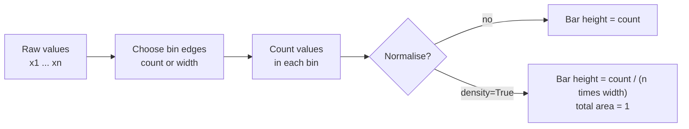

A histogram answers one question: what does the distribution of a single numeric variable look like? Where do most values sit, how spread out are they, is the distribution symmetric or skewed, does it have one peak or two, and are there values far from the rest? Those answers drive real decisions in AI work. The histogram of document lengths decides your tokenizer's maximum sequence length. The histogram of a feature tells you whether to log-transform it before training. The histogram of predicted probabilities tells you whether a classifier is confident or hedging. And comparing histograms of the same feature at training time and in production is the simplest way to spot data drift.

## What a histogram shows, and what it is not

A histogram divides the range of the data into intervals called **bins** and draws a bar for each bin whose height is the number of values falling into it. The bars touch, because the bins are adjacent ranges of a continuous variable.

| | Histogram | Bar chart |
| --- | --- | --- |
| x-axis | A continuous numeric range, split into bins | Separate categories |
| Bars | Touch, because bins are contiguous | Separated by gaps |
| Order of bars | Fixed by the number line | Free (sort by value is often best) |
| Answers | How is one variable distributed? | How do categories compare? |
| AI example | Token count per document | Number of examples per class |

The shapes you are looking for connect directly to the [mean, median and mode](/learn/probability-and-statistics/mean-median-and-mode) and the [normal distribution](/learn/probability-and-statistics/normal-distribution): a symmetric bell, a long right tail (where the mean is pulled above the median), two separate peaks (often two sub-populations mixed together), or a spike at one value (often a default or placeholder such as 0 or -1 filling in missing data).

## How a histogram is computed



If bin $i$ has width $h$ and contains $c_i$ of the $n$ values, the **density** height is

$$
d_i = \frac{c_i}{n\,h},
$$

so that the bar areas $d_i h$ sum to 1. Densities let you compare datasets of different sizes on the same axes and overlay a probability density curve. With unequal bin widths, density is the only honest choice, because raw counts make wide bins look artificially tall.

Step through the counting for five values and four bins of width 1 covering 0 to 4:

```trace
{
  "title": "Counting values into bins of width 1",
  "code": [
    "values = [1.2, 3.7, 2.5, 0.4, 3.1]",
    "counts = [0, 0, 0, 0]",
    "for v in values:",
    "    i = int(v // 1)",
    "    counts[i] += 1",
    "print(counts)"
  ],
  "steps": [
    { "line": 1, "vars": { "values": "[1.2, 3.7, 2.5, 0.4, 3.1]" }, "note": "Five raw values. Bins are [0, 1), [1, 2), [2, 3) and [3, 4]." },
    { "line": 2, "vars": { "counts": "[0, 0, 0, 0]" }, "note": "One counter per bin, all starting at zero." },
    { "line": 4, "vars": { "v": "1.2", "i": "1", "counts": "[0, 0, 0, 0]" }, "note": "Dividing by the bin width and rounding down gives the bin index: 1.2 belongs to bin 1." },
    { "line": 5, "vars": { "v": "1.2", "i": "1", "counts": "[0, 1, 0, 0]" }, "note": "Increment that bin's counter." },
    { "line": 5, "vars": { "v": "3.7", "i": "3", "counts": "[0, 1, 0, 1]" }, "note": "3.7 falls in bin 3." },
    { "line": 5, "vars": { "v": "2.5", "i": "2", "counts": "[0, 1, 1, 1]" }, "note": "2.5 falls in bin 2." },
    { "line": 5, "vars": { "v": "0.4", "i": "0", "counts": "[1, 1, 1, 1]" }, "note": "0.4 falls in bin 0." },
    { "line": 5, "vars": { "v": "3.1", "i": "3", "counts": "[1, 1, 1, 2]" }, "note": "3.1 also falls in bin 3, so that bar will be twice as tall." },
    { "line": 6, "vars": { "counts": "[1, 1, 1, 2]" }, "out": ["[1, 1, 1, 2]"], "note": "These counts are the bar heights. Choosing different edges would give different counts from the same data." }
  ]
}
```

NumPy does the counting with `np.histogram`, and Matplotlib's `ax.hist` calls it for you and draws the bars.

## Bin choice changes the story

The number of bins is the single most important decision when drawing a histogram, and there is no universally correct value. Here is one dataset, a feature built from two overlapping sub-populations, drawn three ways.

```python
import numpy as np
import matplotlib.pyplot as plt

rng = np.random.default_rng(3)
# A bimodal feature: two sub-populations mixed together
x = np.concatenate([rng.normal(40, 6, 700), rng.normal(62, 5, 300)])

fig, axes = plt.subplots(1, 3, figsize=(9, 2.8), sharey=False)
for ax, bins in zip(axes, [4, 30, 300]):
    ax.hist(x, bins=bins, color="tab:blue")
    ax.set_title(f"bins={bins}")
    ax.set_xlabel("feature value")
axes[0].set_ylabel("count")
fig.tight_layout()
fig.savefig("histogram-bin-choice.png", dpi=110, bbox_inches="tight", facecolor="white")
```


- **Too few bins** (4) over-smooth: the second peak disappears into a lopsided single hump. You would wrongly conclude the feature has one population.
- **Too many bins** (300) under-smooth: each bin holds a handful of values, so random noise dominates and the bars become a comb.
- **A moderate number** (30) shows the real structure: two groups, roughly 70% near 40 and 30% near 62.

Several rules choose a bin count automatically. Sturges' rule uses $k = \lceil \log_2 n \rceil + 1$ bins, which works for small, roughly normal samples but gives too few bins for large ones. The Freedman-Diaconis rule sets the bin width from the interquartile range (IQR), which makes it robust to outliers:

$$
h = 2\,\frac{\text{IQR}}{n^{1/3}}
$$

NumPy implements both, plus `"auto"`, which picks the smaller width of the two:

```python
import numpy as np

rng = np.random.default_rng(3)
x = np.concatenate([rng.normal(40, 6, 700), rng.normal(62, 5, 300)])

for rule in ["sturges", "fd", "auto"]:
    edges = np.histogram_bin_edges(x, bins=rule)
    print(f"{rule:8s} {len(edges) - 1:3d} bins, width {edges[1] - edges[0]:.2f}")
```

```output
sturges   11 bins, width 5.27
fd        16 bins, width 3.62
auto      16 bins, width 3.62
```

Pass any of these names directly: `ax.hist(x, bins="fd")`.

> [!KEY]
> A histogram is an estimate, and the bins are a modelling choice. When a conclusion matters, such as "this feature is bimodal", check that it survives at two or three different bin counts. If a pattern appears at only one setting, it is probably noise.

## Skewed data and log scales

Many quantities in AI are heavily right-skewed: document lengths, request latencies, word frequencies, file sizes. On a linear axis almost all the data crowds into the first few bins.

```python
import numpy as np
import matplotlib.pyplot as plt

rng = np.random.default_rng(4)
tokens = rng.lognormal(mean=5.5, sigma=0.9, size=20_000).astype(int) + 1

fig, (ax_lin, ax_log) = plt.subplots(1, 2, figsize=(8, 3))
ax_lin.hist(tokens, bins=60, color="tab:blue")
ax_lin.set(title="Linear x-axis", xlabel="tokens per document", ylabel="documents")

log_bins = np.logspace(np.log10(tokens.min()), np.log10(tokens.max()), 60)
ax_log.hist(tokens, bins=log_bins, color="tab:blue")
ax_log.set_xscale("log")
p95 = np.percentile(tokens, 95)
ax_log.axvline(p95, color="black", linestyle="--", linewidth=1)
ax_log.text(p95, ax_log.get_ylim()[1] * 0.9, " 95th pct", va="top")
ax_log.set(title="Log x-axis, log-spaced bins", xlabel="tokens per document")

fig.tight_layout()
fig.savefig("histogram-token-lengths.png", dpi=110, bbox_inches="tight", facecolor="white")
print("median:", int(np.median(tokens)), " p95:", int(p95), " max:", tokens.max())
```

```output
median: 248  p95: 1083  max: 6648
```


The log axis needs **log-spaced bins** (`np.logspace`), otherwise bins on the left would be tiny slivers and those on the right enormous. Now the decision is easy to make: a maximum sequence length of about 1,100 tokens keeps 95% of documents whole, while padding everything to 6,648 would waste most of the compute on padding. Marking the percentile with `axvline` turns the chart into an argument.

## Comparing distributions

Comparing two histograms of the same variable is one of the most useful checks in machine learning:

```python
fig, ax = plt.subplots(figsize=(6, 3))
bins = np.histogram_bin_edges(np.concatenate([train_x, prod_x]), bins="fd")
ax.hist(train_x, bins=bins, density=True, histtype="step", linewidth=2, label="training data")
ax.hist(prod_x, bins=bins, density=True, histtype="step", linewidth=2, label="production, last week")
ax.set(xlabel="feature value", ylabel="density")
ax.legend()
```

Three details make the comparison fair. Both histograms use the **same bin edges**, computed from the combined data; with separate bins the shapes are not comparable. `density=True` removes the effect of different sample sizes. `histtype="step"` draws outlines so one histogram cannot hide the other. If the production histogram has shifted, your model is now seeing inputs unlike those it was trained on.

The same idea applies to model outputs. A histogram of predicted probabilities for a binary classifier should, for a confident and well-trained model, pile up near 0 and 1; a big hump around 0.5 means the model often cannot tell.

## Pitfalls checklist

| Pitfall | Symptom | Fix |
| --- | --- | --- |
| Too few or too many bins | Hidden peaks or noisy comb | Try `bins="fd"`, then check two other settings |
| Linear axis on skewed data | Everything in the first bar | Log axis with log-spaced bins, or plot `np.log1p(x)` |
| Different bins when comparing | Shapes look different for no reason | Shared bin edges from `np.histogram_bin_edges` |
| Counts with unequal sample sizes | Smaller group looks flat | `density=True` |
| Ignoring spikes | One giant bar at 0 or -1 | Investigate: often missing values encoded as a number |

## Exercises

**1.** A feature `income` has most values between 20,000 and 80,000 but a few above 2,000,000. Describe two ways to plot it so the bulk of the distribution is visible, and the trade-off of each.

<details>
<summary>Show solution</summary>

Option one: plot `np.log10(income)` or use a log x-axis with log-spaced bins. All data stays visible, but readers must interpret a log scale. Option two: restrict the range, for example `ax.hist(income, bins=50, range=(0, 200_000))`. The bulk is shown on a natural scale, but the outliers vanish from the chart, so you must state in the title or caption how many values were excluded.

</details>

**2.** Why should you pass the same `bins` array when overlaying a training-set and a test-set histogram, rather than `bins=30` for each?

<details>
<summary>Show solution</summary>

`bins=30` splits each dataset's own minimum-to-maximum range into 30 bins, so the two histograms have different bin edges and widths. Differences in shape can then come from the binning rather than from the data. Shared edges put both on an identical grid.

</details>

```quiz
[
  {
    "q": "A histogram of a feature drawn with 5 bins shows one peak, but with 40 bins shows two clear peaks that persist at 30 and 60 bins. What is the most reasonable conclusion?",
    "options": ["The feature has one peak; more bins only add noise", "The feature is probably bimodal, and 5 bins over-smoothed it", "Histograms are unreliable and should not be used", "The data has outliers"],
    "answer": 1,
    "why": "A structure that persists across several reasonable bin counts is likely real; too few bins merge separate peaks."
  },
  {
    "q": "What does `density=True` make the bar heights represent?",
    "options": ["Raw counts per bin", "The fraction of values in each bin", "Count divided by (number of values times bin width), so the total area is 1", "Cumulative counts"],
    "answer": 2,
    "why": "Density divides by n and the bin width so the bar areas sum to 1, which makes different sample sizes comparable."
  },
  {
    "q": "Document lengths range from 2 to 6,600 tokens with a median of about 250. Which plot shows the shape best?",
    "options": ["A log x-axis with log-spaced bins", "A linear histogram with 10 bins", "A pie chart of length ranges", "A linear histogram with 10,000 bins"],
    "answer": 0,
    "why": "Heavily right-skewed data needs a log scale, and log-spaced bins keep the bins equal in width on that scale."
  },
  {
    "q": "A histogram of a `age` feature has a huge spike at exactly 0. What is the most likely explanation to check first?",
    "options": ["The data is normally distributed", "The bins are too wide", "The KDE is wrong", "Missing values were filled with 0"],
    "answer": 3,
    "why": "A spike at a round placeholder value is a common sign of missing data encoded as a number."
  }
]
```
