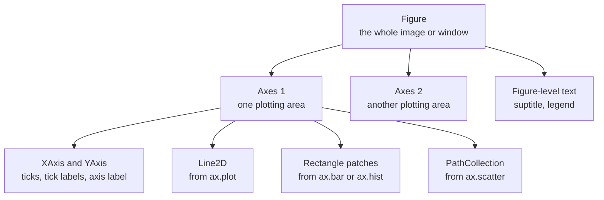

A table of numbers tells you what happened; a chart tells you the shape of what happened. When a model trains, you do not read 30 epochs of loss values line by line, you plot them and see at a glance whether the run converged, diverged or started to overfit. Matplotlib is the plotting library underneath almost every Python visualisation tool, including seaborn and pandas' `.plot()`. Learning its object model properly means you can make any chart you need, fix any chart someone else made, and produce figures that are honest about the data.

## Why plot at all

Summary statistics compress data, and compression loses information. Two datasets can share the same mean, variance and correlation and still look completely different when drawn. In AI work the most common plots answer a handful of recurring questions:

| Question | Chart | Example in AI work |
| --- | --- | --- |
| How does a value change over time or steps? | Line plot | Training and validation loss per epoch |
| What does one variable's distribution look like? | Histogram, box plot | Token lengths, prediction confidence |
| How do two variables relate? | Scatter plot | Predicted vs actual, embedding projections |
| How do values vary across a grid? | Heatmap | Confusion matrix, correlation matrix |
| How do categories compare? | Bar chart | Class counts, accuracy per model |

The rest of this module takes those charts one at a time. This lesson gives you the machinery they all share.

## The object model: Figure, Axes, Artists

Everything Matplotlib draws is an object in a tree. Once you know the three main levels, the API stops feeling arbitrary.



- A **Figure** is the canvas: its size in inches, its background, the file you save.
- An **Axes** (note the spelling: one Axes, many Axes) is a single plot with its own coordinate system, x-axis, y-axis and title. A figure can hold many.
- An **Artist** is anything drawn: lines, bars, text, tick marks. Every plotting method on an Axes creates artists and returns them.

`plt.subplots` creates a figure and a grid of axes in one call:

```python
import matplotlib.pyplot as plt

fig, axes = plt.subplots(2, 3)
print(type(fig).__name__)
print(type(axes).__name__, axes.shape)
print(type(axes[0, 1]).__name__)
print(len(fig.axes))
```

```output
Figure
ndarray (2, 3)
Axes
6
```

With more than one subplot you get a NumPy array of Axes, indexed by row and column exactly as in the [NumPy indexing lesson](/learn/numpy/indexing-and-slicing).

### Two interfaces, one library

Matplotlib offers two styles. The **pyplot** style (`plt.plot`, `plt.title`) acts on whichever Axes is "current", which is convenient for a quick look in a notebook. The **object-oriented** style calls methods on explicit objects (`ax.plot`, `ax.set_title`), which stays clear once there is more than one subplot.

| Task | pyplot style | Object-oriented style |
| --- | --- | --- |
| Create | `plt.figure()` | `fig, ax = plt.subplots()` |
| Plot a line | `plt.plot(x, y)` | `ax.plot(x, y)` |
| Title | `plt.title("Loss")` | `ax.set_title("Loss")` |
| Axis label | `plt.xlabel("epoch")` | `ax.set_xlabel("epoch")` |
| Limits | `plt.ylim(0, 1)` | `ax.set_ylim(0, 1)` |
| Save | `plt.savefig("a.png")` | `fig.savefig("a.png")` |

> [!KEY]
> Use the object-oriented style in anything you will keep. `fig, ax = plt.subplots()` at the top, `ax.` methods for drawing, `fig.savefig` at the end. Every example in this module follows that pattern, and it is what library code like seaborn expects when you pass `ax=ax`.

## Line plots and subplots: training curves

A training curve is the chart you will look at most often as an AI engineer. The code below simulates a run where validation loss stops improving and starts to climb, the classic sign of [overfitting](/learn/machine-learning-fundamentals/underfitting-and-overfitting).

```python
import numpy as np
import matplotlib.pyplot as plt

rng = np.random.default_rng(0)
epochs = np.arange(1, 31)
train_loss = 2.0 * np.exp(-epochs / 8) + 0.15 + rng.normal(0, 0.02, epochs.size)
val_loss = 2.0 * np.exp(-epochs / 8) + 0.25 + 0.004 * (epochs - 12).clip(0) ** 1.5
val_acc = 0.95 - 0.6 * np.exp(-epochs / 6) - 0.002 * (epochs - 12).clip(0)

fig, (ax_loss, ax_acc) = plt.subplots(1, 2, figsize=(8, 3.2))

ax_loss.plot(epochs, train_loss, label="train")
ax_loss.plot(epochs, val_loss, label="validation")
ax_loss.axvline(epochs[val_loss.argmin()], color="grey", linestyle="--", linewidth=1)
ax_loss.set(title="Loss", xlabel="epoch", ylabel="cross-entropy")
ax_loss.legend()

ax_acc.plot(epochs, val_acc, color="tab:orange")
ax_acc.set(title="Validation accuracy", xlabel="epoch", ylabel="accuracy", ylim=(0, 1))

fig.suptitle("Training run: validation loss bottoms out, then rises")
fig.tight_layout()
fig.savefig("training-curves.png", dpi=110, bbox_inches="tight", facecolor="white")
print("best epoch:", epochs[val_loss.argmin()])
```

```output
best epoch: 21
```


Points worth copying from this example:

- `plt.subplots(1, 2, figsize=(8, 3.2))` gives one row of two Axes. `figsize` is in inches; multiplied by `dpi` it sets the pixel size.
- `ax.set(title=..., xlabel=..., ylabel=...)` sets several properties at once.
- `label=` on each line plus `ax.legend()` identifies the series. A chart with two unlabelled lines is a puzzle, not a chart.
- `ax.axvline` adds a reference line. Annotating the moment that matters (the best epoch, a learning-rate change) saves the reader from hunting for it.
- `fig.tight_layout()` stops titles and labels from overlapping.

The gap between the two loss curves is the diagnostic: training loss keeps falling while validation loss turns upward, so the model is memorising rather than generalising, and the checkpoint from epoch 21 is the one to keep.

## Labelling: what every chart needs

A chart should make sense to someone who did not write the code. Before you share one, check:

| Element | Why | How |
| --- | --- | --- |
| Title that states the point | Tells the reader what to look for | `ax.set_title`, `fig.suptitle` |
| Axis labels with units | "0.5" means nothing without "cross-entropy" or "ms" | `ax.set_xlabel`, `ax.set_ylabel` |
| Legend for two or more series | Colour alone does not identify a line | `label=` plus `ax.legend()` |
| Sensible ticks | Too many ticks become noise | `ax.set_xticks`, `ax.tick_params` |

## Honest axes

The same numbers can be drawn to mislead. The most common trick, often accidental, is a truncated y-axis on a bar chart.

```python
import matplotlib.pyplot as plt

models = ["Model A", "Model B"]
accuracy = [0.912, 0.918]

fig, (ax_cut, ax_full) = plt.subplots(1, 2, figsize=(8, 3))

ax_cut.bar(models, accuracy, color="tab:blue")
ax_cut.set_ylim(0.91, 0.92)                 # truncated axis
ax_cut.set_title("Truncated y-axis: looks like a big win")

ax_full.bar(models, accuracy, color="tab:blue")
ax_full.set_ylim(0, 1)                      # bars start at zero
ax_full.set_title("Zero-based y-axis: a 0.6 point gap")

for ax in (ax_cut, ax_full):
    ax.set_ylabel("test accuracy")
fig.tight_layout()
fig.savefig("truncated-axis.png", dpi=110, bbox_inches="tight", facecolor="white")
```


A bar encodes value by its **length**, so a bar that does not start at zero lies about the ratio between values. Line plots are different: they encode value by **position**, and zooming the y-axis to show the detail of a loss curve is legitimate, provided the tick labels make the range obvious.

> [!WARNING]
> Bar charts start at zero. If a difference only looks large when the axis is cut, it is not a large difference. Report it as a number ("0.6 percentage points") rather than inflating it visually.

Other common distortions are a dual y-axis (two scales on one chart, which lets you make any two lines appear to move together), inconsistent axis ranges between panels that readers will compare, and 3D effects that distort lengths. When panels must be compared, pass `sharey=True` to `plt.subplots`.

## Saving figures

```python
fig.savefig("loss.png", dpi=150, bbox_inches="tight", facecolor="white")
fig.savefig("loss.pdf")          # vector format for papers and slides
plt.close(fig)                   # free the memory
```

- **PNG** is a raster format, good for web pages and notebooks. `dpi` controls resolution.
- **PDF** and **SVG** are vector formats that stay sharp at any zoom, ideal for papers.
- `bbox_inches="tight"` trims excess whitespace and keeps labels from being clipped.
- In a script that makes hundreds of figures (one per experiment, say), call `plt.close(fig)` after saving, or memory grows with every figure.

On a server with no display, such as a training job on a remote GPU machine, set the non-interactive backend before importing pyplot with `import matplotlib; matplotlib.use("Agg")`, or set the environment variable `MPLBACKEND=Agg`. Figures then save to files without trying to open a window.

## Exercises

**1.** Create a figure with two rows and one column, sharing the x-axis. In the top Axes, plot `np.sin(x)` and in the bottom Axes `np.cos(x)` for `x = np.linspace(0, 2 * np.pi, 200)`. Give each Axes a title and the bottom one an x-label.

<details>
<summary>Show solution</summary>

```python
import numpy as np
import matplotlib.pyplot as plt

x = np.linspace(0, 2 * np.pi, 200)
fig, (top, bottom) = plt.subplots(2, 1, sharex=True, figsize=(6, 4))
top.plot(x, np.sin(x))
top.set_title("sin(x)")
bottom.plot(x, np.cos(x), color="tab:orange")
bottom.set(title="cos(x)", xlabel="x (radians)")
fig.tight_layout()
```

With `sharex=True` the top Axes hides its tick labels, and zooming one panel zooms both.

</details>

**2.** You have per-step training losses for 10,000 steps, and they are noisy. Plot the raw loss faintly and a 200-step moving average on top, so the trend is visible.

<details>
<summary>Show solution</summary>

```python
import numpy as np
import pandas as pd
import matplotlib.pyplot as plt

rng = np.random.default_rng(0)
steps = np.arange(10_000)
loss = 2 * np.exp(-steps / 2500) + 0.3 + rng.normal(0, 0.15, steps.size)
smooth = pd.Series(loss).rolling(200).mean()

fig, ax = plt.subplots(figsize=(7, 3))
ax.plot(steps, loss, alpha=0.2, linewidth=0.5, label="raw")
ax.plot(steps, smooth, linewidth=2, label="200-step mean")
ax.set(xlabel="step", ylabel="loss")
ax.legend()
```

Smoothing hides spikes, so keep the raw series visible: a sudden spike can signal a bad batch or a learning rate that is too high.

</details>

```quiz
[
  {
    "q": "What does `fig, axes = plt.subplots(2, 2)` return as `axes`?",
    "options": ["A single Axes object", "A list of four Figures", "A 2x2 NumPy array of Axes objects", "A dictionary keyed by position"],
    "answer": 2,
    "why": "With more than one subplot, `plt.subplots` returns a NumPy array of Axes shaped like the grid."
  },
  {
    "q": "Why is a truncated y-axis misleading on a bar chart but often acceptable on a line chart?",
    "options": ["Bars encode value by length, so cutting the axis distorts ratios; lines encode by position", "Line charts cannot have a truncated axis", "Bar charts do not support `set_ylim`", "It is equally misleading in both"],
    "answer": 0,
    "why": "A reader compares bar lengths. Lines are read by position against tick labels, so zooming is fine if the ticks make the range clear."
  },
  {
    "q": "A script saves 500 figures in a loop and slowly runs out of memory. What is the most likely fix?",
    "options": ["Lower the dpi", "Call `plt.close(fig)` after each `savefig`", "Use PDF instead of PNG", "Call `plt.show()` after each figure"],
    "answer": 1,
    "why": "Pyplot keeps a reference to every open figure until it is closed, so memory grows with each new one."
  },
  {
    "q": "Validation loss falls until epoch 21, then rises, while training loss keeps falling. What does the chart suggest?",
    "options": ["The learning rate is too low", "The model is underfitting", "The data loader is broken", "The model is overfitting after about epoch 21"],
    "answer": 3,
    "why": "Diverging training and validation loss is the signature of overfitting; the best checkpoint is around the validation minimum."
  }
]
```
