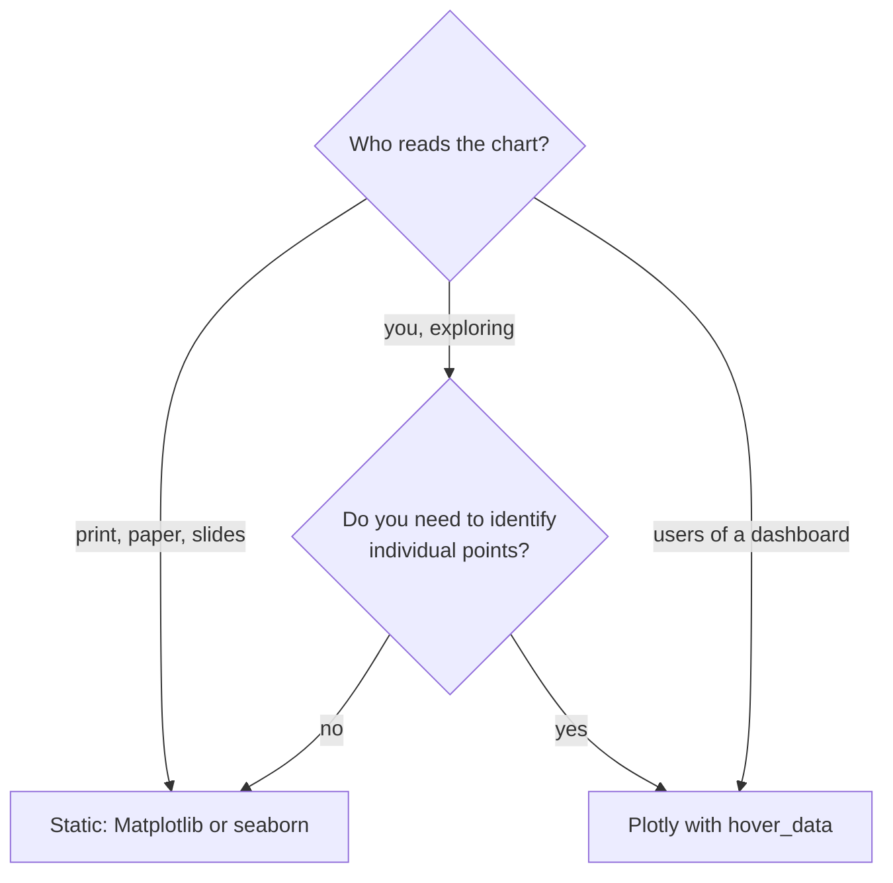
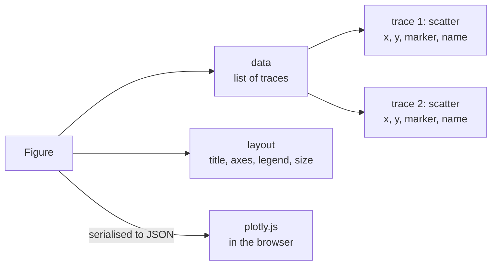

Matplotlib and seaborn produce pictures. Plotly produces **interactive** charts that run in a web browser: you can hover over a point to see its values, zoom into a region, toggle series on and off in the legend and export the view as an image. For an AI engineer this is more than decoration. When you plot 5,000 sentence embeddings and see an odd cluster, hovering to read the actual sentences behind the points is how you discover that the cluster is all duplicates, or all one mislabelled source. Plotly is also the charting engine behind Dash and is widely supported in Streamlit apps, so it is a common choice for dashboards that monitor models.

This lesson shows code only. Plotly output is an interactive HTML page, so the descriptions say what each snippet produces when you run it in a notebook or open the saved file. Install it with `pip install plotly`.

## When interactivity earns its place

| Situation | Static (Matplotlib, seaborn) | Interactive (Plotly) |
| --- | --- | --- |
| Paper, slide, PDF report | Best choice | Must be exported to a static image anyway |
| Exploring thousands of labelled points | Labels cannot fit | Hover shows each point's details |
| Dashboard that others use | Regenerate images on every change | Users zoom and filter themselves |
| Reproducible figure in a repo | Small PNG or PDF | HTML file, larger |
| Quick check in a notebook | Fast and familiar | Also fine |



## Plotly Express: one call per chart

`plotly.express` (imported as `px`) plays the same role as seaborn: it takes a long-form DataFrame and maps columns to x, y, colour, size and facets. Its function names will feel familiar.

```python
import numpy as np
import pandas as pd
import plotly.express as px
from sklearn.datasets import make_blobs
from sklearn.decomposition import PCA

X, topic = make_blobs(n_samples=600, n_features=64, centers=4,
                      cluster_std=6.0, random_state=0)
coords = PCA(n_components=2).fit_transform(X)

df = pd.DataFrame({
    "pc1": coords[:, 0],
    "pc2": coords[:, 1],
    "topic": np.array(["sport", "finance", "health", "tech"])[topic],
    "doc_id": np.arange(len(X)),
    "text": [f"document {i}" for i in range(len(X))],   # your real text here
})

fig = px.scatter(df, x="pc1", y="pc2", color="topic",
                 hover_data=["doc_id", "text"],
                 title="Document embeddings (PCA)")
fig.show()
```

In a notebook, `fig.show()` renders a scatter plot with four colour-coded clusters and a legend. Hovering over any point shows a tooltip with its `pc1`, `pc2`, `topic`, `doc_id` and `text`. Clicking a topic in the legend hides it; double-clicking isolates it. Dragging a rectangle zooms in; double-clicking the plot resets the view. This is the same data as the static embedding scatter in the [scatter plots lesson](/learn/data-visualization/scatter-plots), but now each point can be inspected.

Common Plotly Express functions:

| Function | Chart | Matplotlib or seaborn equivalent |
| --- | --- | --- |
| `px.scatter` | Scatter | `ax.scatter`, `sns.scatterplot` |
| `px.line` | Line | `ax.plot`, `sns.lineplot` |
| `px.histogram` | Histogram | `ax.hist`, `sns.histplot` |
| `px.box`, `px.violin` | Box, violin | `sns.boxplot`, `sns.violinplot` |
| `px.imshow` | Heatmap or image | `ax.imshow`, `sns.heatmap` |
| `px.bar` | Bar | `ax.bar`, `sns.barplot` |

Most accept `facet_col` and `facet_row` for small multiples, like seaborn's `col` and `row`.

## A figure is data

A Plotly figure is not a picture but a description: a tree of plain data that a JavaScript library, plotly.js, renders in the browser. It has two main parts.



- **Traces** are the data series. `px.scatter` with `color="topic"` creates one trace per topic.
- **Layout** holds everything that is not a series: titles, axis settings, legend position, size.

You modify a figure with `update_` methods rather than by calling drawing functions:

```python
fig.update_traces(marker=dict(size=6, opacity=0.7))
fig.update_layout(
    width=800, height=500,
    xaxis_title="principal component 1",
    yaxis_title="principal component 2",
    legend_title_text="topic",
)
```

`xaxis_title` is a "magic underscore" shortcut for the nested `layout.xaxis.title`. You can print `fig.to_dict()` to see the whole structure, which is the most reliable way to find the name of a property you want to change.

## Graph objects for full control

`plotly.graph_objects` (imported as `go`) is the lower-level API, comparable to Matplotlib's object-oriented interface. You build traces explicitly and add them to a figure. Combined with `make_subplots` it gives you the training-curve layout from the Matplotlib lesson:

```python
import numpy as np
import plotly.graph_objects as go
from plotly.subplots import make_subplots

epochs = np.arange(1, 31)
train_loss = 2.0 * np.exp(-epochs / 8) + 0.15
val_loss = 2.0 * np.exp(-epochs / 8) + 0.25 + 0.004 * (epochs - 12).clip(0) ** 1.5
val_acc = 0.95 - 0.6 * np.exp(-epochs / 6)

fig = make_subplots(rows=1, cols=2, subplot_titles=("Loss", "Validation accuracy"))
fig.add_trace(go.Scatter(x=epochs, y=train_loss, mode="lines", name="train"), row=1, col=1)
fig.add_trace(go.Scatter(x=epochs, y=val_loss, mode="lines", name="validation"), row=1, col=1)
fig.add_trace(go.Scatter(x=epochs, y=val_acc, mode="lines", name="val accuracy"), row=1, col=2)
fig.update_yaxes(range=[0, 1], row=1, col=2)
fig.update_xaxes(title_text="epoch")
fig.show()
```

This produces two side-by-side panels. Hovering over the loss panel shows the exact loss at each epoch, so you can read off the best epoch directly rather than estimating from the axis.

> [!TIP]
> Start with Plotly Express. Its figures are ordinary graph-objects figures, so when you need something it does not offer you can still call `fig.add_trace(go.Scatter(...))` on the result, for example to add a reference line.

## Saving and sharing

```python
fig.write_html("embeddings.html", include_plotlyjs="cdn")
fig.write_image("embeddings.png", scale=2)   # needs the kaleido package
```

`write_html` produces a self-contained page you can open in any browser or attach to an experiment report. By default it embeds the whole plotly.js library (several megabytes); `include_plotlyjs="cdn"` instead loads it from a CDN, making the file much smaller but requiring internet access to view. `write_image` exports a static PNG, SVG or PDF and needs the separate `kaleido` package installed.

## Plotly in AI workflows

- **Inspecting errors.** Build a DataFrame of test examples with their true label, predicted label and confidence. A `px.scatter` of confidence against a feature with `hover_data=["text"]` lets you read misclassified examples directly from the chart.
- **Confusion matrices.** `px.imshow(cm, text_auto=True, x=classes, y=classes, labels=dict(x="predicted", y="true", color="count"))` draws an annotated, hoverable confusion matrix.
- **Embeddings over training.** `px.scatter(..., animation_frame="epoch")` adds a slider and play button that animates how clusters form as training progresses, given a long-form DataFrame with one row per point per epoch.
- **Monitoring dashboards.** Plotly figures plug into Dash and Streamlit, so the chart you prototyped in a notebook can become a live view of production metrics.

> [!WARNING]
> Every point in an interactive chart is sent to the browser as JSON. A scatter of a few hundred thousand points can produce a sluggish page and a huge HTML file. Use `render_mode="webgl"` in `px.scatter` (or `go.Scattergl`) for large point counts, and sample or aggregate before plotting millions of rows.

## Exercises

**1.** Write the Plotly Express call that draws a histogram of a `confidence` column from a DataFrame `preds`, with separate colours for `correct` True and False, 40 bins, and the bars overlaid rather than stacked.

<details>
<summary>Show solution</summary>

```python
import plotly.express as px

fig = px.histogram(preds, x="confidence", color="correct", nbins=40,
                   barmode="overlay", opacity=0.6)
fig.update_layout(xaxis_title="predicted probability of the chosen class")
fig.show()
```

`barmode="overlay"` with some transparency lets you see where wrong predictions sit. A well-calibrated model has its wrong predictions concentrated at lower confidence.

</details>

**2.** You have a Plotly Express scatter `fig` of predicted against actual house prices. Add a dashed diagonal line from (0, 0) to (500, 500) labelled "perfect prediction".

<details>
<summary>Show solution</summary>

```python
import plotly.graph_objects as go

fig.add_trace(go.Scatter(x=[0, 500], y=[0, 500], mode="lines",
                         line=dict(dash="dash", color="black"),
                         name="perfect prediction"))
```

</details>

**3.** A teammate wants to email a Plotly chart to a manager who will read it offline on a plane. Which saving option should they use, and why?

<details>
<summary>Show solution</summary>

`fig.write_html("chart.html")` with the default `include_plotlyjs=True`, which embeds plotly.js in the file so it works without internet access. `include_plotlyjs="cdn"` would produce a smaller file that shows nothing offline. If interactivity is not needed, a static PNG from `write_image` is simpler still.

</details>

```quiz
[
  {
    "q": "What are the two top-level parts of a Plotly figure?",
    "options": ["Figure and Axes", "`data` (a list of traces) and `layout`", "Canvas and renderer", "Series and index"],
    "answer": 1,
    "why": "A Plotly figure is a data structure with a list of traces and a layout describing titles, axes and legend."
  },
  {
    "q": "Which feature most directly helps you investigate an odd cluster in a scatter plot of 5,000 text embeddings?",
    "options": ["`hover_data` showing each point's text", "A log-scale x-axis", "`include_plotlyjs=\"cdn\"`", "A diverging colour scale"],
    "answer": 0,
    "why": "Hovering reveals the underlying examples, so you can see what the points in the cluster have in common."
  },
  {
    "q": "A Plotly scatter of 800,000 points makes the browser freeze. What should you try first?",
    "options": ["Increase the figure width", "Switch to `px.line`", "Use WebGL rendering and sample or aggregate the points", "Save with `write_image` at higher scale"],
    "answer": 2,
    "why": "Interactive charts ship every point to the browser; WebGL rendering and reducing the point count address the cause."
  },
  {
    "q": "What does `fig.update_layout(xaxis_title=\"epoch\")` change?",
    "options": ["Every trace's x values", "The legend title", "The figure's file name", "The title of the x-axis, via the nested `layout.xaxis.title` property"],
    "answer": 3,
    "why": "Underscores in `update_layout` keyword names address nested properties, so `xaxis_title` sets `layout.xaxis.title`."
  }
]
```
