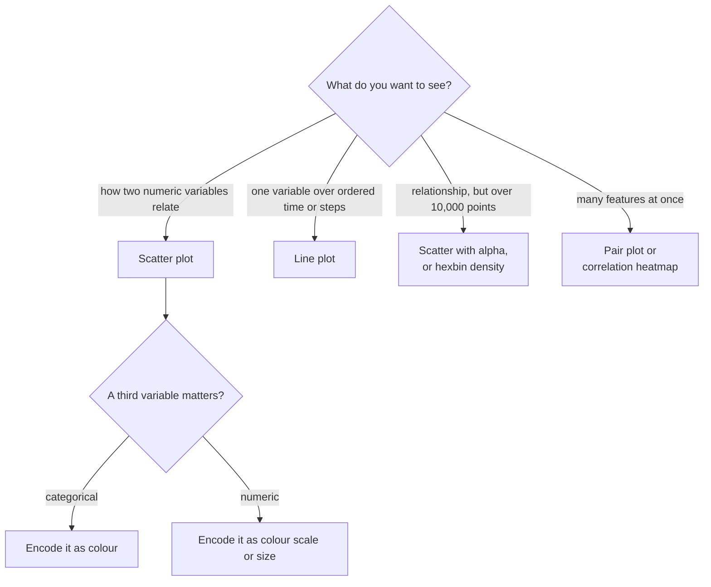

A scatter plot draws one dot per observation, with one variable on the x-axis and another on the y-axis. It answers the question "how do these two variables relate?", and it answers it without assuming anything: a straight-line trend, a curve, separate clusters, a fan of growing error, a handful of outliers or no relationship at all are all visible at a glance. In AI work scatter plots appear constantly: a feature against the target before modelling, predicted against actual values after modelling, and two-dimensional projections of high-dimensional embeddings to see whether a model has learnt meaningful structure.

## What a scatter plot answers



Things to look for in any scatter plot:

| Pattern | What it suggests |
| --- | --- |
| Points along a rising or falling line | Linear relationship; a linear model may suffice |
| A curve | Non-linear relationship; consider a transform or a non-linear model |
| Separate clumps | Sub-groups or classes; a categorical variable may explain them |
| A fan that widens | Variance grows with x (heteroscedasticity); errors are larger for large values |
| Isolated points far from the rest | Outliers or data errors worth inspecting |
| A shapeless cloud | Little relationship between these two variables |

## The basic scatter and extra encodings

`ax.scatter(x, y)` is the core call. Beyond position, a marker can carry more variables:

| Argument | Encodes | Use for |
| --- | --- | --- |
| `c=` or separate calls with `label=` | Colour | A class label (qualitative colours) or a numeric value (with `cmap=`) |
| `s=` | Marker area | A numeric value such as sample count, sparingly |
| `alpha=` | Transparency | Not data; fights overplotting |
| `marker=` | Shape | A second categorical variable, or redundancy for colour-blind readers |

Position is by far the most precisely read encoding, colour and size much less so. Put the two variables you most care about on the axes.

## Predicted against actual

After training a regression model, plot each test example's predicted value against its true value. A perfect model would put every point on the diagonal $y = x$, so draw that line as a reference.

```python
import numpy as np
import matplotlib.pyplot as plt

rng = np.random.default_rng(11)
y_true = rng.uniform(50, 500, 300)
y_pred = y_true * 0.9 + 20 + rng.normal(0, 25, 300)

fig, ax = plt.subplots(figsize=(4.5, 4.5))
ax.scatter(y_true, y_pred, s=10, alpha=0.5)
lims = [0, 550]
ax.plot(lims, lims, color="black", linewidth=1, label="perfect prediction")
ax.set(xlim=lims, ylim=lims, aspect="equal",
       xlabel="actual price (thousands)", ylabel="predicted price (thousands)")
ax.legend()
fig.savefig("predicted-vs-actual.png", dpi=110, bbox_inches="tight", facecolor="white")
```


The reference line and the equal aspect ratio (`aspect="equal"` with the same limits on both axes) make deviations easy to read. Here the points sit above the diagonal at the low end and below it at the high end: the model over-predicts cheap houses and under-predicts expensive ones, pulling every prediction towards the middle. A single number like mean squared error would hide that systematic pattern; the scatter shows exactly where the model is biased.

## Overplotting

With a few hundred points every dot is visible. With tens of thousands, dots pile on top of each other and the plot turns into a solid shape. You can no longer tell where the data is dense, which is precisely what you wanted to know. This is **overplotting**.

```python
import numpy as np
import matplotlib.pyplot as plt

rng = np.random.default_rng(5)
n = 50_000
x = rng.normal(0, 1, n)
y = 0.6 * x + rng.normal(0, 0.8, n)

fig, axes = plt.subplots(1, 3, figsize=(9, 2.9), sharex=True, sharey=True)
axes[0].scatter(x, y, s=10)
axes[0].set_title("Default: a solid blob")

axes[1].scatter(x, y, s=2, alpha=0.05, linewidths=0)
axes[1].set_title("Small, transparent points")

hb = axes[2].hexbin(x, y, gridsize=40, cmap="viridis", mincnt=1)
fig.colorbar(hb, ax=axes[2], label="points per hexagon")
axes[2].set_title("Hexbin density")

for ax in axes:
    ax.set_xlabel("feature x")
axes[0].set_ylabel("target y")
fig.tight_layout()
fig.savefig("scatter-overplotting.png", dpi=110, bbox_inches="tight", facecolor="white")
```


The fixes, in rough order of preference:

- **Smaller, transparent markers.** `s=2, alpha=0.05` lets density show as darkness. `linewidths=0` removes marker outlines, which otherwise dominate tiny points.
- **Binned density.** `ax.hexbin` (or a 2D histogram) counts points per cell and colours by count, which scales to millions of points. Always include the colour bar, since the colour now encodes a count.
- **Sampling.** Plot a random sample of 5,000 points. Fine for the overall shape, but rare outliers may be left out.

> [!WARNING]
> Overplotting hides the most important information, the density, and makes outliers look as important as the core because each outlier is drawn as boldly as thousands of overlapping points. If your scatter looks like a solid blob, assume it is lying to you.

## Embedding scatter plots

Models represent text, images and users as vectors with hundreds or thousands of dimensions. To look at them you must project them to two dimensions. PCA (principal component analysis) finds the two directions of largest variance, building on the [eigenvectors](/learn/linear-algebra/eigenvalues-and-eigenvectors) you met in linear algebra. The example uses synthetic clustered vectors as a stand-in for real sentence embeddings.

```python
import numpy as np
import matplotlib.pyplot as plt
from sklearn.datasets import make_blobs
from sklearn.decomposition import PCA

# Stand-in for sentence embeddings: 600 vectors in 64 dimensions, 4 topics
X, topic = make_blobs(n_samples=600, n_features=64, centers=4,
                      cluster_std=6.0, random_state=0)
names = np.array(["sport", "finance", "health", "tech"])

coords = PCA(n_components=2).fit_transform(X)

fig, ax = plt.subplots(figsize=(6, 4.5))
for k, name in enumerate(names):
    mask = topic == k
    ax.scatter(coords[mask, 0], coords[mask, 1], s=14, alpha=0.7, label=name)
ax.set(title="Document embeddings projected with PCA",
       xlabel="principal component 1", ylabel="principal component 2")
ax.legend(title="topic", markerscale=1.5)
fig.savefig("embedding-scatter.png", dpi=110, bbox_inches="tight", facecolor="white")
```


Plotting each class in its own `ax.scatter` call with a `label` gives a proper legend. The picture suggests finance and tech are easy to separate, and sport and health partly overlap, which predicts where a classifier built on these embeddings will make mistakes.

> [!NOTE]
> PCA is linear and preserves large-scale distances reasonably well. Non-linear methods such as t-SNE and UMAP often show clusters more clearly, but they distort the picture: the sizes of clusters and the distances between clusters in a t-SNE plot are not meaningful, and the layout changes with random seed and parameters. Use them to see whether clusters exist, not to measure how far apart they are.

## Pitfalls checklist

| Pitfall | Fix |
| --- | --- |
| Overplotting | Transparency, smaller markers, hexbin, or sampling |
| Unequal axes on predicted vs actual | Same limits, `aspect="equal"`, diagonal reference line |
| Skewed variables crushing points into a corner | Log scale on one or both axes (`ax.set_xscale("log")`) |
| Too many colours | At most about 8 categories; group the rest as "other" |
| Reading causation into a trend | A scatter shows association only; a third variable may drive both |
| Trusting t-SNE distances | Treat projections as qualitative |

## Exercises

**1.** You plot model confidence against input length for 200,000 predictions and get a solid rectangle. Write the line that replaces `ax.scatter(length, conf)` with a density view, and say what you must add to the figure.

<details>
<summary>Show solution</summary>

```python
hb = ax.hexbin(length, conf, gridsize=50, cmap="viridis", mincnt=1)
fig.colorbar(hb, ax=ax, label="predictions per cell")
```

A colour bar is required because colour now encodes a count. If `length` is skewed, add `xscale="log"` to `hexbin`.

</details>

**2.** In a predicted-against-actual scatter, the points form a fan that is narrow for small values and wide for large values. What does that mean, and what might you try?

<details>
<summary>Show solution</summary>

The absolute error grows with the size of the target (heteroscedasticity). The model is relatively accurate for small values and less so for large ones. Common responses: train on `np.log1p(y)` so errors are relative, or evaluate with a relative metric such as mean absolute percentage error alongside absolute error.

</details>

**3.** Modify the embedding example to use `marker` as well as colour for the four topics, so the plot is readable in greyscale.

<details>
<summary>Show solution</summary>

```python
markers = ["o", "s", "^", "D"]
for k, name in enumerate(names):
    mask = topic == k
    ax.scatter(coords[mask, 0], coords[mask, 1], s=14, alpha=0.7,
               marker=markers[k], label=name)
```

</details>

```quiz
[
  {
    "q": "A scatter of 100,000 points looks like a solid blue ellipse. What is the main problem?",
    "options": ["The axes are truncated", "Overplotting hides where the points are dense", "The colour map is wrong", "The correlation is zero"],
    "answer": 1,
    "why": "When points overlap completely, density becomes invisible; transparency or binning reveals it."
  },
  {
    "q": "In a predicted vs actual plot, points lie above the diagonal for low actual values and below it for high ones. What does this indicate?",
    "options": ["The model over-predicts large values", "The model is perfect", "The model's predictions are pulled towards the middle of the range", "The axes are swapped"],
    "answer": 2,
    "why": "Over-predicting small values and under-predicting large ones means predictions are shrunk towards the mean."
  },
  {
    "q": "In a t-SNE plot of embeddings, cluster A looks twice as large as cluster B. What can you conclude?",
    "options": ["Nothing reliable about their relative spread; t-SNE does not preserve cluster sizes", "Cluster A has twice as many points", "Cluster A has twice the variance", "Cluster B is mislabelled"],
    "answer": 0,
    "why": "t-SNE preserves local neighbourhoods, not global distances or cluster sizes."
  },
  {
    "q": "Which visual encoding is read most accurately in a scatter plot?",
    "options": ["Marker size", "Colour hue", "Transparency", "Position along the axes"],
    "answer": 3,
    "why": "Position on a common scale is the most precisely perceived encoding, so the key variables belong on the axes."
  }
]
```
