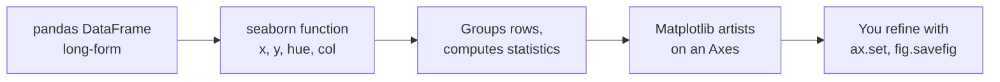
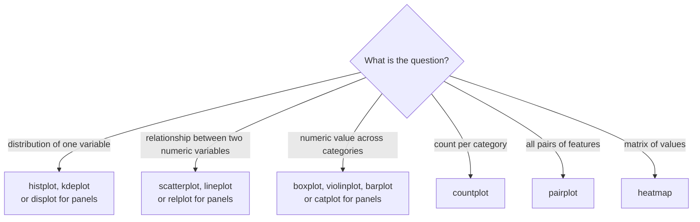

Matplotlib can draw anything, but it makes you do the bookkeeping: loop over groups, pick colours, build the legend, compute means and confidence intervals yourself. Seaborn is a statistical plotting library built on top of Matplotlib that does that bookkeeping for you. You hand it a pandas DataFrame and say which columns map to x, y and colour, and it groups, aggregates and labels. For the exploratory plots you make before training a model, such as class balance, feature distributions per class and metrics across many runs, seaborn turns ten lines into one.

## How seaborn relates to Matplotlib

Seaborn does not replace Matplotlib; it produces Matplotlib objects. Everything you learnt about [Figures and Axes](/learn/data-visualization/matplotlib) still applies, and you can adjust a seaborn chart with ordinary `ax.set_title` calls afterwards.



Seaborn functions come in two kinds, and confusing them is the most common source of errors.

| | Axes-level | Figure-level |
| --- | --- | --- |
| Examples | `histplot`, `scatterplot`, `lineplot`, `boxplot`, `countplot`, `heatmap` | `displot`, `relplot`, `catplot`, `pairplot`, `jointplot` |
| Draws onto | One Axes (pass `ax=` to choose) | A new figure it creates |
| Returns | The Matplotlib `Axes` | A `FacetGrid` (or similar) object |
| Small multiples | No | Yes, via `col=` and `row=` |
| Sizing | Through your own `plt.subplots(figsize=...)` | `height=` and `aspect=` per panel |

Use axes-level functions when you are composing a figure yourself; use figure-level functions when you want seaborn to split the data into a grid of panels.

## Tidy, long-form data

Seaborn works best with **long-form** (tidy) data: one row per observation, one column per variable. Logged metrics often arrive **wide**, with one column per series. `melt`, from the [data transformation lesson](/learn/pandas/data-transformation), converts between the two.

```python
import pandas as pd

wide = pd.DataFrame({
    "epoch": [1, 2, 3],
    "train_loss": [1.20, 0.80, 0.60],
    "val_loss": [1.30, 0.95, 0.90],
})
long = wide.melt(id_vars="epoch", var_name="split", value_name="loss")
print(long)
```

```output
   epoch       split  loss
0      1  train_loss  1.20
1      2  train_loss  0.80
2      3  train_loss  0.60
3      1    val_loss  1.30
4      2    val_loss  0.95
5      3    val_loss  0.90
```

Now `sns.lineplot(data=long, x="epoch", y="loss", hue="split")` draws both curves with a legend, because the series identity is a column that seaborn can map to colour.

> [!KEY]
> In seaborn you describe the chart as a mapping from columns to visual properties: `x`, `y`, `hue` (colour), `size`, `style`, `col` and `row` (separate panels). If the thing you want to colour by is not a column, reshape the data until it is.

## Axes-level plots: class balance and feature distributions

Before training a classifier you want two answers: how imbalanced are the classes, and do the features differ between them? The code below simulates a sentiment dataset with a word-count feature.

```python
import numpy as np
import pandas as pd
import seaborn as sns
import matplotlib.pyplot as plt

rng = np.random.default_rng(1)
labels = rng.choice(["negative", "neutral", "positive"], size=1000, p=[0.15, 0.25, 0.60])
lengths = np.where(labels == "positive", rng.lognormal(3.2, 0.5, 1000), rng.lognormal(3.8, 0.5, 1000))
df = pd.DataFrame({"label": labels, "n_words": lengths.round()})

fig, (ax1, ax2) = plt.subplots(1, 2, figsize=(8, 3.2))
order = ["negative", "neutral", "positive"]
sns.countplot(data=df, x="label", order=order, ax=ax1)
ax1.set(title="Class balance", xlabel="", ylabel="reviews")

sns.histplot(data=df, x="n_words", hue="label", hue_order=order,
             element="step", stat="density", common_norm=False, ax=ax2)
ax2.set(title="Review length by class", xlabel="words per review")

fig.tight_layout()
fig.savefig("seaborn-class-balance.png", dpi=110, bbox_inches="tight", facecolor="white")
print(df["label"].value_counts(normalize=True).round(3))
```

```output
label
positive    0.585
neutral     0.272
negative    0.143
Name: proportion, dtype: float64
```


The left panel shows a 4:1 imbalance between the largest and smallest class, which tells you plain accuracy will be a misleading metric. The right panel shows that review length differs by class, so it may be a useful feature. Note the arguments that make the comparison fair:

- `stat="density"` with `common_norm=False` scales each class's histogram to area 1 on its own. Without that, the positive class would tower over the others simply because it has more rows, hiding the difference in shape.
- `element="step"` draws outlines with light fills so overlapping distributions stay readable.
- `ax=ax1` places each seaborn plot on an Axes you created, which is how you combine seaborn and Matplotlib in one figure.

## Figure-level plots: comparing many runs

Hyperparameter sweeps produce many curves. A figure-level function can split them into panels and aggregate repeated seeds automatically.

```python
import numpy as np
import pandas as pd
import seaborn as sns

rng = np.random.default_rng(2)
rows = []
for opt in ["SGD", "Adam"]:
    for lr in [0.001, 0.01, 0.1]:
        for seed in range(3):
            speed = {"SGD": 10, "Adam": 5}[opt] * (0.01 / lr) ** 0.5
            for epoch in range(1, 21):
                loss = 1.5 * np.exp(-epoch / speed) + 0.2 + rng.normal(0, 0.03)
                rows.append({"optimizer": opt, "lr": lr, "seed": seed,
                             "epoch": epoch, "val_loss": loss})
runs = pd.DataFrame(rows)
runs["lr"] = runs["lr"].astype(str)    # treat lr as a category, not a number

g = sns.relplot(data=runs, x="epoch", y="val_loss", hue="lr", col="optimizer",
                kind="line", palette="viridis", height=3, aspect=1.3)
g.set_axis_labels("epoch", "validation loss")
g.figure.savefig("seaborn-relplot-runs.png", dpi=110, bbox_inches="tight", facecolor="white")
print(runs.shape)
```

```output
(360, 5)
```


There are three seeds for each optimizer and learning rate. `relplot` grouped the rows by `col` and `hue`, averaged the three seeds at each epoch and drew a shaded band. By default that band is a 95% bootstrap confidence interval of the mean; you can change it with `errorbar="sd"` for one standard deviation, or `errorbar=None` to turn it off. The `.astype(str)` line matters: a numeric `hue` gets a continuous colour scale, which makes 0.001 and 0.01 nearly the same colour. Treating learning rate as a category gives three clearly distinct colours.

> [!WARNING]
> Seaborn aggregates silently. If your DataFrame has several rows per x value, `lineplot` and `barplot` show their mean with an interval, not the raw values. That is usually what you want, but always know how many rows sit behind each point: a band built from two seeds is not trustworthy.

## Themes and palettes

```python
sns.set_theme(style="whitegrid", context="notebook")
```

`set_theme` changes Matplotlib's defaults for the rest of the session: background, grid, font sizes (`context` can be `"paper"`, `"notebook"`, `"talk"` or `"poster"`). Choose the palette by what the colour encodes:

| Data in `hue` | Palette type | Examples |
| --- | --- | --- |
| Unordered categories (classes, models) | Qualitative | `"tab10"`, `"colorblind"`, `"Set2"` |
| Ordered magnitudes (learning rate, epoch) | Sequential | `"viridis"`, `"rocket"`, `"Blues"` |
| Values around a meaningful midpoint | Diverging | `"vlag"`, `"RdBu_r"`, `"coolwarm"` |

Keep a category's colour consistent across every chart in a report: if "positive" is green in one figure, it should be green in all of them. Passing `hue_order` (or `order`) fixes both the order and the colour assignment.

## Choosing a seaborn function



The remaining lessons in this module use several of these in depth.

## Exercises

**1.** You have a DataFrame `results` with columns `model`, `fold` and `f1` (five folds per model). Draw one point per fold for each model, plus the mean, in a single Axes.

<details>
<summary>Show solution</summary>

```python
import matplotlib.pyplot as plt
import seaborn as sns

fig, ax = plt.subplots(figsize=(6, 3))
sns.stripplot(data=results, x="model", y="f1", color="grey", ax=ax)
sns.pointplot(data=results, x="model", y="f1", errorbar=None,
              linestyle="none", color="black", marker="D", ax=ax)
ax.set(xlabel="", ylabel="F1 score (5-fold CV)")
```

Showing every fold makes the variance visible; a bar of the mean alone hides it.

</details>

**2.** Why does `sns.histplot(data=df, x="n_words", hue="label")` make the minority class look almost absent, and which two arguments fix that?

<details>
<summary>Show solution</summary>

By default the histograms show counts, so a class with 140 rows has bars about a quarter the height of one with 585 rows. Pass `stat="density"` and `common_norm=False` so each class is normalised to area 1 independently, then you compare shapes rather than sizes.

</details>

**3.** Convert this wide DataFrame into long form so that `sns.lineplot` can draw one line per metric: columns `step`, `accuracy`, `precision`, `recall`.

<details>
<summary>Show solution</summary>

```python
long = wide.melt(id_vars="step", var_name="metric", value_name="score")
sns.lineplot(data=long, x="step", y="score", hue="metric")
```

</details>

```quiz
[
  {
    "q": "What does `sns.relplot(...)` return?",
    "options": ["A Matplotlib Axes", "A FacetGrid that owns its own figure", "A pandas DataFrame", "Nothing; it only displays the plot"],
    "answer": 1,
    "why": "`relplot` is figure-level: it creates a figure and returns a FacetGrid, whose `.figure` attribute you save."
  },
  {
    "q": "You pass `hue=\"lr\"` where `lr` holds 0.001, 0.01 and 0.1 as floats. Why might two lines look almost the same colour?",
    "options": ["Seaborn only supports two hues", "Floats cannot be used for hue", "A numeric hue gets a continuous colour scale, and 0.001 and 0.01 are close on a linear scale", "The palette was qualitative"],
    "answer": 2,
    "why": "Numeric hue maps value linearly onto a colour ramp. Converting to strings makes the values categorical with distinct colours."
  },
  {
    "q": "A `lineplot` of validation loss has a shaded band around each line. By default, what is it?",
    "options": ["A 95% confidence interval of the mean across rows at each x", "The minimum and maximum values", "One standard deviation", "The training loss"],
    "answer": 0,
    "why": "When several rows share an x value, seaborn plots their mean and a bootstrap 95% confidence interval unless you set `errorbar`."
  },
  {
    "q": "Which data shape does seaborn expect for mapping a series to colour?",
    "options": ["Wide form, one column per series", "A NumPy matrix", "A dictionary of lists", "Long form, with a column naming the series"],
    "answer": 3,
    "why": "Seaborn maps columns to visual properties, so the series name must be a column, which `melt` produces."
  }
]
```
