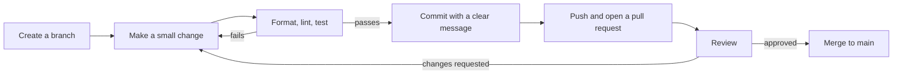

Code that only you can run, only today, is a prototype. Code that a teammate can understand, run and change safely is software. The difference comes from a set of habits that cost little each day and save enormous amounts of time later. Many AI projects fail not because the model is wrong, but because nobody can reproduce the result, find the bug, or safely change the pipeline. This lesson collects the practices that prevent that.

## Structure your project

A predictable layout means anyone, including you in six months, can find things.

```text
sentiment-app/
├── README.md              what it is and how to run it
├── pyproject.toml         dependencies and tool settings
├── uv.lock                exact versions
├── .gitignore
├── .env.example           names of required secrets, without values
├── src/
│   └── sentiment_app/
│       ├── __init__.py
│       ├── config.py      settings loaded from the environment
│       ├── data.py        loading and cleaning
│       ├── model.py       training and prediction
│       └── cli.py         command-line entry point
├── tests/
│   ├── test_data.py
│   └── test_model.py
├── notebooks/             exploration only
└── data/                  ignored by Git
```

| Principle | In this layout |
| --- | --- |
| Separate code by responsibility | Data handling, modelling and the interface live in different modules |
| Keep tests apart from code | `tests/` mirrors `src/` |
| Notebooks explore, modules hold the real code | Notebooks import from `src/`, not the other way round |
| Nothing large or secret in Git | `data/`, `.venv/` and `.env` are ignored |

`.env.example` lists the environment variables the project needs, with empty or placeholder values. New developers copy it to `.env` and fill in their own keys.

## Write readable code

Code is read far more often than it is written. Optimise for the reader.

### Follow PEP 8

**PEP 8** is Python's official style guide. The main conventions:

| Thing | Style | Example |
| --- | --- | --- |
| Variables and functions | `snake_case` | `load_reviews`, `max_tokens` |
| Classes | `PascalCase` | `SentimentModel` |
| Constants | `UPPER_SNAKE_CASE` | `DEFAULT_TEMPERATURE` |
| Indentation | 4 spaces | |
| Private helpers | Leading underscore | `_normalise` |

You do not need to memorise the rest: a formatter applies it for you.

### Names that explain

```python
# unclear
def proc(d, t):
    return [x for x in d if x[1] > t]

# clear
def filter_by_confidence(predictions, threshold):
    return [p for p in predictions if p.confidence > threshold]
```

Good names remove the need for most comments. Save comments for explaining **why**, which the code cannot say:

```python
# Retry on 529 as well as 429: the provider returns 529 when overloaded.
RETRY_STATUS_CODES = {429, 500, 503, 529}
```

### Small functions that do one thing

A function that loads data, cleans it, trains a model and saves a report is hard to test, hard to reuse and hard to debug. Split it so each function has a single job and a name that describes that job.

```python
def run_pipeline(path):
    reviews = load_reviews(path)
    reviews = remove_empty(reviews)
    model = train_classifier(reviews)
    save_report(evaluate(model, reviews))
```

Now `run_pipeline` reads like a summary, and each step can be tested and fixed alone.

### Don't repeat yourself

When you copy and paste a block of code, every future fix must be made in every copy, and one will be forgotten. Extract repeated logic into a function. Two similar lines are fine; the same five lines in three places is a function waiting to be written.

## Formatting and linting with Ruff

Automate style so code review can focus on what matters.

```bash
uv add --dev ruff
uv run ruff format .        # rewrite files in a consistent style
uv run ruff check .         # report likely bugs and bad practice
uv run ruff check --fix .   # fix what can be fixed automatically
```

```output
src/sentiment_app/data.py:3:8: F401 [*] `os` imported but unused
src/sentiment_app/model.py:41:5: F841 Local variable `history` is assigned to but never used
Found 2 errors.
[*] 1 fixable with the `--fix` option.
```

Configure it once in `pyproject.toml`:

```toml
[tool.ruff]
line-length = 88

[tool.ruff.lint]
select = ["E", "F", "I", "B", "UP"]
```

The selected rule groups cover style errors, real bugs, import sorting, common pitfalls and outdated syntax.

## Keep configuration and secrets out of code

Values that change between environments, or between experiments, should not be hard-coded.

```python
# config.py
import os
from dataclasses import dataclass

@dataclass(frozen=True)
class Settings:
    model_name: str = os.environ.get("MODEL_NAME", "gpt-4o-mini")
    temperature: float = float(os.environ.get("TEMPERATURE", "0.2"))
    api_key: str = os.environ["OPENAI_API_KEY"]

settings = Settings()
```

| Belongs in code | Belongs in configuration |
| --- | --- |
| Logic and algorithms | API keys and passwords (always) |
| Sensible defaults | Model names, hyperparameters, file paths |
| | Anything that differs between your laptop and production |

> [!WARNING]
> Secrets go in environment variables or a secrets manager, never in source code, notebooks, logs or commit history. Treat a leaked key as compromised: revoke it immediately.

## Use logging instead of print

`print` is fine for scripts you run once. Applications should use the `logging` module, which adds timestamps and severity levels and can be turned up or down without editing code.

```python
import logging

logging.basicConfig(level=logging.INFO, format="%(asctime)s %(levelname)s %(name)s: %(message)s")
logger = logging.getLogger(__name__)

logger.info("Loaded %d reviews", 1250)
logger.warning("%d reviews had no text and were skipped", 38)
logger.error("Model file not found: %s", "models/v2.pt")
```

```output
2025-03-14 10:02:11,482 INFO sentiment_app.data: Loaded 1250 reviews
2025-03-14 10:02:11,483 WARNING sentiment_app.data: 38 reviews had no text and were skipped
2025-03-14 10:02:11,483 ERROR sentiment_app.data: Model file not found: models/v2.pt
```

| Level | Use for |
| --- | --- |
| `DEBUG` | Detailed information for diagnosing problems |
| `INFO` | Normal events worth recording |
| `WARNING` | Something unexpected that the program handled |
| `ERROR` | A failure of one operation |
| `CRITICAL` | The program cannot continue |

Setting the level to `WARNING` in production hides the routine messages without removing them from the code.

## Test your code

A **test** is code that checks your code. It runs in seconds, every time you change something, and tells you immediately if you broke what used to work. **pytest** is the standard tool.

```python
# src/sentiment_app/data.py
def clean_text(text: str) -> str:
    """Lowercase, trim and collapse internal whitespace."""
    return " ".join(text.lower().split())
```

```python
# tests/test_data.py
from sentiment_app.data import clean_text

def test_lowercases():
    assert clean_text("GREAT Film") == "great film"

def test_collapses_whitespace():
    assert clean_text("  too   many\n spaces ") == "too many spaces"

def test_empty_string():
    assert clean_text("") == ""
```

```bash
uv run pytest
```

```output
============================= test session starts ==============================
collected 3 items

tests/test_data.py ...                                                   [100%]

============================== 3 passed in 0.02s ===============================
```

Each test is a function whose name starts with `test_`, containing `assert` statements. pytest finds and runs them all.

Start by testing the functions most likely to break: data cleaning, parsing, and anything with edge cases such as empty input. Whenever you fix a bug, first write a test that reproduces it. The bug can then never return unnoticed. Testing is covered in depth in Phase 10.

## The development loop



Each loop should be short: hours, not weeks. Small changes are easy to review and easy to undo.

### Automate the checks

A **pre-commit hook** runs checks automatically before every commit, so badly formatted or broken code never enters the history. The `pre-commit` tool manages them from a config file:

```text
# .pre-commit-config.yaml
repos:
  - repo: https://github.com/astral-sh/ruff-pre-commit
    rev: v0.7.4
    hooks:
      - id: ruff
        args: [--fix]
      - id: ruff-format
```

```bash
uv add --dev pre-commit
uv run pre-commit install
```

Later in the curriculum, the same checks run on every pull request through continuous integration.

## Code review

On a team, every change is read by someone else before it is merged. Review catches bugs, spreads knowledge, and keeps the codebase consistent.

| As the author | As the reviewer |
| --- | --- |
| Keep pull requests small and focused | Review promptly |
| Explain what changed and why in the description | Ask questions rather than make demands |
| Review your own diff first | Focus on correctness and clarity, not personal style |
| Do not take comments personally | Praise good solutions as well as flagging problems |

## Document as you go

Documentation that lives next to the code stays up to date.

- **README**: what the project does, how to install it, how to run it, and how to run the tests.
- **Docstrings**: on every public function and class, saying what it does, its arguments and what it returns.
- **Comments**: only where the reason for the code is not obvious from the code itself.

```python
def chunk_text(text: str, size: int = 500, overlap: int = 50) -> list[str]:
    """Split text into overlapping chunks of roughly `size` characters.

    Overlap keeps sentences that cross a boundary visible in both chunks,
    which improves retrieval quality.

    Args:
        text: The document to split.
        size: Target characters per chunk.
        overlap: Characters shared between consecutive chunks.

    Returns:
        The chunks, in document order.
    """
```

## Exercises

**1.** Refactor this function into smaller, well-named functions.

```python
def go(p):
    f = open(p)
    rows = [l.strip().split(",") for l in f]
    f.close()
    rows = [r for r in rows if r[1] != ""]
    s = sum(float(r[1]) for r in rows)
    print(s / len(rows))
```

<details>
<summary>Show solution</summary>

```python
def read_rows(path: str) -> list[list[str]]:
    with open(path, encoding="utf-8") as f:
        return [line.strip().split(",") for line in f]

def drop_missing_scores(rows: list[list[str]]) -> list[list[str]]:
    return [row for row in rows if row[1] != ""]

def mean_score(rows: list[list[str]]) -> float:
    return sum(float(row[1]) for row in rows) / len(rows)

def report_mean_score(path: str) -> None:
    rows = drop_missing_scores(read_rows(path))
    print(f"Mean score: {mean_score(rows):.2f}")
```

The file is now closed safely by `with`, each step can be tested on its own, and the names explain the intent.

</details>

**2.** Write three pytest tests for a function `word_count(text)` that returns the number of words in a string, including one test for an empty string.

<details>
<summary>Show solution</summary>

```python
def word_count(text: str) -> int:
    return len(text.split())

def test_simple_sentence():
    assert word_count("the cat sat") == 3

def test_extra_whitespace():
    assert word_count("  the   cat  ") == 2

def test_empty_string():
    assert word_count("") == 0
```

</details>

**3.** Replace the prints in this snippet with appropriate logging calls.

```python
print("Starting training")
print("WARNING: GPU not found, using CPU")
print("Epoch 3 loss 0.214")
```

<details>
<summary>Show solution</summary>

```python
import logging

logging.basicConfig(level=logging.INFO)
logger = logging.getLogger(__name__)

logger.info("Starting training")
logger.warning("GPU not found, using CPU")
logger.info("Epoch %d loss %.3f", 3, 0.214)
```

</details>

```quiz
[
  {
    "q": "What is the purpose of a `.env.example` file?",
    "options": [
      "To store the real API keys in Git",
      "To list the environment variables a project needs, without their secret values",
      "To configure VS Code",
      "To replace `requirements.txt`"
    ],
    "answer": 1,
    "why": "It documents the required settings so new developers know what to put in their own uncommitted `.env`."
  },
  {
    "q": "Which name follows PEP 8 for a class?",
    "options": ["`sentiment_model`", "`SentimentModel`", "`SENTIMENT_MODEL`", "`sentimentModel`"],
    "answer": 1,
    "why": "Classes use PascalCase. Functions and variables use snake_case, and constants use UPPER_SNAKE_CASE."
  },
  {
    "q": "Why prefer `logging` over `print` in an application?",
    "options": [
      "`print` does not work on servers",
      "Logging adds timestamps and severity levels and can be filtered without changing code",
      "Logging is faster for all output",
      "`print` cannot show numbers"
    ],
    "answer": 1,
    "why": "Levels and formatting make logs searchable and let you control verbosity per environment."
  },
  {
    "q": "You have just fixed a bug. What should you add so it cannot silently return?",
    "options": ["A comment", "A test that reproduces the bug", "A print statement", "A new branch"],
    "answer": 1,
    "why": "A regression test fails if the bug reappears, every time the tests run."
  }
]
```
