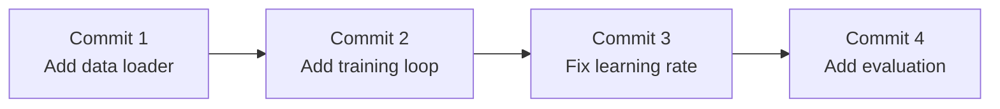
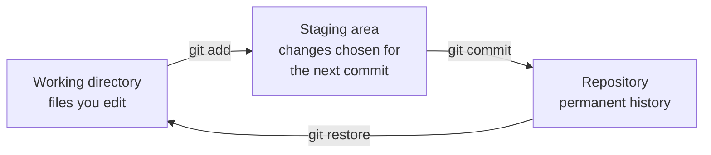
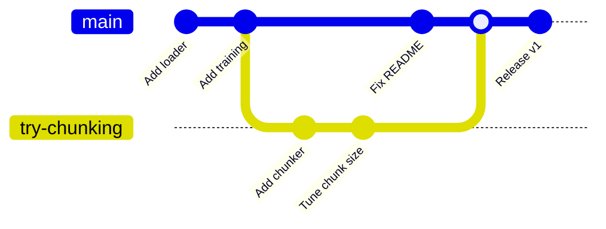
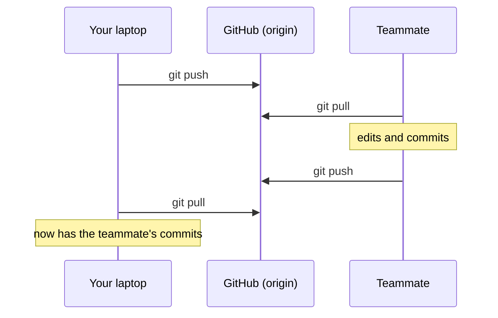

You change a prompt and the chatbot gets worse. You refactor a data loader and training breaks. Which change caused it, and how do you get back to the version that worked? **Git** answers both questions. It records every version of your project so you can compare, undo and experiment without fear. **GitHub** hosts Git projects online so you can back them up, share them and work with others. Every software team uses them, and your GitHub profile is part of your portfolio as an AI engineer.

## Version control in one picture

Git stores your project's history as a series of **commits**. A commit is a snapshot of every tracked file at one moment, with a message explaining what changed and why.



At any point you can see what changed between two commits, or restore a file to how it was in any of them.

| Term | Meaning |
| --- | --- |
| Repository (repo) | A project tracked by Git, including its full history |
| Commit | A saved snapshot with a message |
| Branch | An independent line of development |
| Remote | A copy of the repository on another machine, usually GitHub |
| Clone | Download a full copy of a remote repository |
| Push / pull | Send commits to, or fetch commits from, a remote |

## Setting up

Install Git (`sudo apt install git` on Ubuntu; on macOS, running `git` the first time offers to install it), then tell it who you are. Every commit records this.

```bash
git config --global user.name "Amina Khan"
git config --global user.email "amina@example.com"
git config --global init.defaultBranch main
```

## The three areas

The idea that makes Git click is that a change passes through three places before it is saved.



1. **Working directory**: the files on your disk as you edit them.
2. **Staging area**: the changes you have selected to go into the next commit.
3. **Repository**: the committed history, stored in a hidden `.git` folder.

The staging area lets you commit related changes together even when you have edited many files. You might fix a bug and tweak a prompt at the same time, then commit them separately with clear messages.

## The everyday workflow

```bash
mkdir sentiment-app
cd sentiment-app
git init
```

```output
Initialized empty Git repository in /home/amina/sentiment-app/.git/
```

Create a file, then ask Git what it sees:

```bash
echo "print('hello')" > main.py
git status
```

```output
On branch main

No commits yet

Untracked files:
  (use "git add <file>..." to include in what will be committed)
	main.py
```

Stage it and commit:

```bash
git add main.py
git commit -m "Add entry point"
```

```output
[main (root-commit) 3f2a91c] Add entry point
 1 file changed, 1 insertion(+)
 create mode 100644 main.py
```

That is the loop you will repeat hundreds of times: **edit, `git status`, `git add`, `git commit`**.

| Command | Does |
| --- | --- |
| `git status` | What has changed, and what is staged. Run it constantly |
| `git add file` | Stage a file. `git add .` stages everything in the current folder |
| `git commit -m "message"` | Save the staged changes as a commit |
| `git diff` | Show unstaged changes, line by line |
| `git diff --staged` | Show what is about to be committed |
| `git log --oneline` | Compact history |

```bash
git log --oneline
```

```output
a81c0d2 Add evaluation script
6be4f10 Fix learning rate schedule
3f2a91c Add entry point
```

Each commit has a unique ID, a **hash**. The short form on the left is enough to refer to it.

### Writing good commit messages

A commit message is a note to your future self and your teammates. Write it in the imperative, as if completing the sentence "This commit will...".

| Weak | Better |
| --- | --- |
| `fix` | `Fix crash when the PDF has no text layer` |
| `updates` | `Lower temperature to 0.2 for factual answers` |
| `changed stuff in model.py` | `Cache embeddings to avoid recomputing on restart` |

> [!TIP]
> Commit small and often. A commit should hold one logical change. Small commits are easy to understand, easy to review and easy to undo.

## What not to commit: .gitignore

Some files must never enter the repository. A `.gitignore` file in the project root lists patterns Git should ignore.

```text
# .gitignore

# environments and caches
.venv/
__pycache__/
.ipynb_checkpoints/

# secrets
.env

# large artefacts
data/
models/
*.pt
*.ckpt
wandb/
mlruns/
```

> [!WARNING]
> **Never commit secrets.** An API key pushed to GitHub is found by automated scanners within minutes, even if you delete it in the next commit, because it remains in the history. If it happens, revoke the key with the provider immediately and issue a new one.

Large datasets and model weights do not belong in Git either. Git keeps every version of every file forever, so a 2 GB checkpoint committed ten times makes the repository 20 GB. Use dedicated tools for those, such as DVC or a model registry, which you will meet in the MLOps phase.

## Branches

A **branch** is an independent line of development. You create one to try an idea without touching the working version on `main`. If the idea works, you **merge** it back. If not, you delete the branch and nothing is lost.



```bash
git switch -c try-chunking      # create a branch and switch to it
# ...edit and commit as usual...
git switch main                 # go back to main
git merge try-chunking          # bring the branch's commits into main
git branch -d try-chunking      # delete the branch once merged
```

Switching branches changes the files on your disk to match that branch. Commit or stash your work before switching.

### Merge conflicts

If both branches changed the same lines, Git cannot decide which version to keep. It stops and marks the conflict inside the file:

```text
def build_prompt(question):
<<<<<<< HEAD
    return f"Answer briefly: {question}"
=======
    return f"Answer step by step: {question}"
>>>>>>> try-chunking
```

The part above `=======` is your current branch; the part below is the incoming branch. To resolve it, edit the file to the version you want, delete the marker lines, then stage and commit:

```bash
git add prompts.py
git commit -m "Merge try-chunking, keep step-by-step prompt"
```

Conflicts are normal, not a sign that something is broken. VS Code shows them with buttons to accept either side.

## Working with GitHub

**GitHub** hosts remote repositories. A **remote** is just another copy of your repository; the conventional name for the main one is `origin`.



### Publishing a project

Create an empty repository on GitHub, then connect your local one and push:

```bash
git remote add origin git@github.com:amina/sentiment-app.git
git branch -M main
git push -u origin main
```

`-u` links your local `main` to the remote one, so afterwards a plain `git push` or `git pull` is enough.

### Getting someone else's project

```bash
git clone https://github.com/huggingface/transformers.git
```

This downloads the full repository and its entire history.

### Authentication

GitHub does not accept your account password for Git operations. Use one of:

- **SSH keys** (recommended): generate a key pair once with `ssh-keygen -t ed25519`, add the public key (`~/.ssh/id_ed25519.pub`) to your GitHub settings, and use the `git@github.com:...` form of repository URLs.
- **The GitHub CLI**: run `gh auth login` and it configures HTTPS access for you.

### Pull requests

On a team you rarely push straight to `main`. Instead you push a branch and open a **pull request** (PR): a proposal to merge it, where teammates review the changes, comment, and automated tests run. When it is approved, it is merged.

```bash
git switch -c add-reranker
# ...commit your work...
git push -u origin add-reranker
# then open the pull request on GitHub
```

## Undoing things

| Situation | Command |
| --- | --- |
| Discard unsaved edits to a file | `git restore file.py` |
| Unstage a file but keep the edits | `git restore --staged file.py` |
| Fix the message or contents of the last commit (not yet pushed) | `git commit --amend` |
| Undo a commit that is already pushed | `git revert <hash>`: makes a new commit that reverses it |
| Undo the last local commit but keep the changes | `git reset --soft HEAD~1` |
| See an old version of a file | `git show <hash>:path/to/file.py` |

> [!WARNING]
> Commands that rewrite history, such as `git reset --hard` and `git push --force`, can destroy work permanently, including other people's. Avoid them until you understand exactly what they do. On shared branches, prefer `git revert`, which undoes a change by adding a new commit.

## A README that shows your work

Every repository should have a `README.md` at its root. GitHub displays it on the project page. For a portfolio project, include:

- what the project does, in one or two sentences,
- a screenshot or example output,
- how to install and run it,
- the technologies used and any results, such as accuracy.

## Exercises

**1.** Create a repository, add a `notes.md` file, and make two commits: one creating it and one adding a second line. Then show the history and the difference between the two commits.

<details>
<summary>Show solution</summary>

```bash
mkdir git-practice && cd git-practice
git init
echo "# Notes" > notes.md
git add notes.md
git commit -m "Create notes"
echo "Git stores snapshots." >> notes.md
git commit -am "Add first note"
git log --oneline
git diff HEAD~1 HEAD
```

`git commit -am` stages and commits every tracked file that changed. It does not include new, untracked files.

</details>

**2.** Write a `.gitignore` for an AI project that has a virtual environment in `.venv`, an API key in `.env`, downloaded data in `data/` and saved PyTorch weights ending in `.pt`.

<details>
<summary>Show solution</summary>

```text
.venv/
.env
data/
*.pt
__pycache__/
```

</details>

**3.** Create a branch called `experiment`, change a file there and commit it, switch back to `main`, and merge the branch.

<details>
<summary>Show solution</summary>

```bash
git switch -c experiment
echo "Branches are cheap." >> notes.md
git commit -am "Add note about branches"
git switch main
git merge experiment
git branch -d experiment
```

</details>

**4.** You committed a change on `main`, pushed it, and it broke the app. What is the safe way to undo it?

<details>
<summary>Show solution</summary>

```bash
git log --oneline          # find the hash of the bad commit
git revert 6be4f10
git push
```

`git revert` adds a new commit that reverses the bad one, so history is preserved and nobody else's copy is disrupted.

</details>

```quiz
[
  {
    "q": "What does `git add` do?",
    "options": [
      "Saves a permanent snapshot",
      "Uploads files to GitHub",
      "Moves changes into the staging area for the next commit",
      "Creates a new branch"
    ],
    "answer": 2,
    "why": "`git add` stages changes. `git commit` then records the staged changes in history."
  },
  {
    "q": "You accidentally committed an API key and pushed it. What should you do first?",
    "options": [
      "Delete the file in a new commit",
      "Revoke the key with the provider and create a new one",
      "Make the repository private",
      "Rename the variable"
    ],
    "answer": 1,
    "why": "Once pushed, the key is in the history and may already be copied. Revoking it is the only way to make it harmless."
  },
  {
    "q": "What is a branch for?",
    "options": [
      "Backing up the repository to GitHub",
      "Developing a change independently without affecting the main line",
      "Storing large files",
      "Deleting old commits"
    ],
    "answer": 1,
    "why": "Branches let you experiment in isolation and merge the work back only when it is ready."
  },
  {
    "q": "Which command safely undoes a commit that has already been pushed to a shared branch?",
    "options": ["`git reset --hard`", "`git push --force`", "`git revert <hash>`", "`git restore`"],
    "answer": 2,
    "why": "`git revert` creates a new commit that reverses the old one, without rewriting history others depend on."
  },
  {
    "q": "Why should model weights such as `model.pt` usually be listed in `.gitignore`?",
    "options": [
      "Git cannot read binary files",
      "Git keeps every version forever, so large files bloat the repository permanently",
      "GitHub forbids files ending in `.pt`",
      "They contain secrets"
    ],
    "answer": 1,
    "why": "Each committed version stays in history. Large artefacts belong in tools built for them, such as DVC or a model registry."
  }
]
```
