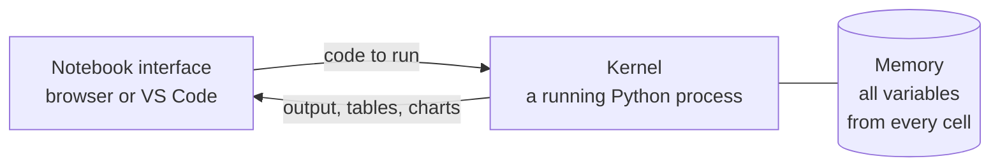

A **Jupyter notebook** mixes runnable code, its output, charts and written explanation in one document. You run code a piece at a time and see results immediately, which makes notebooks the standard tool for exploring data, prototyping models and sharing analysis. Most machine learning tutorials, Kaggle solutions and research demos are notebooks. They also have traps that catch everyone, and this lesson covers both.

## Cells

A notebook is a list of **cells**. There are two main kinds:

| Cell type | Contains | When run |
| --- | --- | --- |
| Code | Python | Executes and shows the output below the cell |
| Markdown | Formatted text, headings, lists, maths, links | Renders as formatted text |

```python
import pandas as pd

df = pd.DataFrame({"model": ["bert", "gpt2", "t5"], "accuracy": [0.91, 0.88, 0.90]})
df
```

```output
  model  accuracy
0  bert      0.91
1  gpt2      0.88
2    t5      0.90
```

In a notebook, the value of the **last expression** in a cell is displayed automatically, without `print`. DataFrames appear as formatted tables and charts appear inline. That immediate visual feedback is why notebooks suit data work.

The number beside each cell, such as `[3]`, records the order in which cells were run.

## How notebooks work: the kernel



The **kernel** is a Python process that stays running in the background. Every cell you run is sent to the same kernel, so a variable created in one cell is available in all others. The kernel's memory, not the file, is the true state of your work.

| Kernel action | Effect |
| --- | --- |
| Interrupt | Stop a cell that is running too long, like `Ctrl+C` |
| Restart | Wipe all variables and start a fresh Python process |
| Restart and run all | Restart, then run every cell from top to bottom |
| Change kernel | Switch to a different Python environment |

## The hidden state trap

Because cells can run in any order, and can be edited after running, what you **see** in a notebook can differ from what the kernel **holds**.

Consider three cells run in the order 1, 2, 3, then cell 1 edited and run again:

```python
# cell 1, first version
rate = 0.1
```

```python
# cell 2
steps = 10
total = rate * steps
```

```python
# cell 3
print(total)
```

```output
1.0
```

Now change cell 1 to `rate = 0.5` and run only that cell. Cell 3's printed output still says `1.0`, and `total` is still `1.0`, because cell 2 has not been rerun. The notebook on screen shows `rate = 0.5` next to a result computed with `0.1`.

It gets worse. Delete cell 1 entirely and the variable `rate` still exists in the kernel, so everything keeps working, until someone else opens the notebook, runs it from the top, and gets a `NameError`.

> [!KEY]
> A notebook is only trustworthy if it runs cleanly from top to bottom in a fresh kernel. Before you share a notebook, commit it, or believe its results, use **Restart Kernel and Run All**. If it fails, fix it until it passes.

## Installing and starting

Install JupyterLab, the modern interface, into your project's virtual environment:

```bash
source .venv/bin/activate
pip install jupyterlab
jupyter lab
```

This starts a local server and opens it in your browser. Alternatively, open any `.ipynb` file in VS Code with the Jupyter extension installed, which is often more convenient because you keep your editor's features.

### Using the right environment

A notebook runs in whichever environment its **kernel** belongs to. To make a project's environment available as a kernel, install `ipykernel` in it and register it:

```bash
pip install ipykernel
python -m ipykernel install --user --name sentiment-app --display-name "Python (sentiment-app)"
```

Then choose "Python (sentiment-app)" from the kernel menu. In VS Code, simply pick the `.venv` interpreter from the kernel picker at the top right.

> [!TIP]
> If a package you installed is "not found" in a notebook, check which kernel is selected. Running `import sys; print(sys.executable)` in a cell shows exactly which Python the kernel is using.

## Keyboard shortcuts

Notebooks have two modes. In **edit mode** (a cursor in a cell) you type code. In **command mode** (press `Esc`) single keys act on whole cells.

| Key | Mode | Does |
| --- | --- | --- |
| `Shift+Enter` | Either | Run the cell and move to the next |
| `Ctrl+Enter` | Either | Run the cell and stay on it |
| `Esc` / `Enter` | | Switch to command mode / edit mode |
| `A` / `B` | Command | Insert a cell above / below |
| `D` `D` | Command | Delete the cell (press D twice) |
| `M` / `Y` | Command | Change to Markdown / code |
| `Z` | Command | Undo cell deletion |

## Magic commands

Lines beginning with `%` or `!` are not Python. They are instructions to the notebook itself.

| Command | Does |
| --- | --- |
| `%pip install pandas` | Install into the kernel's own environment |
| `!ls data` | Run a shell command |
| `%timeit expr` | Time a small piece of code accurately, over many runs |
| `%%time` | At the top of a cell: time the whole cell once |
| `%who` | List the variables in memory |
| `%debug` | Open the debugger at the point of the last error |
| `%load_ext autoreload` then `%autoreload 2` | Reload your own modules automatically when you edit them |

```python
import numpy as np

numbers = list(range(100_000))
array = np.arange(100_000)

%timeit sum(x * x for x in numbers)
%timeit (array * array).sum()
```

```output
4.12 ms ± 31.2 µs per loop (mean ± std. dev. of 7 runs, 100 loops each)
48.6 µs ± 0.9 µs per loop (mean ± std. dev. of 7 runs, 10,000 loops each)
```

NumPy is about 85 times faster here. That one experiment is the motivation for the whole of Phase 3.

> [!WARNING]
> Use `%pip install`, not `!pip install`. The `!` form runs whichever `pip` is first on the system `PATH`, which may belong to a different environment from the kernel. `%pip` always installs into the kernel's environment.

### Working with your own modules

As a project grows, move reusable functions out of the notebook into `.py` files and import them. With autoreload switched on, edits to those files take effect without restarting the kernel:

```python
%load_ext autoreload
%autoreload 2

from src.preprocessing import clean_text
```

## Markdown cells

Markdown cells turn a notebook into a readable report. Explain what you are doing and why, record what you found, and use headings so the notebook has a structure.

```text
## 2. Cleaning the reviews

About 3% of reviews are empty or contain only whitespace. These are removed.
The loss used later is cross-entropy, $L = -\sum y \log \hat{y}$.
```

Notebooks render LaTeX maths between dollar signs, which is useful for documenting the formulas behind a model.

## Notebooks and Git

A `.ipynb` file is JSON. Alongside your code it stores every output, including images encoded as text and execution counts. That makes notebooks awkward in Git: diffs are unreadable, files become large, and two people editing the same notebook almost always conflict.

Practical habits:

- **Clear outputs before committing** unless the outputs are the point, such as a published report. Tools like `nbstripout` can do this automatically on every commit.
- **Keep notebooks for exploration and move stable code into `.py` modules**, which diff and review cleanly.
- **Never store secrets in a notebook.** Outputs are saved too, so printing an API key leaves it in the file.

## Notebooks or scripts?

| Use a notebook for | Use a script or module for |
| --- | --- |
| Exploring a new dataset | Code you will run repeatedly |
| Visualising results | Training pipelines and jobs |
| Prototyping a model idea | Anything deployed to production |
| Teaching and sharing an analysis | Code that needs tests and review |

A common pattern is to explore in a notebook, then move what works into functions in `.py` files, and finally import those functions back into a much shorter notebook.

## Cloud notebooks

You do not need a GPU of your own to start deep learning. Hosted notebook services give you one in a browser:

| Service | Notes |
| --- | --- |
| Google Colab | Free tier with a GPU for limited sessions. Files are lost when the session ends unless saved to Drive |
| Kaggle Notebooks | Free GPU hours each week, with datasets one click away |
| Cloud providers' notebook services | Paid, with larger and longer-running machines |

Everything in this lesson applies to them: they are Jupyter underneath.

## Exercises

**1.** Install JupyterLab in a virtual environment, start it, and create a notebook that prints the Python version and the path of the running interpreter.

<details>
<summary>Show solution</summary>

```bash
python3 -m venv .venv
source .venv/bin/activate
pip install jupyterlab
jupyter lab
```

```python
import sys
print(sys.version)
print(sys.executable)
```

The executable path should point inside `.venv`.

</details>

**2.** A notebook works on your machine but fails for a colleague with `NameError: name 'clean_df' is not defined`. What probably happened, and how do you prevent it?

<details>
<summary>Show solution</summary>

The cell that created `clean_df` was deleted, edited or never kept in the saved notebook, but the variable survived in your kernel's memory, so your copy kept working. Prevent it by running **Restart Kernel and Run All** before sharing. If anything fails, the notebook depends on hidden state.

</details>

**3.** Use `%timeit` to compare building a list of squares with a `for` loop and `append`, against a list comprehension, for 10,000 numbers.

<details>
<summary>Show solution</summary>

```python
def with_loop():
    out = []
    for n in range(10_000):
        out.append(n * n)
    return out

%timeit with_loop()
%timeit [n * n for n in range(10_000)]
```

The comprehension is usually noticeably faster, because it avoids looking up and calling `append` on every iteration.

</details>

```quiz
[
  {
    "q": "What is the kernel in Jupyter?",
    "options": [
      "The notebook file on disk",
      "A running Python process that executes the cells and holds their variables",
      "The browser tab",
      "A Markdown renderer"
    ],
    "answer": 1,
    "why": "All cells share one kernel process, which is why variables persist between cells."
  },
  {
    "q": "Why might a notebook's visible output not match its code?",
    "options": [
      "Jupyter randomly reorders cells",
      "Cells can be run out of order or edited after running, so outputs reflect older state",
      "Markdown cells change the code",
      "Outputs are cached on GitHub"
    ],
    "answer": 1,
    "why": "Outputs show the state at the time each cell last ran, which may not match the current code above them."
  },
  {
    "q": "What is the best check before sharing a notebook?",
    "options": [
      "Save it twice",
      "Restart the kernel and run all cells from top to bottom",
      "Delete all Markdown cells",
      "Convert it to PDF"
    ],
    "answer": 1,
    "why": "A clean top-to-bottom run proves the notebook does not depend on hidden state."
  },
  {
    "q": "Why is `%pip install x` preferred over `!pip install x` in a notebook?",
    "options": [
      "It is faster",
      "It always installs into the kernel's own environment",
      "It does not need internet access",
      "`!pip` is a syntax error"
    ],
    "answer": 1,
    "why": "`!pip` runs whichever pip is first on `PATH`, which may belong to a different Python."
  }
]
```
