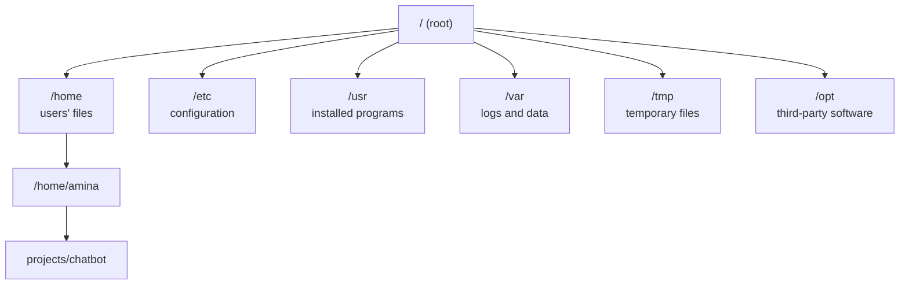

Almost every AI system in production runs on Linux. Cloud GPU servers, Docker containers, Kubernetes clusters and the machines behind every major LLM API are all Linux. Your laptop may run macOS or Windows, but the moment you train on a rented GPU or deploy a model, you are working on Linux, usually through nothing but a terminal. This lesson gives you the mental model you need to feel at home there.

## What Linux is

**Linux** is an operating system **kernel**: the core program that manages the hardware, memory, processes and files. A full operating system bundles the kernel with tools, a package manager and often a desktop. These bundles are called **distributions**.

| Distribution | Where you will meet it |
| --- | --- |
| Ubuntu | The default on most cloud GPU instances and in tutorials |
| Debian | Many Docker base images, such as `python:3.12-slim` |
| Amazon Linux, Rocky Linux | AWS and enterprise servers |
| Alpine | Very small Docker images |

They differ mainly in their package manager and default settings. The concepts in this lesson apply to all of them.

### Linux on your own machine

| Your computer | How to get a Linux environment |
| --- | --- |
| Windows | **WSL** (Windows Subsystem for Linux): run `wsl --install` in PowerShell, then restart. You get a real Ubuntu terminal |
| macOS | macOS is Unix-based, so the terminal works almost identically. Most commands in this module run unchanged |
| Linux | You are already there |

> [!TIP]
> On Windows, do your AI work inside WSL rather than native Windows. Most libraries, tutorials and deployment targets assume Linux, and GPU support for PyTorch works through WSL.

## Why AI engineers need it

- **Remote servers have no desktop.** A cloud GPU machine gives you a terminal over SSH and nothing else.
- **Containers are Linux.** Every Dockerfile you write describes a small Linux system.
- **Debugging production means reading logs, checking processes and inspecting disk usage**, all from the command line.
- **GPU tooling** such as `nvidia-smi` and CUDA drivers is Linux-first.

## Everything is a file

Linux organises everything into a single tree that starts at the **root**, written `/`. There are no drive letters like `C:`. Disks, USB sticks and even hardware devices appear somewhere inside this one tree.



| Directory | Contains |
| --- | --- |
| `/home/<user>` | Each user's personal files. Your **home directory**, written `~` |
| `/root` | The home directory of the administrator account |
| `/etc` | System-wide configuration files |
| `/usr/bin`, `/bin` | Programs and commands |
| `/var/log` | Log files: the first place to look when a service misbehaves |
| `/tmp` | Temporary files, often cleared on reboot |
| `/opt` | Optional software, such as some CUDA installs |
| `/dev` | Devices, including GPUs (`/dev/nvidia0`) |
| `/mnt`, `/media` | Mounted disks |

### Paths

An **absolute path** starts at the root: `/home/amina/projects/chatbot/main.py`. A **relative path** starts from wherever you are now: if you are in `/home/amina`, the same file is `projects/chatbot/main.py`.

| Symbol | Means |
| --- | --- |
| `/` | The root, or a separator between folder names |
| `~` | Your home directory |
| `.` | The current directory |
| `..` | The parent directory |

> [!WARNING]
> Linux is **case-sensitive**. `Data.csv`, `data.csv` and `DATA.csv` are three different files. Code that works on macOS or Windows, which usually ignore case, can fail on a Linux server because of this.

File names starting with a dot, such as `.env`, `.gitignore` and `.bashrc`, are **hidden**. They do not appear in a normal listing, which is why they are used for configuration.

## Users, root and sudo

Linux is a multi-user system. Every file has an owner, and every program runs as some user. The special user **root** is the administrator and can do anything, including delete the whole system.

You normally work as an ordinary user and borrow root's power for one command at a time with `sudo` ("superuser do"):

```bash
sudo apt update
```

```output
[sudo] password for amina:
```

> [!WARNING]
> `sudo` removes every safety check. Use it only for system administration, such as installing system packages. Never use it to run your Python scripts or `pip install`. If a command fails with "permission denied", find out why before reaching for `sudo`.

## Permissions

Every file records who may **read**, **write** and **execute** it, for three groups of people: the file's **owner**, its **group**, and **everyone else**. The `ls -l` command shows them:

```bash
ls -l
```

```output
-rw-r--r--  1 amina  staff   1204 Mar 14 10:02 notes.md
-rwxr-xr-x  1 amina  staff    220 Mar 14 10:05 train.sh
drwxr-xr-x  4 amina  staff    128 Mar 14 09:40 data
```

The first column decodes like this:

```text
-  rwx  r-x  r-x
│   │    │    └── others: read, execute
│   │    └─────── group:  read, execute
│   └──────────── owner:  read, write, execute
└──────────────── type: - file, d directory, l link
```

| Letter | On a file | On a directory |
| --- | --- | --- |
| `r` | Read its contents | List what is inside |
| `w` | Change it | Create or delete files inside |
| `x` | Run it as a program | Enter it with `cd` |

### Changing permissions

The most common change is making a script executable:

```bash
chmod +x train.sh
./train.sh
```

You will also see permissions written as three digits. Each permission has a value, and the values are added for each group:

$$
r = 4, \quad w = 2, \quad x = 1
$$

So `rwx` is $4 + 2 + 1 = 7$, `r-x` is $4 + 1 = 5$, and `r--` is $4$.

| Command | Result | Typical use |
| --- | --- | --- |
| `chmod 755 run.sh` | `rwxr-xr-x` | Scripts and programs |
| `chmod 644 notes.md` | `rw-r--r--` | Ordinary files |
| `chmod 600 ~/.ssh/id_ed25519` | `rw-------` | Private keys: only you can read them |

SSH refuses to use a private key that other users can read, so `chmod 600` on key files is something you will do for real.

## Processes

A running program is a **process**, identified by a number called its **PID**. Training jobs, web servers and notebooks are all processes.

| Command | What it does |
| --- | --- |
| `ps aux` | List every running process |
| `top` or `htop` | Live view of CPU and memory use, like a task manager |
| `kill <PID>` | Ask a process to stop |
| `kill -9 <PID>` | Force a process to stop immediately |
| `nvidia-smi` | GPU usage, memory and the processes using each GPU |

```bash
ps aux | grep python
```

```output
amina   48213  98.2  12.4  python train.py --epochs 20
amina   48390   0.0   0.0  grep python
```

Here a training script is using almost a full CPU core. You will meet the `|` symbol in the next lesson.

> [!TIP]
> When a GPU says it is out of memory but you are not running anything, check `nvidia-smi`. A crashed notebook kernel or a forgotten training process is often still holding the memory. Stop it with `kill` and the memory is freed.

## Installing software

Linux distributions install software through a **package manager**. On Ubuntu and Debian it is `apt`:

```bash
sudo apt update                 # refresh the list of available packages
sudo apt install git htop       # install packages
```

This installs **system** software: Git, compilers, system libraries. Python packages for your projects still go through `pip` inside a virtual environment, never through `sudo pip`.

## Environment variables and PATH

An **environment variable** is a named value that every program started from your shell can read. You used them for API keys in the previous module.

```bash
echo $HOME
export OPENAI_API_KEY="sk-..."
```

```output
/home/amina
```

The most important one is `PATH`: a list of folders, separated by colons, that the shell searches when you type a command.

```bash
echo $PATH
which python
```

```output
/home/amina/projects/chatbot/.venv/bin:/usr/local/bin:/usr/bin:/bin
/home/amina/projects/chatbot/.venv/bin/python
```

When you type `python`, the shell checks each folder from left to right and runs the first match. Activating a virtual environment works by putting its `bin` folder at the front of `PATH`.

Variables set with `export` last only for the current terminal session. To make them permanent, add the `export` line to your shell's startup file: `~/.bashrc` for bash, or `~/.zshrc` for zsh, the macOS default.

## Disk and memory

Datasets and model weights are large, and running out of disk is a common way for a training job to crash.

```bash
df -h            # free space on each disk
du -sh data/     # size of a folder
free -h          # memory usage (Linux only)
```

```output
Filesystem      Size  Used Avail Use% Mounted on
/dev/nvme0n1p1  200G  171G   29G  86% /
4.2G    data/
```

The `-h` flag means "human-readable": sizes in G and M instead of raw bytes.

## Exercises

**1.** In your terminal (WSL, macOS or Linux), print your home directory, the current directory, and the full path of the `python3` program.

<details>
<summary>Show solution</summary>

```bash
echo $HOME
pwd
which python3
```

</details>

**2.** What permissions does `chmod 640 report.csv` give, and who can read the file?

<details>
<summary>Show solution</summary>

`6` is $4 + 2$ (read and write) for the owner, `4` is read-only for the group, and `0` gives others nothing. The result is `rw-r-----`: the owner and members of the file's group can read it, and nobody else can.

</details>

**3.** A training script on a server has frozen and you need to stop it. Write the commands to find its PID and stop it, first politely and then forcibly.

<details>
<summary>Show solution</summary>

```bash
ps aux | grep train.py      # read the PID from the second column
kill 48213                  # ask it to stop
kill -9 48213               # force it if it ignores the first request
```

</details>

```quiz
[
  {
    "q": "On Linux, what is the difference between `/data` and `data`?",
    "options": [
      "There is no difference",
      "`/data` is an absolute path from the root; `data` is relative to the current directory",
      "`/data` is a file and `data` is a folder",
      "`/data` is hidden"
    ],
    "answer": 1,
    "why": "A leading slash anchors the path at the root of the file system. Without it, the path is resolved from where you are."
  },
  {
    "q": "What does `rwxr-x---` mean?",
    "options": [
      "Everyone can read, write and execute",
      "The owner can do everything, the group can read and execute, others have no access",
      "Only others can execute the file",
      "The file is a directory"
    ],
    "answer": 1,
    "why": "The nine letters are three groups of three: owner, group, then others."
  },
  {
    "q": "Why does activating a virtual environment change which `python` runs?",
    "options": [
      "It deletes the system Python",
      "It puts the environment's `bin` folder at the front of `PATH`",
      "It edits `/etc/python`",
      "It runs Python with `sudo`"
    ],
    "answer": 1,
    "why": "The shell searches `PATH` from left to right, so the environment's `python` is found first."
  },
  {
    "q": "Which command shows what is using a GPU's memory?",
    "options": ["`df -h`", "`nvidia-smi`", "`chmod`", "`apt list`"],
    "answer": 1,
    "why": "`nvidia-smi` reports GPU utilisation, memory and the processes using each GPU."
  }
]
```
