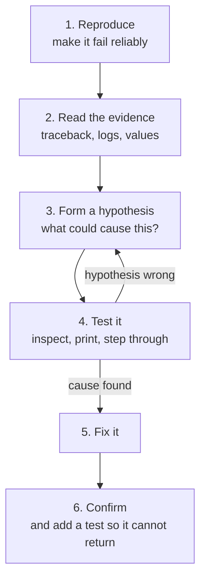

Every programmer spends a large share of their time finding out why code does not do what they expected. Debugging is not a sign of failure; it is a core skill, and it can be done systematically rather than by guessing. In AI work it matters even more, because many bugs do not crash: a model trains happily on shuffled labels, or a pipeline silently drops half the data. This lesson gives you a method and the tools to apply it.

## The debugging method

Random changes until the error disappears is not debugging. Treat a bug like a scientist treats an unexplained result.



**Reproduce** comes first because a bug you cannot trigger on demand is a bug you cannot confirm you have fixed. Shrink the failing case as far as possible: one input instead of a dataset, ten lines instead of a whole script. Often the bug becomes obvious during the shrinking.

## Reading a traceback properly

The previous module introduced tracebacks. Here is a realistic one, from a program split across several files:

```output
Traceback (most recent call last):
  File "/home/amina/app/main.py", line 12, in <module>
    report = summarise_reviews("data/reviews.csv")
  File "/home/amina/app/analysis.py", line 21, in summarise_reviews
    scores = [score_review(r) for r in reviews]
  File "/home/amina/app/analysis.py", line 9, in score_review
    return len(review["text"]) / review["rating"]
           ~~~~~~~~~~~~~~~~~~~~^~~~~~~~~~~~~~~~~~
ZeroDivisionError: division by zero
```

| Read | Tells you |
| --- | --- |
| The last line | **What** went wrong: a division by zero |
| The frame just above it | **Where**: line 9 of `analysis.py`, inside `score_review`. The `^` markers point at the exact operation |
| The frames above that | **How you got there**: `main.py` called `summarise_reviews`, which called `score_review` |

The line that crashed is not always the line that is wrong. Here the division is fine; the real question is why a review has a rating of zero. Was that valid data, or did loading the CSV go wrong? The traceback shows you where to start looking, not always where to fix.

> [!TIP]
> When the traceback runs through library code, such as pandas or PyTorch internals, scroll up to the **last frame in your own code**. That is almost always where the real mistake is: you passed the library something it did not expect.

### Chained exceptions

Sometimes you will see two tracebacks joined by the line *During handling of the above exception, another exception occurred* or *The above exception was the direct cause of the following exception*. Read both: the first one is usually the original cause.

## Print debugging

The simplest tool is printing values to check your assumptions. It is fast and works everywhere. Use the `=` form of f-strings, which labels each value for you:

```python
def normalise(values):
    low, high = min(values), max(values)
    print(f"{low=} {high=} {len(values)=}")
    return [(v - low) / (high - low) for v in values]

normalise([5, 5, 5])
```

```output
low=5 high=5 len(values)=3
ZeroDivisionError: float division by zero
```

The print reveals the cause immediately: when every value is the same, `high - low` is zero.

Print debugging has limits: you must guess in advance what to print, re-run after each guess, and remember to remove the prints afterwards. For anything non-trivial, a debugger is faster.

## The debugger: pausing a running program

A **debugger** lets you pause a program at any line, look at every variable, and then run it forward one line at a time, watching what happens. Instead of guessing what to print, you can inspect everything.

### Step through a bug

This function should return the average of the positive numbers in a list, but it returns the wrong answer. Step through it and watch the variables.

```trace
{
  "title": "finding a bug",
  "code": [
    "def mean_positive(values):",
    "    total = 0",
    "    count = 0",
    "    for v in values:",
    "        if v > 0:",
    "            total += v",
    "        count += 1",
    "    return total / count",
    "",
    "print(mean_positive([4, -2, 6]))"
  ],
  "steps": [
    { "line": 10, "vars": {}, "note": "We expect (4 + 6) / 2 = 5.0. Let's see what actually happens." },
    { "line": 3, "vars": { "values": "[4, -2, 6]", "total": "0", "count": "0" }, "note": "total and count start at zero." },
    { "line": 6, "vars": { "values": "[4, -2, 6]", "total": "4", "count": "0", "v": "4" }, "note": "4 is positive, so it is added to total." },
    { "line": 7, "vars": { "values": "[4, -2, 6]", "total": "4", "count": "1", "v": "4" }, "note": "count goes up. So far, so good." },
    { "line": 5, "vars": { "values": "[4, -2, 6]", "total": "4", "count": "1", "v": "-2" }, "note": "-2 is not positive, so line 6 is skipped." },
    { "line": 7, "vars": { "values": "[4, -2, 6]", "total": "4", "count": "2", "v": "-2" }, "note": "Bug spotted: count increased for a negative number. Line 7 is indented at the loop level, not inside the if." },
    { "line": 7, "vars": { "values": "[4, -2, 6]", "total": "10", "count": "3", "v": "6" }, "note": "After the last value, total is 10 but count is 3." },
    { "line": 8, "vars": { "values": "[4, -2, 6]", "total": "10", "count": "3" }, "out": ["3.3333333333333335"], "note": "10 / 3 instead of 10 / 2. The fix: indent count += 1 so it sits inside the if block." }
  ]
}
```

No error was raised. The answer was simply wrong, which is exactly the kind of bug a debugger finds faster than reading the code.

### pdb: the built-in debugger

Python ships with a debugger called `pdb`. Add one line where you want the program to pause:

```python
def mean_positive(values):
    total = 0
    count = 0
    for v in values:
        breakpoint()            # execution pauses here
        if v > 0:
            total += v
        count += 1
    return total / count
```

When execution reaches `breakpoint()`, you get an interactive `(Pdb)` prompt:

```output
> /home/amina/app/stats.py(6)mean_positive()
-> if v > 0:
(Pdb) p v, total, count
(4, 0, 0)
(Pdb) n
> /home/amina/app/stats.py(7)mean_positive()
-> total += v
(Pdb) c
```

| Command | Does |
| --- | --- |
| `p expr` | Print the value of an expression |
| `pp expr` | Pretty-print, for large dictionaries and lists |
| `n` | Next: run the current line, stepping over function calls |
| `s` | Step into the function called on this line |
| `r` | Return: run until the current function returns |
| `c` | Continue until the next breakpoint |
| `l` / `ll` | List the code around the current line / the whole function |
| `w` | Where: show the call stack |
| `u` / `d` | Move up or down the call stack to inspect the caller's variables |
| `q` | Quit |

You can also type any Python expression at the prompt, such as `len(values)` or `df.shape`.

To open the debugger at the moment a script crashes, run it with `python -m pdb script.py` and type `c`. In a notebook, run `%debug` in a new cell after an error.

### The VS Code debugger

The graphical debugger does the same things with a mouse and a much better view.

1. Click in the margin to the left of a line number to set a **breakpoint**, shown as a red dot.
2. Press `F5` and choose **Python File**.
3. When execution pauses, the side bar shows every variable, the call stack and any **watch** expressions you add.

| Key | Action |
| --- | --- |
| `F5` | Start or continue |
| `F10` | Step over |
| `F11` | Step into |
| `Shift+F11` | Step out |
| `Shift+F5` | Stop |

Two features are especially useful for data work:

- **Conditional breakpoints**: right-click a breakpoint and add a condition such as `v < 0` or `i == 4182`. The program pauses only when the condition is true, so you can jump straight to the one bad row in a million.
- **The debug console**: while paused, type any expression, such as `df.head()` or `tensor.shape`, and see the result.

To run a script with arguments under the debugger, add a configuration file, `.vscode/launch.json`:

```json
{
  "version": "0.2.0",
  "configurations": [
    {
      "name": "Train",
      "type": "debugpy",
      "request": "launch",
      "program": "train.py",
      "args": ["data/train.csv", "--epochs", "1"],
      "console": "integratedTerminal"
    }
  ]
}
```

## Assertions: catch bugs where they start

An `assert` statement checks something you believe must be true and stops the program immediately if it is not. A bug caught at its origin is far easier to fix than one discovered three functions later.

```python
def split_dataset(rows, train_fraction):
    assert 0 < train_fraction < 1, f"train_fraction must be in (0, 1), got {train_fraction}"
    cut = int(len(rows) * train_fraction)
    train, test = rows[:cut], rows[cut:]
    assert len(train) + len(test) == len(rows), "rows were lost in the split"
    return train, test
```

Assertions document your assumptions and check them on every run. They are for catching programming mistakes. For invalid user input, raise a proper exception such as `ValueError` instead, because assertions can be disabled with Python's `-O` flag.

## Common bugs and their signatures

| Symptom | Frequent cause |
| --- | --- |
| Off by one item, or the last item missing | `range(len(x) - 1)`, or `<` where `<=` was needed |
| A list or dictionary changes "by itself" | Two names refer to the same mutable object, or a mutable default argument |
| `ModuleNotFoundError` for an installed package | The wrong interpreter or environment is running |
| `AttributeError: 'NoneType' object has no attribute ...` | A function returned `None`: a missing `return`, or a lookup that found nothing |
| Works in the notebook, fails as a script | Hidden notebook state, or a different working directory |
| Works on your machine, fails on the server | Different package versions, case-sensitive file names, missing environment variables |
| Code change has no effect | You are running an old copy, or a cached module was not reloaded |

## Debugging AI code

Machine learning adds bug types that rarely raise errors. Some checks to build into your habits now:

- **Check shapes.** Print `array.shape` or `tensor.shape` at each step. Most deep learning errors are shape mismatches.
- **Look at the data.** Print a few real examples after each preprocessing step. Many "model problems" are data problems.
- **Check for `NaN`.** A single not-a-number value spreads through every calculation. If the loss becomes `nan`, find the first place it appears.
- **Overfit a tiny batch first.** A correct model can reach almost zero loss on ten examples. If yours cannot, the bug is in the code, not the data size.
- **Fix random seeds** so a failing run can be reproduced exactly.

## When you are stuck

- **Explain the code aloud**, line by line, to a colleague or to an object on your desk. This is called **rubber duck debugging**, and it works remarkably often, because explaining forces you to check every assumption.
- **Take a break.** Fresh eyes find in two minutes what tired eyes missed for an hour.
- **Search the exact error message**, in quotes, leaving out your own file names and values.
- **Ask well.** Write a **minimal reproducible example**: the smallest complete code that shows the problem, the full traceback, what you expected, and what happened. Writing it often solves the problem before you post it.

## Exercises

**1.** This function should return the largest number in a list, but returns the wrong answer for `[-5, -2, -9]`. Find the bug.

```python
def largest(values):
    best = 0
    for v in values:
        if v > best:
            best = v
    return best
```

<details>
<summary>Show solution</summary>

`best` starts at `0`, which is larger than every value in an all-negative list, so the function returns `0`. Start from the first element instead:

```python
def largest(values):
    best = values[0]
    for v in values[1:]:
        if v > best:
            best = v
    return best
```

</details>

**2.** Put a `breakpoint()` inside the loop of `mean_positive` from this lesson, run it, and use `p`, `n` and `c` to watch `count` change. Then fix the bug.

<details>
<summary>Show solution</summary>

At the `(Pdb)` prompt, `p v, total, count` shows the values, `n` advances one line, and `c` continues to the next iteration. You will see `count` increase when `v` is `-2`. The fix is to indent `count += 1` into the `if` block:

```python
for v in values:
    if v > 0:
        total += v
        count += 1
```

</details>

**3.** Add assertions to this function so that it fails immediately if it receives an empty list or if any probability is outside the range 0 to 1.

```python
def average_confidence(probabilities):
    return sum(probabilities) / len(probabilities)
```

<details>
<summary>Show solution</summary>

```python
def average_confidence(probabilities):
    assert probabilities, "probabilities must not be empty"
    assert all(0 <= p <= 1 for p in probabilities), f"out-of-range value in {probabilities}"
    return sum(probabilities) / len(probabilities)
```

</details>

```quiz
[
  {
    "q": "What is the first step in debugging a problem?",
    "options": [
      "Rewrite the function from scratch",
      "Reproduce the bug reliably",
      "Add `try`/`except` around the code",
      "Upgrade every package"
    ],
    "answer": 1,
    "why": "You cannot investigate, or confirm a fix for, a bug you cannot trigger on demand."
  },
  {
    "q": "A traceback passes through many pandas internal files. Where should you usually look first?",
    "options": [
      "The first line of the traceback",
      "The deepest pandas frame",
      "The last frame that is in your own code",
      "The pandas source on GitHub"
    ],
    "answer": 2,
    "why": "Library code is rarely wrong. The usual cause is what your code passed to it."
  },
  {
    "q": "In `pdb`, what does `n` do?",
    "options": [
      "Steps into the function being called",
      "Runs the current line and moves to the next one",
      "Prints a variable called `n`",
      "Quits the debugger"
    ],
    "answer": 1,
    "why": "`n` (next) executes the current line, stepping over any function calls. `s` would step into them."
  },
  {
    "q": "What is a conditional breakpoint useful for?",
    "options": [
      "Pausing only when a specific condition is true, such as on one bad row",
      "Making the program run faster",
      "Skipping lines that raise errors",
      "Running code only in production"
    ],
    "answer": 0,
    "why": "It lets you jump straight to the interesting iteration among thousands or millions."
  }
]
```
