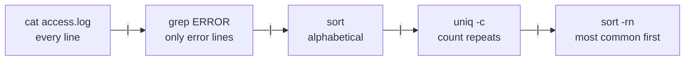

The terminal looks old-fashioned, but it is the fastest way to work with files, run programs and control remote machines. Everything in AI engineering, from starting a training run to deploying an API, is done or automated from the command line. This lesson covers the commands you will use every day and, more importantly, how to combine them.

## Anatomy of a command

You type commands into a **shell**, a program that reads what you type and runs it. The common shells are `bash` (most Linux servers) and `zsh` (the macOS default). They behave almost identically for everything in this lesson.

```text
amina@laptop:~/projects$ ls -l --all data/
└──────────┬──────────┘ └┬┘ └─────┬────┘ └─┬─┘
        prompt        command  options   argument
```

| Part | Meaning |
| --- | --- |
| Prompt | Shows who and where you are. You do not type it |
| Command | The program to run |
| Options (flags) | Change how it behaves. Short form `-l`, long form `--all`. Short flags combine: `-la` |
| Arguments | What it acts on, such as a file or folder |

> [!NOTE]
> Tutorials often show a `$` before commands to stand for the prompt. Do not type it.

### Getting help

```bash
ls --help        # short summary of options
man ls           # full manual page: press q to quit
```

## Navigating

| Command | Does |
| --- | --- |
| `pwd` | Print the working (current) directory |
| `ls` | List files. `ls -la` includes hidden files and details |
| `cd folder` | Change into a folder |
| `cd ..` | Go up one level |
| `cd ~` or just `cd` | Go to your home directory |
| `cd -` | Go back to the previous directory |

```bash
pwd
cd projects/chatbot
ls
cd ..
pwd
```

```output
/home/amina
main.py  requirements.txt  data
/home/amina/projects
```

> [!TIP]
> Press **Tab** to complete file and folder names, and press it twice to see all options. Press the **up arrow** to recall previous commands. These two habits remove most of the typing, and most of the typos.

## Working with files and folders

| Command | Does |
| --- | --- |
| `mkdir data` | Create a folder. `mkdir -p a/b/c` creates the whole chain |
| `touch notes.md` | Create an empty file |
| `cp src dst` | Copy. Add `-r` to copy a folder |
| `mv src dst` | Move or rename |
| `rm file` | Delete a file. `rm -r folder` deletes a folder and everything in it |
| `cat file` | Print a whole file |
| `less file` | Scroll through a long file. `q` quits, `/word` searches |
| `head -n 5 file` | First 5 lines |
| `tail -n 5 file` | Last 5 lines |
| `tail -f train.log` | Follow a file as it grows: ideal for watching training logs |

```bash
mkdir -p experiments/run1
cp config.json experiments/run1/
mv experiments/run1 experiments/baseline
ls experiments/baseline
```

```output
config.json
```

> [!WARNING]
> `rm` does not use a recycle bin. Deleted files are gone. Be especially careful with `rm -r` and wildcards, and read the command twice before pressing Enter. `rm -rf` on the wrong path is a classic way to lose a day of work.

### Wildcards

The shell expands patterns before the command runs.

| Pattern | Matches |
| --- | --- |
| `*` | Any characters: `*.csv` is every CSV file |
| `?` | Exactly one character: `run?.log` matches `run1.log` |
| `[0-9]` | One character from a range |

```bash
ls data/*.csv
rm logs/run?.log
```

## Redirection

Every command has an input stream and two output streams: **standard output** for normal results and **standard error** for error messages. You can send them to files instead of the screen.

| Syntax | Does |
| --- | --- |
| `cmd > file` | Write output to a file, replacing its contents |
| `cmd >> file` | Append output to a file |
| `cmd 2> errors.log` | Write error messages to a file |
| `cmd > all.log 2>&1` | Send both output and errors to the same file |
| `cmd < file` | Use a file as input |

```bash
python train.py > train.log 2>&1
pip freeze > requirements.txt
```

## Pipes: combining small tools

The real power of the command line is the **pipe**, `|`. It sends the output of one command into the input of the next. Each tool does one small job; pipes join them into something bigger.



```bash
cat app.log | grep ERROR | sort | uniq -c | sort -rn | head -n 3
```

```output
     42 ERROR RateLimitError: 429 Too Many Requests
     17 ERROR TimeoutError: request took longer than 30s
      3 ERROR KeyError: 'choices'
```

In one line you have found the three most common errors in a log file, with counts. That is a real debugging task you will do on production servers.

### The tools you will pipe most

| Command | Does |
| --- | --- |
| `grep pattern` | Keep lines containing a pattern. `-i` ignores case, `-r` searches folders, `-n` shows line numbers |
| `wc -l` | Count lines |
| `sort` | Sort lines. `-n` numeric, `-r` reverse |
| `uniq -c` | Collapse adjacent repeated lines and count them |
| `cut -d, -f2` | Take the second comma-separated column |
| `head`, `tail` | First or last lines |

```bash
wc -l data/train.csv                       # how many rows?
grep -rn "TODO" src/                        # every TODO in the code, with line numbers
cut -d, -f3 data/reviews.csv | sort | uniq -c   # count values in column 3
```

## Finding things

```bash
find . -name "*.py"                 # every Python file below here
find data -size +100M               # files bigger than 100 MB
grep -rn "load_model" .             # where is this function used?
```

## Chaining commands

| Syntax | Runs the second command |
| --- | --- |
| `a ; b` | Always |
| `a && b` | Only if `a` succeeded |
| `a \|\| b` | Only if `a` failed |

```bash
pip install -r requirements.txt && python main.py
```

Every command finishes with an **exit code**: `0` for success, anything else for failure. `&&` checks it. Your own Python scripts return `0` unless they crash or call `sys.exit(1)`.

## Running Python from the terminal

### Passing arguments to a script

Scripts become far more useful when they take arguments instead of having values hard-coded. The standard library's `argparse` handles this:

```python
# train.py
import argparse

parser = argparse.ArgumentParser(description="Train a model")
parser.add_argument("data", help="path to the training CSV")
parser.add_argument("--epochs", type=int, default=10)
parser.add_argument("--lr", type=float, default=0.001)
args = parser.parse_args()

print(f"Training on {args.data} for {args.epochs} epochs at lr={args.lr}")
```

```bash
python train.py data/train.csv --epochs 3
python train.py --help
```

```output
Training on data/train.csv for 3 epochs at lr=0.001
usage: train.py [-h] [--epochs EPOCHS] [--lr LR] data

Train a model

positional arguments:
  data             path to the training CSV

options:
  -h, --help       show this help message and exit
  --epochs EPOCHS
  --lr LR
```

You get a `--help` message and type conversion for free.

### Long-running jobs

| Need | How |
| --- | --- |
| Stop a running command | `Ctrl+C` |
| Run in the background | `python train.py &` |
| Keep running after you log out | `nohup python train.py > train.log 2>&1 &` |
| Reattach to a session later | `tmux` or `screen` |

> [!TIP]
> On a remote server, start long training runs inside `tmux`. If your connection drops, the job keeps running, and `tmux attach` brings you back to it. Without it, a Wi-Fi blip can kill hours of training.

## Talking to other machines

`curl` makes HTTP requests from the terminal, which is the quickest way to test an API:

```bash
curl -s "https://api.open-meteo.com/v1/forecast?latitude=31.55&longitude=74.34&current=temperature_2m"
```

`ssh` logs you into a remote machine, and `scp` copies files to or from it:

```bash
ssh amina@203.0.113.10
scp model.pt amina@203.0.113.10:~/models/
```

Once connected, every command in this lesson works on the remote machine exactly as it does locally.

## Exercises

**1.** Create the folder structure `ml-project/data/raw`, `ml-project/data/processed` and `ml-project/src` with a single command, then create an empty `ml-project/src/main.py`.

<details>
<summary>Show solution</summary>

```bash
mkdir -p ml-project/data/raw ml-project/data/processed ml-project/src
touch ml-project/src/main.py
```

</details>

**2.** A log file `server.log` contains lines with `INFO`, `WARNING` and `ERROR`. Write one command that prints how many lines contain `ERROR`.

<details>
<summary>Show solution</summary>

```bash
grep ERROR server.log | wc -l
```

`grep -c ERROR server.log` does the same in one command.

</details>

**3.** Run a script so that both its output and its errors go into `run.log`, and print `finished` only if the script succeeded.

<details>
<summary>Show solution</summary>

```bash
python main.py > run.log 2>&1 && echo finished
```

</details>

**4.** Add a `--batch-size` integer argument with a default of 32 to the `train.py` example, and print it.

<details>
<summary>Show solution</summary>

```python
parser.add_argument("--batch-size", type=int, default=32)
args = parser.parse_args()
print(args.batch_size)
```

`argparse` converts the dash to an underscore in the attribute name.

</details>

```quiz
[
  {
    "q": "What does `cmd > out.txt` do if `out.txt` already exists?",
    "options": ["Appends to it", "Replaces its contents", "Fails with an error", "Creates `out.txt.1`"],
    "answer": 1,
    "why": "A single `>` overwrites. Use `>>` to append."
  },
  {
    "q": "What does the pipe in `cat log.txt | grep ERROR` do?",
    "options": [
      "Runs both commands at the same time on separate files",
      "Sends the output of `cat` as the input to `grep`",
      "Saves the output to a file named `grep`",
      "Runs `grep` only if `cat` fails"
    ],
    "answer": 1,
    "why": "A pipe connects one command's standard output to the next command's standard input."
  },
  {
    "q": "When does `b` run in `a && b`?",
    "options": ["Always", "Only if `a` fails", "Only if `a` succeeds", "Before `a`"],
    "answer": 2,
    "why": "`&&` runs the next command only when the previous one exits with code 0."
  },
  {
    "q": "Which command follows a log file live as new lines are written?",
    "options": ["`cat -f`", "`head -f`", "`tail -f`", "`less -n`"],
    "answer": 2,
    "why": "`tail -f` keeps the file open and prints new lines as they appear."
  }
]
```
