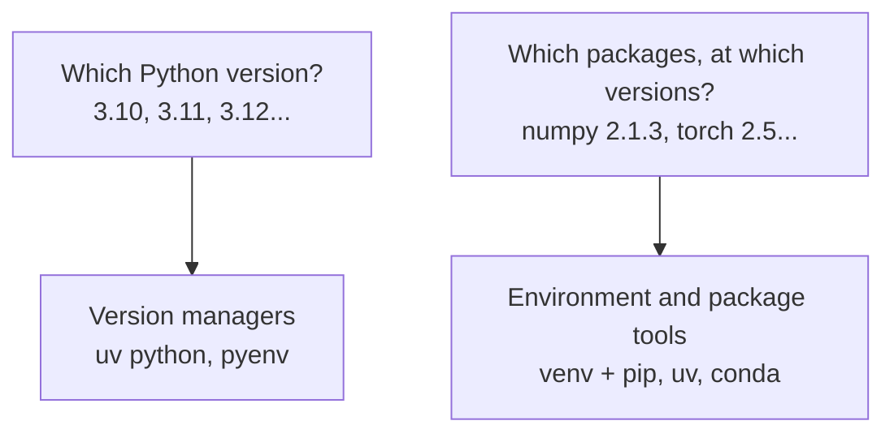
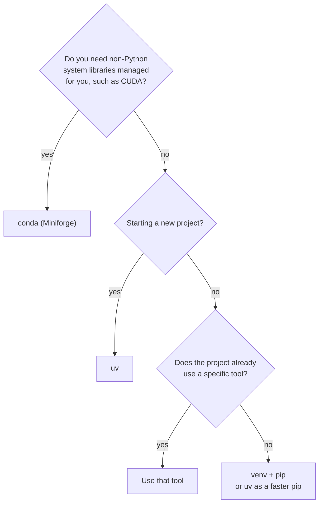

The [virtual environments lesson](/learn/python-programming/virtual-environments) in Python Programming covered the essentials: why isolation matters, `python -m venv`, activation, and `requirements.txt`. This lesson treats environments as part of your day-to-day tooling. It covers managing several Python versions, the modern `uv` workflow, `conda` for GPU and scientific stacks, and how to make a project reproducible on any machine.

## A quick recap

```bash
python3 -m venv .venv
source .venv/bin/activate          # Windows: .venv\Scripts\Activate.ps1
pip install -r requirements.txt
```

One environment per project, created inside the project folder as `.venv`, never committed to Git, and rebuilt from a dependency file whenever needed. Everything below builds on that.

## Two different problems

Environment tools solve two separate problems, and it helps to keep them apart.



`venv` solves only the second. It creates an environment from whichever Python you run it with. If a project needs Python 3.11 and your machine has 3.13, you need a way to get 3.11 first.

## Managing Python versions

Libraries do not support every Python version immediately. A new Python release can take months to be supported by every deep learning package, and older projects may require an older version. You will regularly need more than one Python installed.

Do not replace or modify the Python that came with your operating system: system tools depend on it. Install additional versions alongside it with a version manager.

### With uv

```bash
uv python install 3.11 3.12
uv python list
```

```output
cpython-3.12.7-macos-aarch64-none    /Users/amina/.local/share/uv/python/cpython-3.12.7/bin/python3.12
cpython-3.11.10-macos-aarch64-none   /Users/amina/.local/share/uv/python/cpython-3.11.10/bin/python3.11
cpython-3.9.6-macos-aarch64-none     /usr/bin/python3
```

### With pyenv

```bash
pyenv install 3.11.10
pyenv local 3.11.10        # use this version in the current folder
```

Both tools can **pin** a version for a project by writing a `.python-version` file in its folder. Commit that file so everyone uses the same version.

## uv: the modern workflow

`uv` is a single, very fast tool that installs Python versions, creates environments, resolves and installs packages, and records exact versions in a lock file. It replaces `pyenv`, `venv`, `pip` and `pip-tools` in one, and it is quickly becoming the standard for new projects.

Install it once:

```bash
curl -LsSf https://astral.sh/uv/install.sh | sh
```

### Starting a project

```bash
uv init sentiment-app
cd sentiment-app
uv add pandas scikit-learn
uv add --dev pytest ruff
uv run python main.py
```

```output
Initialized project `sentiment-app` at `/home/amina/sentiment-app`
Using CPython 3.12.7
Creating virtual environment at: .venv
Resolved 14 packages in 412ms
Installed 13 packages in 38ms
Hello from sentiment-app!
```

| Command | Does |
| --- | --- |
| `uv init name` | Create a project with a `pyproject.toml`, a `.python-version` and a sample `main.py` |
| `uv add package` | Add a dependency, install it and update the lock file |
| `uv add --dev package` | Add a development-only dependency |
| `uv remove package` | Remove a dependency |
| `uv run command` | Run a command inside the project environment, creating or updating it first |
| `uv sync` | Make `.venv` match the lock file exactly |
| `uv lock --upgrade` | Upgrade dependencies within their allowed ranges |

`uv run` removes the need to activate anything. It always runs inside the correct, up-to-date environment.

### The files it manages

| File | Contains | Commit it |
| --- | --- | --- |
| `pyproject.toml` | Your direct dependencies and their allowed ranges | Yes |
| `uv.lock` | The exact version of every package, including transitive ones | Yes |
| `.python-version` | The Python version | Yes |
| `.venv/` | The installed environment | No |

A teammate who clones the repository runs one command and gets an identical environment:

```bash
uv sync
```

### Using uv with existing pip projects

`uv` also works as a faster `pip`, so you can use it on any project without changing anything else:

```bash
uv venv
uv pip install -r requirements.txt
```

## conda: when Python packages are not enough

Some AI dependencies are not Python at all. GPU libraries such as CUDA and cuDNN, compilers, and libraries like GDAL for geospatial data are compiled system software. `pip` cannot install those. **conda** can: it manages packages for any language, including the non-Python libraries that deep learning frameworks sit on.

```bash
conda create -n vision python=3.11
conda activate vision
conda install -c conda-forge numpy opencv
```

Unlike `venv`, conda stores environments centrally rather than in your project folder, and you refer to them by name.

Environments are described in an `environment.yml` file:

```text
# environment.yml
name: vision
channels:
  - conda-forge
dependencies:
  - python=3.11
  - numpy
  - opencv
  - pip
  - pip:
      - ultralytics
```

```bash
conda env create -f environment.yml
conda env export --from-history > environment.yml
```

> [!WARNING]
> Install as much as possible with conda first and use `pip` inside a conda environment only for packages conda does not have. Mixing them freely, especially installing with pip and then with conda again, can leave the environment in a broken state that neither tool understands.

**Miniforge** is the recommended way to install conda. It uses the community `conda-forge` channel by default and avoids the licensing terms that apply to Anaconda's default channel in larger organisations.

## Choosing a tool



| Tool | Strengths | Watch out for |
| --- | --- | --- |
| `venv` + `pip` | Always available, universally understood | No lock file or Python version management |
| `uv` | Extremely fast, lock files, manages Python versions | Newer; some older guides do not mention it |
| `conda` | Handles non-Python libraries and GPU stacks | Slower; mixing with pip needs care |
| `poetry` | Mature lock files and packaging | Slower than uv; separate Python version management |

> [!NOTE]
> Modern PyTorch wheels from pip bundle the CUDA libraries they need, so on most machines you can install GPU PyTorch with `pip` or `uv` and no conda at all. You still need the NVIDIA **driver** installed on the system, which no Python tool can provide.

## Environments in your other tools

An environment only helps if every tool uses it.

| Tool | How to point it at the environment |
| --- | --- |
| Terminal | Activate it, or prefix commands with `uv run` |
| VS Code | **Python: Select Interpreter**, then choose `.venv` |
| Jupyter | Install `ipykernel` into it and select it as the kernel |
| Scripts run by cron or a server | Call the environment's Python by its full path, such as `/srv/app/.venv/bin/python` |

The last row matters in production. A scheduled job or service does not run your shell's startup files, so it never "activates" anything. Using the full path to the environment's interpreter guarantees the right packages.

## Levels of reproducibility

How exactly can someone recreate your environment? Each step down this table is more reliable.

| Level | What you record | Recreates |
| --- | --- | --- |
| 1 | A list of package names | Roughly similar, varies over time |
| 2 | `requirements.txt` with pinned direct dependencies | Same top-level versions; transitive ones may drift |
| 3 | A lock file such as `uv.lock` | Every package at an identical version |
| 4 | A container image (Docker) | The whole operating system, Python and packages |

For learning projects, level 2 is fine. For anything you deploy or any experiment you need to reproduce, aim for level 3. Containers are covered in Phase 11.

## Housekeeping

Environments are disposable. When one gets into a strange state, do not try to repair it: delete it and rebuild it from your dependency file.

```bash
rm -rf .venv
uv sync                        # or: python3 -m venv .venv && pip install -r requirements.txt
```

Deep learning environments are several gigabytes each. Delete the ones you no longer use, and clear package caches occasionally with `uv cache clean`, `pip cache purge` or `conda clean --all`.

## Exercises

**1.** Install `uv`, create a project called `env-practice`, add `requests`, and run a one-line script that prints the `requests` version, all without activating anything.

<details>
<summary>Show solution</summary>

```bash
uv init env-practice
cd env-practice
uv add requests
uv run python -c "import requests; print(requests.__version__)"
```

</details>

**2.** Pin the project from exercise 1 to Python 3.11 and confirm the environment now uses it.

<details>
<summary>Show solution</summary>

```bash
uv python pin 3.11
uv sync
uv run python --version
```

`uv python pin` writes `.python-version`, and `uv sync` rebuilds the environment with that version, downloading it if needed.

</details>

**3.** A teammate's project needs OpenCV and GDAL, and their pip install of GDAL keeps failing while compiling. Which tool would you suggest, and why?

<details>
<summary>Show solution</summary>

Conda, using the `conda-forge` channel. GDAL depends on compiled C libraries that pip often cannot build, while conda installs pre-built binaries for those system libraries as well as the Python bindings.

</details>

```quiz
[
  {
    "q": "Which file records the exact version of every package, including transitive dependencies, in a uv project?",
    "options": ["`pyproject.toml`", "`uv.lock`", "`.python-version`", "`requirements.txt`"],
    "answer": 1,
    "why": "`pyproject.toml` lists your direct dependencies and ranges; the lock file pins everything exactly."
  },
  {
    "q": "When is conda a better choice than pip or uv?",
    "options": [
      "Whenever a project uses NumPy",
      "When you need non-Python system libraries, such as compiled geospatial or GPU libraries, managed for you",
      "When you want the fastest installs",
      "Never: conda is deprecated"
    ],
    "answer": 1,
    "why": "Conda manages packages for any language, which pip cannot do."
  },
  {
    "q": "What does `uv run python main.py` do?",
    "options": [
      "Runs the script with the system Python",
      "Runs the script inside the project's environment, syncing it first if needed",
      "Uploads the script to a server",
      "Converts the script to a notebook"
    ],
    "answer": 1,
    "why": "`uv run` ensures the environment matches the lock file, then runs the command inside it, with no activation needed."
  },
  {
    "q": "A scheduled job on a server uses the wrong packages. What is the most reliable fix?",
    "options": [
      "Add `source .venv/bin/activate` to your personal shell profile",
      "Call the environment's interpreter by its full path, such as `/srv/app/.venv/bin/python`",
      "Install the packages globally with `sudo pip`",
      "Restart the server"
    ],
    "answer": 1,
    "why": "Scheduled jobs do not load your shell setup. A full path to the environment's Python is unambiguous."
  }
]
```
